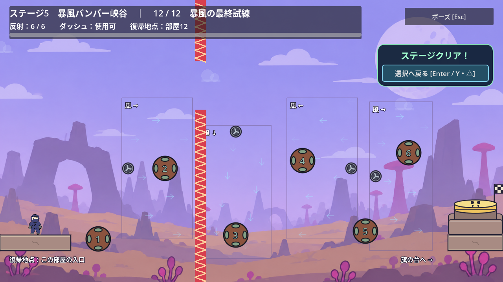

# 忍者ぶっとびくん Galaxy

宇宙を舞台に、重力反転で床と天井を切り替えて進む2Dアクションです。Phase 1の移動、Phase 2の環境ギミック、Phase 3のGrab / Carryを実装しています。

前作「忍者ぶっとびくん」の主役6姿勢を使い、壁登りと運搬を各2枚で補完しています。生物と赤い和傘も少数フレームで動かします。ステージとギミックはA案の輪郭・色面で揃え、宇宙基地・生活圏・未開発・溶岩・邪悪なオーラの背景を緩やかに動かします。

素材の出典・割り当て・確認事項は [キャラクタースプライト](docs/character-sprites.md)、生成プロンプトは [素材の記録](assets/characters/PROMPTS.md) に記録しています。

## 必要環境と起動

- Godot 4.7.2 Stable（Standard版）、Git
- Godotに `project.godot` をインポートし、`F5` で実行します。

埋め込み実行の表示を広げたい場合は、Game画面右上のサイズ設定で「Keep Aspect Ratio」を選びます。単独実行・書き出し版では、F11またはステージ選択・ポーズメニューのボタンで全画面へ切り替えられ、次回起動時にウィンドウサイズと全画面状態を復元します。詳しくは[画面表示](docs/display-settings.md)を参照してください。

## スタート画面

F5で起動すると、宇宙背景の中央に「忍者ぶっとびくん Galaxy」のユーザー提供ロゴとSTARTを表示します。STARTのクリック、Enter／Space、ゲームパッドA／×でステージ選択へ進みます。選択画面の「タイトルに戻る」、Esc／Back・Selectでスタート画面へ戻れます。

ロゴが拡大しながら現れ、少し遅れてSTARTと操作説明を表示します。忍者が弧を描いて飛び込み、STARTの横に着地します。周囲では金色の手裏剣型パーティクルがゆっくりきらめき、ロゴもわずかに拡大・縮小します。決定すると忍者が跳び出し、白金色の光が広がる0.28秒のワープ演出からステージ選択へ進みます。登場を待たずに決定操作で進めます。OSから動きを減らす設定が通知された場合は、演出を止めて最初から表示します。

仕様は [スタート画面](docs/start-screen.md)、ロゴの出典は [タイトル素材](assets/ui/PROMPTS.md)、3回のデザイン確認は [確認記録](docs/start-screen-design-review.md) に記録しています。


## ステージ選択

スタート画面のSTARTから、ステージ1〜5が左から順に並んだ選択画面へ進みます。「ステージ1：チュートリアル」「ステージ2：星のぼりの塔」「ステージ3：壁キックと重力」「ステージ4：星渡りの回廊」「ステージ5：暴風バンパー峡谷」を自由に選べます。各カードには、練習の段差、塔の上昇、壁と重力、相棒、バンパーと風を表す小さな絵を添えています。「背景・ギミックを見る」から、全環境の背景・地形・ギミックを操作できるプレビューへ入れます。

クリック、方向キー＋Enter、ゲームパッドの十字キー／左スティック＋A／×で選べます。全プレイ画面でEsc／Back・Select、または「ポーズ [Esc]」からポーズメニューを開けます。背景を含むゲーム全体が止まり、再開・ヒント切り替え・チェックポイントからのやり直し・ステージ選択への帰還を選べます。ヒントのない画面では該当ボタンを表示しません。帰還時は進み具合が保存されない旨を確認します。再選択時は最初から始まり、部屋や復帰地点の進捗は保存しません。獲得が確定した巻物は保存され、ステージ選択に獲得数と実配置総数を表示します。クリア後も、引き続き自由に練習できます。

チュートリアル全17部屋は宇宙基地、ステージ2・3は生活圏のある惑星を舞台にしています。プレビューでは画面上部の選択欄、数字キー1〜5、ゲームパッドのL／Rで環境を切り替えられます。「背景の動き」、Mキー、ゲームパッドのY／△で背景を一時停止できます。移動・ジャンプ・運搬などは本編と同じ操作です。溶岩の波・泡・火の粉や瘴気は背景表現で、追加のダメージ判定はありません。

合意した仕様は [ステージ選択の仕様書](docs/stage-selection.md) に記録しています。

共通メニューの操作と停止範囲は [ポーズメニューの仕様](docs/pause-menu.md) を参照してください。


## ステージ2：星のぼりの塔

`sota_sodex_1st`から取り込んだ、上へ連続スクロールする全19区間・上昇24640pxのコースです。壁登り・壁キック、Spring、ダッシュ回復・追加ジャンプのクリスタル、生物をつないで頂上を目指します。第1区間は壁登りや壁キック、第2区間はバネ、第3区間は回復したダッシュの連鎖、第4区間は靴による追加ジャンプとダッシュ、第5区間は相棒を保持して使う追加ジャンプとダッシュを必要とする地形です。第6区間はバネから空中へ飛び、靴の追加ジャンプか回復したダッシュを選んで次の旗へ渡ります。後半には壁と回復ダッシュ、バネの左折り返し、靴と相棒を重ねる上昇、相棒との壁キック、横風と反射を加えました。上層の第13〜18区間では長い棚を左右に渡り、逆風の反射、相棒の運搬、対向壁、Springと回復ダッシュを組み合わせます。第19区間は傘で二つの上昇風を渡り、右の休憩棚とSpringを経て左の頂上へ滑空します。側面に寄って戻る任意の巻物は全6本です。各区間の旗と足跡がある広い足場に着地すると復帰地点を更新し、落下やR / Startで最新の復帰地点へ戻ります。中空の旗は未到達、「↺」は現在の復帰地点、「✓」は到達済みを示します。追加区間の配置と検証は[塔の上層6区間](docs/tower-more.md)と[傘と上昇風](docs/tower-parachute.md)を参照してください。

生活圏の惑星のふもとから、雲の上、星が見える上空へ登ります。街と山は登るにつれて下へ遠ざかり、雲と星は足場よりゆっくり動きます。背景は高度に合わせて連続して変わり、降下ややり直しでも同じ高さの景色へ戻ります。

配置は `scenes/stage_2.tscn`、進行は `scripts/stage_2.gd`、背景は `scripts/ascent_backdrop.gd`。詳しくは [第2ステージの仕様](docs/stage-2.md) を参照してください。

## ステージ3：壁キックと重力

壁キックと重力反転を使う25部屋の本編ステージです。1部屋目はSpringから張り出しを交互の壁キックで越え、重力反転・天井のSpringへ、2部屋目は天井の穴を跳び、反転中に下側へ壁を渡って休める足場と反発板へつなぎます。3〜6部屋目は空中ジャンプのクリスタル、縦風と移動ゲート、空中のSpring、向かい風と横移動ゲートを、それぞれ違う経路で使います。7部屋目は右の入口から左へ渡って折り返し、8部屋目は上層から二つの追加ジャンプと下ダッシュで降下し、9部屋目は重力の二往復と風・移動ゲートを組み合わせます。ダッシュと壁登りは最初から使えます。3部屋目は空中ジャンプと下ダッシュで吊り壁の下を回り、5部屋目は下ダッシュでSpringの下へ回り込みます。第1〜9室の他6部屋にはダッシュなしの攻略経路があります。第10〜15室は幅2560pxで二つの異なる連携をつなぎ、間に休める床を置きます。第11・14室は左へ攻略した後、開いた床から右へ帰る構成です。第16〜21室は空中Dash回復で天井間の横断、深い下降、逆風の左折り返し、張り出しから吊り壁の下回り、垂直の上昇と下降をつなぎます。第22〜25室では傘と通常・反転中の上昇気流、高い静止床、左折り返し、深い回復Dashを組み合わせます。

第1〜9室の基本幅は1280px、第10〜15室は2560px、第16〜24室は2304px、第25室は3072pxで、到着台を押すと出口が開きます。広い部屋では横に、上下を広げた部屋では縦にもカメラが追従します。巻物は第1・7・10・14・18・20・22・24室に計8個。第1・22・24室は上層へ外れる枝、他は反転中の休憩面から下へ寄る枝です。第7・14・18・20室では到着後も帰り橋の開口から巻物へ下り、段を跳んで主経路へ戻れます。2〜25部屋目には床の落とし穴もあり、クリア後は床の穴を埋める足場が現れます。穴の縁はオレンジ色で示します。落下やR / Startでその部屋の入口へ戻り、重力・ダッシュ・スタミナと移動ゲートをリセットします。開いた出口は、そのプレイ中は開いたままです。最終の25部屋目のクリア後も前の部屋へ戻って練習できます。

経路の矢印と説明文は初期状態で非表示です。「ポーズ [Esc]」またはEsc／Back・Selectで開く共通メニューから、説明文と経路の矢印を表示・非表示にできます。切り替え後もポーズを維持し、設定は部屋移動ややり直しでも保ちます。選択画面から入り直すと説明文と経路の矢印は非表示に戻ります。壁スタミナはチュートリアルと同じゲージで表示します。部屋番号・タイトル・ポーズの入口と、ゲージ・ダッシュ・空中ジャンプの表示は、通常重力では画面上側、反転中は下側へ同時に移ります。開いたメニュー自体は常に画面中央に表示します。

3部屋目では幅330pxの天井で休み、真下の靴を通常ジャンプで取って追加ジャンプと下ダッシュをつなぎます。谷底のトゲは深く落ちてからのダッシュによる代用を防ぎ、クリア後は帰りの橋に覆われます。4部屋目は既存の重力ゲートを広げ、床の壁を登って重力反転を避ける抜け道を防いでいます。

配置は `scenes/stage_3.tscn`、進行は `scripts/stage_3.gd` で調整します。合意した仕様と25部屋の課題は [第３ステージの仕様書](docs/stage-3.md) に記録しています。第16〜21室は[回復Dashの連携](docs/gravity-third.md)、第22〜25室は[傘と反転した風](docs/gravity-parachute.md)に配置・検証と画像を記録しています。


## ステージ4：星渡りの回廊

全24面で緑の相棒を持ったまま出口へ運ぶステージです。運搬中は壁登りができないため、壁キックと追加ジャンプを使います。第1室は入口から420px上の広い片面足場へ、相棒の追加ジャンプとダッシュを組み合わせて上がります。第2室は相棒を保持し、縦に続く峡谷を壁キックで上がって広い足場で休みます。第2室と追加した第7〜9室ではカメラが縦に追従します。第5室は相棒の追加ジャンプと上ダッシュで高い横風へ入り、630px先の幅230pxの島で休めます。低い天井・峠の下り・折り返しの第3・4・6室は、ダッシュなしでも攻略できます。画面上端には危険が見える天井トゲを配置しています。部屋移動で復帰地点を更新し、落下・トゲへの接触・R / Startで現在の部屋から再開します。

第7室は二段の高い足場、第8室は壁キックの縦穴から左へ折り返す経路、第9室は高い風から左右へ渡る経路です。第10〜15室は、空中の靴・重力反転・Spring・高い風・対向壁・連続する高台と相棒のジャンプをつなぎます。第16〜18室は幅1920pxで、空中のDash回復から再Dash、二つの反転天井、高い風から対向壁へ登る運搬をつなぎます。第19〜24室はSpringと靴、反射、保持反転、風と壁キックを組み合わせます。最終の第24室は、緑を左上へ運ぶ経路と、赤い傘生物へ持ち替えてSpringと風を渡る経路を選べます。最終到着台は第24室にあります。第7・10・13・16・18・20・23室には左上や上層へ寄る巻物が計7個あり、相棒を持ったまま安全な棚から主経路へ戻れます。安全な着地で確定した巻物は途中帰還しても保存され、選択画面へ収集数を表示します。

ポーズメニューで操作のヒントを表示できます。配置・操作・テストは [第4ステージの仕様](docs/stage-4.md)、新6室と収集経路は [連携6室の記録](docs/companion-more.md)、広い3室は [幅を広げた運搬の記録](docs/companion-wide.md) を参照してください。

全5ステージでクリア時に右上へ小さな通知と戻るボタンを表示します。Space・A/×で自由練習を続けられ、Enter（テンキーも可）、ボタンのクリック、Y/△でステージ選択へ戻れます。



## ステージ5：暴風バンパー峡谷

ギャラリーの「未開発の惑星」を舞台に、バンパーの反射と風をつなぐ高難度の全27部屋です。Godot 4.7.2で `project.godot` をインポートしてF5を押し、STARTから「ステージ5：暴風バンパー峡谷」を選ぶと試遊できます。`scenes/stage_5.tscn` を開いてF6でも直接起動できます。

第1室は高い入口からバンパーの上側へ降りて、反射で峡谷を渡ります。全27室で出口の使用履歴ロックを設けず、反射を使う別経路でも進めます。番号順の反射は任意ヒントの攻略例です。第1〜26室は出口の足場に着地すると、その1回で次の部屋へ進みます。空中で出口側の端を越えた場合も次へ進み、クリアした部屋をやり直す必要はありません。第16室は右から入って左へ抜け、第18室は右上から降りて左の出口へ、第20・23室も右から左へ進みます。第24室の上昇と下降に続き、第25室はバネから高い反射列へ、第26室はその左折り返しへ進みます。最終の第27室は傘と上昇風から反射列へ移り、右の到着台を目指します。浅くかするだけでは反射しません。反射でダッシュが回復し、ダッシュ中は風の影響を受けません。第11室には3反射後に降りて休める幅120pxの片面足場があり、連続反射を続けても進めます。赤い帯に触れたり出口以外の画面外へ出たりすると、その部屋の入口へ戻って反射の進捗もリセットされます。第9室には壁キックに使える岩壁があり、出口は側面を登れない薄い片面足場です。通常の移動・ジャンプ・壁アクション・ダッシュの能力値は変更していません。

| 部屋 | 課題 |
| --- | --- |
| 1：針穴の反射 | バンパー2個、追い風、細い隙間 |
| 2：横風の狙撃 | 横風の中で高低差のある3個へ接触 |
| 3：風の境目 | 追い風と向かい風の境目を越える |
| 4：三連反射 | 高低差のある3個と2つの狭い通路 |
| 5：逆風を裂く | 長い向かい風の中でダッシュを配分 |
| 6：天井返し | 天井のバンパーへ下から当たり、下側のバンパーへつなぐ |
| 7：吹き落とす風 | 下向きの風に抗って3個をつなぐ |
| 8：折り返す航路 | ②から③は左へ戻り、④へ大きく飛び直す |
| 9：壁からの一撃 | 岩壁と高いバンパー、後半の向かい風 |
| 10：暴走する追い風 | 長い追い風の中で4個へ位置合わせ |
| 11：嵐の五連鎖 | 横風・下向きの風・狭い通路と5連反射 |
| 12：暴風の六連鎖 | 4つの風域と6連反射をつなぐ |
| 13：折り返す空と巻物 | 左へ折り返す反射、任意の巻物と幅120pxの休憩台 |
| 14：縦に抜ける峡谷 | 高さ1280pxの部屋を反射で上がり、右上の出口へ |
| 15：嵐の帰り道 | 横風と下向きの風、左折返しを含む6反射 |
| 16：左へ抜ける反射 | 右から入り上へ戻る5反射、右上の任意巻物と左出口 |
| 17：上層への五段 | 高さ1600pxの部屋で左右に折り返し上層へ |
| 18：深い谷の折り返し | 右上から降り、任意巻物と休憩台から左上の出口へ |
| 19：広い空の反射連鎖 | 横幅3840px。高さの違う10反射と左上の巻物 |
| 20：向かい風の左航路 | 横幅3840px。右から左へ、風が切り替わる10反射 |
| 21：斜めに登る峡谷 | 横幅3840px・高さ2200px。下層から上層へ10反射 |
| 22：谷底からの帰還 | 横幅3840px・高さ2200px。谷へ降り、9反射で右上へ |
| 23：風を渡る左折り返し | 横幅3840px。上下の風と9反射、右上の巻物 |
| 24：天空の大きな一周 | 横幅2560px。上昇・左折り返し・下降から右出口へ |
| 25：バネから反射の階段へ | 幅3200px・高さ2000px。バネから6反射へ。二つの休憩棚と左上の巻物 |
| 26：左へ跳ねるバネ航路 | 幅3200px・高さ2000px。右のバネから左出口へ反射をつなぐ |
| 27：傘から反射する空 | 幅2560px・高さ2000px。傘で上昇風へ入り、4反射から到着台へ。入口の左上にも巻物 |

第13室の2個目の反射からさらに左上へ回ると、巻物を取って3個目の反射から休憩台へ戻れます。安全に着地すると獲得を保存し、途中帰還しても選択画面に残ります。第14室は縦にカメラが追従します。追加3室の仕様と検証は[峡谷の拡張](docs/canyon-expansion.md)にまとめています。

第16室の右上、第18室の右下にも巻物があり、第19室の左上と第23室の右上にも寄り道を加え、さらに第25室の左上と第27室の入口上層へ寄り道でき、計7個を集められます。幅160〜170pxの休憩台で止まってから主経路へ戻れます。第18室では下降先が見えるようにカメラを下寄りにします。[左出口と上下の反射](docs/canyon-left-routes.md)に配置と検証を記録しています。

第19〜24室は室内を横・縦にスクロールし、3個目の反射の下に幅240pxの休憩台があります。通常ジャンプと上ダッシュで同じ反射へ戻り、残りの課題を続けられます。静止トゲの壁の切れ目で進む高さを示します。配置と検証は[広い反射コース](docs/canyon-wide-routes.md)に記録します。

移動はA/D・方向キー、ジャンプはSpace / W、ダッシュはX＋方向、やり直しはR / Startです。全室の番号・目標のひし形・経路線・出口の矢印は、ヒントを表示したときだけ現れます。Esc / Back・Selectの共通ポーズメニューでヒントと経路線を表示でき、帰還確認から選択画面へ戻れます。経路線は反射先を結ぶ順序の目安です。再選択すると1部屋目から始まります。配置は `scenes/stage_5.tscn`、進行は `scripts/stage_5.gd` で調整できます。

`tests/stage_5_test.gd` は、通常の入力だけで全27部屋・144個の反射からゴールまで到達することを検証します。この到達確認ではテレポート、速度の代入、能力の補充、進捗の直接変更を使いません。反射履歴なしの物理到着・やり直し・障害物・画面外・ヒント・選択画面への復帰も別に確認します。

`tests/stage_5_exit_test.gd` は第1〜26室の出口への着地と、ダッシュで空中から出口側の端を越える場合を確認します。どちらも1回で次の部屋へ進み、二重に進まないことを検証します。全室で反射履歴なしの物理到着を受け付け、入口や最終室の端通過だけではクリアしないことを確認します。

第25〜27室は、バネや傘と風から高い反射へ入る組み合わせです。幅280pxの棚で休み、通常ジャンプと上ダッシュで同じ反射へ戻れます。第25・26室には後半の反射へ降りる前にも広い棚があり、着地し直した場合も再出発できます。[バネと傘の入口](docs/canyon-entry-routes.md)に配置と検証を記録します。

## チュートリアル

選択画面から開始するチュートリアルは `scenes/tutorial.tscn` です。基本は1280×720の1画面で、第16室だけは1600×720の部屋をカメラが横へ追います。課題をクリアしてプレイヤーの右端が部屋の右端に届くか、部屋の左端を越えると隣室へ0.28秒でスライドし、切り替え中だけ操作が止まります。

本編は16部屋、最後に任意のSuperdash練習部屋があります。最初の4部屋で移動の基本を体験し、続く部屋でCrystal、Spring、風、運搬、生物とそれらの連携を練習します。

第1・2・4・5・7・8・11・14室には任意の巻物があり、計8個を集められます。ジャンプの折り返し、壁の上、反転した天井、空中Dash補充、Springと反射、運んだ箱の足場、傘の上昇風からそれぞれ上や左へ寄り、元の主経路へ戻れます。安全に着地して確定した巻物は保存され、選択画面へ獲得数を表示します。配置と検証は[元の4枝](docs/tutorial-scrolls.md)、[Springと反射の2枝](docs/tutorial-launch-scrolls.md)、[補充と箱の2枝](docs/tutorial-refill-carry-scrolls.md)に記録しています。

1部屋目は、移動とジャンプだけが解禁された状態で、低い段差と小さな谷を越えます。谷で跳び損ねても下の回復床から通常ジャンプで戻れ、到着台はジャンプ履歴を要求しません。移動とジャンプのボタン案内は最初の体験に必要なため残しています。

| 部屋 | 課題と配置 | 新しく使える操作 |
| --- | --- | --- |
| 1：移動・ジャンプ | 平地、64pxと96pxの段差、下に戻れる床を置いた短い穴 | 移動・ジャンプ |
| 2：よじ登り・壁キック | 左の壁を登って休憩足場へ。中央の壁の下を通り、向かい合う壁の張り出しを壁キックで越えて右へ進む | 壁Grab・壁登り・壁スライド・壁キック |
| 3：ダッシュ | 練習床から330pxの穴をDashで越え、幅460pxの片面着地場へ。Superdashも使用可。上段とDash Crystalは任意練習 | 8方向Dash |
| [4：重力切り替え](docs/screenshots/tutorial-gravity/room-04-entrance.png) | Upゲートで天井へ。ジャンプとDashでは渡れない780pxの穴を天井から越え、段差を跳んでDownゲートからゴールへ降りる | ゲートによる重力反転 |
| 5：ダッシュの補充 | 安全な入口から680pxの穴へ。空中の緑クリスタルで回復し、もう一度ダッシュして幅360pxの片面足場へ渡る。到着後は帰路の床が現れる | 空中でのDash回復 |
| 7：ばねで跳ぶ | 安全な入口から斜めのSpringへ歩いて降り、650pxの穴を越えて幅280pxの着地場へ。必須はこのSpringで、ジャンプ・Dashは着地後などの補助に使える | Springの発射・移動資源の回復 |

- 操作キーや矢印は課題に応じて表示し、地形で伝わる部屋には置きません。詳しい操作説明・状態・目標の進捗は、ポーズメニューの「ヒントを表示」で確認できます。表示の選択は部屋移動ややり直しでも維持します。
- 部屋に入ると入口を復帰地点にし、重力Down、速度0、Dash回復、スタミナ最大の状態で始めます。
- 落下またはR / Startで、現在の部屋の入口へ戻ります。その部屋のDash Crystalもすぐに戻ります。
- 10部屋目も780pxの穴を天井から越えます。移動ゲートの往復範囲を入口床へ寄せ、待つ時機にかかわらず床からUpゲートへ触れられるようにしました。ゲートの届かない入口側で往復を見てから近づけます。第4・10室はUp/Downゲートで反転して穴を渡り、到着台に乗ると出口が開きます。使用履歴による追加条件はありません。ゲート自身の方向表示を残し、重複する説明矢印は外しています。[第10室の配置](docs/screenshots/tutorial-gravity/room-10-entrance.png)も確認できます。
- 左端から前の部屋へ戻れます。習得した壁アクションとDashは、戻ったりやり直したりしても使用可能です。
- 16部屋目の到着台を押すと本編の完了を表示します。その後も戻って練習したり、17部屋目でSuperdashを試したりできます。

任意の17部屋目は、二段の低い天井トゲと逆風の先にある100px高い片面足場へ、地上の水平ダッシュからジャンプをつないで渡る練習路です。到着台は最初から押せ、操作履歴では制限しません。完了後はRで安全な入口へ戻り、左へ進むと16部屋目へ退出できます。詳しくは[Superdash練習路](docs/tutorial-superdash.md)を参照してください。

14部屋目は、入口で傘を掴み、820pxの谷を滑空して幅220pxの片面足場へ渡ります。弱めの横入力でも、ジャンプ後の水平ダッシュを組み合わせて着地できます。傘は持ったままでも、着地の手前で離しても構いません。傘なしのジャンプ・8方向ダッシュ・Superdashでは着地場へ届かず、到着台は操作履歴を要求しません。

`tests/tutorial_carry_learning_test.gd` は、複数のダッシュ時機と傘を離す位置、弱めのスティック入力、傘なしのコヨーテジャンプ・全方向ダッシュ・Superdash・壁・傘の踏み台、落下とR、隣室との往復を実入力で確認します。

15部屋目は、相棒を保持して跳び、空中の紫のばね靴を取って追加ジャンプをつなぎます。上ダッシュで560px上の幅520pxの片面足場へ着地し、相棒とダッシュが回復したら、そのまま右の到着台へ歩けます。相棒と靴のどちらか一方だけでは、出口前のトゲ壁を越えられません。到着台は操作履歴を要求せず、戻るときは高い休憩足場を復帰地点にします。

`tests/tutorial_combo_jump_test.gd` は、相棒から空中の靴への受け渡し、二つの追加ジャンプとダッシュの入力時機、弱めのスティック、片方だけの攻略・踏み台・Superdash・壁・隣室への持ち越し・落下・実Rを確認します。

16部屋目は、傘を保持して上昇気流を渡り、Upゲートから天井で休み、反転した滑空でDownゲートと幅180pxの到着場へ進みます。弱いスティックでもジャンプ・Dashの時機合わせなしで渡れます。入口端へ置いた傘の踏み台や風なしのDashではUpゲートへ届かず、屋根上のトゲと、自由な傘を上面で支えない片面天井で、屋根を経由する補充も防ぎます。到着台は履歴条件を持たず、傘を離す・投げる操作も制限しません。[配置と検証](docs/tutorial-final-glide.md)、`tests/tutorial_final_glide_test.gd`、`tests/tutorial_final_glide_bypass_test.gd`で、休憩・弱い入力・実R・部屋の往復と典型的な代替入力を確認します。

部屋の足場・入口・説明文は `scenes/tutorial.tscn` の `Rooms/Room1` ～ `Room17`、切り替えと解禁は `scripts/tutorial.gd` で調整します。風・Spring・運搬などをまとめた既存デモは `scenes/main.tscn` に残しています。GodotでそのSceneを開き、F6で実行できます。

11部屋目は、箱を重量スイッチに置くと到着台が開きます。床の配線がつながりを示し、押す前に箱を取り除くと再びロックします。軽い箱でも重い箱でも攻略できます。

### 到着台

各部屋の足跡とチェッカー旗がある丸い到着台は、ミッションが設定されている部屋では未達成の間、南京錠付きのガラスケースで覆われています。上の小さな枠には次の操作の絵と「のこり 2/3」のような残り数を表示し、解除後は足跡と「乗ろう ↓」、完了後は星と「完了 ✓」に変わります。詳しい目標文はポーズメニューの「ヒントを表示」で確認できます。案内枠は忍者や持っている物と重なる間だけ隠れ、離れると元の表示に戻ります。ケースは実際にプレイヤーを支えるため、未達成のままスイッチを押すことはできません。

全ステップを達成すると、南京錠が跳ねて開き、星が散ってケースが消え、短いチャイムが鳴ります。ケースの上で待っていた場合も、そのまま下のスイッチへ着地できます。スイッチに乗るとプレイヤーごと約0.2秒で32px沈み、押し込みが完了してから出口の壁が開きます。一度押すとその位置で固定され、離れたりやり直したりしても出口は開いたままです。押す前に落下またはR / Startでやり直すと、ミッションとケースのロックをリセットします。 押し込み途中でやり直すと、最初から解錠されている到着台も含めて未完了の押下を取り消します。完了した到着台は押された状態を保ちます。

`scenes/arrival_switch.tscn` / `scripts/arrival_switch.gd` が表示、物理的な押し込み、解錠・押下の効果音を担当します。重量を測るPressure Buttonとは別の仕掛けです。

到着台は金色の丸い押す面、環境に合わせた台座、透明の保護フードと南京錠で描きます。解錠時には南京錠が開き、フードとともに浮いて消えます。金色の押す面が台座の受け口へ沈み、足跡と旗からゴールを見分けられます。以前の光沢付き画像は参照資料として残していますが、現在の描画には使いません。

新しい見た目でも当たり判定、押し込みの距離・時間、解錠条件は既存のままです。比較見本と方針は [ステージとオブジェクトの絵柄](docs/art-direction.md)、背景素材の生成記録は [背景のプロンプト](assets/environments/PROMPTS.md) を参照してください。


## 操作

| 操作 | キーボード | ゲームパッド |
| --- | --- | --- |
| 移動 | A / D または ← / → | 左スティックまたは十字キー |
| ジャンプ | Space / W | A / × |
| Dash | X + 方向入力 | B / ○ + 左スティック／十字キー |
| Object / 壁を掴む | Shift（長押し） | ZL / ZR（長押し） |
| 壁を昇降 | 掴みながら W / S または ↑ / ↓ | 掴みながら上下入力 |
| やり直し | R | Start |
| ポーズを開閉（全プレイ画面） | Esc | Back / Select |

- **重力ゲート**：赤の↑でGravity Up、シアンの↓でGravity Down。反転中は天井が床です。通常は↑で壁を登り上端へマントル、反転中は↓で登り下端へマントルします。
- **Wall Grab**：床と壁に同時に接していても、Grabキーを長押しすると壁に捕まれます。横入力は不要で、上入力からそのまま登り、低い段差もよじのぼれます。重力反転中は天井への接地から下入力で登ります。壁に捕まっている間のWは登り、接地中のSpace / Aは地上ジャンプを優先します。
- **Wall Stamina**：最大3秒分。接地中は消費せず、床を離れてから重力に逆らって登ると1倍、静止／重力方向へ降りると1/3倍で消費します。0になるとGrab解除。壁へ再接触しても回復せず、現在の床に着地すると全回復します。壁方向への入力による壁スライドは引き続き可能です。
- **壁キック**：スタミナを消費せず、残量0でも使えます。横720px/s・重力と逆向き560px/s（水平から約38°）で跳び出し、同じ壁へ入力し続けて戻っても、蹴り出した高さより低い位置へ戻ります。高い足場へ移るときは壁を登ってから反対側へ蹴り出します。地上ジャンプとは別に `wall_jump_speed` / `wall_jump_up_speed` で調整できます。
- **8方向Dash**：画面基準の8方向へ一定速度で移動します。無入力なら最後に左右移動した方向（初期は右）。空中では1回まで、着地かDash Crystalで回復します。壁Grabでは回復しません。Dash中も壁に衝突し、重力ゲート通過でDashは止まりません。地上の水平Dashは終了時にも使用可能に戻ります。
- **色／HUD**：Dash使用可能なら忍者の衣装は元の藍色、消費済みならシアンです。顔・手足・目の色は保ちます。HUDは重力、スタミナバー、Dash、Air Jumpを表示します。
- **Superdash相当**：地上で水平Dashし、Dash中または終了後0.12秒以内にジャンプすると、通常ジャンプの高さとDash由来の水平速度を得られます。Dash中のジャンプ入力も短時間バッファされます。
- **Dash Crystal**：緑の速度マークに触れるとDashだけが1回へ回復します。Air JumpやWall Stamina、保持中のCreatureのジャンプは回復しません。取得後は消え、2.5秒で再出現します。
- **Jump Crystal**：紫のばね靴の形をしたアイテムです。触れるとAir Jumpを1回得ます。重複取得しても蓄積せず、DashやWall Stamina、保持中のCreatureのジャンプは回復しません。取得後は消え、2.5秒で再出現します。見た目の向きにかかわらず、ジャンプは現在の重力と逆向きです。
- **Air Jump**：Jump Crystal取得後、地上／コヨーテジャンプと壁ジャンプができない空中でジャンプすると発動。現在の重力に逆らって跳び、水平慣性を保ちます。未使用の権利は着地後も保持します（重力反転中も同様）。使用すると消費し、着地だけでは回復しません。Dashで上へ向かうときは方向入力とXを同時に押すか、Spaceでジャンプ後に方向を指定してください。
- **Respawn**：R / Startまたは画面外落下で、重力Down、Dash使用可能、Air Jumpなし、スタミナ最大へ戻ります。

チュートリアル第6室は、紫の靴による追加ジャンプと既習の上向きDashを組み合わせ、床から400px上の幅450pxの片面足場へ上がる練習です。追加ジャンプとDashはどちらを先に使っても上がれます。単独のジャンプ・Dashや出口壁の壁技では届かず、出口壁の上部には見える固定トゲを配置しています。下は連続した安全な床なので、その場で跳び直したり靴へ戻ったりできます。操作履歴による到着台のロックと重複する説明ラベルを外し、地形への到達で出口が開きます。R / Startでは入口と靴を復元し、右からの帰路は床を歩いて戻れます。

第6室の実入力・再試行・部屋往復は、`godot --headless --fixed-fps 60 --path . --script res://tests/tutorial_extra_jump_route_test.gd` で確認できます。 到着台の押し込み途中のR、再到達での押下、完了後のRは、`res://tests/arrival_retry_test.gd`でチュートリアル・ステージ2〜5を確認できます。

第13室は、緑の相棒を保持し、追加ジャンプと上向きDashで420px上の幅450pxの片面足場へ上がる練習です。着地すると相棒の追加ジャンプが回復し、その場で落ち着いて休めます。下は連続した安全な床で、失敗時は保持した相棒と跳び直せます。到着台は最初から押せる状態です。相棒を踏み台にしてからGrabと通常ジャンプを同時入力する迂回も高さで防ぎます。

`res://tests/tutorial_companion_route_test.gd`は、相棒の保持・追加ジャンプ・着地回復と再試行、8方向Dash・壁技・相棒の踏み台による迂回失敗、再取得と部屋往復を実入力で確認します。


## 既存のギミックデモ配置（main.tscn）

開始地点から右側の足場と壁で移動・壁Grabを確認できます。Dash Crystalは足場AとBの間の空中 `(700, 330)` と、反転側の `(1540, 240)` にあります。その近くの `(810, 330)` と `(1650, 240)` にJump Crystalを配置しています。緑の速度マークでDash、紫のばね靴でAir Jumpをそれぞれ取得してください。右へ進むと赤いUpゲート、天井側をさらに進むとシアンのDownゲートがあります。床上の空間では水平Dash→ジャンプを試せます。

F6で実行する `main.tscn` のPhase 2配置：

| ギミック | 位置と試し方 |
| --- | --- |
| 床Spring | `(650, 640)` の黄緑の矢印。落下して触れ、直後に回復したDashを使用 |
| 壁Spring | 右端の壁 `(2320, 340)`。左向きに発射 |
| Moving Gate | `(1230, 470)` ～ `(1530, 470)` を往復する赤いUp。Dashで通過可能 |
| Wind Area | 壁の右側 `(980, 480)`、幅140／高さ320の左風。移動／Dash、左の壁へのGrabと解除を比較 |
| Updraft | 傘の上 `(980, 360)`、幅140／高さ560の上昇気流。傘保持中はゆっくり浮上し、傘なしでは落下上限が半分になる |
| PinballSpring | `(1870, 540)` のピンクの円形バンパー。上・下・左右・斜めから接触し反射方向を比較 |

既存の静止Gate、足場、Dash Crystalの配置はそのままです。

## Phase 2：環境ギミックとInspector

### Moving GravityGate

既存 `gravity_gate.tscn` を拡張しています。`moving_enabled = false` が標準で、既存配置は静止します。有効時は初期位置Aから `A + move_offset` のBへ移動し、両端で待機して往復します。無効化すると移動／待機が一時停止し、再有効化で続きから再開します。

- `move_offset = Vector2(300, 0)`：親座標系の移動先offset。縦・斜めも指定可能。
- `move_speed = 120.0`：移動速度。0では停止。
- `endpoint_wait_time = 0.5`：両端の待機秒数。
- `target_gravity`：Upは赤、Downはシアン。Areaへ再進入するごとに発動。Dash中も重力だけが変わり、Dash方向／速度は維持します。

### Spring

`spring.tscn` はローカル上向きが発射方向です。Sceneのrotationで地面・壁・天井へ配置します。原点が表面、台座はローカル下側です。Playerが表側から接触すると、発射方向と直交する接線速度を保存し、法線成分だけ `spring_speed = 900.0` へ置換します。低速・静止接触でも有効で、裏側や外へ離れる接触は無効です。

1接触につき1回だけ発射し、退出後の再進入で再発動します。Dash／Superdash受付を終了して即発射、その後は通常物理へ戻ります。発射時はDash・Wall Staminaを全回復し、Grab Exhaustedも解除。Air Jumpや保持中のCreatureのジャンプは付与・回復しません。取得済みの未使用Air Jumpは、発射や床との同frame接触、その後の着地でも保持します。Creatureは保持したまま着地したときに回復します。

### PinballSpring

`pinball_spring.tscn` は半径32の円形バンパーです。見た目と当たり判定が円形で、全周から接触できます。円の中心から接触時のPlayer中心へ向かう方向を表面法線とし、接触直前の速度を反射します。同じ進行方向でも、円のどこに当たるかによって跳ねる方向が変わります。Sceneのrotationは反射方向に影響しません。Dash突入時もDash速度で反射してからDashを終了し、Springと同じDash・Wall Stamina回復を行います。Air Jumpや保持中のCreatureのジャンプは付与・回復しません。

- `minimum_bounce_speed = 800.0`／`maximum_bounce_speed = 1200.0`：反発速度の下限／上限。範囲内の入射速度は保存（下限が上限より大きい場合は下限を優先）。
- `min_impact_normal_speed = 50.0`：表面へ向かう法線速度の最低値。浅い擦れは発動せず、反射は必ず外向き。1接触につき1回です。

### Wind Area

チュートリアル第9室は、安全な入口床で向かい風を確かめ、地上ダッシュで短い谷を越えます。着地床を低くして開始位置に余裕を持たせています。第3・8・9室は地形でDash・バンパーの反射・風中のDashを必要にし、到着台に乗れば使用履歴による追加条件なしで出口が開きます。変更後の入口は[第3室](docs/screenshots/tutorial-terrain/room-03-entrance.png)、[第8室](docs/screenshots/tutorial-terrain/room-08-entrance.png)、[第9室](docs/screenshots/tutorial-terrain/room-09-entrance.png)で確認できます。重複する操作キーや矢印は外し、風自身の方向矢印とポーズメニューの詳しい説明を残しています。落下・R・右からの部屋戻りはいずれも左の安全な入口へ戻ります。

この経路と迂回・復帰の回帰確認は、`godot --headless --fixed-fps 60 --path . --script res://tests/tutorial_wind_route_test.gd` で実行できます。

`wind_area.tscn` は半透明の領域と方向矢印です。横風は地上・空中の移動目標速度に加わり、無入力でも風下へ流されます。標準の横風では通常歩行360に対して、向かい風36、無入力324、追い風684になります。向かい風でも入力中は実効歩行速度の10%以上で前進でき、Heavy保持中は27です。歩行でじりじり進むこともできますが、素早く抜けるにはDashを使います。上下の風は加速度として作用します。Dash中・Wall Grab中は無効で、解除後に再適用します。

- `wind_direction = Vector2.RIGHT`：world基準の任意方向。正規化して使用し、ゼロなら無風。GravityやScene rotationでは反転しません。
- `wind_acceleration = 900.0`：風の強さ。横方向の速度への寄与は合成加速度の0.36秒分、上下方向は毎frameの加速度として使います。
- `max_wind_speed = 500.0`：風による速度への寄与の上限。横方向は入力による速度に加える風の速度を制限し、追い風では合計速度がこの値を超えることがあります。上下方向は合成風向への速度成分に応じて加速分を制限し、既に速いJump／Spring速度を切り詰めません。
- `area_size = Vector2(260, 240)`：領域サイズ。Inspectorで変更すると当たり判定と表示が追従します。

複数Areaでは加速度をベクトル合成します（右900＋上900なら `(900, -900)`、反対方向なら相殺）。合成方向に対して有効Areaの最大 `max_wind_speed` を使います。登録はArea単位で、退出・削除時にその寄与だけを解除します。通常の重力方向の落下上限／Wall Slide上限とCollisionは引き続き適用します。

合成した風が現在の重力に逆らう成分を持つ場合は、上昇気流として扱います。重力Downでは画面上向き、Gravity Upでは画面下向きが該当し、斜め風も含みます。傘なしではその成分による加速を受けず、落下上限を通常の1/2（標準では900→450）に制限します。横風成分は作用し、他のObjectを保持していても浮上できません。領域を出ると通常の落下上限に戻ります。

傘保持中は上昇気流による浮上が可能です。風が加える上昇速度の上限は `parachute_fall_speed` と同じ180で、既に速く上昇しているJump／Spring等の慣性は切り詰めません。傘を離すと風による浮上が解除され、残った上昇慣性は重力で自然に減速します。Dash中・Wall Grab中は従来どおり風を受けません。デモの上昇気流は `wind_acceleration = 3000` で、既存の左風と重なります。右入力で横風に逆らい、領域内に留まりながら浮上を試してください。

## Sceneの担当分け

- `scenes/player.tscn` / `scripts/player.gd`：移動、壁アクション、スタミナ、Dash、Air Jump
- `scenes/stage.tscn`：足場と当たり判定
- `scenes/gravity_gate.tscn` / `scripts/gravity_gate.gd`：重力変更、方向別の自動配色
- `scenes/refill_crystal.tscn` / `scripts/refill_crystal.gd`：Dash回復と再出現
- `scenes/jump_crystal.tscn` / `scripts/refill_crystal.gd`：Air Jump付与と再出現（`refill_kind = AIR_JUMP`）。再出現処理はDash Crystalと共通
- `scenes/spring.tscn` / `scripts/spring.gd`：固定方向の発射とDash・Wall Stamina回復
- `scenes/pinball_spring.tscn` / `scripts/pinball_spring.gd`：入射角に応じた反射とDash・Wall Stamina回復
- `scenes/wind_area.tscn` / `scripts/wind_area.gd`：風の登録・解除と表示
- `scenes/hud.tscn` / `scripts/hud.gd`：操作説明と状態表示（Playerのsignal/getterを使用）
- `scenes/main.tscn`：各Sceneのデモ配置
- `scenes/stage_select.tscn` / `scripts/stage_select.gd`：通常起動するステージ選択画面、ステージ1〜5の開始と環境プレビュー
- `scenes/stage_2.tscn` / `scripts/stage_2.gd`：星のぼりの塔の全19区間、連続カメラ、復帰地点
- `scenes/stage_3.tscn` / `scripts/stage_3.gd`：壁キックと重力反転を組み合わせた25部屋の本編ステージ
- `scenes/stage_4.tscn` / `scripts/stage_4.gd`：星渡りの回廊の全24部屋
- `scenes/stage_5.tscn` / `scripts/stage_5.gd`：暴風バンパー峡谷の全27部屋
- `scenes/tutorial.tscn` / `scripts/tutorial.gd`：17部屋のチュートリアル、部屋切り替え、操作の解禁、復帰地点
- `scenes/arrival_switch.tscn` / `scripts/arrival_switch.gd`：到着台、目標の吹き出し、ロックケース、解錠と押し込み

調整値はPlayer／CrystalのInspectorから変更できます。同じSceneを複数人で同時編集せず、担当ごとにブランチを分けます。

## 自動テスト

```powershell
Godot_v4.7.2-stable_win64_console.exe --headless --fixed-fps 60 --path . --script res://tests/stage_select_test.gd
Godot_v4.7.2-stable_win64_console.exe --headless --fixed-fps 60 --path . --script res://tests/stage_2_test.gd
Godot_v4.7.2-stable_win64_console.exe --headless --fixed-fps 60 --path . --script res://tests/stage_3_test.gd
Godot_v4.7.2-stable_win64_console.exe --headless --fixed-fps 60 --path . --script res://tests/gravity_wall_jump_route_test.gd
Godot_v4.7.2-stable_win64_console.exe --headless --fixed-fps 60 --path . --script res://tests/gravity_room_three_jump_test.gd
Godot_v4.7.2-stable_win64_console.exe --headless --fixed-fps 60 --path . --script res://tests/gravity_room_three_roof_test.gd
Godot_v4.7.2-stable_win64_console.exe --headless --fixed-fps 60 --path . --script res://tests/gravity_room_two_terrain_test.gd
Godot_v4.7.2-stable_win64_console.exe --headless --fixed-fps 60 --path . --script res://tests/stage_4_test.gd
Godot_v4.7.2-stable_win64_console.exe --headless --fixed-fps 60 --path . --script res://tests/corridor_companion_route_test.gd
Godot_v4.7.2-stable_win64_console.exe --headless --fixed-fps 60 --path . --script res://tests/corridor_islands_route_test.gd
Godot_v4.7.2-stable_win64_console.exe --headless --fixed-fps 60 --path . --script res://tests/stage_5_test.gd
Godot_v4.7.2-stable_win64_console.exe --headless --fixed-fps 60 --path . --script res://tests/stage_5_exit_test.gd
Godot_v4.7.2-stable_win64_console.exe --headless --fixed-fps 60 --path . --script res://tests/stage_5_entry_route_test.gd
Godot_v4.7.2-stable_win64_console.exe --headless --fixed-fps 60 --path . --script res://tests/ascent_backdrop_test.gd
Godot_v4.7.2-stable_win64_console.exe --headless --fixed-fps 60 --path . --script res://tests/environment_art_test.gd
Godot_v4.7.2-stable_win64_console.exe --headless --fixed-fps 60 --path . --script res://tests/tutorial_guidance_test.gd
Godot_v4.7.2-stable_win64_console.exe --headless --fixed-fps 60 --path . --script res://tests/arrival_cues_test.gd
Godot_v4.7.2-stable_win64_console.exe --headless --path . --script res://tests/base_system_test.gd
Godot_v4.7.2-stable_win64_console.exe --headless --path . --script res://tests/phase1_movement_test.gd
Godot_v4.7.2-stable_win64_console.exe --headless --fixed-fps 240 --path . --script res://tests/wall_jump_regression_test.gd
Godot_v4.7.2-stable_win64_console.exe --headless --fixed-fps 60 --path . --script res://tests/tutorial_throw_route_test.gd
Godot_v4.7.2-stable_win64_console.exe --headless --path . --script res://tests/phase2_environment_test.gd
Godot_v4.7.2-stable_win64_console.exe --headless --path . --script res://tests/phase3_grab_test.gd
Godot_v4.7.2-stable_win64_console.exe --headless --fixed-fps 60 --path . --script res://tests/tutorial_rooms_test.gd
Godot_v4.7.2-stable_win64_console.exe --headless --fixed-fps 60 --path . --script res://tests/tutorial_extension_test.gd
Godot_v4.7.2-stable_win64_console.exe --headless --fixed-fps 60 --path . --script res://tests/tutorial_final_glide_test.gd
Godot_v4.7.2-stable_win64_console.exe --headless --fixed-fps 60 --path . --script res://tests/tutorial_movement_learning_test.gd
Godot_v4.7.2-stable_win64_console.exe --headless --fixed-fps 60 --path . --script res://tests/arrival_switch_test.gd
Godot_v4.7.2-stable_win64_console.exe --headless --fixed-fps 60 --path . --script res://tests/character_sprites_test.gd
```

それぞれ `BASE_SYSTEM_TEST_OK` / `PHASE1_MOVEMENT_TEST_OK` / `PHASE2_ENVIRONMENT_TEST_OK` と終了コード0で成功です。baseは入力・移動・壁・重力とデモ配置、Phase 1は両重力・左右両側の接地からのGrab／低い段差のマントル／ジャンプ優先と接地中のスタミナ、空中のマントル／スタミナ・Dash・色・ジャンプ連携・2種類のクリスタルの効果分離／再出現・Respawnを検証します。Phase 2はGate往復・実接触、4方向Spring、反射と速度範囲、追加ジャンプを付与しないことと未使用の権利の保持、同frame着地回復、Wind合成・能力相互作用・削除を検証します。

`PAUSE_MENU_TEST_OK` は、7つのプレイ画面の開閉、ヒントの有無、確認・キャンセル、チェックポイントからの再開、背景・物理・タイマー・部屋移動の停止、クリア表示との入力競合を確認します。実行は `--script res://tests/pause_menu_test.gd` を指定します。

`STAGE_SELECT_TEST_OK` は、全5ステージの選択画面からの起動、マウス・キーボード・ゲームパッドの入力、クリア後の任意練習、選択画面へ戻る操作、再選択時の進捗初期化を確認します。

`STAGE_2_TEST_OK` は、実入力による全区間の登頂、復帰地点の更新、落下・やり直し、頂上の到着台、カメラ、ポーズメニュー、再入場を確認します。`ASCENT_BACKDROP_TEST_OK` は背景の高度連動、地表が視界から離れること、区間境界の連続性、降下と復帰時の景色、既存の地形表現を確認します。

`STAGE_4_TEST_OK` は、実入力で相棒を保持した全24室の攻略、手ぶらでの出口通過拒否、天井と巡回トゲ、部屋移動、落下・やり直し、クリアとメニュー、再入場を確認します。旧第7〜9室は`tests/corridor_expansion_test.gd`、第10〜15室は`tests/corridor_more_test.gd`、広い第16〜18室と新巻物は`tests/corridor_wide_route_test.gd`で確認します。第19〜24室と新2巻物は`tests/corridor_fourth_route_test.gd`・`tests/corridor_fourth_scroll_test.gd`、赤の最終経路は`tests/corridor_fourth_choice_test.gd`、再開は`tests/corridor_fourth_retry_test.gd`で確認します。省略経路は`tests/corridor_wide_required_test.gd`・`tests/corridor_fourth_required_test.gd`、投げて手ぶらで登る比較は`tests/corridor_throw_climb_test.gd --wide-shaft`・`--fourth-shaft`で確認します。[新6室の仕様と検証](docs/companion-fourth.md)を参照してください。

`STAGE_5_ENTRY_ROUTE_TEST_OK` は、第1室を入口から歩いて降り、反射を使って10秒以内に渡れることと、バンパーを無効にした162通りのジャンプ・8方向Dashでは出口へ届かないことを確認します。

`CANYON_REQUIRED_BUMPER_TEST_OK` は、反射を無効にした通常ジャンプ・8方向Dashと、第9室の岩壁からのジャンプ・Dash・出口側面登りを比較します。広い追加6室は`--wide-only`で972経路と岩壁45経路を確認できます。`tests/canyon_wide_route_test.gd`は各室の休憩・再出発、通常/実axis0.8の16/20/24f、巻物の帰路・中断・保存、実体とHUDの非交差を確認します。

第25〜27室は`tests/canyon_entry_route_test.gd`で通常/実axis0.8の16/20/24fと休憩後の続行、`tests/canyon_entry_required_test.gd`でバネ・反射・傘・上昇風の省略と実物の踏み台、`tests/canyon_entry_scroll_test.gd`で新2巻物の往復と保存を検証します。新しい境界の実トゲ接触とRは`tests/canyon_entry_recovery_test.gd`で確認します。

`STAGE_5_TEST_OK` は、位置変更や能力の強制補充を使わずに全27部屋・144個の反射を実入力で攻略し、風・ダッシュ・最後の到着台を確認します。部屋移動、落下・Rによる復帰、共通ポーズとヒント、再選択時の初期化も検証します。

`STAGE_3_TEST_OK` は、実入力で全25部屋を攻略し（第1〜9室の第3・5・8室は下ダッシュ併用、同範囲の他6室はダッシュなし）、壁キック・通常重力と反転中の連携、移動ゲート、到着台、部屋移動と逆戻り、落下・やり直し、クリア後の自由練習、再選択時の進捗初期化を確認します。`GRAVITY_EXPANSION_ROUTE_TEST_OK` は新3室の弱入力・操作時機・代替経路と、第7室の巻物の取得、確定前後の復帰、保存、旧最終室との往復を確認します。`tests/gravity_third_route_test.gd`は第16〜21室の通常/実axis0.8、回復Crystalの省略、壁の屋根と端面の迂回、Rと実トゲ死、左進行の帰路と新巻物2個の保存・再訪を確認します。

第22〜25室は `tests/gravity_parachute_route_test.gd -- --timing` で通常／実axis0.8と16/20/24フレームの全24経路、`gravity_parachute_required_test.gd` で傘・風・回復の省略と実物の踏み台を確認します。`gravity_parachute_recovery_test.gd` はR・実トゲ死・旧第21室との往復、`gravity_parachute_scroll_test.gd` と `gravity_parachute_reload_test.gd` は新2巻物の確定前後と別プロセスでの保存を確認します。native描画は経路・巻物試験へ `--screenshots` を渡します。

第5室のSpring経路・代替入力・復帰の検証は `tests/gravity_room_five_spring_test.gd` を実行します。通常と弱い横入力の踏切、通常Jumpと8方向Dash、実Superdash、屋根迂回、R・落下・隣室往復を確認します。

`CHARACTER_SPRITES_TEST_OK` は、元画像の使い分け、少数フレームの歩行・壁登り・運搬、両重力の左右向きと壁キック、大きなアイテムの縦横比・表示幅・手との接点、追加ジャンプ表示の位置を確認します。

`TUTORIAL_ROOMS_TEST_OK` は、操作の制限と解禁、部屋内の固定カメラ、画面端での切り替え、段差と穴のジャンプ、壁登りと壁キック、水平・斜めDashでの攻略、重力ゲートとゴール、各部屋への復帰、戻った後の操作維持、Crystalの復帰を確認します。

`WALL_JUMP_REGRESSION_TEST_OK` は、30・60・120回／秒の物理更新、両重力・壁の両側で、同じ壁への連続キックが高さを増やさず、スタミナ残量0でも無料で使えることを確認します。SpaceとWの入力、重い箱・傘の保持、傘と壁方向への横風の組み合わせも対象です。

`TUTORIAL_REFILL_ROUTE_TEST_OK` は第5室をキーボードと弱めのスティック入力で渡り、複数時機の補充・再ダッシュ、8方向Dashとコヨーテジャンプの迂回、地上でのDash回復、落下・R・往復を確認します。実行は `--script res://tests/tutorial_refill_route_test.gd` を指定します。

`TUTORIAL_SPRING_ROUTE_TEST_OK` は第7室を右入力だけで渡り、13段階のスティック強度と入口での待機、Springなしの8方向Dash・コヨーテ・Superdash・壁アクション、落下・実R・再発射・隣室往復を確認します。実行は `--script res://tests/tutorial_spring_route_test.gd` を指定します。

`TUTORIAL_EXTENSION_TEST_OK` は追加した部屋を実入力で攻略します。`ARRIVAL_SWITCH_TEST_OK` は全17面のケースへの接地、残り目標の表示、解除時のフィードバック、ケース上からの着地、押し込みへの追従、完了後の出口解禁、やり直し前後のロックと固定、下降中のジャンプを確認します。

`TUTORIAL_GUIDANCE_TEST_OK` は全17部屋の常設ガイドと到着台の目標、画面内の配置、詳細ヒントの切替と進捗・復帰地点の保持を確認します。描画ありで `-- --screenshots` を付けると、通常表示17部屋と詳細表示1枚を `docs/screenshots/tutorial-guidance/` に保存します。

`ARRIVAL_CUES_TEST_OK` は全17部屋の到着台について、未解除・解除後・完了後とヒントON/OFFの6通りで、表示範囲・残り数・詳細文・台上のプレイヤーとの間隔を確認します。固定した表示用の姿勢を使い、押し込みの物理は既存の到着台テストで確認します。描画ありで `-- --screenshots` を付けると102枚を `/tmp/arrival-cues-screenshots/` に保存します。


## Phase 3：Grab / Carry

Shift / ZL / ZRを長押しすると、当たり判定の最寄りの端が `grab_range = 60` 内にあり、壁に遮られていない最寄りObjectを優先して掴みます。大きな傘も、中心まで近づかずに掴めます。対象がない場合は従来のWall Grabです。低い天井の下でも取得できます。Object保持中はWall Grab／壁登りを使いませんが、壁キックと壁スライドは使用できます。Dash中の新規Grabは禁止ですが、Dash終了後も押していればGrabできます。保持済みならDash、Spring、円形Pinball、静止／移動GravityGate、Windでも保持を続けます。

Wall Grab中は、登り・静止・降りのいずれでも近くのObjectを自動で掴みません。Grabキーを一度離して押し直した場合は、範囲内のObjectを優先して掴みます。登り切り・壁からの離脱・スタミナ切れ・壁ジャンプでWall Grabが終わったときは、Grabキーを押したままならその時点の範囲内のObjectを自動で掴みます。Dash中は引き続き新規Grabしません。

ボタンを離した瞬間の**実velocity**の長さが `throw_move_threshold = 80` 未満ならDrop、80以上ならThrowです。Input方向やGravityではなく、実velocity方向へ `player_velocity + direction * throw_speed` を与えます。Dropは慣性だけを引き継ぎ、追加投擲速度を与えません。通常の `throw_speed = 450`、Heavyは300です。停止からDashと同frameに離した場合も、Dash速度を設定してからThrowします。Spring／Pinballの発射後も同じ操作です。

### Jump Creature

緑のCreatureを保持中だけ独立した追加空中Jumpを1回使えます。優先順はGround／Coyote → Wall → Jump CrystalのAir Jump → Creatureです。残数はCreature自身が保持し、Drop→再Grabでは回復しません。

プレイヤーの体の横に、Air Jumpと保持中のCreatureを合わせた**追加ジャンプ残数**を白い山形＋暗い縁取りで表示します。1回なら1個、2回なら縦に2個、0回なら非表示です。地上・Dash中も表示し、重力反転に合わせて向きが変わります。残数が増えた瞬間だけ軽く拡大して戻り、消費やCreatureのReleaseはすぐ表示に反映されます。由来による区別はせず、衣装の色はDashの使用可否を示します。

保持したまま現在の床へ着地するとCreatureが回復し、未使用のAir Jumpは保持します。Air Jumpが残っていれば表示2、消費済みなら表示1になります。Spring／Pinballと、どちらのCrystalでもCreatureのジャンプは回復しません。

### Heavy Object

銅色の分銅型の箱は `weight = 8.0`、物理質量も8.0です。太い輪の取っ手と幅広の底で重さを表現しています。表示幅は63px、当たり判定は取っ手を含む輪郭に合わせた約63×54.14pxです。保持中だけ移動速度・地上加速・空中加速が0.75倍、通常Jump速度が0.85倍になります。PlayerのInspector値を変更せず実効値で計算し、Releaseで即解除します。Dash速度／時間／回数、Wall Stamina、Wall Climb／Jump、Superdash、Gravityは変わりません。

軽い箱は表示幅・当たり判定63×63pxの段ボールです。上面の継ぎ目、中央の梱包テープ、角の折れと配送マークを描いています。`weight = 2.0`、物理質量も2.0で、持っても移動やジャンプの能力は変わりません。重い箱との重量比は従来どおり4倍です。両方とも当たり判定は四角のままです。

### Parachute Creature

一つ目と舌を持つ赤い和傘を保持中だけ、現在の重力方向への落下成分を `parachute_fall_speed = 180` に制限します。横速度とJump等の上昇慣性を維持し、Gravity Upにも対応します。空中で保持すると傘が開き、地上・Dash中は通常の姿勢へ戻ります。Wind適用後に落下を制限するため、横風では流され、重力に逆らう強い風では180を上限に浮上でき、重力方向の風でも落下上限を超えません。Dash中は無効、Spring／Pinball発射後の落下制限には `parachute_launch_grace = 0.15` 秒の猶予があります。Releaseで落下制限と風による浮上を即解除します。

### Pressure Button

赤茶色のPlateはArea内の、手放されているGrabbable重量を合算し、`required_weight = 2.0` 以上で緑へ変わって沈みます。軽い箱1個、重い箱1個、または重量0.5の生物4個でON、離れて不足するとOFFです。Bodyは重複加算しません。`include_player = false` が標準で、trueの場合のみPlayerの `weight = 1.0` も加算します。

`pressed_changed(is_pressed: bool)` と `is_pressed()` を公開しています。チュートリアル12部屋目では、物体だけが通る柵へ接続しています。走ってHeavyを手放し、向こうの広いPlateへ届くと柵が開きます。運搬、押し運び、停止してDropする方法では届きません。未クリアならRで箱と柵が戻り、クリア後は柵を開いたままにして戻り道を保ちます。

### Carryの衝突と公開API

- `grabbable.tscn` / `grabbable.gd` は1つの `CollisionShape2D` を持つRigidBody2Dの共通基盤です。派生Scene／Scriptが重量、投擲速度、Modifier、追加Jump、落下上限を提供します。
- Playerは `try_begin_grab()` / `release_grab()` / `get_held_object()` / `get_available_extra_jump_count()` と実効移動値のgetter、`carry_changed` signalを公開します。外部ObjectはPlayerのprivate stateを変更しません。
- Carryは頭側の `carry_offset = Vector2(0, -48)` を基準に、拡大した当たり判定の下端が上げた手に合うよう高さを補正します。重力Upでは画面下へ反転し、傘の持ち手だけ前側の片手へ14px寄せます。保持中はRigidBodyをfreezeし、回転・速度を停止します。
- 保持中だけcollision layer／maskを0にして、壁・床・天井・Player・他Bodyとの物理衝突を無効化します。Shape自体は残してRelease位置の検査に使用します。保持アイテムが地形に重なってもPlayerの移動・方向転換を制限しません。重量スイッチには加算しません。
- Grab時はPlayerと対象の中心を結ぶRayで遮蔽物を確認します。薄い壁越しの取得は禁止し、取得後の頭上配置経路と天井への重なりは許容します。非Solid Areaは取得を妨げません。
- Release時に地形や他Bodyへ重なっていれば、保持位置からPlayer中心へ約1px刻みで安全位置を探します。Playerとの一時的な重なりは許容します。安全位置がなければ保持を継続し、ボタンを離している間は毎frame再試行します。待機中も移動できます。
- Releaseで元のcollision layer／maskとRigidBodyの物理を復帰します。離した直後はRigidBodyが先に進めるよう相互衝突を短く猶予し、上昇慣性を保ちます。Playerは通常移動でアイテムを穏やかに押せます（押す方向の目標速度は最大120px/s）。重なったペアは一時的に相互衝突だけを外し、Playerを地形に衝突する移動で毎秒60pxずつ離し、アイテムにも逆方向の押し返しを与えます。床・天井に挟まれている場合は横方向へ解消し、分離後に相互衝突を戻します。強制ノックバックは与えません。
- R / Start／画面外Respawnで全Grabbableの初期位置・回転・速度・Collision・Jump残数を戻します。Buttonは物理同期後、戻ったBodyの位置に応じて再集計します。

保持位置はPlayerの `carry_offset`、押す速さは `object_push_speed = 120`、重なりを解消する速さは `overlap_separation_speed = 60` で調整できます。傘の表示幅は90px（プレイヤーの体幅36pxの2.5倍）、それ以外の持てる物体は63px（体幅の1.75倍）です。当たり判定も表示の拡大率に合わせます。生物と傘は通常姿勢の矩形を使い、アニメーションで物理サイズを変えません。縦横比を保ち、置いたときは当たり判定の底、保持中は忍者の手に画像の下端を合わせます。反転中は保持物の画像も反転します。

### Phase 3デモ手順

既存デモの `main.tscn` に次を追加しています。Phase 1・2の配置は維持しています。

| Object | 初期位置 | 確認方法 |
| --- | --- | --- |
| Jump Creature | `(250, 607.1)` | 近づきShiftを保持。床Spring `(650, 640)` で表示2にし、空中Jumpを2回使って2→1→0。離して再Grabしても回復しないことを確認 |
| Light Box | `(345, 606.5)` | 段ボールの軽い箱。Heavyとの見た目と持ち運びの違いを比較 |
| Heavy Object | `(440, 606.5)` | 足場Aの下でGrabし移動差を比較。右へ移動して離す／Dashと同時に離すと投擲 |
| Pressure Button | `(530, 640)` | HeavyをPlateへ投げるか上でDropし、緑のONを確認。外へ運ぶとOFF |
| Parachute Creature | `(1000, 593.4)` | 上昇気流内でGrab→ゆっくり浮上。離すと慣性が減速して落下。傘なしでJumpして落下上限450を比較。Upゲートで反転し天井へゆっくり落下。保持したままSpring／PinballやDashも比較 |

狭い足場下で取得・方向転換し、壁際で保持したまま壁キックできることを確認できます。低い天井にアイテムが重なった状態で離すと、Player側へ補正してから物理を復帰します。HUDは既存のGravity／Stamina／Dash／Air Jumpに **CARRY: NONE / JUMP / HEAVY / PARACHUTE** を追加しています。

### Phase 3テスト

上記4本をGodot 4.7.2 headlessで実行します。新しい `tests/phase3_grab_test.gd` は `PHASE3_GRAB_TEST_OK` と終了コード0で成功です。保持中の衝突無効化と頭上追従を各テストframeで確認し、両重力の壁キック／壁スライド、低い天井での取得と方向転換、薄い壁越しGrab拒否、Release位置補正・待機・自動再試行、狭い通路での重なり解消、通常移動での押し合いを検証します。入力の共有・優先順位、Drop／全方向Throw／同frame Dash Throw、独立Jump残数と表示、Heavyの例外、ParachuteとWind／Launch猶予、実RigidBodyの投擲からButton ON、Respawnも対象です。上昇気流は両重力で、傘の有無・他Objectの保持・落下450・浮上180・斜め風・風の相殺・Release後の慣性・実Areaからの退出を検証します。

Wall GrabとObject Grabの切り替えは両重力で検証します。壁を掴んだままの登り・静止・降りでは取得せず、キーの押し直しと、登り切り・降り切り・スタミナ切れ・壁ジャンプでの解除時には取得すること、Dashによる解除では取得しないことを確認します。
