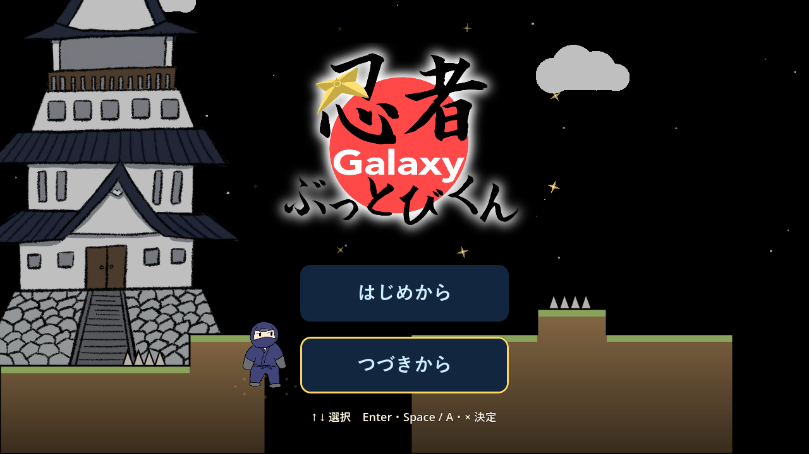
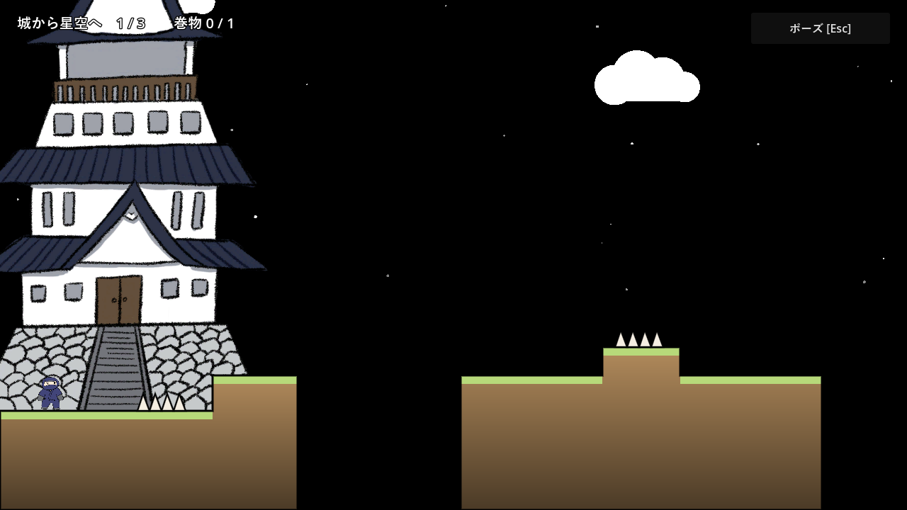

# 忍者ぶっとびくん Galaxy

重力反転、壁登り、ダッシュ、相棒の運搬を組み合わせるGodot製2Dアクションです。前作「忍者ぶっとびくん」の忍者と城の素材を使用しています。

## 起動

Godot 4.7.2 StableのStandard版で `project.godot` をインポートし、F5で実行してください。最初にタイトル画面が開きます。

- 「はじめから」：全ステージの進捗・巻物・操作設定・画面設定を初期化し、ステージ1へ進みます。既存データや変更済み設定がある場合だけ確認画面を表示します。
- 「つづきから」：保存したクリア印と巻物数を保ち、ステージ選択へ進みます。保存前は無効です。
- 全6面は自由に選択できます。ステージを選び直すと、そのステージの最初から始まります。

タイトルと選択画面には、第1面の開始地点と共通の景色を表示します。



## 操作

| 操作 | キーボードの初期設定 | ゲームパッドの初期設定 |
| --- | --- | --- |
| 移動・方向 | A/D、方向キー、W/S | 十字キー・左スティック |
| ジャンプ | Space、W/↑ | 下ボタン（A/×）・十字キー上 |
| ダッシュ | X＋方向 | 右ボタン（B/○）＋方向 |
| 壁掴み・登り、物を掴む | Shift＋方向 | 左右のトリガー＋方向 |
| チェックポイントからやり直し | R | Start/Menu |
| ポーズ | Esc | Back/Select |
| 操作設定 | F10、メニュー内「操作設定」 | メニュー内「操作設定」 |
| 全画面 | F11、メニュー内の表示切替 | メニュー内の表示切替 |

ジャンプは押している時間で高さが変わります。最大距離を出すには長押ししてください。手動の壁キック・追加ジャンプ・Superdashにも適用し、ばねやバンパーの発射、ダッシュ自体の勢いは変えません。

壁登り・ダッシュの吹き出しは、第1面では現在の割り当てと使用デバイスに追従します。[操作設定](docs/input-settings.md)・[画面表示](docs/display-settings.md)も参照してください。

## ステージ

| 面 | 内容 | 巻物 |
| --- | --- | --- |
| 1：チュートリアル | 城から始まる3部屋。移動・ジャンプ・壁登りの後、崩れる橋で右上ダッシュを学ぶ | 1 |
| 2：星のぼりの塔 | 全34区間を上昇するコース。壁、ばね、空中資源と相棒をつなぐ | 8 |
| 3：壁キックと重力 | 全37部屋。床と天井を切り替え、壁キックと風を使う | 10 |
| 4：星渡りの回廊 | 全36部屋。相棒を出口へ運び、投げ渡しや持ち替えを使う | 12 |
| 5：暴風バンパー峡谷 | 全34部屋。風と184個のバンパーを使う高難度コース | 12 |
| 6：追跡者の終域 | 全13部屋。箱・傘・重力を使って追跡者から逃れ、決着・封じ込め・逃走から勝ち方を選ぶ | なし |

ステージ1では各部屋内でカメラが追従し、前の部屋にも戻れます。死亡・やり直しでは、現在の部屋に最後に入った側へ復帰します。橋は最高速度の走行と適切なジャンプが必要です。最後の先端へ正しく跳んだ場合だけ時間が止まり、新たな右上ダッシュ入力を待ちます。正解すると安全に着地し、暗転からクリア画面へ進みます。



第1面のクリア画面は決定で選択へ戻ります。ステージ2〜5は既存の小さなクリア通知を表示し、そのまま練習を続けられます。ステージ6も小さな通知を表示し、決着後は操作を止めます。Enter・通知のボタン・Y/△で選択へ戻れます。全6面でクリア印を保存します。

確定した巻物とクリア印は終了後も残ります。巻物は触れた時点では仮取得で、安全な静止床へ0.2秒着地すると確定します。部屋・途中のチェックポイントは保存しません。


詳細は [第1面の仕様](docs/tutorial-stage-1-redesign.md)、[第2面](docs/stage-2.md)、[第3面](docs/stage-3.md)、[第4面](docs/stage-4.md)、[第5面の進路](docs/stage-5-navigation.md)、[第6面](docs/stage-6.md)を参照してください。ステージ6では敵の針や捕獲でスタミナを失い、尽きると現在の部屋から自動で再開します。落下・棘・R / Start・ポーズ・ヘルプからのやり直しも、現在の部屋の敵や仕掛けを初期化します。H / Y・△で攻略説明を開けます。

「背景・ギミックを見る」から環境プレビュー、「キャラクターと道具の図鑑」から敵や道具の説明を開けます。

## ポーズと演出

タイトル・ステージ選択と各ステージではBGMをループ再生します。ステージ1〜6の系統は順にC・A・B・C・A・Bです。クリア画面ではクリアSEを一度再生し、終了後に同系統の静版BGMをループ再生します。ジャンプ・ダッシュ・クリアSEの前後の無音はカットしています。[音源と割り当て](assets/audio/README.md)を参照してください。

ポーズ中は再開、操作設定、やり直し、表示切替、ステージ選択への帰還を選べます。ヒントを持つステージではヒントも切り替えられます。

映像演出を省略するときは、一度ポーズメニューを開いて「演出をスキップ」を選びます。第1面の減速を省略してもダッシュ入力待ちは残り、ダッシュや着地そのものは省略できません。[共通スキップ仕様](docs/cinematic-skip.md)に境界を記録しています。

## 素材の差し替え

城は前作の原画をそのまま使っています。橋、コース内のロケット、クリア画面の背景・ロケット・文字には描き替え用の仮PNGを用意しました。[画像差し替えガイド](docs/tutorial-stage-1/asset-replacement-guide.md)に寸法、透過、配置、同名ファイルでの差し替え手順をまとめています。

忍者・相棒などの出典は [キャラクタースプライト](docs/character-sprites.md)、既存の生成素材は [素材の記録](assets/characters/PROMPTS.md)、城と今回の仮素材は [出典](assets/tutorial/README.md)を参照してください。

## 検証

Python 3の標準ライブラリだけで、作業コピーと検証専用の保存先を作って実行できます。実際のプレイデータには書き込みません。Godotの実行ファイルを指定してください。

```sh
python tests/run_checks.py --godot /path/to/godot --smoke --render game_audio_test.gd tutorial_redesign_test.gd variable_jump_test.gd game_progress_test.gd stage_select_test.gd
python tests/run_checks.py --godot /path/to/godot --timeout 240 stage_2_test.gd stage_3_test.gd stage_4_test.gd stage_5_test.gd
```

`--render` は描画ありの第1面通しテストを行い、スクリーンショットを `deliverables/tutorial-validation/` へ保存します。Windowsでは描画用ウィンドウを非表示で起動します。描画にはOpenGLの利用できる環境が必要です。結果と確認範囲は [実装・検証記録](docs/tutorial-stage-1-implementation.md)を参照してください。

地形と描画は `scripts/tutorial_landscape.gd`、橋は `scripts/tutorial_bridge.gd`、第1面の進行は `scripts/tutorial.gd`、共通移動は `scripts/player.gd` で調整します。旧17部屋の第1面と専用の攻略テストは新コースに置き換えました。以前の経緯はGit履歴と各設計文書に残っています。
