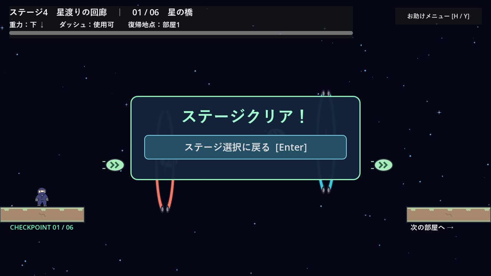
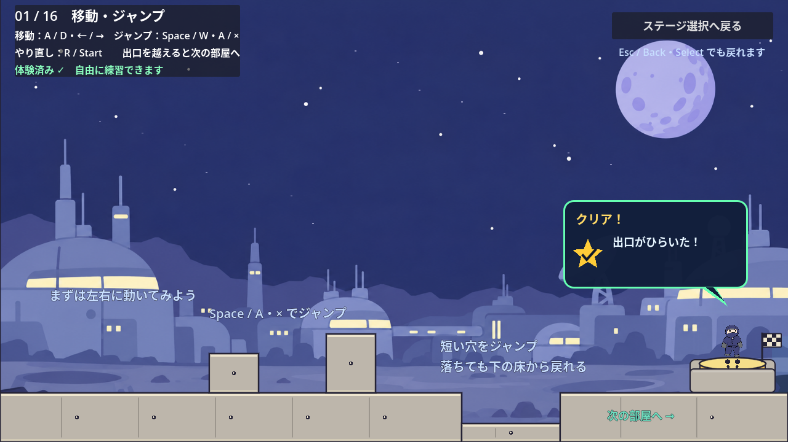
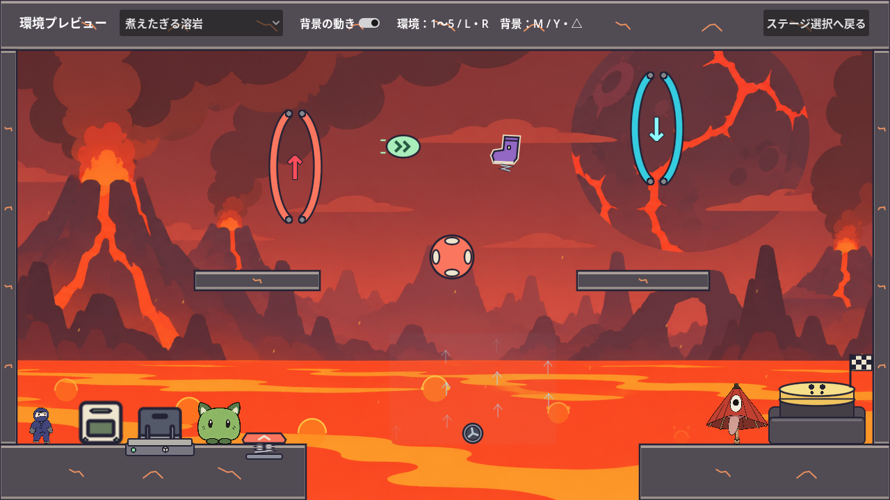

# 忍者ぶっとびくん Galaxy

宇宙を舞台に、重力反転で床と天井を切り替えて進む2Dアクションです。Phase 1の移動、Phase 2の環境ギミック、Phase 3のGrab / Carryを実装しています。

前作「忍者ぶっとびくん」の主役6姿勢を使い、壁登りと運搬を各2枚で補完しています。生物と赤い和傘も少数フレームで動かします。ステージとギミックはA案の輪郭・色面で揃え、宇宙基地・生活圏・未開発・溶岩・邪悪なオーラの背景を緩やかに動かします。

素材の出典・割り当て・確認事項は [キャラクタースプライト](docs/character-sprites.md)、生成プロンプトは [素材の記録](assets/characters/PROMPTS.md) に記録しています。

## 必要環境と起動

- Godot 4.7.2 Stable（Standard版）、Git
- Godotに `project.godot` をインポートし、`F5` で実行します。

## スタート画面

F5で起動すると、宇宙背景の中央に「忍者ぶっとびくん Galaxy」のユーザー提供ロゴとSTARTを表示します。STARTのクリック、Enter／Space、ゲームパッドA／×でステージ選択へ進みます。選択画面の「タイトルに戻る」、Esc／Back・Selectでスタート画面へ戻れます。

ロゴが拡大しながら現れ、少し遅れてSTARTと操作説明を表示します。忍者が弧を描いて飛び込み、STARTの横に着地します。周囲では金色の手裏剣型パーティクルがゆっくりきらめき、ロゴもわずかに拡大・縮小します。決定すると忍者が跳び出し、白金色の光が広がる0.28秒のワープ演出からステージ選択へ進みます。登場を待たずに決定操作で進めます。OSから動きを減らす設定が通知された場合は、演出を止めて最初から表示します。

仕様は [スタート画面](docs/start-screen.md)、ロゴの出典は [タイトル素材](assets/ui/PROMPTS.md)、3回のデザイン確認は [確認記録](docs/start-screen-design-review.md) に記録しています。


## ステージ選択

スタート画面のSTARTから、ステージ1〜5が左から順に並んだ選択画面へ進みます。「ステージ1：チュートリアル」「ステージ2：星のぼりの塔」「ステージ3：壁キックと重力」「ステージ4：星渡りの回廊」「ステージ5：暴風バンパー峡谷」を自由に選べます。「5つの環境を見る」から、全環境の背景・地形・ギミックを操作できるプレビューへ入れます。

クリック、方向キー＋Enter、ゲームパッドの十字キー／左スティック＋A／×で選べます。全プレイ画面でEsc／Back・Select、または「ポーズ [Esc]」からポーズメニューを開けます。背景を含むゲーム全体が止まり、再開・ヒント切り替え・チェックポイントからのやり直し・ステージ選択への帰還を選べます。ヒントのない画面では該当ボタンを表示しません。帰還時は進み具合が保存されない旨を確認します。再選択時は最初から始まり、進捗は保存しません。クリア後も、引き続き自由に練習できます。

チュートリアル全17部屋は宇宙基地、ステージ2・3は生活圏のある惑星を舞台にしています。プレビューでは画面上部の選択欄、数字キー1〜5、ゲームパッドのL／Rで環境を切り替えられます。「背景の動き」、Mキー、ゲームパッドのY／△で背景を一時停止できます。移動・ジャンプ・運搬などは本編と同じ操作です。溶岩の波・泡・火の粉や瘴気は背景表現で、追加のダメージ判定はありません。

合意した仕様は [ステージ選択の仕様書](docs/stage-selection.md) に記録しています。

共通メニューの操作と停止範囲は [ポーズメニューの仕様](docs/pause-menu.md) を参照してください。


## ステージ2：星のぼりの塔

`sota_sodex_1st`から取り込んだ、上へ連続スクロールする全6区間・24段のコースです。壁登り・壁キック、Spring、ダッシュ回復・追加ジャンプのクリスタル、生物をつないで頂上を目指します。各区間の広い足場に着地すると復帰地点を更新し、落下やR / Startで最新の復帰地点へ戻ります。

生活圏の惑星のふもとから、雲の上、星が見える上空へ登ります。街と山は登るにつれて下へ遠ざかり、雲と星は足場よりゆっくり動きます。背景は高度に合わせて連続して変わり、降下ややり直しでも同じ高さの景色へ戻ります。

配置は `scenes/stage_2.tscn`、進行は `scripts/stage_2.gd`、背景は `scripts/ascent_backdrop.gd`。詳しくは [第2ステージの仕様](docs/stage-2.md) を参照してください。

## ステージ3：壁キックと重力

壁キックと重力反転を使う6部屋の本編ステージです。1部屋目はSpringから壁キック・重力反転・天井のSpringへ、2部屋目は天井側の反発板から壁への掴み替えへつなぎます。3〜6部屋目は後半にも天井の穴があり、空中ジャンプのクリスタル、縦風と移動ゲート、短い足場のSpring、向かい風と横移動ゲートを、それぞれ違う経路で使います。ダッシュと壁登りは最初から使え、全6部屋をダッシュなしでも攻略できます。

各部屋は1280×720の固定カメラで、到着台を押すと出口が開きます。3〜6部屋目には床の落とし穴もあり、クリア後は床の穴を埋める足場が現れます。穴の縁はオレンジ色で示します。落下やR / Startでその部屋の入口へ戻り、重力・ダッシュ・スタミナと移動ゲートをリセットします。開いた出口は、そのプレイ中は開いたままです。6部屋目のクリア後も前の部屋へ戻って練習できます。

説明文と経路の矢印は初期状態で非表示です。「ポーズ [Esc]」またはEsc／Back・Selectで開く共通メニューから、ヒントを表示・非表示にできます。切り替え後もポーズを維持し、設定は部屋移動ややり直しでも保ちます。選択画面から入り直すと非表示に戻ります。壁スタミナはチュートリアルと同じゲージで表示します。部屋番号・タイトル・ポーズの入口と、ゲージ・ダッシュ・空中ジャンプの表示は、通常重力では画面上側、反転中は下側へ同時に移ります。開いたメニュー自体は常に画面中央に表示します。

3部屋目の床の穴は730px幅に広げ、壁の上からのジャンプとダッシュでも届かないようにしました。4部屋目は既存の重力ゲートを広げ、床の壁を登って重力反転を避ける抜け道を防いでいます。

配置は `scenes/stage_3.tscn`、進行は `scripts/stage_3.gd` で調整します。合意した仕様と6部屋の課題は [第３ステージの仕様書](docs/stage-3.md) に記録しています。


## ステージ4：星渡りの回廊

全6面で緑の相棒を持ったまま出口へ運ぶステージです。運搬中は壁登りができないため、壁キックと追加ジャンプを使います。階段・縦穴・低い天井・峠の下り・離れ小島・折り返しの6種類の地形を、ダッシュなしでも攻略できます。画面上端には危険が見える天井トゲを配置しています。部屋移動で復帰地点を更新し、落下・トゲへの接触・R / Startで現在の部屋から再開します。

ポーズメニューで操作のヒントを表示できます。配置・操作・テストは [第4ステージの仕様](docs/stage-4.md) を参照してください。

全5ステージでクリア時に「ステージクリア！」と戻るボタンを表示します。Enter（テンキーも可）、ボタンのクリック、ゲームパッドAで確認なしにステージ選択へ戻れます。



## ステージ5：暴風バンパー峡谷

ギャラリーの「未開発の惑星」を舞台に、バンパーの反射と風をつなぐ高難度の全12部屋です。Godot 4.7.2で `project.godot` をインポートしてF5を押し、STARTから「ステージ5：暴風バンパー峡谷」を選ぶと試遊できます。`scenes/stage_5.tscn` を開いてF6でも直接起動できます。

各部屋のバンパーを番号順に反射すると出口の柵が開きます。第1〜11室は出口の足場に着地すると、その1回で次の部屋へ進みます。空中で画面右端を越えた場合も次へ進み、クリアした部屋をやり直す必要はありません。第12室は最後の到着台への着地でクリアです。浅くかするだけでは反射しません。反射でダッシュが回復し、ダッシュ中は風の影響を受けません。途中に休憩用の足場はなく、赤い帯に触れたり出口以外の画面外へ出たりすると、その部屋の入口へ戻って反射の進捗もリセットされます。第9室には壁キックに使える岩壁があります。通常の移動・ジャンプ・壁アクション・ダッシュの能力値は変更していません。

| 部屋 | 課題 |
| --- | --- |
| 1：針穴の反射 | バンパー2個、追い風、細い隙間 |
| 2：横風の狙撃 | 横風の中で高低差のある3個へ接触 |
| 3：風の境目 | 追い風と向かい風の境目を越える |
| 4：三連反射 | 高低差のある3個と2つの狭い通路 |
| 5：逆風を裂く | 長い向かい風の中でダッシュを配分 |
| 6：天井返し | 天井のバンパーへ下から当たり、下側のバンパーへつなぐ |
| 7：吹き落とす風 | 下向きの風に抗って3個をつなぐ |
| 8：折り返す航路 | ②から③は左へ戻り、④へ大きく飛び直す |
| 9：壁からの一撃 | 岩壁と高いバンパー、後半の向かい風 |
| 10：暴走する追い風 | 長い追い風の中で4個へ位置合わせ |
| 11：嵐の五連鎖 | 横風・下向きの風・狭い通路と5連反射 |
| 12：暴風の最終試練 | 4つの風域と6連反射から、小さな到着台へ |

移動はA/D・方向キー、ジャンプはSpace / W、ダッシュはX＋方向、やり直しはR / Startです。Esc / Back・Selectの共通ポーズメニューでヒントと経路線を表示でき、帰還確認から選択画面へ戻れます。再選択すると1部屋目から始まります。配置は `scenes/stage_5.tscn`、進行は `scripts/stage_5.gd` で調整できます。

`tests/stage_5_test.gd` は、通常の入力だけで全12部屋・43個の反射からゴールまで到達することを検証します。この到達確認ではテレポート、速度の代入、能力の補充、進捗の直接変更を使いません。順序違い・やり直し・障害物・画面外・ヒント・選択画面への復帰も別に確認します。

`tests/stage_5_exit_test.gd` は第1〜11室の出口への着地と、ダッシュで空中から右端を越える場合を確認します。どちらも1回で次の部屋へ進み、二重に進まず、未達成の反射を飛ばせないことを検証します。

## チュートリアル

選択画面から開始するチュートリアルは `scenes/tutorial.tscn` です。各部屋は1280×720の1画面で、カメラは部屋の中では固定されます。課題をクリアしてプレイヤーの右端が画面右端に届くか、画面左端を越えると隣室へ0.28秒でスライドし、切り替え中だけ操作が止まります。

本編は16部屋、最後に任意のSuperdash練習部屋があります。最初の4部屋で移動の基本を体験し、続く部屋でCrystal、Spring、風、運搬、生物とそれらの連携を練習します。

| 部屋 | 課題と配置 | 新しく使える操作 |
| --- | --- | --- |
| 1：移動・ジャンプ | 平地、64pxと96pxの段差、下に戻れる床を置いた短い穴 | 移動・ジャンプ |
| 2：よじ登り・壁キック | 左の壁を登って休憩足場へ。中央の壁の下を通り、向かい合う壁の張り出しを壁キックで越えて右へ進む | 壁Grab・壁登り・壁スライド・壁キック |
| 3：ダッシュ | 練習床、360pxの穴、140px高い足場、任意で取れるDash Crystal | 8方向Dash |
| 4：重力切り替え | 安全なUpゲート、天井を歩いて越える障害物、反転中に跳び越す段差、Downゲート、床のゴール | ゲートによる重力反転 |

- 操作説明は、その部屋の課題の近くに表示します。
- 部屋に入ると入口を復帰地点にし、重力Down、速度0、Dash回復、スタミナ最大の状態で始めます。
- 落下またはR / Startで、現在の部屋の入口へ戻ります。その部屋のDash Crystalもすぐに戻ります。
- 左端から前の部屋へ戻れます。習得した壁アクションとDashは、戻ったりやり直したりしても使用可能です。
- 16部屋目の到着台を押すと本編の完了を表示します。その後も戻って練習したり、17部屋目でSuperdashを試したりできます。

部屋の足場・入口・説明文は `scenes/tutorial.tscn` の `Rooms/Room1` ～ `Room17`、切り替えと解禁は `scripts/tutorial.gd` で調整します。風・Spring・運搬などをまとめた既存デモは `scenes/main.tscn` に残しています。GodotでそのSceneを開き、F6で実行できます。

### 到着台

各部屋の足跡とチェッカー旗がある丸い到着台は、ミッション未達成の間、南京錠付きのガラスケースで覆われています。上の吹き出しには「のこり 2/3」のような残りステップ数と、最初の未達成目標を図と短文で表示します。ケースは実際にプレイヤーを支えるため、未達成のままスイッチを押すことはできません。

全ステップを達成すると、南京錠が跳ねて開き、星が散ってケースが消え、短いチャイムが鳴ります。ケースの上で待っていた場合も、そのまま下のスイッチへ着地できます。スイッチに乗るとプレイヤーごと約0.2秒で32px沈み、押し込みが完了してから出口の壁が開きます。一度押すとその位置で固定され、離れたりやり直したりしても出口は開いたままです。押す前に落下またはR / Startでやり直すと、ミッションとケースのロックをリセットします。

`scenes/arrival_switch.tscn` / `scripts/arrival_switch.gd` が表示、物理的な押し込み、解錠・押下の効果音を担当します。重量を測るPressure Buttonとは別の仕掛けです。

到着台は金色の丸い押す面、環境に合わせた台座、透明の保護フードと南京錠で描きます。解錠時には南京錠が開き、フードとともに浮いて消えます。金色の押す面が台座の受け口へ沈み、足跡と旗からゴールを見分けられます。以前の光沢付き画像は参照資料として残していますが、現在の描画には使いません。

新しい見た目でも当たり判定、押し込みの距離・時間、解錠条件は既存のままです。比較見本と方針は [ステージとオブジェクトの絵柄](docs/art-direction.md)、背景素材の生成記録は [背景のプロンプト](assets/environments/PROMPTS.md) を参照してください。



## 操作

| 操作 | キーボード | ゲームパッド |
| --- | --- | --- |
| 移動 | A / D または ← / → | 左スティックまたは十字キー |
| ジャンプ | Space / W | A / × |
| Dash | X + 方向入力 | B / ○ + 左スティック／十字キー |
| Object / 壁を掴む | Shift（長押し） | ZL / ZR（長押し） |
| 壁を昇降 | 掴みながら W / S または ↑ / ↓ | 掴みながら上下入力 |
| やり直し | R | Start |
| ポーズを開閉（全プレイ画面） | Esc | Back / Select |

- **重力ゲート**：赤の↑でGravity Up、シアンの↓でGravity Down。反転中は天井が床です。通常は↑で壁を登り上端へマントル、反転中は↓で登り下端へマントルします。
- **Wall Grab**：床と壁に同時に接していても、Grabキーを長押しすると壁に捕まれます。横入力は不要で、上入力からそのまま登り、低い段差もよじのぼれます。重力反転中は天井への接地から下入力で登ります。壁に捕まっている間のWは登り、接地中のSpace / Aは地上ジャンプを優先します。
- **Wall Stamina**：最大3秒分。接地中は消費せず、床を離れてから重力に逆らって登ると1倍、静止／重力方向へ降りると1/3倍で消費します。0になるとGrab解除。壁へ再接触しても回復せず、現在の床に着地すると全回復します。壁方向への入力による壁スライドは引き続き可能です。
- **壁キック**：スタミナを消費せず、残量0でも使えます。横720px/s・重力と逆向き560px/s（水平から約38°）で跳び出し、同じ壁へ入力し続けて戻っても、蹴り出した高さより低い位置へ戻ります。高い足場へ移るときは壁を登ってから反対側へ蹴り出します。地上ジャンプとは別に `wall_jump_speed` / `wall_jump_up_speed` で調整できます。
- **8方向Dash**：画面基準の8方向へ一定速度で移動します。無入力なら最後に左右移動した方向（初期は右）。空中では1回まで、着地かDash Crystalで回復します。壁Grabでは回復しません。Dash中も壁に衝突し、重力ゲート通過でDashは止まりません。地上の水平Dashは終了時にも使用可能に戻ります。
- **色／HUD**：Dash使用可能なら忍者の衣装は元の藍色、消費済みならシアンです。顔・手足・目の色は保ちます。HUDは重力、スタミナバー、Dash、Air Jumpを表示します。
- **Superdash相当**：地上で水平Dashし、Dash中または終了後0.12秒以内にジャンプすると、通常ジャンプの高さとDash由来の水平速度を得られます。Dash中のジャンプ入力も短時間バッファされます。
- **Dash Crystal**：緑の速度マークに触れるとDashだけが1回へ回復します。Air JumpやWall Stamina、保持中のCreatureのジャンプは回復しません。取得後は消え、2.5秒で再出現します。
- **Jump Crystal**：紫のばね靴の形をしたアイテムです。触れるとAir Jumpを1回得ます。重複取得しても蓄積せず、DashやWall Stamina、保持中のCreatureのジャンプは回復しません。取得後は消え、2.5秒で再出現します。見た目の向きにかかわらず、ジャンプは現在の重力と逆向きです。
- **Air Jump**：Jump Crystal取得後、地上／コヨーテジャンプと壁ジャンプができない空中でジャンプすると発動。現在の重力に逆らって跳び、水平慣性を保ちます。未使用の権利は着地後も保持します（重力反転中も同様）。使用すると消費し、着地だけでは回復しません。Dashで上へ向かうときは方向入力とXを同時に押すか、Spaceでジャンプ後に方向を指定してください。
- **Respawn**：R / Startまたは画面外落下で、重力Down、Dash使用可能、Air Jumpなし、スタミナ最大へ戻ります。



## 既存のギミックデモ配置（main.tscn）

開始地点から右側の足場と壁で移動・壁Grabを確認できます。Dash Crystalは足場AとBの間の空中 `(700, 330)` と、反転側の `(1540, 240)` にあります。その近くの `(810, 330)` と `(1650, 240)` にJump Crystalを配置しています。緑の速度マークでDash、紫のばね靴でAir Jumpをそれぞれ取得してください。右へ進むと赤いUpゲート、天井側をさらに進むとシアンのDownゲートがあります。床上の空間では水平Dash→ジャンプを試せます。

F6で実行する `main.tscn` のPhase 2配置：

| ギミック | 位置と試し方 |
| --- | --- |
| 床Spring | `(650, 640)` の黄緑の矢印。落下して触れ、直後に回復したDashを使用 |
| 壁Spring | 右端の壁 `(2320, 340)`。左向きに発射 |
| Moving Gate | `(1230, 470)` ～ `(1530, 470)` を往復する赤いUp。Dashで通過可能 |
| Wind Area | 壁の右側 `(980, 480)`、幅140／高さ320の左風。移動／Dash、左の壁へのGrabと解除を比較 |
| Updraft | 傘の上 `(980, 360)`、幅140／高さ560の上昇気流。傘保持中はゆっくり浮上し、傘なしでは落下上限が半分になる |
| PinballSpring | `(1870, 540)` のピンクの円形バンパー。上・下・左右・斜めから接触し反射方向を比較 |

既存の静止Gate、足場、Dash Crystalの配置はそのままです。

## Phase 2：環境ギミックとInspector

### Moving GravityGate

既存 `gravity_gate.tscn` を拡張しています。`moving_enabled = false` が標準で、既存配置は静止します。有効時は初期位置Aから `A + move_offset` のBへ移動し、両端で待機して往復します。無効化すると移動／待機が一時停止し、再有効化で続きから再開します。

- `move_offset = Vector2(300, 0)`：親座標系の移動先offset。縦・斜めも指定可能。
- `move_speed = 120.0`：移動速度。0では停止。
- `endpoint_wait_time = 0.5`：両端の待機秒数。
- `target_gravity`：Upは赤、Downはシアン。Areaへ再進入するごとに発動。Dash中も重力だけが変わり、Dash方向／速度は維持します。

### Spring

`spring.tscn` はローカル上向きが発射方向です。Sceneのrotationで地面・壁・天井へ配置します。原点が表面、台座はローカル下側です。Playerが表側から接触すると、発射方向と直交する接線速度を保存し、法線成分だけ `spring_speed = 900.0` へ置換します。低速・静止接触でも有効で、裏側や外へ離れる接触は無効です。

1接触につき1回だけ発射し、退出後の再進入で再発動します。Dash／Superdash受付を終了して即発射、その後は通常物理へ戻ります。発射時はDash・Wall Staminaを全回復し、Grab Exhaustedも解除。Air Jumpや保持中のCreatureのジャンプは付与・回復しません。取得済みの未使用Air Jumpは、発射や床との同frame接触、その後の着地でも保持します。Creatureは保持したまま着地したときに回復します。

### PinballSpring

`pinball_spring.tscn` は半径32の円形バンパーです。見た目と当たり判定が円形で、全周から接触できます。円の中心から接触時のPlayer中心へ向かう方向を表面法線とし、接触直前の速度を反射します。同じ進行方向でも、円のどこに当たるかによって跳ねる方向が変わります。Sceneのrotationは反射方向に影響しません。Dash突入時もDash速度で反射してからDashを終了し、Springと同じDash・Wall Stamina回復を行います。Air Jumpや保持中のCreatureのジャンプは付与・回復しません。

- `minimum_bounce_speed = 800.0`／`maximum_bounce_speed = 1200.0`：反発速度の下限／上限。範囲内の入射速度は保存（下限が上限より大きい場合は下限を優先）。
- `min_impact_normal_speed = 50.0`：表面へ向かう法線速度の最低値。浅い擦れは発動せず、反射は必ず外向き。1接触につき1回です。

### Wind Area

`wind_area.tscn` は半透明の領域と方向矢印です。横風は地上・空中の移動目標速度に加わり、無入力でも風下へ流されます。標準の横風では通常歩行360に対して、向かい風36、無入力324、追い風684になります。向かい風でも入力中は実効歩行速度の10%以上で前進でき、Heavy保持中は27です。歩行でじりじり進むこともできますが、素早く抜けるにはDashを使います。上下の風は加速度として作用します。Dash中・Wall Grab中は無効で、解除後に再適用します。

- `wind_direction = Vector2.RIGHT`：world基準の任意方向。正規化して使用し、ゼロなら無風。GravityやScene rotationでは反転しません。
- `wind_acceleration = 900.0`：風の強さ。横方向の速度への寄与は合成加速度の0.36秒分、上下方向は毎frameの加速度として使います。
- `max_wind_speed = 500.0`：風による速度への寄与の上限。横方向は入力による速度に加える風の速度を制限し、追い風では合計速度がこの値を超えることがあります。上下方向は合成風向への速度成分に応じて加速分を制限し、既に速いJump／Spring速度を切り詰めません。
- `area_size = Vector2(260, 240)`：領域サイズ。Inspectorで変更すると当たり判定と表示が追従します。

複数Areaでは加速度をベクトル合成します（右900＋上900なら `(900, -900)`、反対方向なら相殺）。合成方向に対して有効Areaの最大 `max_wind_speed` を使います。登録はArea単位で、退出・削除時にその寄与だけを解除します。通常の重力方向の落下上限／Wall Slide上限とCollisionは引き続き適用します。

合成した風が現在の重力に逆らう成分を持つ場合は、上昇気流として扱います。重力Downでは画面上向き、Gravity Upでは画面下向きが該当し、斜め風も含みます。傘なしではその成分による加速を受けず、落下上限を通常の1/2（標準では900→450）に制限します。横風成分は作用し、他のObjectを保持していても浮上できません。領域を出ると通常の落下上限に戻ります。

傘保持中は上昇気流による浮上が可能です。風が加える上昇速度の上限は `parachute_fall_speed` と同じ180で、既に速く上昇しているJump／Spring等の慣性は切り詰めません。傘を離すと風による浮上が解除され、残った上昇慣性は重力で自然に減速します。Dash中・Wall Grab中は従来どおり風を受けません。デモの上昇気流は `wind_acceleration = 3000` で、既存の左風と重なります。右入力で横風に逆らい、領域内に留まりながら浮上を試してください。

## Sceneの担当分け

- `scenes/player.tscn` / `scripts/player.gd`：移動、壁アクション、スタミナ、Dash、Air Jump
- `scenes/stage.tscn`：足場と当たり判定
- `scenes/gravity_gate.tscn` / `scripts/gravity_gate.gd`：重力変更、方向別の自動配色
- `scenes/refill_crystal.tscn` / `scripts/refill_crystal.gd`：Dash回復と再出現
- `scenes/jump_crystal.tscn` / `scripts/refill_crystal.gd`：Air Jump付与と再出現（`refill_kind = AIR_JUMP`）。再出現処理はDash Crystalと共通
- `scenes/spring.tscn` / `scripts/spring.gd`：固定方向の発射とDash・Wall Stamina回復
- `scenes/pinball_spring.tscn` / `scripts/pinball_spring.gd`：入射角に応じた反射とDash・Wall Stamina回復
- `scenes/wind_area.tscn` / `scripts/wind_area.gd`：風の登録・解除と表示
- `scenes/hud.tscn` / `scripts/hud.gd`：操作説明と状態表示（Playerのsignal/getterを使用）
- `scenes/main.tscn`：各Sceneのデモ配置
- `scenes/stage_select.tscn` / `scripts/stage_select.gd`：通常起動するステージ選択画面、ステージ1〜5の開始と環境プレビュー
- `scenes/stage_2.tscn` / `scripts/stage_2.gd`：星のぼりの塔の全6区間、連続カメラ、復帰地点
- `scenes/stage_3.tscn` / `scripts/stage_3.gd`：壁キックと重力反転を組み合わせた6部屋の本編ステージ
- `scenes/stage_4.tscn` / `scripts/stage_4.gd`：星渡りの回廊の全6部屋
- `scenes/stage_5.tscn` / `scripts/stage_5.gd`：暴風バンパー峡谷の全12部屋
- `scenes/tutorial.tscn` / `scripts/tutorial.gd`：17部屋のチュートリアル、部屋切り替え、操作の解禁、復帰地点
- `scenes/arrival_switch.tscn` / `scripts/arrival_switch.gd`：到着台、目標の吹き出し、ロックケース、解錠と押し込み

調整値はPlayer／CrystalのInspectorから変更できます。同じSceneを複数人で同時編集せず、担当ごとにブランチを分けます。

## 自動テスト

```powershell
Godot_v4.7.2-stable_win64_console.exe --headless --fixed-fps 60 --path . --script res://tests/stage_select_test.gd
Godot_v4.7.2-stable_win64_console.exe --headless --fixed-fps 60 --path . --script res://tests/stage_2_test.gd
Godot_v4.7.2-stable_win64_console.exe --headless --fixed-fps 60 --path . --script res://tests/stage_3_test.gd
Godot_v4.7.2-stable_win64_console.exe --headless --fixed-fps 60 --path . --script res://tests/stage_4_test.gd
Godot_v4.7.2-stable_win64_console.exe --headless --fixed-fps 60 --path . --script res://tests/stage_5_test.gd
Godot_v4.7.2-stable_win64_console.exe --headless --fixed-fps 60 --path . --script res://tests/stage_5_exit_test.gd
Godot_v4.7.2-stable_win64_console.exe --headless --fixed-fps 60 --path . --script res://tests/ascent_backdrop_test.gd
Godot_v4.7.2-stable_win64_console.exe --headless --fixed-fps 60 --path . --script res://tests/environment_art_test.gd
Godot_v4.7.2-stable_win64_console.exe --headless --path . --script res://tests/base_system_test.gd
Godot_v4.7.2-stable_win64_console.exe --headless --path . --script res://tests/phase1_movement_test.gd
Godot_v4.7.2-stable_win64_console.exe --headless --fixed-fps 240 --path . --script res://tests/wall_jump_regression_test.gd
Godot_v4.7.2-stable_win64_console.exe --headless --path . --script res://tests/phase2_environment_test.gd
Godot_v4.7.2-stable_win64_console.exe --headless --path . --script res://tests/phase3_grab_test.gd
Godot_v4.7.2-stable_win64_console.exe --headless --fixed-fps 60 --path . --script res://tests/tutorial_rooms_test.gd
Godot_v4.7.2-stable_win64_console.exe --headless --fixed-fps 60 --path . --script res://tests/tutorial_extension_test.gd
Godot_v4.7.2-stable_win64_console.exe --headless --fixed-fps 60 --path . --script res://tests/tutorial_throw_route_test.gd
Godot_v4.7.2-stable_win64_console.exe --headless --fixed-fps 60 --path . --script res://tests/arrival_switch_test.gd
Godot_v4.7.2-stable_win64_console.exe --headless --fixed-fps 60 --path . --script res://tests/character_sprites_test.gd
```

それぞれ `BASE_SYSTEM_TEST_OK` / `PHASE1_MOVEMENT_TEST_OK` / `PHASE2_ENVIRONMENT_TEST_OK` と終了コード0で成功です。baseは入力・移動・壁・重力とデモ配置、Phase 1は両重力・左右両側の接地からのGrab／低い段差のマントル／ジャンプ優先と接地中のスタミナ、空中のマントル／スタミナ・Dash・色・ジャンプ連携・2種類のクリスタルの効果分離／再出現・Respawnを検証します。Phase 2はGate往復・実接触、4方向Spring、反射と速度範囲、追加ジャンプを付与しないことと未使用の権利の保持、同frame着地回復、Wind合成・能力相互作用・削除を検証します。

`PAUSE_MENU_TEST_OK` は、7つのプレイ画面の開閉、ヒントの有無、確認・キャンセル、チェックポイントからの再開、背景・物理・タイマー・部屋移動の停止、クリア表示との入力競合を確認します。実行は `--script res://tests/pause_menu_test.gd` を指定します。

`STAGE_SELECT_TEST_OK` は、全5ステージの選択画面からの起動、マウス・キーボード・ゲームパッドの入力、クリア後の任意練習、選択画面へ戻る操作、再選択時の進捗初期化を確認します。

`STAGE_2_TEST_OK` は、実入力による全24段の登頂、復帰地点の更新、落下・やり直し、頂上の到着台、カメラ、ポーズメニュー、再入場を確認します。`ASCENT_BACKDROP_TEST_OK` は背景の高度連動、地表が視界から離れること、区間境界の連続性、降下と復帰時の景色、既存の地形表現を確認します。

`STAGE_4_TEST_OK` は、実入力による全6部屋の通過、クリスタル・反転ゲートの連携、部屋移動、落下・やり直し、メニュー、再入場を確認します。

`STAGE_5_TEST_OK` は、位置変更や能力の強制補充を使わずに全12部屋・43個の反射を実入力で攻略し、風・ダッシュ・最後の到着台を確認します。部屋移動、落下・Rによる復帰、共通ポーズとヒント、再選択時の初期化も検証します。

`STAGE_3_TEST_OK` は、ダッシュなしの実入力で全6部屋を攻略し、壁キック・通常重力と反転中の連携、移動ゲート、到着台、部屋移動と逆戻り、落下・やり直し、クリア後の自由練習、再選択時の進捗初期化を確認します。

`CHARACTER_SPRITES_TEST_OK` は、元画像の使い分け、少数フレームの歩行・壁登り・運搬、両重力の左右向きと壁キック、大きなアイテムの縦横比・表示幅・手との接点、追加ジャンプ表示の位置を確認します。

`TUTORIAL_ROOMS_TEST_OK` は、操作の制限と解禁、部屋内の固定カメラ、画面端での切り替え、段差と穴のジャンプ、壁登りと壁キック、水平・斜めDashでの攻略、重力ゲートとゴール、各部屋への復帰、戻った後の操作維持、Crystalの復帰を確認します。

`WALL_JUMP_REGRESSION_TEST_OK` は、30・60・120回／秒の物理更新、両重力・壁の両側で、同じ壁への連続キックが高さを増やさず、スタミナ残量0でも無料で使えることを確認します。SpaceとWの入力、重い箱・傘の保持、傘と壁方向への横風の組み合わせも対象です。

`TUTORIAL_EXTENSION_TEST_OK` は追加した部屋を実入力で攻略します。`ARRIVAL_SWITCH_TEST_OK` は全17面のケースへの接地、残り目標の表示、解除時のフィードバック、ケース上からの着地、押し込みへの追従、完了後の出口解禁、やり直し前後のロックと固定、下降中のジャンプを確認します。


## Phase 3：Grab / Carry

Shift / ZL / ZRを長押しすると、当たり判定の最寄りの端が `grab_range = 60` 内にあり、壁に遮られていない最寄りObjectを優先して掴みます。大きな傘も、中心まで近づかずに掴めます。対象がない場合は従来のWall Grabです。低い天井の下でも取得できます。Object保持中はWall Grab／壁登りを使いませんが、壁キックと壁スライドは使用できます。Dash中の新規Grabは禁止ですが、Dash終了後も押していればGrabできます。保持済みならDash、Spring、円形Pinball、静止／移動GravityGate、Windでも保持を続けます。

Wall Grab中は、登り・静止・降りのいずれでも近くのObjectを自動で掴みません。Grabキーを一度離して押し直した場合は、範囲内のObjectを優先して掴みます。登り切り・壁からの離脱・スタミナ切れ・壁ジャンプでWall Grabが終わったときは、Grabキーを押したままならその時点の範囲内のObjectを自動で掴みます。Dash中は引き続き新規Grabしません。

ボタンを離した瞬間の**実velocity**の長さが `throw_move_threshold = 80` 未満ならDrop、80以上ならThrowです。Input方向やGravityではなく、実velocity方向へ `player_velocity + direction * throw_speed` を与えます。Dropは慣性だけを引き継ぎ、追加投擲速度を与えません。通常の `throw_speed = 450`、Heavyは300です。停止からDashと同frameに離した場合も、Dash速度を設定してからThrowします。Spring／Pinballの発射後も同じ操作です。

### Jump Creature

緑のCreatureを保持中だけ独立した追加空中Jumpを1回使えます。優先順はGround／Coyote → Wall → Jump CrystalのAir Jump → Creatureです。残数はCreature自身が保持し、Drop→再Grabでは回復しません。

プレイヤーの体の横に、Air Jumpと保持中のCreatureを合わせた**追加ジャンプ残数**を白い山形＋暗い縁取りで表示します。1回なら1個、2回なら縦に2個、0回なら非表示です。地上・Dash中も表示し、重力反転に合わせて向きが変わります。残数が増えた瞬間だけ軽く拡大して戻り、消費やCreatureのReleaseはすぐ表示に反映されます。由来による区別はせず、衣装の色はDashの使用可否を示します。

保持したまま現在の床へ着地するとCreatureが回復し、未使用のAir Jumpは保持します。Air Jumpが残っていれば表示2、消費済みなら表示1になります。Spring／Pinballと、どちらのCrystalでもCreatureのジャンプは回復しません。

### Heavy Object

銅色の分銅型の箱は `weight = 8.0`、物理質量も8.0です。太い輪の取っ手と幅広の底で重さを表現しています。表示幅は63px、当たり判定は取っ手を含む輪郭に合わせた約63×54.14pxです。保持中だけ移動速度・地上加速・空中加速が0.75倍、通常Jump速度が0.85倍になります。PlayerのInspector値を変更せず実効値で計算し、Releaseで即解除します。Dash速度／時間／回数、Wall Stamina、Wall Climb／Jump、Superdash、Gravityは変わりません。

軽い箱は表示幅・当たり判定63×63pxの段ボールです。上面の継ぎ目、中央の梱包テープ、角の折れと配送マークを描いています。`weight = 2.0`、物理質量も2.0で、持っても移動やジャンプの能力は変わりません。重い箱との重量比は従来どおり4倍です。両方とも当たり判定は四角のままです。

### Parachute Creature

一つ目と舌を持つ赤い和傘を保持中だけ、現在の重力方向への落下成分を `parachute_fall_speed = 180` に制限します。横速度とJump等の上昇慣性を維持し、Gravity Upにも対応します。空中で保持すると傘が開き、地上・Dash中は通常の姿勢へ戻ります。Wind適用後に落下を制限するため、横風では流され、重力に逆らう強い風では180を上限に浮上でき、重力方向の風でも落下上限を超えません。Dash中は無効、Spring／Pinball発射後の落下制限には `parachute_launch_grace = 0.15` 秒の猶予があります。Releaseで落下制限と風による浮上を即解除します。

### Pressure Button

赤茶色のPlateはArea内の、手放されているGrabbable重量を合算し、`required_weight = 2.0` 以上で緑へ変わって沈みます。軽い箱1個、重い箱1個、または重量0.5の生物4個でON、離れて不足するとOFFです。Bodyは重複加算しません。`include_player = false` が標準で、trueの場合のみPlayerの `weight = 1.0` も加算します。

`pressed_changed(is_pressed: bool)` と `is_pressed()` を公開しています。チュートリアル12部屋目では、物体だけが通る柵へ接続しています。走ってHeavyを手放し、向こうの広いPlateへ届くと柵が開きます。運搬、押し運び、停止してDropする方法では届きません。未クリアならRで箱と柵が戻り、クリア後は柵を開いたままにして戻り道を保ちます。

### Carryの衝突と公開API

- `grabbable.tscn` / `grabbable.gd` は1つの `CollisionShape2D` を持つRigidBody2Dの共通基盤です。派生Scene／Scriptが重量、投擲速度、Modifier、追加Jump、落下上限を提供します。
- Playerは `try_begin_grab()` / `release_grab()` / `get_held_object()` / `get_available_extra_jump_count()` と実効移動値のgetter、`carry_changed` signalを公開します。外部ObjectはPlayerのprivate stateを変更しません。
- Carryは頭側の `carry_offset = Vector2(0, -48)` を基準に、拡大した当たり判定の下端が上げた手に合うよう高さを補正します。重力Upでは画面下へ反転し、傘の持ち手だけ前側の片手へ14px寄せます。保持中はRigidBodyをfreezeし、回転・速度を停止します。
- 保持中だけcollision layer／maskを0にして、壁・床・天井・Player・他Bodyとの物理衝突を無効化します。Shape自体は残してRelease位置の検査に使用します。保持アイテムが地形に重なってもPlayerの移動・方向転換を制限しません。重量スイッチには加算しません。
- Grab時はPlayerと対象の中心を結ぶRayで遮蔽物を確認します。薄い壁越しの取得は禁止し、取得後の頭上配置経路と天井への重なりは許容します。非Solid Areaは取得を妨げません。
- Release時に地形や他Bodyへ重なっていれば、保持位置からPlayer中心へ約1px刻みで安全位置を探します。Playerとの一時的な重なりは許容します。安全位置がなければ保持を継続し、ボタンを離している間は毎frame再試行します。待機中も移動できます。
- Releaseで元のcollision layer／maskとRigidBodyの物理を復帰します。離した直後はRigidBodyが先に進めるよう相互衝突を短く猶予し、上昇慣性を保ちます。Playerは通常移動でアイテムを穏やかに押せます（押す方向の目標速度は最大120px/s）。重なったペアは一時的に相互衝突だけを外し、Playerを地形に衝突する移動で毎秒60pxずつ離し、アイテムにも逆方向の押し返しを与えます。床・天井に挟まれている場合は横方向へ解消し、分離後に相互衝突を戻します。強制ノックバックは与えません。
- R / Start／画面外Respawnで全Grabbableの初期位置・回転・速度・Collision・Jump残数を戻します。Buttonは物理同期後、戻ったBodyの位置に応じて再集計します。

保持位置はPlayerの `carry_offset`、押す速さは `object_push_speed = 120`、重なりを解消する速さは `overlap_separation_speed = 60` で調整できます。傘の表示幅は90px（プレイヤーの体幅36pxの2.5倍）、それ以外の持てる物体は63px（体幅の1.75倍）です。当たり判定も表示の拡大率に合わせます。生物と傘は通常姿勢の矩形を使い、アニメーションで物理サイズを変えません。縦横比を保ち、置いたときは当たり判定の底、保持中は忍者の手に画像の下端を合わせます。反転中は保持物の画像も反転します。

### Phase 3デモ手順

既存デモの `main.tscn` に次を追加しています。Phase 1・2の配置は維持しています。

| Object | 初期位置 | 確認方法 |
| --- | --- | --- |
| Jump Creature | `(250, 607.1)` | 近づきShiftを保持。床Spring `(650, 640)` で表示2にし、空中Jumpを2回使って2→1→0。離して再Grabしても回復しないことを確認 |
| Light Box | `(345, 606.5)` | 段ボールの軽い箱。Heavyとの見た目と持ち運びの違いを比較 |
| Heavy Object | `(440, 606.5)` | 足場Aの下でGrabし移動差を比較。右へ移動して離す／Dashと同時に離すと投擲 |
| Pressure Button | `(530, 640)` | HeavyをPlateへ投げるか上でDropし、緑のONを確認。外へ運ぶとOFF |
| Parachute Creature | `(1000, 593.4)` | 上昇気流内でGrab→ゆっくり浮上。離すと慣性が減速して落下。傘なしでJumpして落下上限450を比較。Upゲートで反転し天井へゆっくり落下。保持したままSpring／PinballやDashも比較 |

狭い足場下で取得・方向転換し、壁際で保持したまま壁キックできることを確認できます。低い天井にアイテムが重なった状態で離すと、Player側へ補正してから物理を復帰します。HUDは既存のGravity／Stamina／Dash／Air Jumpに **CARRY: NONE / JUMP / HEAVY / PARACHUTE** を追加しています。

### Phase 3テスト

上記4本をGodot 4.7.2 headlessで実行します。新しい `tests/phase3_grab_test.gd` は `PHASE3_GRAB_TEST_OK` と終了コード0で成功です。保持中の衝突無効化と頭上追従を各テストframeで確認し、両重力の壁キック／壁スライド、低い天井での取得と方向転換、薄い壁越しGrab拒否、Release位置補正・待機・自動再試行、狭い通路での重なり解消、通常移動での押し合いを検証します。入力の共有・優先順位、Drop／全方向Throw／同frame Dash Throw、独立Jump残数と表示、Heavyの例外、ParachuteとWind／Launch猶予、実RigidBodyの投擲からButton ON、Respawnも対象です。上昇気流は両重力で、傘の有無・他Objectの保持・落下450・浮上180・斜め風・風の相殺・Release後の慣性・実Areaからの退出を検証します。

Wall GrabとObject Grabの切り替えは両重力で検証します。壁を掴んだままの登り・静止・降りでは取得せず、キーの押し直しと、登り切り・降り切り・スタミナ切れ・壁ジャンプでの解除時には取得すること、Dashによる解除では取得しないことを確認します。
