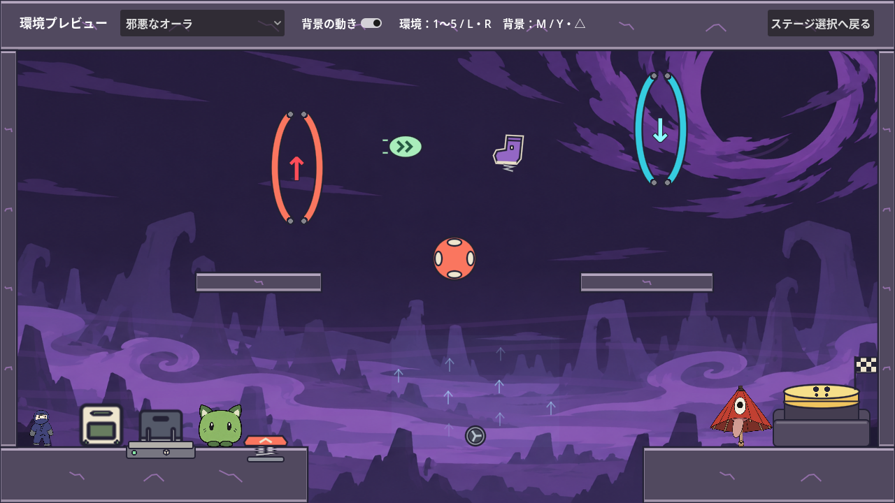

# ゲームへの反映と3回の動作画面レビュー

2026年10月13日。承認されたAの見た目を既存コースへ反映し、背景を緩やかに動かした。完成後の描画画面・動画を3回確認し、1・2回目で見つかった点を修正してから次の確認へ進んだ。

## 完成した範囲

- チュートリアル17部屋は宇宙基地、本編6部屋は生活圏のある惑星で統一した。
- 地形、重力ゲート、回復アイテム、ばね、バンパー、箱、重量スイッチ、到着台・ロックケース・出口・帰り道の橋をAの輪郭と配色に合わせた。緑の生物・傘・忍者の既存素材と、ギミックの当たり判定・効果は維持した。
- 宇宙基地・生活圏・未開発・溶岩・邪悪なオーラの背景を作成した。宇宙基地は星、生活圏・未開発は雲、溶岩は波・泡・火の粉・煙、邪悪なオーラは瘴気・遠景の渦を緩やかに動かす。
- 「5つの環境を見る」から、同じ操作・ギミックで全環境を確認するプレビューへ入れる。環境は1〜5キー／L・R／選択欄で切り替え、背景はMキー／Y・△／チェックボタンで停止・再開できる。
- ステージ3〜5の新しい攻略コースは今回の範囲に含めない。溶岩や瘴気へのダメージ判定も追加していない。

背景は内蔵image_genで生成し、[使用プロンプト](../../assets/environments/PROMPTS.md)を保存した。仕掛け・地形の既存のコードによる描画を拡張し、背景の動きはGodotの描画とシェーダーで実行する。

## 3回のレビュー

Godot 4.7.2のLinux ARM64版を、Xvfb・Mesa llvmpipeで描画した。各回の動画は1280×720、30fps、約38秒。溶岩・邪悪なオーラを各10秒、ほかの3環境を各4秒、最後に実際のチュートリアルで到着台の解錠から押下までを記録した。キャラクターの移動・ジャンプ・ダッシュは入力を模擬している。静止画も実際のシーン・カメラ・HUD・物理処理で取得した。

動画にはGodotの[MovieWriter](https://docs.godotengine.org/en/stable/classes/class_moviewriter.html)を使用した。描画とアニメーションを確認するための固定フレームレートでの記録であり、実機の描画性能を測定するものではない。

| 回 | 確認した画面と動き | 気になった点と対応 |
| --- | --- | --- |
| 1 | 5環境の通常・反転表示、既存23部屋の33画面と動画 | 地形が枠付きパネルのように見える点、暗い背景での紫の靴の識別、説明図と新しい仕掛けの不一致を確認。地形の縁・模様を調整し、靴へ細い明るい縁を追加。到着台・重量スイッチ・ばね・バンパーの説明図も揃えた |
| 2 | 50画面と動画。上記に、本編6部屋の反転表示、ループ境界・途中の表示、到着台3状態を追加 | 明るい地形で説明文が読みにくい点、古い「次の部屋」案内と新しい出口案内の重複を確認。文字へ暗い縁を付け、重複する旧案内を隠した。プレビュー開始時の箱と忍者の間隔も広げた |
| 3 | 修正後の50画面と動画。背景停止・再開、反転表示、到着台の状態変化、選択画面も確認 | 新たな修正を要する表示上の問題は見つからなかった。溶岩の波・泡・火の粉、瘴気が仕掛けの前面へ重ならず、足場と仕掛けの輪郭を読めることを確認した |

[1回目の画面一覧](../screenshots/art-review/round-1/contact-sheet.jpg)、[2回目の画面一覧](../screenshots/art-review/round-2/contact-sheet.jpg)、[3回目の画面一覧](../screenshots/art-review/round-3/contact-sheet.jpg)。個別画面と中間動画は確認用の生成物として作業コピーに保存している。最終動画はDiscordへの添付用ファイルにまとめた。

ループの境界は背景時刻119.98秒と0.02秒で比較した。地形と仕掛けを除いた空の領域での平均RGB差は、溶岩0.021、邪悪なオーラ0.015（各チャンネル0〜255）で、大きな飛びは見られなかった。泡・火の粉は出現・消失時の不透明度を連続的に変え、境界で突然現れないようにしている。




## 動作テスト

12種類のテストを実行し、すべて成功した。到着台の32px・0.2秒の押し込みと解錠条件、重力ゲートの移動・反転、ばね・風、運搬物と箱の大きさ・重量、既存コースの進行・ヒント・部屋移動は既存の確認を維持した。見た目の変更後、古い星の配列を前提とした確認は、新しい背景が画面全体を覆い、遊びの後ろへ描かれることの確認へ更新した。

| テスト | 結果 |
| --- | --- |
| arrival_switch_test | OK、88項目 |
| base_system_test | OK |
| character_sprites_test | OK |
| environment_art_test | OK、60項目 |
| phase1_movement_test | OK、305項目 |
| phase2_environment_test | OK、443項目 |
| phase3_grab_test | OK、1512項目 |
| stage_2_test | OK、325項目 |
| stage_select_test | OK、41項目。描画ありの実行でも成功 |
| tutorial_extension_test | OK、99項目 |
| tutorial_rooms_test | OK、48項目 |
| wall_jump_regression_test | OK、684項目 |

追加したテストでは環境切り替え、背景停止・再開、ループ時刻の折り返し、キーボード・ゲームパッドの操作、選択画面からの出入りを確認した。Windows実機と接続した実物のゲームパッドでの確認、実機GPUでの負荷測定は行っていない。

## 再確認する方法

Godotでプロジェクトを開いてF5。「5つの環境を見る」で各環境の動きを確認する。自動で画面・動画を再取得する場合は次のスクリプトを使う。

```text
godot --path . --script tests/art_visual_review.gd -- --output res://docs/screenshots/art-review/recheck
godot --path . --fixed-fps 30 --write-movie recheck.avi --script tests/art_motion_review.gd
godot --headless --fixed-fps 60 --path . --script tests/environment_art_test.gd
```

`godot` は使用するGodot 4.7.2実行ファイルのパスへ置き換える。
