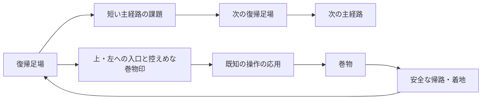

# Celesteを参考にした探索・巻物・増量の設計

2026-10-25。Q5・Q6を反映した最終方針に、ユーザーがQ7「はい」と回答して合意。継続目標を作成し、改善ループを開始した。

既存の[調査・合意](celeste-stage-design.md)を引き継ぎ、今回追加された多方向の探索、巻物の収集記録、各ステージの増量を扱う。以下は合意済みの設計方針。段階的に実装するため、現時点の実装範囲は末尾の改善記録と各ステージの仕様を参照する。

## 引き継ぐ条件と今回の追加条件

- 難易度は段階的にする。既存5ステージのテーマと基本の移動性能を保ち、部屋の順序・数・広さは再構成できる。
- 狙った操作は配置で必要にする。使用履歴だけで出口を閉じて代用しない。物体の運搬先など、ゲーム内で意味のある条件は残す。
- 再挑戦は、成功経路の通常操作で導入5〜10秒、通常10〜20秒、原則30秒以内が目安。長い部屋には途中の復帰地点を設ける。短い課題を時間合わせで引き延ばす下限ではない。
- 主経路の途中から上・左などへ離れ、巻物を取りに行ける。大きな部屋と部屋内スクロールを許容する。
- 巻物の入口は、控えめだが気付ける表示にする。不要な説明ラベルを増やさず、地形や着地点で進み方を伝える。
- 巻物の獲得数を保存し、ステージ選択に表示する。
- Q5：本編の主経路は9〜15分、巻物込み15〜24分程度を目指す。ユーザー回答「推奨の3倍」を、先に示した主経路3〜5分・巻物込み5〜8分の両方へ適用する。初見の死亡・迷いは含めない。
- Q6：チュートリアルは必須説明を延ばさず、既習操作で挑む任意の巻物ルートを追加して増量する。ユーザー回答「推奨通り」で確定。
- タスク作成→テスト→PR作成→PRレビュー→マージを繰り返す。停止条件成立後は新規タスクを作らず、進行中のタスクを終えてからfastをオフにする。

## 資料と本作への適用

### 開発者自身の説明から確認したこと

[Maddy Thorson「Celeste & Forgiveness」](https://www.maddymakesgames.com/articles/celeste_and_forgiveness/index.html)は、崖を離れた直後のジャンプ、着地前の入力予約、壁ジャンプの距離、角への衝突などに猶予を持たせる設計を説明している。操作を必須にすることと入力を狭くすることは別である。本作にはコヨーテタイムと入力予約が各0.14秒あるため、まず配置を変え、踏切やダッシュ開始の時機に幅が残るか検証する。

[開発元の製品紹介](https://maddymakesgamesinc.itch.io/celeste)では、ジャンプ・空中ダッシュ・登りという少数の操作、秘密のある多数の画面、素早い復帰を特徴としている。本作でも、一本道の距離や新しい仕掛けの数だけを増やさず、既知の操作を使い直す短い課題と探索を組み合わせる。

[公式変更履歴](https://www.celestegame.com/changelog.html)には、章終了時に収集演出を待たずカットシーンを飛ばした場合のストロベリー確定の修正がある。巻物についても、演出と収集記録の更新を分け、ゴール・画面遷移・途中帰還が重なった場合の保存を確認する。

[GDC講演](https://www.gdcvault.com/play/1024307/Level-Design-Workshop-Designing-Celeste)は今回もメンテナンス先へ転送された。講演全体を視聴したとは扱わない。Celeste本体をこの環境で実機プレイした結果でもない。

### 通常ストロベリーの挙動の補足調査

[攻略Wikiの通常ストロベリーの説明](https://wikiwiki.jp/celeste/ストロベリー（イチゴ）)では、接触後はいったん追従し、安全な床への接地で獲得し、その前に死亡すると元の場所へ戻る。秘密の入口には地形のくぼみや主経路外の足場などの手掛かりがある。これはコミュニティ資料であり、開発者による仕様書とは区別する。掲載された接地時間の概数を、本作の厳密なフレーム仕様としては使わない。

今回の「ストロベリーと同様」は、通常の収集物について次の挙動を採用する。羽付き・金色・種集めなど別のルールを持つ派生型まで追加するという解釈はしない。

1. 接触すると巻物がプレイヤーへ追従する。掴むキーや運搬枠を使わず、相棒や傘を持ったまま拾える。
2. 安全な足場へ短時間接地すると獲得を確定する。壁掴まり、空中、バネに触れた瞬間だけでは確定しない。重力反転中は、現在の重力に対する安全な天井側を足場として扱う。
3. 確定前の死亡・手動やり直し・ステージ帰還では元の配置へ戻る。確定後の巻物は死亡・途中帰還・未クリア・ゲーム再起動で失わない。
4. 取得済みの巻物は薄い見た目にして、再訪時も場所が分かる。同じ巻物の再取得で保存数を増やさない。
5. ステージ選択は巻物の小さな絵と「獲得数 / 総数」を表示し、読み上げ用の名前にも含める。収集数によってステージやゴールをロックしない。

安全な着地、確定前の死亡、取得済み表示は、まず一つの寄り道の試作で見え方と操作を確認する。接地時間や演出の細部は本作で調整し、Celesteの厳密な再現値とは主張しない。

## 現在の実装を出発点にする

既存文書の2026-10-23調査開始時点の表と、現在の実装を区別する。以下はコードと既存テストの読み取り結果であり、今回テストを再実行した結果ではない。

| ステージ | 現在の構成 | 今回拡張する余地 |
| --- | --- | --- |
| チュートリアル | 必須16室＋任意のSuperdash室。第16室は1600×720、他は基本1280×720。左へ前室に戻れる。 | Q6に従い、必須説明を延ばさず、学んだ操作の任意課題として上・左へ寄り道できるようにする。 |
| 星のぼりの塔 | 上昇6区間、4320px、10段。到達した復帰足場へ戻る。 | 塔の側面に横枝と上方の小部屋を作り、登頂途中の足場へ戻す。落下を既存の死亡境界に捕まえられないか確認が必要。 |
| 壁キックと重力 | 基本1280×720の6室。右進行で左へ戻れる。 | 重力で天井側へ入り、左上へ折り返して元の部屋へ戻る探索がテーマに合う。 |
| 星渡りの回廊 | 6室。第2室は1280×1800で縦スクロール。室間は右進行。 | 相棒を使った上方の追加課題や、左上への回り道を増やせる。寄り道で相棒を失っても詰まらない復帰が必要。 |
| 暴風バンパー峡谷 | 基本1280×720の12室、43バンパー。第8室内は左へ折り返し、第11室に休憩足場。 | バンパーで横枝や上側へ飛び、別の安全足場から本線へ合流させる。速い移動中の視認性を確認する。 |

根拠：`scripts/tutorial.gd`、`scripts/stage_2.gd`〜`stage_5.gd`、`scripts/stage_4_room.gd`、`scenes/tutorial.tscn`、各ステージの既存仕様とテスト。

塔のギミック必須化は既に進んでおり、峡谷の反射順序の履歴ロックは撤去済み。トゲも既にステージグループ、可変長、回転、ダッシュ中の接触判定に対応している。これらを新規実装し直さない。チュートリアルのSuperdash室など、地形による必須化が未解決の課題は引き続き別タスクで扱う。

## コース構成の提案



この図は構成例であり、全分岐を同じ形にしない。戻って同じ操作を繰り返す形、別の足場に合流する短い環状路、上へ行って下へ安全に降りる形をステージのテーマに合わせる。

- 入口では小さな巻物の紋を一つ使い、目的地へ向かう長い矢印や説明文を常設しない。通常の危険表示、足場、出口より強く見せない。
- 主経路の出口と寄り道の入口は、開口部の形・足場の並び・視線の先で区別する。寄り道を必須経路と誤認しないか描画で確認する。
- 分岐前に安全に止まって周囲を見られる場所を置く。巻物までの距離が長い場合は枝の入口に復帰地点を設けるが、本線へ戻れなくなる保存位置は作らない。
- 帰路も課題の一部にする場合は、確定前に安全な中間足場へ着地して課題を省略できないか調べる。高い場所の巻物へ触れて死亡するだけでは獲得できない。
- 主経路自体にも上昇・左折り返し・下降を取り入れる。室間の並びを全てグラフ構造へ置き換えることは前提にせず、既存の部屋管理を使って実現できる範囲から始める。
- 増量は異なる応用課題と探索に配分し、同じ穴・同じジャンプの反復だけで長くしない。難しい課題の後は足を止められる場所を設ける。

### Q5・Q6を反映したステージ別の構成案

時間はステージ全体のボリューム、復帰間隔は一度の失敗で失う進行の長さであり、別の基準として扱う。ステージ全体を長くしても、一回の再挑戦は通常10〜20秒、原則30秒以内を保つ。

| ステージ | 主経路の目安 | 巻物込みの目安 | 構成の出発案 |
| --- | --- | --- | --- |
| チュートリアル | 必須説明の長さを保つ | 任意課題で増量 | 壁操作、重力、追加ジャンプ、運搬・滑空を使う寄り道。まず巻物4個を異なる既習操作へ割り当てる。 |
| 星のぼりの塔 | 9〜10分 | 15〜17分 | 既存の6テーマを保ち、各区間に短い課題と復帰足場を増やす。側面の小部屋・横枝・上からの帰路に巻物8個を置く案。 |
| 壁キックと重力 | 10〜12分 | 17〜20分 | 床側と天井側を行き来する上昇・左折り返しを増やす。天井側の枝や壁の裏側に巻物10個を置く案。 |
| 星渡りの回廊 | 12〜14分 | 20〜22分 | 相棒と登る、風で渡る、降りて戻る課題を複数の短い区間へ分ける。運搬と探索を組み合わせた枝に巻物12個を置く案。 |
| 暴風バンパー峡谷 | 14〜15分 | 22〜24分 | 反射の導入、上方への連鎖、左への反射、風との連携を増やし、連続課題の途中に安全な足場を置く。枝と周回路に巻物14個を置く案。 |

巻物数は配置を始めるための設計案であり、同じ課題の水増しで達成する固定ノルマにはしない。各本編はおよそ30〜60の短い課題を組み合わせる規模を想定する。部屋数と復帰地点数は一致させず、大きな部屋の途中にも復帰地点を置く。通常操作での通し確認に応じて課題数と巻物数を調整し、時間だけを合わせる待機・長い平地・同じジャンプの繰り返しは追加しない。

増量後も収集は任意で、巻物を取らずにゴールできる。全巻物を取るための一回の連続プレイも要求せず、確定した収集記録を次回へ持ち越す。途中の部屋進捗の永続保存は今回の追加要件には含めず、ステージ選択からの再挑戦は最初からとする。

## 設計の決定木

```text
既存ステージの探索と増量
├─ 既存Q1〜Q4：段階的難易度・地形必須化・短い再挑戦・テーマ維持【継承】
├─ ユーザー指定：上・左への探索、巻物、選択画面の収集記録【確定】
├─ Q5：主経路9〜15分、巻物込み15〜24分【確定：推奨の3倍】
│  └─ テーマを保ち、短い課題と復帰地点を増やす構成案【提示済み】
├─ Q6：チュートリアルは任意の巻物ルートで増量【確定：推奨通り】
│  └─ 必須説明を延ばさず、異なる既習操作に巻物を配置【提示済み】
└─ 通常ストロベリー型の獲得・再訪・帰路【Q7で合意】
   └─ 継続目標を作成して改善ループを開始【開始済み】
```

Q5は、当初の推奨値から3倍へ変更して確定。初見の死亡・迷いは含めず、通常操作で成功した経路を比較する。人による初見の所要時間と自動入力の所要時間は区別する。

Q6は、チュートリアルの必須説明を延ばさず、既習操作の任意の巻物ルートを追加して増量する推奨案で確定。

## 変更が届く範囲

- 収集物、獲得確定、死亡時復元、部屋移動、ゴール、ポーズからの帰還。既存のクリスタル消費通知と巻物取得を混同しない。
- 収集記録の保存と読み込み。個数だけでなく変更に耐える巻物ごとのIDを記録し、二重加算を防ぐ。既存の入力設定・表示設定と途中の部屋進捗を巻き込まない。
- ステージ選択カードの表示と読み上げ、ポーズの「失う進み具合」の説明、関係する仕様文書。
- 大型室のカメラ範囲、死亡境界、入口と出口、復帰位置、背景、トゲの範囲、運搬物のリセット。既存の固定座標テストも変更した経路に合わせる。

## 合意後の改善ループと判定

最初に共通の巻物・保存・ステージ選択表示を用意し、短い上／左の寄り道一つで獲得から再起動まで通して確認する。その後、塔、重力、回廊、峡谷の各テーマを短い区間ごとに増量し、チュートリアルへ任意ルートを追加する。共通処理と各ステージの探索・増量は小さなPRへ分け、段階ごとに通し確認して上記の目安へ近づける。

Q7で、この構成案、巻物の獲得・保存・再訪、途中の部屋進捗を保存しない範囲をまとめて確認し、合意した。通常の配置調整やPRごとの着手について確認を繰り返さず、停止条件まで改善を継続する。

各タスクでは、問題、狙う操作、主経路と枝、帰路、復帰地点、成功経路、典型的な迂回をIssueに残す。正規ルートの成功だけでなく、狙ったギミックを使わない経路、屋根・下面・自由な物体を足場にする経路も調べる。全入力列に対する不可能証明とは扱わない。

収集では確定前の死亡、確定後の死亡、手動やり直し、部屋往復、途中帰還、未クリアでの再起動、同一巻物の再取得、保存失敗、不正な保存内容を確認する。描画付きの確認では入口の印、巻物、帰路、次の着地点が見えるか、カメラ外への不意の跳躍を要求していないかを見る。

PRレビューでは接触判定と重力反転、入力猶予、復帰状態、保存、表示、影響する既存テストを確認する。修正と検証を終えてからマージする。未完了PRを放置して別タスクへ進んだり、停止条件後に新しい改善を始めたりしない。

## 運用の実測

- 2026-10-25 05:39 UTC、`account/rateLimits/read`の10080分窓で使用率12%、Weekly残量88%を取得。リセット予定は2026-10-30 17:41:24 UTC。primary／secondaryというキー名で週枠を決めず、窓の長さを確認する。
- 05:42 UTCの再取得では残量87%、同じリセット予定時刻。今回の取得間で停止条件は成立していない。取得は新規の`codex app-server --stdio`へ`initialize`、`initialized`、`account/rateLimits/read`を送る経路で再現した。
- 過去の85%から88%への差だけでは、100%近傍への大幅増加とは判定しない。改善ループ開始時に基準値を取り直し、タスク着手前・PR作成前・マージ後・長い検証の途中で確認する。
- 残量5%未満、または100%近傍への大幅増加を検知したら、新規タスク作成を止める。リセット時刻の変化も照合し、残量の小さな揺れと区別する。取得失敗時は推測せず、新規タスクを増やさずに取得経路を復旧する。
- GitHubは`Foxy-null/2d-space`、既定ブランチ`main`。読み取りでadmin／push権限を確認。Godot 4.7.2の既存実行ファイルを確認済み。
- 今回の読み取り時点では、環境の`config.toml`は`service_tier = "default"`。以前の調査文書の`fast`設定は現状と異なる。現在スレッドの実効状態と終了時の切り替え経路は別途確認し、設定ファイルだけを見て切り替え完了とは扱わない。
- ローカルAPIスキーマには`thread/settings/update`と`turn/settings/update`の`serviceTier`指定がある。ただし現在のDiscord botのstdio app-serverへ追加RPCを届ける公開経路は未確認。別のapp-serverや常駐daemonを変更して、このスレッドのfastを切り替えたとは扱わない。[OpenAI公式の速度設定](https://learn.chatgpt.com/docs/agent-configuration/speed)も参照した。

2026-10-25 06:18〜06:19 UTCの開始時確認では残量100%、リセット予定2026-11-01 06:17:29 UTCを2回取得した。前回87%からの回復と予定時刻の更新により一度停止条件を検知したが、その後ユーザーが「もう一回やり直してください」と指示したため、100%を新しい開始基準として改善ループを再開した。旧87%との差を繰り返し停止理由にしない。再開後に5%未満へ低下するか、次の大幅な回復・リセットを検知したら終了処理する。06:28 UTCの取得値も100%、予定時刻は同じ。fast設定は終了時まで変更しない。

## 改善記録

- [Issue #114](https://github.com/Foxy-null/2d-space/issues/114)：巻物の追従、安全な着地での確定、ID単位の永続保存、選択画面の数表示を実装。重力第1室の入口側に上層への寄り道を一つ追加し、控えめな巻物印と、元の入口へ下りる帰路を設けた。本編の増量目標全体を達成したとは扱わない。単体の巻物物理26項目、保存と別プロセスの再読込、寄り道の連続入力11項目、既存重力ステージ329項目・ポーズ171項目・選択画面144項目を確認。描画付きの寄り道も通過した。独立レビューでも巻物物理・保存・寄り道を再実行し、現配置に対する必須指摘なし。06:32 UTCのWeekly残量は99%、リセット予定は同じ。

- [PR #115](https://github.com/Foxy-null/2d-space/pull/115)を独立レビュー後にマージ。既存主課題の壁キック試験1821項目・512の迂回入力も成功。マージ後のWeekly残量は99%。
- [Issue #118](https://github.com/Foxy-null/2d-space/issues/118)：通常の部屋移動と死亡・やり直しを区別し、未確定巻物を次室へ持ち越す。移動中は獲得を確定せず、移動後の安全な着地で新たに判定する。途中でポーズからやり直した場合は元へ戻す。4ステージの実際の移動処理、チュートリアル・重力の左戻りを48項目、巻物物理を31項目、ポーズを171項目確認。独立検証でも48・31項目が成功。試験用の保存先にはプロセスIDを含め、並行実行が干渉しないようにした。06:53 UTCのWeekly残量は98%、リセット予定は同じ。
- [PR #119](https://github.com/Foxy-null/2d-space/pull/119)を独立レビュー後にマージ。
- [PR #121](https://github.com/Foxy-null/2d-space/pull/121)：塔のCP03から左へ渡って戻る巻物の横枝を追加し、独立レビュー後にマージ。16・24フレームのDashでも実着地と帰還を確認。往復2.93〜2.95秒、既存6テーマの回帰と全区間を通過した。終了時の音声警告は100ms待つ比較で消え、30回のシーン生成・解放でもオブジェクト数は増えなかった。内部の原因までは断定しない。
- [PR #122](https://github.com/Foxy-null/2d-space/pull/122)：チュートリアルのジャンプ室・壁操作室へ上と左の任意ルートを各1個追加し、独立レビュー後にマージ。必須16室と任意のSuperdash室は維持する。実入力の往復は約6.2秒・7.9秒。実装担当の物理30・60・120Hz各18項目と、独立した最終headの18・42項目が成功。rootの別実行でも全17室101項目が通過した。音声オブジェクトの即終了時の警告は記録し、ゲーム中の累積と混同しない。
- [Issue #120](https://github.com/Foxy-null/2d-space/issues/120)は重力の3室、[Issue #123](https://github.com/Foxy-null/2d-space/issues/123)は回廊の3室、[Issue #124](https://github.com/Foxy-null/2d-space/issues/124)は峡谷の3室、[Issue #125](https://github.com/Foxy-null/2d-space/issues/125)は塔の6区間を増やす中間拡張として並行制作。いずれも新しい巻物枝と主経路の応用を追加する。完成・マージの判定は各PRの検証後に行い、着手だけで達成としない。
- 07:28 UTCのWeekly残量は95%、リセット予定は2026-11-01 06:17:29 UTCで変わらず。再開後の停止条件は成立していない。本編9〜15分・巻物込み15〜24分は、現時点の実装で達成した値ではない。
- Issue #124の峡谷は15室・57反射へ拡張。全コース5956項目、反射なし2430経路と壁45経路の2536項目、追加室・巻物43項目が成功した。通常／横入力0.8の実入力と描画、入口と帰路・上層カメラを確認。巻物は通常攻略で取らず、左へ追加で寄って休憩台へ戻る。詳細は[峡谷の拡張](canyon-expansion.md)。独立PRレビューはこの実装と検証を揃えてから行う。07:41 UTCのWeekly残量は93%、同じリセット予定。
- [PR #126](https://github.com/Foxy-null/2d-space/pull/126)を独立レビュー後にマージ。独立再実行でも追加43・全室5956・出口87項目が成功し、縦長の第14室で中間休憩から再出発して出口まで通過した。
- [PR #129](https://github.com/Foxy-null/2d-space/pull/129)で重力を9室・巻物2個へ拡張し、独立レビュー後にマージ。最終headの独立再実行は全9室417、拡張767・121負例、旧巻物11、クリア動線71項目が成功した。新3室の通常入力は約34秒で、本編9〜15分の目標へ向けた中間拡張として扱う。
- [PR #127](https://github.com/Foxy-null/2d-space/pull/127)で回廊を9室・巻物1個へ拡張し、独立レビュー後にマージ。レビューで再現した第8室の上投げ・手ぶら登り・再取得による壁キック0回の経路は、入口と壁の下端を400px下げて防いだ。最終地形の全9室659・新室422項目が成功し、rootの最終独立再実行でも迂回73・正例53項目が成功。新第8室は3秒休憩込み18.08〜18.60秒。
- [Issue #130](https://github.com/Foxy-null/2d-space/issues/130)：峡谷を18室へ広げ、右入口から左出口へ進む部屋と、上昇・下降の応用、新しい巻物2個を追加する。下降の部屋はカメラを下寄りにして、飛び出す前に次の反射が見えるようにする。08:22 UTCのWeekly残量は89%、リセット予定は同じ。停止条件は成立していない。
