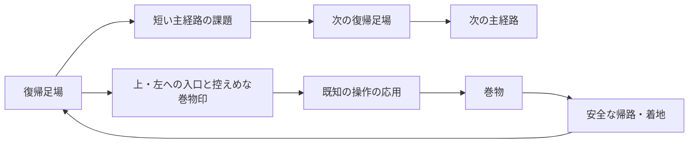

# Celesteを参考にした探索・巻物・増量の設計

2026-10-25。調査・すり合わせ中。ゲーム実装と改善ループは今回の追加方針の合意後に開始する。

既存の[調査・合意](celeste-stage-design.md)を引き継ぎ、今回追加された多方向の探索、巻物の収集記録、各ステージの増量を扱う。以下の「提案」は未承認であり、実装済みの仕様ではない。

## 引き継ぐ条件と今回の追加条件

- 難易度は段階的にする。既存5ステージのテーマと基本の移動性能を保ち、部屋の順序・数・広さは再構成できる。
- 狙った操作は配置で必要にする。使用履歴だけで出口を閉じて代用しない。物体の運搬先など、ゲーム内で意味のある条件は残す。
- 再挑戦は、成功経路の通常操作で導入5〜10秒、通常10〜20秒、原則30秒以内が目安。長い部屋には途中の復帰地点を設ける。短い課題を時間合わせで引き延ばす下限ではない。
- 主経路の途中から上・左などへ離れ、巻物を取りに行ける。大きな部屋と部屋内スクロールを許容する。
- 巻物の入口は、控えめだが気付ける表示にする。不要な説明ラベルを増やさず、地形や着地点で進み方を伝える。
- 巻物の獲得数を保存し、ステージ選択に表示する。
- タスク作成→テスト→PR作成→PRレビュー→マージを繰り返す。停止条件成立後は新規タスクを作らず、進行中のタスクを終えてからfastをオフにする。

## 資料と本作への適用

### 開発者自身の説明から確認したこと

[Maddy Thorson「Celeste & Forgiveness」](https://www.maddymakesgames.com/articles/celeste_and_forgiveness/index.html)は、崖を離れた直後のジャンプ、着地前の入力予約、壁ジャンプの距離、角への衝突などに猶予を持たせる設計を説明している。操作を必須にすることと入力を狭くすることは別である。本作にはコヨーテタイムと入力予約が各0.14秒あるため、まず配置を変え、踏切やダッシュ開始の時機に幅が残るか検証する。

[開発元の製品紹介](https://maddymakesgamesinc.itch.io/celeste)では、ジャンプ・空中ダッシュ・登りという少数の操作、秘密のある多数の画面、素早い復帰を特徴としている。本作でも、一本道の距離や新しい仕掛けの数だけを増やさず、既知の操作を使い直す短い課題と探索を組み合わせる。

[公式変更履歴](https://www.celestegame.com/changelog.html)には、章終了時に収集演出を待たずカットシーンを飛ばした場合のストロベリー確定の修正がある。巻物についても、演出と収集記録の更新を分け、ゴール・画面遷移・途中帰還が重なった場合の保存を確認する。

[GDC講演](https://www.gdcvault.com/play/1024307/Level-Design-Workshop-Designing-Celeste)は今回もメンテナンス先へ転送された。講演全体を視聴したとは扱わない。Celeste本体をこの環境で実機プレイした結果でもない。

### 通常ストロベリーの挙動の補足調査

[攻略Wikiの通常ストロベリーの説明](https://wikiwiki.jp/celeste/ストロベリー（イチゴ）)では、接触後はいったん追従し、安全な床への接地で獲得し、その前に死亡すると元の場所へ戻る。秘密の入口には地形のくぼみや主経路外の足場などの手掛かりがある。これはコミュニティ資料であり、開発者による仕様書とは区別する。掲載された接地時間の概数を、本作の厳密なフレーム仕様としては使わない。

今回の「ストロベリーと同様」は、通常の収集物について次の挙動にする提案。羽付き・金色・種集めなど別のルールを持つ派生型まで追加するという解釈はしない。

1. 接触すると巻物がプレイヤーへ追従する。掴むキーや運搬枠を使わず、相棒や傘を持ったまま拾える。
2. 安全な足場へ短時間接地すると獲得を確定する。壁掴まり、空中、バネに触れた瞬間だけでは確定しない。重力反転中は、現在の重力に対する安全な天井側を足場として扱う。
3. 確定前の死亡・手動やり直し・ステージ帰還では元の配置へ戻る。確定後の巻物は死亡・途中帰還・未クリア・ゲーム再起動で失わない。
4. 取得済みの巻物は薄い見た目にして、再訪時も場所が分かる。同じ巻物の再取得で保存数を増やさない。
5. ステージ選択は巻物の小さな絵と「獲得数 / 総数」を表示し、読み上げ用の名前にも含める。収集数によってステージやゴールをロックしない。

安全な着地、確定前の死亡、取得済み表示は、まず一つの寄り道の試作で見え方と操作を確認する。接地時間や演出の細部は本作で調整し、Celesteの厳密な再現値とは主張しない。

## 現在の実装を出発点にする

既存文書の2026-10-23調査開始時点の表と、現在の実装を区別する。以下はコードと既存テストの読み取り結果であり、今回テストを再実行した結果ではない。

| ステージ | 現在の構成 | 今回拡張する余地 |
| --- | --- | --- |
| チュートリアル | 必須16室＋任意のSuperdash室。第16室は1600×720、他は基本1280×720。左へ前室に戻れる。 | 説明を長くせず、学んだ操作の任意課題として上・左へ寄り道できる。増量方法はQ6で確認する。 |
| 星のぼりの塔 | 上昇6区間、4320px、10段。到達した復帰足場へ戻る。 | 塔の側面に横枝と上方の小部屋を作り、登頂途中の足場へ戻す。落下を既存の死亡境界に捕まえられないか確認が必要。 |
| 壁キックと重力 | 基本1280×720の6室。右進行で左へ戻れる。 | 重力で天井側へ入り、左上へ折り返して元の部屋へ戻る探索がテーマに合う。 |
| 星渡りの回廊 | 6室。第2室は1280×1800で縦スクロール。室間は右進行。 | 相棒を使った上方の追加課題や、左上への回り道を増やせる。寄り道で相棒を失っても詰まらない復帰が必要。 |
| 暴風バンパー峡谷 | 基本1280×720の12室、43バンパー。第8室内は左へ折り返し、第11室に休憩足場。 | バンパーで横枝や上側へ飛び、別の安全足場から本線へ合流させる。速い移動中の視認性を確認する。 |

根拠：`scripts/tutorial.gd`、`scripts/stage_2.gd`〜`stage_5.gd`、`scripts/stage_4_room.gd`、`scenes/tutorial.tscn`、各ステージの既存仕様とテスト。

塔のギミック必須化は既に進んでおり、峡谷の反射順序の履歴ロックは撤去済み。トゲも既にステージグループ、可変長、回転、ダッシュ中の接触判定に対応している。これらを新規実装し直さない。チュートリアルのSuperdash室など、地形による必須化が未解決の課題は引き続き別タスクで扱う。

## コース構成の提案



この図は構成例であり、全分岐を同じ形にしない。戻って同じ操作を繰り返す形、別の足場に合流する短い環状路、上へ行って下へ安全に降りる形をステージのテーマに合わせる。

- 入口では小さな巻物の紋を一つ使い、目的地へ向かう長い矢印や説明文を常設しない。通常の危険表示、足場、出口より強く見せない。
- 主経路の出口と寄り道の入口は、開口部の形・足場の並び・視線の先で区別する。寄り道を必須経路と誤認しないか描画で確認する。
- 分岐前に安全に止まって周囲を見られる場所を置く。巻物までの距離が長い場合は枝の入口に復帰地点を設けるが、本線へ戻れなくなる保存位置は作らない。
- 帰路も課題の一部にする場合は、確定前に安全な中間足場へ着地して課題を省略できないか調べる。高い場所の巻物へ触れて死亡するだけでは獲得できない。
- 主経路自体にも上昇・左折り返し・下降を取り入れる。室間の並びを全てグラフ構造へ置き換えることは前提にせず、既存の部屋管理を使って実現できる範囲から始める。
- 増量は異なる応用課題と探索に配分し、同じ穴・同じジャンプの反復だけで長くしない。難しい課題の後は足を止められる場所を設ける。

## 設計の決定木

```text
既存ステージの探索と増量
├─ 既存Q1〜Q4：段階的難易度・地形必須化・短い再挑戦・テーマ維持【継承】
├─ ユーザー指定：上・左への探索、巻物、選択画面の収集記録【確定】
├─ Q5：本編の主経路と収集込みのボリューム【回答待ち】
│  └─ 各ステージの具体的な追加課題数・巻物数【Q5後に提案】
├─ Q6：チュートリアルの増量方法【回答待ち】
│  └─ チュートリアルの枝配置と必須課題の扱い【Q6後に提案】
└─ 通常ストロベリー型の獲得・再訪・帰路の案【最終すり合わせ待ち】
   └─ 合意内容を明文化して確認後、継続目標と改善ループを開始
```

Q5の推奨：本編の主経路3〜5分、巻物込み5〜8分程度を目安に、後半ほど長くする。初見の死亡・迷いは含めず、通常操作で成功した経路を比較する。人による初見の所要時間と自動入力の所要時間は区別する。

Q6の推奨：チュートリアルの必須説明を延ばさず、既習操作の任意の巻物ルートを追加して増量する。

## 変更が届く範囲

- 収集物、獲得確定、死亡時復元、部屋移動、ゴール、ポーズからの帰還。既存のクリスタル消費通知と巻物取得を混同しない。
- 収集記録の保存と読み込み。個数だけでなく変更に耐える巻物ごとのIDを記録し、二重加算を防ぐ。既存の入力設定・表示設定と途中の部屋進捗を巻き込まない。
- ステージ選択カードの表示と読み上げ、ポーズの「失う進み具合」の説明、関係する仕様文書。
- 大型室のカメラ範囲、死亡境界、入口と出口、復帰位置、背景、トゲの範囲、運搬物のリセット。既存の固定座標テストも変更した経路に合わせる。

## 合意後の改善ループと判定

最初に共通の巻物・保存・ステージ選択表示を用意し、短い上／左の寄り道一つで獲得から再起動まで通して確認する。その後、共通処理の再利用と各ステージの探索・増量を小さなPRへ分ける。具体的なステージ別の量はQ5・Q6の回答後に決める。

各タスクでは、問題、狙う操作、主経路と枝、帰路、復帰地点、成功経路、典型的な迂回をIssueに残す。正規ルートの成功だけでなく、狙ったギミックを使わない経路、屋根・下面・自由な物体を足場にする経路も調べる。全入力列に対する不可能証明とは扱わない。

収集では確定前の死亡、確定後の死亡、手動やり直し、部屋往復、途中帰還、未クリアでの再起動、同一巻物の再取得、保存失敗、不正な保存内容を確認する。描画付きの確認では入口の印、巻物、帰路、次の着地点が見えるか、カメラ外への不意の跳躍を要求していないかを見る。

PRレビューでは接触判定と重力反転、入力猶予、復帰状態、保存、表示、影響する既存テストを確認する。修正と検証を終えてからマージする。未完了PRを放置して別タスクへ進んだり、停止条件後に新しい改善を始めたりしない。

## 運用の実測

- 2026-10-25 05:39 UTC、`account/rateLimits/read`の10080分窓で使用率12%、Weekly残量88%を取得。リセット予定は2026-10-30 17:41:24 UTC。primary／secondaryというキー名で週枠を決めず、窓の長さを確認する。
- 05:42 UTCの再取得では残量87%、同じリセット予定時刻。今回の取得間で停止条件は成立していない。取得は新規の`codex app-server --stdio`へ`initialize`、`initialized`、`account/rateLimits/read`を送る経路で再現した。
- 過去の85%から88%への差だけでは、100%近傍への大幅増加とは判定しない。改善ループ開始時に基準値を取り直し、タスク着手前・PR作成前・マージ後・長い検証の途中で確認する。
- 残量5%未満、または100%近傍への大幅増加を検知したら、新規タスク作成を止める。リセット時刻の変化も照合し、残量の小さな揺れと区別する。取得失敗時は推測せず、新規タスクを増やさずに取得経路を復旧する。
- GitHubは`Foxy-null/2d-space`、既定ブランチ`main`。読み取りでadmin／push権限を確認。Godot 4.7.2の既存実行ファイルを確認済み。
- 今回の読み取り時点では、環境の`config.toml`は`service_tier = "default"`。以前の調査文書の`fast`設定は現状と異なる。現在スレッドの実効状態と終了時の切り替え経路は別途確認し、設定ファイルだけを見て切り替え完了とは扱わない。
- ローカルAPIスキーマには`thread/settings/update`と`turn/settings/update`の`serviceTier`指定がある。ただし現在のDiscord botのstdio app-serverへ追加RPCを届ける公開経路は未確認。別のapp-serverや常駐daemonを変更して、このスレッドのfastを切り替えたとは扱わない。[OpenAI公式の速度設定](https://learn.chatgpt.com/docs/agent-configuration/speed)も参照した。

現段階では継続目標・Issue・PRを作成しておらず、fast設定も変更していない。
