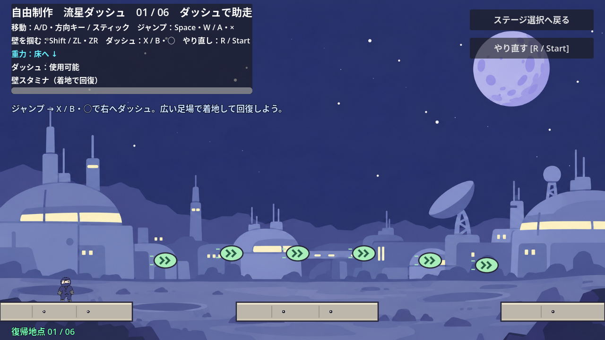
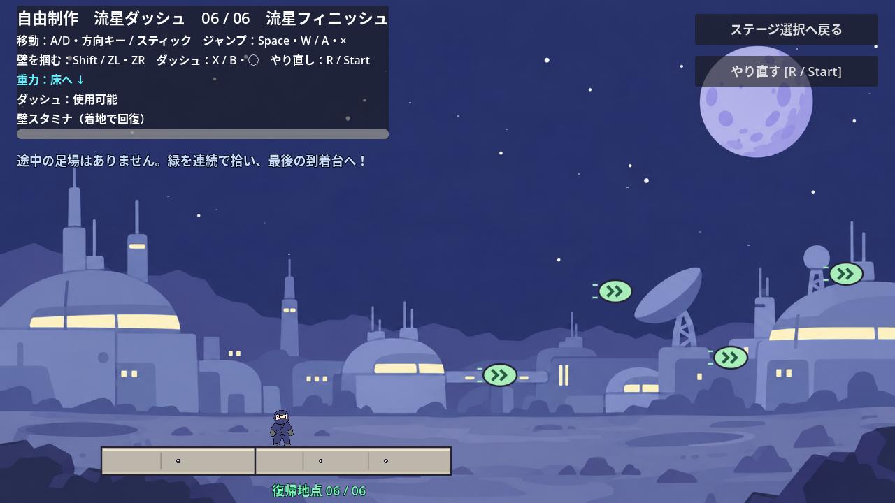

# 自由制作ステージ：流星ダッシュ

作者が自由に作るための補助枠。本編のステージ1〜5とは別に、選択画面の「自由制作ステージ（補助枠）」から入る。キャラクター、背景、地形、ボタン、到着台は既存のデザインを引き継ぐ。

ダッシュ回復クリスタルをつなぎ、横に走り抜ける全6区間のコース。各区間は1280px幅、全長7680px。部屋切り替えで停止せず、カメラが進行方向の少し先を追う。基本の移動・ダッシュ性能は既存ステージと共通で、壁アクションとダッシュは最初から使える。

| 区間 | 課題 | 難易度の変化 |
| --- | --- | --- |
| 1：ダッシュで助走 | ジャンプと右ダッシュ | 緑が近く、中央に300px幅の広い足場 |
| 2：緑をつなごう | 緩い高低差の連続ダッシュ | 中央の休憩足場は180px幅 |
| 3：斜め上へ | 斜めダッシュで上り、下りへつなぐ | 高低差が増え、中央の足場は140px幅 |
| 4：空中ジグザグ | 上下の切り返し | 中央の足場は90px幅で、立て直しが難しくなる |
| 5：高低差のリレー | 広い間隔で斜めダッシュを連続させる | 緑の間隔は160px、中央の足場は70px幅 |
| 6：流星フィニッシュ | 足場なしの連続ダッシュから到着台へ | 緑の間隔は165px、高低差は最大120px、途中の足場なし |

各区間の入口には280px幅の安全な復帰足場がある。着地すると復帰地点を更新する。空中で通過するだけでは更新しない。クリスタルは全34個で、緑に触れるとダッシュを回復する。最後の到着台にジャンプして乗るとクリアを表示し、そのまま練習できる。





## 編集する場所

Godotで `scenes/free_stage.tscn` を開き、配置を編集する。F6でこのステージだけを実行できる。F5では選択画面から開始する。

| ノード | 編集する内容 |
| --- | --- |
| `Terrain/Section1`〜`Section6` | 出口側や途中の足場。当たり判定と `Visual` の輪郭を揃えて編集する |
| `Objects/Section1`〜`Section6` | クリスタルと、追加したい既存ギミックのシーン |
| `Checkpoints/Section1`〜`Section6` | 復帰足場、`Spawn` の復帰位置、番号の表示 |
| `Goal` | 到着台。原点を床の表面に合わせる |
| `Camera2D` | コース全体の表示範囲と追従の滑らかさ |

背景を変える場合はルートの `metadata/environment_theme` を0〜4に変更する。0は宇宙基地、1は生活圏、2は未開発、3は溶岩、4は邪悪なオーラ。背景と地形の絵柄は既存の仕組みで揃う。

R / Start、または右上の「やり直す」で最新の復帰地点に戻る。重力、ダッシュ、スタミナ、運搬物と、`Objects` に置いたクリスタル・移動ゲートをリセットする。画面の上下へ外れた場合も最新の復帰地点に戻る。クリア表示はそのプレイ中だけ保ち、選択画面から入り直すと最初から始まる。Esc / Back・Select、または右上のボタンで選択画面へ戻れる。

## 確認

```powershell
Godot_v4.7.2-stable_win64_console.exe --headless --fixed-fps 60 --path . --script res://tests/free_stage_test.gd
```

成功時は `FREE_STAGE_TEST_OK` と終了コード0。テレポート・能力補充なしの実入力で全6区間を渡り、全34個のクリスタルを取得して到着台を押す。復帰地点の更新、落下・やり直し、クリスタルのリセット、再入場も確認する。難易度は配置と通過確認を基準に調整しており、人による体感比較は今後の試遊で行う。
