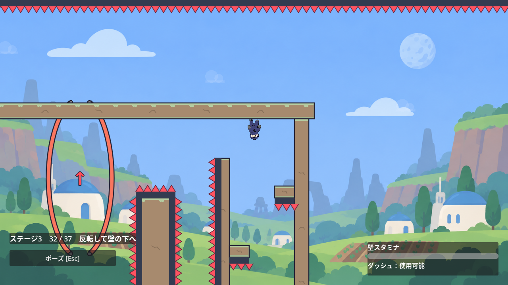
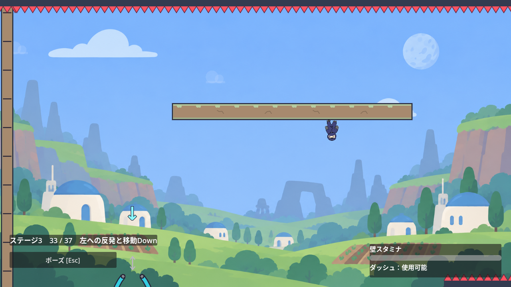
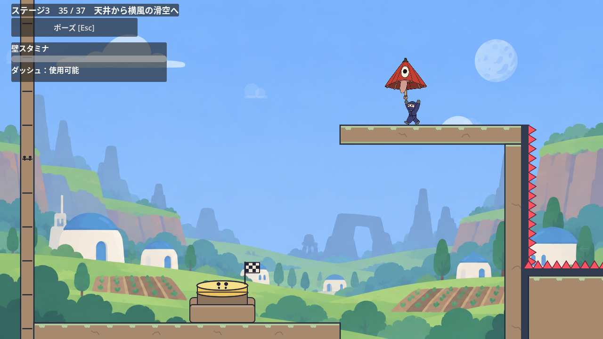
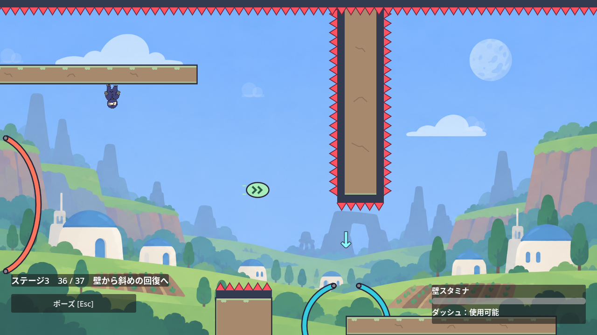

# 重力第32〜37室：向きを変えて進む六つの応用

2026-10-25。[Issue #169](https://github.com/Foxy-null/2d-space/issues/169)の設計と検証記録。初期baseはPR168固定HEAD `6da584ec04b1b8576adc0c874e668072b1f95345`、branchは`feat/gravity-sixth-six`。親PRの統合後はこのSHAを旧baseとして`git rebase --onto`で移し、旧親のcommitを重ねない。「六つの構成案」は実入力前の仮説であり、後半の実装と最終検証で実測した寸法・必要操作・時間を区別して記録する。

参照：`docs/celeste-exploration-design.md`、`docs/stage-3.md`、`docs/gravity-third.md`、`docs/gravity-parachute.md`、`docs/gravity-fifth.md`、`scripts/stage_3.gd`、既存Spring／PinballSpring／GravityGate／WindArea／Playerの挙動。

## 引き継ぐ条件

- 既存31室の地形・原点・10巻物IDを保つ。今回は本線6室だけの増量案とし、新しい巻物数・IDを設けない。既存10枝の探索／確定／保存／選択は回帰対象。
- 復帰位置から実到着まで通常10〜20秒目安、静止面の各3秒休憩を含め原則30秒以内。長くなる案は二つの短い課題へ分けるか縮める。時間合わせの平地・待機・反復を加えない。
- 共有Player／ギミック物理、使用履歴による出口ロック、常設の説明ラベルは追加しない。nativeシーンと既存部屋metadataを使う。
- 第26・28・31室に続けて「傘で上がる→天井→回復横Dash」を複製しない。新しい主眼は反転後の壁キック、接触位置を使う反発、反転した段差、横風の滑空、斜めの回復、二段の折返し。

## 六つの構成案

| 仮室 | 入口からの具体的な操作 | 既存との差／静止面／帰路 |
| --- | --- | --- |
| 32：反転して壁の下へ | 左の床のSpringでUpへ入り、上の短い天井へ。反転Jumpから左右の短い壁を交互に蹴り、画面下へ伸びる張り出しの先を回る。深い天井で休み、右のDownから到着床へ。 | 第26室の通常重力による上昇壁の順序を変え、**反転してから下方向へ蹴り替える**課題。先端の下面と端面の見えるトゲで、壁沿いの登りだけ／下Dash一発による補充面への着地を比較する。最初の天井と深い天井は無入力3秒静止可。到着後に壁を撤去し、下の短い橋から往復。 |
| 33：左への反発と移動Down | 右入口のUpから天井へ。下面から離れて円形PinballSpringの右上側へ入り、左下の壁へ反発する。広い下面に着いて休み、隣の短い壁から上下移動するDownへ蹴り出し、左の床に着く。 | 単なる水平回復ではなく**反射面への進入位置→反転壁キックでゲートへ**。第2／12室の反発板をそのまま一室複製せず、左向きの静止支持と移動ゲートの組を使う。支持面からゲートの全移動範囲が見える配置。待機を強制せず、少なくとも端の位相と中間位相から試す。左到着後は橋から右へ戻る。 |
| 34：反転した段差の追加Jump | 右入口でUp、下面Y350前後の右天井へ。左下へJumpして実JumpCrystalを取り、追加Jumpで画面下側の段差天井へ着く。そこから短い左方向の壁キックとDownをつなぎ、左到着床へ。 | 第30室の通常重力によるBoots→高いDash回復とは異なり、**反転Jumpの途中で追加Jumpを取り直して段差へ**。横幅の大穴ではなく、Y350→Y750程度の深い段差を最初の仮説とする。通常Jump＋Dashだけで届くなら高さ／横の張り出しを調整する。右天井と着地先の下面で休む。到着後の右帰路は下の橋。 |
| 35：天井から横風の滑空へ | 右の入口床で傘を持ち、近いUpから上の天井へ。左寄りのDownを通って通常重力に戻り、左向きの横風の帯へ出る。傘で下降を抑えながら深い穴を横断し、中間の広い床で休んでから左到着床へ。 | **縦風で持ち上げる課題を置かず、反転からの横滑空**を主眼にする。仮の横断距離700〜900px、落差350〜500pxから試し、素手のJump／Dash／Superdash＋追加入力の実到達と比較して調整する。傘保持中は壁動作が使えない既存仕様を前提に、掴まりを要求しない。中間床からの再出発は風の助走なしで可能にする。左到着後に右への橋を開く。 |
| 36：壁から斜めの回復へ | 左床から短い通常壁キックでUpへ入り、下面で休む。反転Jumpから右下へDashし、吊り壁の角の外に置くCrystalで実回復。もう一度右下Dashして、別の向きの張り出しを回ってDown／右到着床へ。 | 第17室の一直線の下降や第27室の水平回復とは異なる、**斜め二辺の角回り**。休憩面を角の直前へ置き、空中で長く待たせない。回復なしの8方向、角の壁で掴まり直してDash補充、屋根／下回り、斜めの一発抜けを確認。二つ目のDashの前に安全な着地補充を置かない。到着後は吊り壁を撤去。 |
| 37：上下二段の折返し | 左床からUpへ入り、右へ短い天井渡り。反転Springで画面下へ抜け、中央のDownから通常床へ。休憩後、短い左右の壁を蹴って左上のUpへ戻り、左側の天井からDown／中央より右の最終到着床へ降りる。 | 第31室の風＋左回復を終幕として繰り返さず、**右→左上→右下の二段折返し**で壁と反転をまとめる。各課題は一つずつ、空中回復や傘は加えない。天井と中間床の2支持で止まれる。下から最初のSpringを省く経路や、中央床を踏み台に直接最終Up／Downへ向かう経路を先に比較する。到着後は中間の障害を撤去し、左右に再訪できる。 |

横幅は新室だけ2304px程度を出発点とし、必要なときに2560pxへ広げる。高さは各課題に合わせる。幅や上下端は案のため固定しない。旧31室の右端はglobal X64512付近だが、実装時はsceneのRoom31.position.x＋room_widthを読んで次室の原点を算出し、推測値を書き込まない。

第33・34・35室は左へ進んで到着後右へ戻る。第37室は一室内で左右を折り返す。最終室以外の右側転送と左再訪は既存方式を使い、専用checkpointからの成功と旧31室からの本当の連続接続を区別する。

## 採用前に解く不確実性

1. 円形反発板は実接触法線で反射し、入射の法線速度が足りないと発動しない。第33室は16／20／24fだけで狭い接触点を狙わせないか先に実測する。成立しなければ板を増やさず、壁と板の間隔・進入の静止面を調整する。
2. 横風は入力目標速度へ加算される既存動作で、素手にも効く。第35室の「傘が必要」は距離だけで断定しない。素手の風勢い＋Superdash＋遅いDash、傘上への実支持→同時Grab／Jump→8方向Dashを実入口から比較する。30秒を超えるなら短くし、必要な距離を平地で稼がない。
3. 第34室の追加Jumpは既存の一個分の資源であり、複数回スタックしない。拾ったときのsignalと実air_jumpを観測し、主張と実行回数を一致させる。通常Jump＋遅いDashが段差を省く場合は、正規の弱16fを壊さない地形変更を選ぶ。
4. 第36室はCrystalの通知がDash終了より1tick遅れる場合を既存helperと同様に待つ。Dash中の交差を撮影しただけでは回復成功と数えない。
5. 第37室は他より長くなりやすい。二つの3秒休憩＋右帰路を含め弱入力30秒未満で成立しないなら、最後の反転を縮める。共有の移動速度や強制待機で合わせない。

## 実装依頼後に残す回帰

- 通常／`Input.action_press`の実axis0.8×16／20／24f。実axisをassertし、Joypadのデッドゾーンを通した値とは区別する。各支持面の3秒静止後に再出発し、遅め32fの代表省略も比較する。
- R、現物トゲへの接触死、同じ室の再攻略、旧31→32の実接続、新6室の右移動と左戻り、到着後25f以上の室保持、現物Returnを使うR。正常転送のrespawnedは実死と分ける。
- ReturnはGoalのBase／Case／Capおよび壁と実矩形で非交差にする。第26／28／30室で経験した転送直後の押し戻しを、静止frameだけでなく実往復で確認する。
- 新37だけ最終Goal。Room31が中継になるcallers／fixturesを検索し、旧31の傘、左へのcamera_offset_x=-256、保持物とHUDを保った本当の32転送へ更新する。旧31は専用checkpointで始める比較と連続プレイを別々に記録する。
- 各frameの主人公／保持物とviewport／表示HUDの実矩形、静止phaseの次の安全面／ゲート／矢印、native PNGの全目視。左折返しではcameraで出発側ばかり映さない。
- 旧31全通し＋新6で全37室、旧10巻物の実経路と保存再読込、選択の10総数／accessible名、他stageの最新TOTALS、共通clear／arrivalの最終室fixtureを確認する。旧10IDに関する個数だけの互換fixtureを実収集の証拠へ代用しない。
- required比較は対象ギミックを除く場合と有効なまま省く場合を区別し、途中で位置・速度・移動資源を注入しない。実支持／実Superdashの未発動を代用防止の成功件数へ含めない。代表有限列であり、全入力列に対する不可能証明とは主張しない。

本編9〜15分・巻物込み15〜24分の目標は、この未実装案でも達成済みとしない。現在の31室の自動既知経路と人による初見時間を混同せず、次の実装後にも再試行長と全体増量を別に記録する。

## 実装した六室

仮説から実入力で配置を変えた。幅は新室だけ各2304px、原点は64512／66816／69120／71424／73728／76032。旧31室の配置ファイルと原点は維持した。巻物は既存10IDのままで、新設しない。

| 室 | 実装した本経路と静止面 | 到着後 |
| --- | --- | --- |
| 32 | 床のSpringで高いUpへ入り、天井の休憩から反転した壁を4回蹴り替えて下へ。深いDownから右の床へ着地して休む。入口の縦壁と見えるトゲは床を二度踏み切る下回りを防ぐ。 | 壁とトゲを退けて下の橋を開く。 |
| 33 | 右入口のUpから天井へ。反転Jumpで円形反発板へ入り、左の深い天井へ渡って休む。左下の上下移動Downへ下降Dashし、左床へ着地。 | 横風と中間の危険帯を退け、右帰路を開く。 |
| 34 | 右の反転天井で実Bootsを取り、左へJump、追加Jump、下降Dashで深い天井へ着く。休んでから左のDownを下降Dashで通る。 | 低い橋から右へ戻る。 |
| 35 | 右で傘を持ってUpへ。天井で休み、左のDownから左向きの横風へ滑り出す。広い中間床で休み、左の到着台へ降りる。低い危険帯は中間床の下を抜ける代用を防ぐ。 | 横風と低い危険帯を退け、傘を保持して右へ戻る。 |
| 36 | 左の通常壁キック4回からUpへ入り天井で休む。右下Dashで実Crystalを取り、吊り壁の角を越えてから2回目の右下DashでDownと中間床へ。3秒休んで右の到着床へ降りる。 | 吊り壁を退けて橋を開く。 |
| 37 | 右のUpから天井へ入り休む。反転Springと最初のDownで中間床へ着地し休む。左へ進んで通常壁キック4回から上のUp、左天井の休憩、Downへの左下Dashで左の最終到着台へ。 | 橋を開いて右側から旧室へ再訪できる。 |

全到着台は既存ArrivalSwitchで、使用履歴による解錠条件を設けない。第37室だけ最終。第31室は同じ地形のまま第32室への中継になる。新たな説明ラベルは置かず、既存の任意ヒントと経路矢印を使う。

第35室は反転時の`camera_offset_y=40`と通常時の`camera_offset_y_normal=120`、第36室は`camera_offset_y=120`を指定する。指定しない旧室は以前の傘用先読み／-80の値をそのまま使う。第33室は左へ500px、第35室は左へ450px、第36室は右へ400px先を見せる。第36室の上の静止面では次のDown矢印全体と着地床の先頭160×8pxを、着地面では次の出口床の先頭160×8pxをviewport内・表示HUD外の実矩形で確認する。各frameの主人公と保持物の矩形検査と、phase静止点の次の地形の確認は別の観測である。

## 見つけて直した省略

第33室の最初の候補では、反発板を使わない左下Dashで深い左天井に届いた。天井間を広げ、正規反射の浅い経路と深い経路の間へ見える短い危険帯を置いた。

第36室の最初の候補では、天井端寄りX890でJumpから20f後の下Dashだけで実Goalへ到達した。位置・速度・資源は途中で変更せず、実壁キックから準備し、Crystalを省いた1Dash、死亡0回の反例だった。Downを深くした後もX890／24fの下Dashで中間床に到達する列が残ったため、Down中心をY700（上端610）へ下げた。正規は回復後に吊り壁の角より下（主人公中心Y450超）へ移ってから2回目の斜めDashを使う。数式上の最大距離だけで不可能と扱わず、反例の踏切位置と遅い32fを含む実入力列を回帰へ残す。

## 検証の読み方

`gravity_sixth_route_test.gd -- --timing --hints`は通常／`Input.action_press`実axis0.8と16／20／24fの36経路。`--normal-timing`／`--weak-timing`で分割でき、`--room=32`〜37で対象室を絞れる。明示checkpoint fixtureから開始する比較であり、本当の旧31→新32接続はrecoveryと旧第31室のrouteで別に確認する。

`gravity_sixth_required_test.gd -- --only=...`は実地形上の有限な省略比較。対象nodeを除く対照と、有効な能力のまま行動を省く列を区別する。未発動のSuperdashや実支持に失敗した傘踏み台を成功した負例へ含めない。死亡後の重力を到達の代用とせず、死亡前の現物支持面または実Goal到達を観測する。全入力列の不可能証明ではない。

`gravity_sixth_recovery_test.gd`は新6室のR・実トゲ接触死・再攻略、実到着後R、旧31から新37への実境界移動と各左戻りを確認する。新Boots／Crystalの実消費直後、2.5秒の自動再出現より早いRも別に確認し、既存stage3の`reset_for_respawn`呼出しが同じ現物資源を復旧することを観測する。

本編初見9〜15分／巻物込み15〜24分は未達。自動既知経路の入力時間を人の初見時間へ換算しない。今回の増量は実経路の時間と各再試行上限を別に記録する。

第35室では、風なしの横Dashから傘保持のまま中間床右端（中心X1068／Y697と729）を2回壁キックして出口床へ到達する反例を確認した。仮説の「傘保持中は壁動作が使えない」は広すぎた記述で、現行Playerは保持中の壁Grabを禁止する一方、壁Jumpは使える。共有物理は変えず、中間床の右側面をトゲと下支えで閉じた。それでも風なし左上Dashで中間床へ届いたため、横滑空区間の上に短い天井と下面トゲを置き、Dashで高度を延ばす代用を比較する。弱axis0.8では中間床右端の手前約30pxで実トゲ接触したため、横風加速度を600から750へ増やした。この時点の3引数は後述のとおり実入力が重なっていた。最終検証では踏切を変え、風800の配置で再確認した。

## 最終検証（2026-10-26）

Godot 4.7.2、fixed60、専用PID保存先、共有2枠のwrapperで1担当1job・終了後2秒間隔を使った。以下は期待する完了markerと終了0を両方確認した結果で、初稿のparse／準備失敗／到達反例は成功件数へ含めない。

最終の通常／実axis0.8×6室は36経路・208,240項目、ERROR／WARNINGなし。各面の3秒静止、接地安定の15f、左到着後の右帰路を含む。

| 室 | 通常16/20/24 | 実axis0.8・16/20/24 |
| --- | --- | --- |
| 32 | 15.62 / 15.95 / 16.07秒 | 17.05 / 17.38 / 17.50秒 |
| 33 | 21.85 / 20.07 / 18.97秒 | 23.12 / 21.57 / 20.77秒 |
| 34 | 18.73 / 18.78 / 18.88秒 | 20.97 / 20.97 / 21.00秒 |
| 35 | 22.72 / 22.58 / 22.78秒 | 24.45 / 24.33 / 24.55秒 |
| 36 | 15.22 / 15.22 / 15.22秒 | 16.33 / 16.33 / 16.33秒 |
| 37 | 26.55 / 26.60 / 26.67秒 | 28.87 / 28.92 / 28.98秒 |

第35室は、Jump後のgapがDownまでの待ちへ吸収され、最初の3引数では実入力列が同じだった。最終版は16/20/24の各値へ天井の踏切目標X1784/1800/1816を対応させる。実踏切は通常1787.91/1798.76/1812.49、弱入力1787.36/1799.65/1813.38で、単なる引数違いを3時機の成功と数えない。右寄りの弱入力は横風750の候補では実死したため、800へ調整し同じ最終条件で全6列と省略を再確認した。風の最大速度500は保った。他室は実Jump・Dash・壁キックの入力間隔を変える。

中間値の新6室合計は通常119.20秒／弱129.50秒。検査で固定した13面×195fの静止42.25秒を除くと76.95秒／87.25秒である。残りにも入力調整が含まれ、人のプレイ時間ではない。静止検査を増量の達成根拠にしない。本編初見9〜15分／巻物込み15〜24分、実機ゲームパッド、人による初見UXは未測定・未達成扱いを維持する。

### 実再現から直した可視性

第35室では、実到着後に傘を保持して次室へ歩くと、転送前のlocal X2245.39で傘がviewportを0.39px越えた。既存`parachute_room`の72px横余白をこの室へ適用した。縦先読みは反転40／通常120を明示し、滑空の次の床と左Goalの本体を見せ、左Goalでの保持傘とStatusの交差も避ける。第32室でも、実転送前のlocal X2287.57で主人公右端が1.57px欠けたため、新しい非傘5室だけ`camera_margin_x=32`を使う。旧31室のカメラ既定値は保つ。

第33室は、実入口から反発して左のLandingCeilingへ着いた後に動くDownの1周期以上を観測した。初稿Arrowはscreen Y400..648で、TitlePanel Y589..616とヒントON/OFF双方で交差した。物理ゲートは動かさず、Arrowだけ80px上へ移した。`gravity_sixth_view_test.gd`は各360fで両端180pxの実移動、静止支持、Arrow全体のviewport内／可視HUD非交差を監視し、9,303項目で成功。最終Arrowはscreen Y320..568だった。600pxのゲート全体と180pxの移動範囲を一画面に収めたという主張ではない。

### 有限の省略と現物代用

対象室の最終物理条件で分割確認した。35の横風800化に影響する滑空・実Superdash・入口の屋根／下回りは最終800で再実行した。通常の320比較に加え、弱い滑空32比較と通常／弱の実投げ12比較を確認する。新旧の共通観測を加えた後も入力・途中位置・速度・移動資源は注入しない。

| `--only=` | 比較数 | 項目 | 観測 |
| --- | ---: | ---: | --- |
| `spring` | 48 | 145 | 32/37のSpringを除き16/24/32f×8方向 |
| `bumper` | 24 | 769 | 33の反発を除き、左天井／床への実着地を監視 |
| `boots` | 24 | 793 | 34の実追加Jumpを除く8方向 |
| `glide` | 32 | 1041 | 35の傘なし／風なし、16/24f×8方向 |
| `glide --weak` | 32 | 1042 | 同じ800配置の実axis0.8 |
| `refill` | 48 | 193 | 36の踏切830/890×16/24/32f×8方向。実到達した旧反例を含む |
| `wall` | 48 | 1617 | 32/36の壁動作を省く有限比較 |
| `steps` | 8 | 273 | 同じ現物傘への実支持→同時Grab/Jump。支持失敗を成功に含めない |
| `roof` | 64 | 2,065 | 6室の実入口から屋根／下回り48と、32の床を二度踏み切る16列 |
| `super` | 24 | 799 | 発動signal必須の実Superdash、遅延0/4/8fと次入力16/24f |
| `throws` | 12 | 433 | 通常／弱×Jump後1/8fの実投げ×左/左上/左下Dash。風なしの対照、同一傘の実thrown signal必須 |

表は合計364の有限列で、320列全てを弱入力でも実施した意味ではない。最初のSpring／壁等の無効化は対象を切り分ける試験上の対照で、製品の物理や出口条件へは導入しない。現物投げの再掴みや壁キックは観測中も許し、実支持・投げ・Superdashに失敗した準備を省略防止の成功と数えない。全ての入力列に対する到達不能証明ではない。

### 復帰・接続・既存10巻物

`gravity_sixth_recovery_test.gd -- --hints`は94,709項目で成功。新Boots／Crystalを実消費して2.5秒の自動再出現より早くRを押す列、新6室の実R／現物トゲ死／再攻略／確定後R、実旧31→32→…→37、保持傘を持つ35→36、全左戻りと現物Returnでの25f保持・Rを含む。正常転送のrespawnedと実死は別に数える。ReturnとGoal3部品の実矩形も比較する。

`stage_3_test.gd`は全37室の攻略と実Goalまで1,064項目で成功した。旧pitの単体fixtureには前半の室間にも位置変更があり、最終到達後にも既存の単体境界fixtureがある。これらを連続した実経路の証拠には使わない。各courseの攻略と、`gravity_sixth_recovery_test.gd`の旧31→32→…→37の連続移動は位置・速度の途中注入なしで確認した。旧31の通常／弱×16/20/24と実32転送は49,944項目で成功。旧25→31とその全左戻りのcallerは`gravity_fifth_recovery_test.gd -- --seams-only --hints`で133項目だった。

既存巻物は以下の6系列で全10IDの現物経路を確認した。10本を同じプレイで連続取得したという意味ではない。

| 試験 | 既存の現物ID | 項目 |
| --- | --- | ---: |
| `gravity_scroll_route_test.gd` | `wall_loft_01` | 11 |
| `gravity_expansion_route_test.gd -- --scroll-only --positive-only` | `inverted_return_02` | 12 |
| `gravity_more_route_test.gd -- --scroll-only` | `upper_current_03`, `left_depth_04` | 169 |
| `gravity_third_route_test.gd -- --scroll-only` | `wind_return_05`, `upper_return_06` | 290 |
| `gravity_parachute_scroll_test.gd` | `parachute_loft_07`, `folded_current_08` | 86,744 |
| `gravity_fifth_scroll_test.gd -- --keep-save --hints` | `wind_wall_loft_09`, `inverted_observatory_10` | 156,779 |

最後の系列は未確定R／実死／未完帰還、確定後の実死／自然帰還／Goal／再訪、通常／弱と到着前後の枝を含む。その実2IDだけを保持したPID別ファイルを別processの`gravity_fifth_reload_test.gd -- --save=user://...`へ渡し17項目で再読込した。最初は2 / 10とaccessible名、そこで既存8IDを加える互換fixtureは10 / 10と再保存を確認する。後者の8ID注入を現物収集の証拠には使わない。

共有回帰は選択144、クリア71、到着後R32、通常移動の巻物保持48で終了0。native実配置は重力10IDで重複なし、`TOTALS.gravity=10`と一致する。保存先はPID別で、ユーザーの通常保存へ書かない。旧31室のnative地形・原点・10IDと共有Player／ギミック物理は変更していない。

### native画像と確認の限界

`docs/screenshots/gravity-sixth/`へ通常中間値のヒントON/OFF各29枚、移動Downの上端／下端×ヒントON/OFFの4枚、計62枚を出力した。全枚の配置を目視し、33の移動矢印、35の滑空着地／左Goal／傘を持つ右帰路、36の角と次の床、37の折り返しを原寸でも確認した。通常の無接尾辞はヒントON、`_plain`はOFF。移動Down4枚だけは`_hints`／`_plain`を明記する。

操作可能な正規経路の各frameで主人公／保持物とviewport／可視HUDの実矩形を監視する。入力停止中の転送tween、明示checkpointの準備、負例と実死誘導はこの監視から除く。転送直前と到着後の安定はrecoveryで別に確認する。次の地形を確認するphase点の検査とは区別する。35の滑空床は最後の160px、左GoalはCase/Cap/Base全体、36の次の床は先頭160×8pxと次のDown矢印を静止面から検査する。全床全体を常に画面内へ要求しない。

最終描画のヒントONは33,473項目、OFFは33,472項目。両方とも終了0で、ERROR／SCRIPT ERRORはなかった。XvfbのVSync警告だけがあり、最終nativeのObjectDB警告はなかった。先行する失敗実行で終了時ObjectDB2件を観測した事実は残り、音声などの共有コードは変更していない。警告の解消や長時間反復での蓄積不存在は主張しない。有限入力、headless／Xvfb描画、単独の再読込までの確認であり、実機の操作感と初見時間の確認は残る。

## mainへの統合

旧親`6da584ec`から`--onto`でIssue169の1commitだけを載せ、最終統合先をPR171マージ後の`dc4bb9140456073cc6e0b857fbeac3bbef9fa193`へ更新した。READMEと選択仕様は塔31／重力37／回廊36／峡谷33を両立し、巻物総数8／8／10／12／11を保持する。全18のproduction／testファイルは統合前後でbyte同一、62PNGも不変。旧31室のroot scene部分はresource追加とload_steps以外の既存値を保持し、旧native室と共有物理の変更はない。

統合後の選択144も終了0・警告なしで再確認した。sourceが変わらない経路や省略の全反復は追加せず、PRの独立レビューとマージは別担当へ引き継ぐ。
