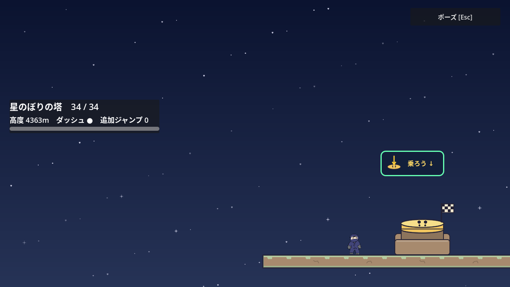
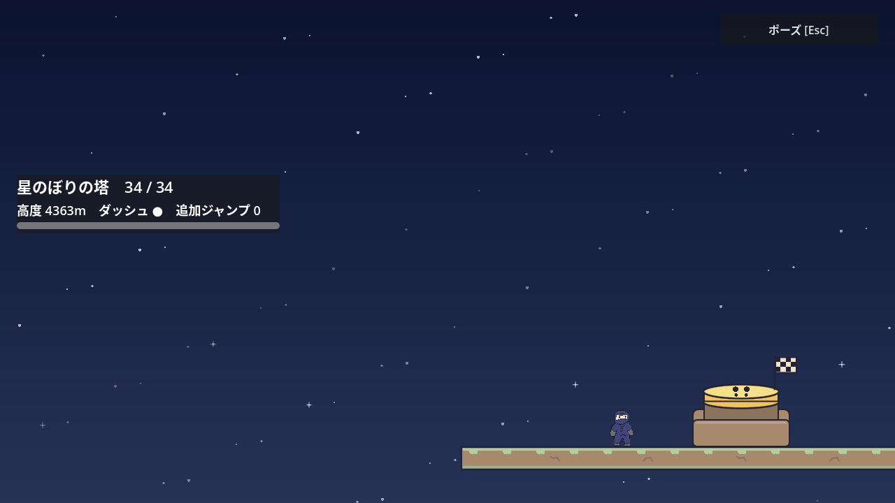
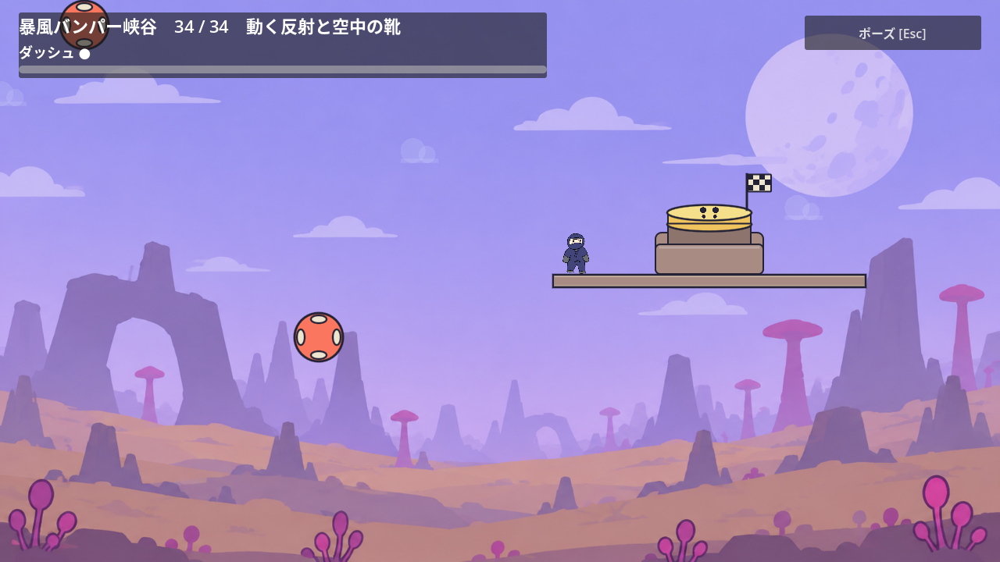

# ポーズメニュー

状態：合意した仕様を実装済み。

2026-10-30の第1面改修で、全プレイ画面のメニューに「操作設定」を追加した。省略できる映像演出中だけ「演出をスキップ」を表示する。閉じる際は開く前の停止状態を復元し、第1面の必須ダッシュ入力待ちでは停止を維持する。第1面のガイドは条件に応じて表示し、従来の任意ヒント切替は設けない。以下の旧チュートリアルに関する導入記録は当時の挙動で、現在の仕様は [第1面改修](tutorial-stage-1-redesign.md)と[共通スキップ](cinematic-skip.md)を参照する。

## 確定した要件

- ステージ1〜5、環境プレビュー、開発用デモを含む全プレイ画面に導入する。
- Esc・Back／Selectでポーズメニューを開閉する。H・Y／△によるメニュー開閉は廃止する。環境プレビューのY／△による背景の停止・再開は維持する。
- 物理、ギミック、タイマー、部屋移動、背景を含むゲーム全体を停止し、メニューだけ操作できる状態にする。
- 「ゲームに戻る」「ヒントを表示」「チェックポイントからやり直す」「ステージ選択に戻る」を用意する。
- 単独実行では「全画面 [F11]」も用意する。切り替えてもポーズとフォーカスを保ち、全画面中は「ウィンドウ表示 [F11]」にする。埋め込み実行では無効にし、Godot側で表示を変更するよう案内する。詳細は[画面表示](display-settings.md)を参照する。
- ヒントが用意されていないステージでは、ヒントボタンごと非表示にする。
- ヒントは既存の表示切り替えを使い、表示中のボタン名を「ヒントを隠す」にする。切り替え後もポーズを維持する。
- ポーズからステージ選択に戻る際は「現在の進み具合は保存されません。戻ってもよろしいですか？」という確認画面を表示する。
- クリア表示からの帰還は確認なしにする。Enter・ゲームパッドA・クリックで戻れる既存操作を維持する。
- 重力方向にかかわらず、画面中央に暗幕付きで表示する。開いた直後は「ゲームに戻る」にフォーカスする。
- 帰還確認は「戻る」「キャンセル」で、最初は「キャンセル」にフォーカスする。確認中のEsc・Back／Selectではポーズへ戻り、ポーズ中はゲームを再開する。
- R・Startによるプレイ中のやり直しも維持する。

## やり直しとヒント

「チェックポイントからやり直す」は確認を挟まずポーズを閉じて再開する。本編では既存の復帰地点、チェックポイントのない開発用デモと環境プレビューでは開始地点へ戻る。リセットする物体や能力は既存のR・Startによるやり直しと同じ。

チュートリアルとステージ2〜5では、ポーズ内でヒントの表示を切り替えられる。チュートリアルの短い操作キーと矢印は常時表示し、到着台の案内枠は忍者や持っている物と重なる間だけ隠れて、離れると戻る。開発用デモの常設説明は表示したままにし、開発用デモと環境プレビューではヒントボタンを表示しない。

## 実装と確認

`scenes/pause_menu.tscn` と `scripts/pause_menu.gd` を全7シーンで共有する。ゲーム全体の停止にはGodot標準の `SceneTree.paused` を使い、メニューだけを常時処理する。ステージ側には既存のヒント切り替えを残す。

```sh
Godot_v4.7.2-stable_linux.arm64 --headless --fixed-fps 60 --path . --script res://tests/pause_menu_test.gd
```

導入時はGodot 4.7.2でステージ5を含む共通167項目がヘッドレスで成功した。当時の全12部屋の攻略、各部屋の退出、ステージ選択、共通クリア表示も対応するテストで確認した。

共通テストは `PAUSE_MENU_TEST_OK` と終了コード0が成功条件。`-- --screenshots` を加えて描画ありで実行すると、メニューと帰還確認の画像も保存する。


## 検証する動作

- クリア表示の入力が、ポーズや帰還確認の入力を先取りしないこと。
- ポーズ中に物体・移動ゲート・復活時間・到着台・部屋移動が進まず、再開後に続きから動くこと。
- 入力の長押しで開閉を繰り返さず、メニュー操作がジャンプ・ダッシュ・やり直しへ伝わらないこと。
- 帰還をキャンセルすると、進み具合を保ったままポーズへ戻れること。
- 選択画面への遷移後やステージへの入り直し後に、ポーズ状態を引き継がないこと。

既存のステージ選択・ステージ2〜5・環境プレビューのテストも共通ポーズへ更新した。クリア表示の既存テストでは、確認なしで帰還できる操作を維持する。

チュートリアルの既存テスト2本は終了時にObjectDBの警告を出す。変更前の部屋テストでも同じ4件の警告が再現し、共通ポーズのテストでは発生しなかった。

## Issue #205：最終到着台の文字もヒント設定へ合わせる

2026-10-28の[Issue #205](https://github.com/Foxy-null/2d-space/issues/205)では、ステージ2・5の最終到着台に残る「乗ろう↓」を既存のヒントON時だけ表示する。初回はOFFで、金色の足跡付き上面とチェッカー旗を保つ。ステージ2も初期化時に既存setterを呼び、HUD・補助ラベル・到着台の設定を揃える。

到着台の案内枠とアイコンは親の`_draw`で描くため、子Bubbleの表示だけを変えると描画が取り残された。解除演出後の静止画で、実setterのON画像と同状態を強制再描画した画像に9,885画素の差を確認した。共有`ArrivalSwitch`はBubbleの`visibility_changed`で再描画する1行を追加し、物理・進捗・残数表示の意味は変えない。チュートリアルのミッション残数はヒントOFFでも維持する。

### 設定・実攻略・描画の3観点

1. 共通Pauseテストへ、両ステージの初回OFF、実ボタンによるON/OFF、Retryで選択を維持する条件を追加した。旧処理は初期OFFと再OFFで失敗。改善後は実際の帰還と再入場も含め181項目成功。
2. チュートリアルの到着台・残数は既存89項目と描画状態388項目が成功。ステージ2の最終CP34は実Boot・反射・壁登り・到着を2,089項目、ステージ5の最終室は実移動反射と靴から到着まで3,495項目確認し、通常入力で11.35秒・17.12秒、死亡0。両driverには終了時ObjectDB2件の警告が残る。
3. Xvfb/OpenGLの表示fixtureは17項目成功。両ステージのON/OFF画像は同状態の強制再描画と相違0画素。近傍へ配置した状態から実際に落下して32px押し込み、クリアしても案内がOFFのままであることを確認した。チュートリアル第12室の残数も残る。主経路の実攻略とは別の表示・押下fixtureであり、同じ開始地点から全経路をプレイした検証ではない。







実機ゲームパッド、初見ユーザー、60Hz以外は未確認。
