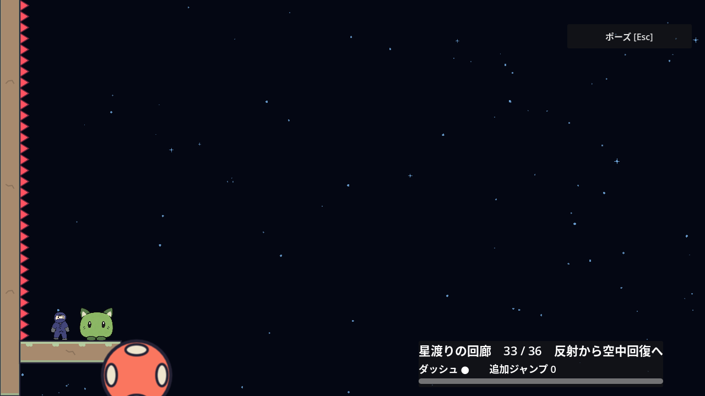
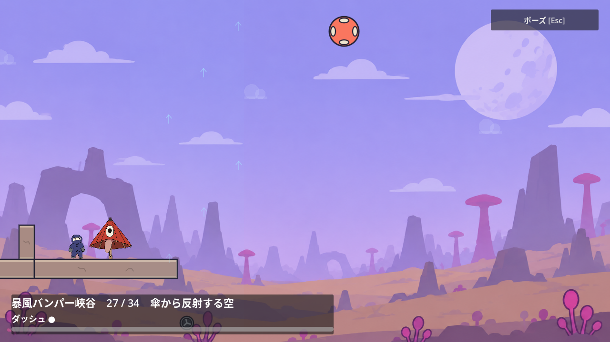

# ステージ4・5の部屋移動

2026-10-28。[Issue #193](https://github.com/Foxy-null/2d-space/issues/193)。[Celesteの一次資料と合意した方針](stage-3-navigation.md)に沿って、部屋の切り替わりで進行方向を見失う表示を改善する。

## 確認した問題と変更

従来は部屋番号と復帰位置を即時に更新した後、カメラだけを0.28秒かけて前室から動かしていた。左出口でも画面は大きく右へ流れ、次室のキャラや相棒が一時的に画面外やHUDの裏に隠れた。

| 境界 | 従来のカメラ移動 | 移動中の支障 |
| --- | --- | --- |
| ステージ4 第26→27室 | 右2,088・下1,181px | 17回の観測中、キャラは16回画面外 |
| ステージ4 第32→33室 | 右2,728・下367px | 11回画面外、終盤3フレームはHUDと重複 |
| ステージ5 第26→27室 | 右3,200・下901px | 17回の観測中、キャラは13回画面外 |

次室への復帰と同じ時点でカメラを到着位置へ合わせ、HUDも更新する。0.28秒の入力待機は既存のノードに結び付いたTweenで保ち、ポーズ中は待機も止まる。部屋番号の即時更新、通常移動時の未確定巻物の追従、リトライ時の取消は維持する。新しい説明文や矢印は追加しない。

## 3観点の検証

### 全境界の到着表示

新しい`room_transition_camera_test.gd`はステージ4の35境界、ステージ5の33境界を列挙する。出口へ配置してcontrollerを呼び、部屋番号・復帰位置・カメラ・HUDタイトルの同期更新、入力待機中の位置維持、プレイヤーと入口近くの実相棒の画像全体が画面内かつ可視HUDの外にあること、約17フレーム後の操作再開を確認する。

旧controllerを一時ファイルへ取り出した同テストは最初の第1→2室で失敗した。変更後はヒントOFF/ONとも全68境界・各8,739項目成功。全境界の確認で見つかった第17室の相棒の足先とHUDの重複も、情報パネルを右へ120px移して解消した。

### 実攻略と途中操作

代表の実攻略ではステージ4第32室が10,995項目、ステージ5第26室が4,058項目成功した。既存の共通ポーズ171項目と巻物の部屋移動50項目も成功し、移動途中のポーズ、Retryによる次室への復帰、通常移動とRetryでの未確定巻物の違いを確認した。

HUDを動かした第17室はヒントON・実入力1.0/0.8で、相棒と二つの天井を渡る実攻略3,904項目成功。次の天井の見通しとHUDとの間隔、実出口からの移動も保った。独立レビューでは切替途中のシーン離脱8ケース・60項目、ステージ5全33境界の空中退出をヒントOFF/ON各3,172項目確認し、いずれも終了0・エラーなし。最終判定はApprove。

### 描画

Xvfb/OpenGLでステージ4第16→17・26→27・32→33室、ステージ5第26→27室の計4境界を実入力で越す55項目に成功。切り替え待機中の画面外表示とHUD重複は全観測で0回だった。代表画像を目視し、次室のキャラ・相棒と更新済みのHUDが見えることを確認した。

出口へ配置してから実入力と着地で境界を越す描画用fixtureと、controllerを直接呼ぶ回帰テストは、実入口からの主課題の攻略とは区別する。実機ゲームパッド、初見ユーザー、60Hz以外の確認は含まない。
