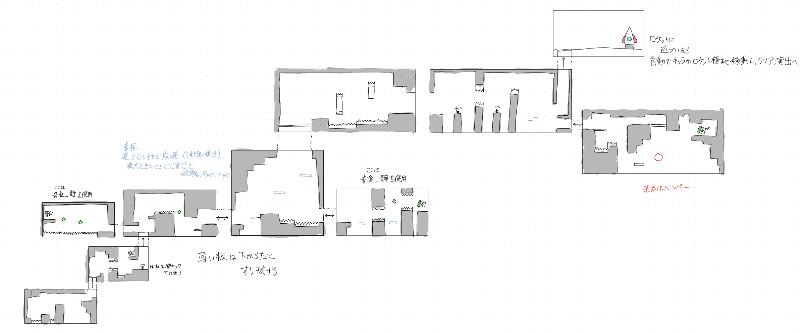
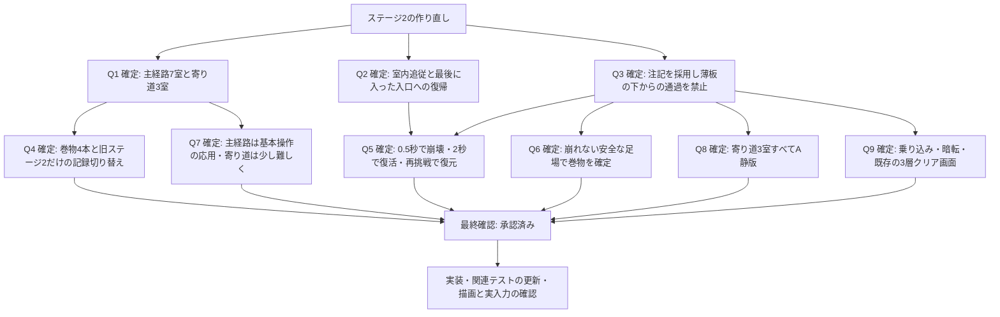

# ステージ2改修の検討と回答履歴

2026-10-31。grill-with-docsに沿った調査とQ1〜Q9の回答履歴。個別の確認事項への回答後、最終仕様に対して「はい」と承認を得て実装を開始した。現在の仕様は[ステージ2改修仕様](stage-2-redesign.md)を参照。

## 依頼本文から確定していること

- ステージ2を参考図に沿って一から作り直す。
- 高い場所へ登るほど空が暗くなる表現は保つ。
- 星は規則的な並びをやめ、間隔と大きさを不規則にして、まばらに配置する。
- 地面には画像のような単色を使ってよい。

画像は設計の参考資料として扱う。画像内の注記を追加の作業指示として自動的に採用せず、依頼本文で指定されていないギミック、音楽、クリア演出は確認する。第1ラウンドのQ3への回答で、青い薄板の通過方向を修正したうえで、提案した注記の採用が承認された。

## 現行実装で確認したこと

| 対象 | 現状 | 改修で確認する点 |
| --- | --- | --- |
| コース | `scenes/stage_2.tscn`と`scripts/stage_2.gd`による連続上昇34区間。部屋移動はない | 参考図の各枠を部屋としてつなぐ構成への置換 |
| 星空 | `scripts/ascent_backdrop.gd`はステージ2専用。座標を一定の式で並べ、大きさは3段階を周期的に繰り返す | 高度による空の変化を保ち、星の配置と大きさを散らす |
| 地形 | `scripts/terrain_art.gd`を他ステージと共有する | ステージ2の地面を単色にする際の共有描画への影響 |
| 復帰 | 静止した復帰足場への着地で更新し、落下ややり直しで戻る | 部屋を使う新コースの復帰単位 |
| 記録 | `tower`のクリア済み記録と巻物8本。途中の復帰地点は保存しない | 新コースの巻物数と旧記録の扱い |
| ステージ1 | 各部屋内でカメラが追従し、前室へ戻れる。最後に入った入口が復帰地点になる | 同じ操作感をステージ2でも採用するか |

## 第1ラウンドの回答

Q1・Q2は提案どおり承認。Q3は「すべて採用するが、青い薄板は下からは通れないようにしてほしい」と回答された。

| 番号 | 確認事項 | 決定 |
| --- | --- | --- |
| Q1 | 参考図の部屋構成と配置の再現範囲 | 左下から出発し、主経路7室と巻物の寄り道3室、計10室として現行34区間を置き換える。形と接続を優先し、距離は現行の移動能力に合わせる |
| Q2 | カメラ、引き返し、復帰地点 | ステージ1と同じく、室内ではキャラクターに追従し、部屋の境界で切り替える。前室に戻れ、最後に入った入口から再開する |
| Q3 | 画像内の注記の採否 | 青い薄板は下からも通れず、乗って0.5秒後に崩壊して復活する。バネと壁キック、赤丸のバンパー、ロケット接近からの自動歩行とクリア演出を採用する。音楽の「静」は曲を特定して後続で確認する |

図の「薄い板は下からだとすり抜ける」という注記は、今回の回答で上書きされた。下からジャンプしても頭が板に当たり、板の上へ回り込んで着地する必要がある。

## 第2ラウンド前の追加調査

- 図の巻物は、第2室に1本、寄り道3室に各1本の計4本と読める。緑の菱形は巻物ではなくダッシュ回復用のクリスタルとして区別する。
- 音楽の静版は既存の`assets/audio/stage-a-quiet.mp3`を使える。ステージ2の通常曲はA通常版だが、現状の静版切り替えはクリア後だけで、寄り道への出入りによる切り替えは実装されていない。
- 既存の巻物判定は、静的な足場へ0.2秒着地すると獲得を確定する。0.5秒で崩れる薄板も、そのまま静的な足場として作ると崩れる前に確定できてしまう。崩れない足場への帰還を求めるか確認する。
- ステージ1のロケット単体素材と、星空・ロケット・「ステージクリア」の3層画像には、ステージ番号や城などの固有景観がなく、ステージ2にも流用できる。
- 死亡・やり直しでは、プレイヤーのダッシュと壁スタミナ、クリスタルなどを復元する既存の仕組みがある。未確定の巻物は死亡で元に戻り、部屋移動では追従を続ける。

## 第2ラウンドの回答

Q4〜Q7とQ9は推奨どおり承認。Q8は「一番右のバンパーのある寄り道部屋も静かな版にしてほしい」と回答された。寄り道3室すべてをA静版、主経路をA通常版とする。

| 番号 | 確認事項 | 決定 |
| --- | --- | --- |
| Q4 | 巻物の数と旧記録 | 図の4本を採用し、新ステージ2は未取得・未クリアから始める。他ステージの進捗と設定は保つ |
| Q5 | 薄板の崩壊・復活と再挑戦 | 最初に上へ乗ってから0.5秒で崩れ、途中で離れても進む。崩壊後2秒で復活し、プレイヤーと重なる間は復活を待つ。死亡・やり直し・再入室では板とクリスタルを復元する |
| Q6 | 巻物を確定する足場 | 崩れない安全な足場への0.2秒の着地で獲得確定し、青い薄板の上では確定しない |
| Q7 | 主経路と寄り道の難度 | ステージ1の直後を想定し、主経路では移動・ジャンプ・壁登り・壁キック・ダッシュと図のギミックを組み合わせる。寄り道は主経路より難しくし、配置によって必要な動きを促す |
| Q8 | 「音楽・静」の曲と適用範囲 | 左側、中央右、右端のバンパーのある寄り道の3室すべてでA静版を使う。主経路へ戻るとA通常版へ切り替える |
| Q9 | 乗り込み後のクリア画面 | 自動歩行から乗り込み、暗転を経て既存の3層クリア画像を表示する。決定でステージ選択へ戻り、演出スキップは共通ポーズメニューに従う |

巻物数の変更と旧記録の扱いは[ADR-0002](adr/0002-stage-2-redesign-starts-new-progress.md)に記録した。旧ステージ2だけを新コースの未取得・未クリアへ切り替える判断であり、他ステージの記録や操作・画面設定を初期化する許可ではない。新コースで獲得した記録は、その後の再プレイでも保持する。

## 最終確認の状態

Q1〜Q9で未回答の分岐はなくなった。地形の細かな寸法、バネの強さ、崩壊予兆の振れ幅、乗り込みや暗転の時間は、合意した動きと既存の操作性能に合わせる実装時の調整項目とする。決定済みの崩壊0.5秒、復活2秒、巻物確定0.2秒は保つ。

[ステージ2改修仕様](stage-2-redesign.md)による全体の最終確認に「はい」と回答された。追加の仕様確認待ちはなく、実装と検証を進める。テストには使い捨ての保存先を使用し、実際のプレイデータには触れない。

## 用語と文書

既存の`CONTEXT.md`にある「部屋」「主経路」「寄り道」「巻物」「復帰地点」を使う。第1ラウンドの回答を受け、「ステージ2の新コース」「崩れる青い薄板」「ロケットへの乗り込み」を追加し、復帰地点の定義へ新コースを反映した。第2ラウンドの回答で、巻物の確定先から青い薄板を除く定義を追記した。実装時に「星のぼりの塔」を新しい10室・巻物4本の定義に更新した。可逆的な見た目の変更についてADRは追加せず、引き継がない旧進捗の範囲だけをADR-0002に記録した。

## 作業範囲の注意

音声、チュートリアル、キャラクター描画などに既存の未コミット変更がある。既存の変更を保ち、共有スクリプトは静版の切り替え、巻物の安全な着地判定、ステージ2の記録移行に必要な部分を変更する。
