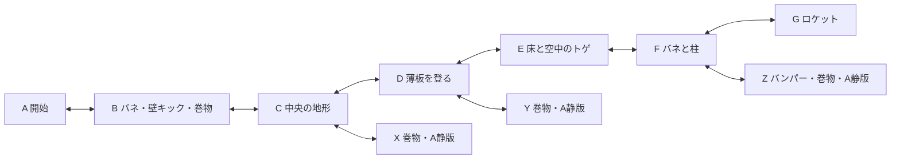

# ステージ2改修仕様：部屋をつないでロケットへ

状態：元図との再照合・追記経路の確認中。2026-10-31。Q1〜Q9の回答後、全体の最終確認で実装を承認された。[回答履歴と調査](stage-2-redesign-decisions.md)、[実装・検証の記録](stage-2.md)を参照。

## コース

現行のステージ2全34区間を、参考図の主経路7室と寄り道3室、計10室へ置き換える。既存のステージ2の入口と名称「星のぼりの塔」を引き継ぐ。

図の地形の形と接続、トゲ、薄板、バネ、クリスタル、バンパー、巻物とロケットの位置関係を優先する。元画像から輪郭を取り直し、全室共通の縮尺で小さくする。クリアのために図にない中継床や高い棚を追加しない。追記された緑の移動・ジャンプ・壁キックと青のダッシュの経路を基準に動作を照合する。

この仕様では主経路をA〜G、寄り道をX〜Zと呼ぶ。ゲーム内に表示する番号ではない。

| 部屋 | 図の位置と内容 | 接続と巻物 |
| --- | --- | --- |
| A | 左下の開始部屋。柱とトゲを越えて右上へ | Bへ |
| B | Aの右上の小部屋。バネと壁キックを使う | Cへ。巻物1本 |
| C | Bの上の横長の部屋。中央のトゲ付き地形を越える | Dへ。左の寄り道Xへ戻れる |
| D | 中央の縦長の部屋。青い薄板をつないで上へ登る | 上のEへ。右の寄り道Yへ戻れる |
| E | 上段左の横長の部屋。床と空中のトゲを避ける | Fへ |
| F | 上段中央の横長の部屋。バネとトゲ付きの柱を越える | 上のGへ。右の寄り道Zへ戻れる |
| G | 最上部のロケットがある部屋 | 接近から自動で乗り込み、クリアへ |
| X | Cの左側。床のトゲと空中の回復クリスタル | 巻物1本。Cへ帰還 |
| Y | Dの右側。薄板と上下のトゲ付き地形 | 巻物1本。Dへ帰還 |
| Z | Fの右側。赤丸のバンパーと右上の棚 | 巻物1本。Fへ帰還 |

主経路はステージ1の直後に遊ぶ基本操作の応用、寄り道はそれより少し難しい課題にする。配置によって必要な動きを促し、巻物を取らずにロケットへ到達できるようにする。

## 部屋移動・カメラ・復帰

- ステージ1と同様、各室内ではカメラがキャラクターに追従する。大きい部屋の端では追従を止め、画面より小さい部屋は中央に収める。各室は固定カメラの一画面とは限らない。
- 通り口を越えると隣室へ切り替える。主経路も寄り道も引き返せる。
- 部屋の切り替えがチェックポイント。死亡とやり直しでは、現在の部屋へ最後に入った入口へ戻る。
- トゲへの接触とコース外への落下では復帰する。再開時はダッシュと壁スタミナを回復し、板とクリスタルを初期状態へ戻す。
- 再入室でも、その部屋の板とクリスタルを初期状態へ戻す。部屋移動中は未確定の巻物の追従を維持する。
- ステージ選択から入り直したときはAから始め、確定済み巻物とクリア印を引き継ぐ。

## 青い薄板

青い薄板は上から着地でき、下からはすり抜けられない。図の「下からだとすり抜ける」という注記は、Q3の回答で上書きされた。

- 最初に上へ乗ってから0.5秒後に崩れる。途中で飛び降りても、そのカウントは進む。
- 崩壊前は揺れで予兆を示し、崩壊中は足場の当たり判定をなくす。
- 崩壊後2秒で復活する。プレイヤーと重なる間は復活を待ち、復活した板に閉じ込めない。
- 死亡・やり直し・再入室では、待ち時間を残さず初期状態へ戻す。
- 巻物の獲得を確定できる安全な足場には数えない。

## 巻物と記録

巻物はB・X・Y・Zの4本。接触すると仮取得して追従し、崩れない安全な足場へ0.2秒着地すると獲得確定する。青い薄板の上では確定しない。確定前の死亡・やり直しで元の場所へ戻り、確定後は死亡・帰還・再起動でも保持する。

旧ステージ2の巻物8本とクリア印は新コースへ引き継がず、新コースを未取得・未クリアから始める。この切り替えは一度だけとし、新コースでの達成を再読込や再プレイのたびに消さない。他ステージの進捗と操作・画面設定は保つ。[ADR-0002](adr/0002-stage-2-redesign-starts-new-progress.md)に判断の理由を記録する。

## 背景と地形

- 上へ登るほど空が暗くなる既存の表現を保つ。部屋の位置と室内の高さに対応させ、部屋番号だけで空の明るさを決めない。
- 星は少量をまばらに散らし、位置・間隔・大きさを不規則にする。毎フレーム配置が変わったり、一定間隔の列に見えたりしないようにする。
- 地面は参考図のような灰色の単色とし、見える地形と当たり判定を合わせる。青い薄板や危険物、回復クリスタルは区別できる見た目を保つ。
- 既存のプレイヤー性能と他ステージの描画を、この改修のために一括変更しない。

## 音楽とクリア

主経路A〜Gでは既存のA通常版を使う。寄り道X・Y・Zの3室ではすべてA静版を使い、主経路へ戻るとA通常版へ切り替える。右端のバンパー部屋も静版に含める。

Gでロケットへ近づくと、忍者が自動で入口まで歩いて乗り込む。乗り込みから暗転し、既存の星空・ロケット・「ステージクリア」の3層画像を使った画面を表示する。決定でステージ選択へ戻る。クリア印の保存と既存のクリア音・静版への遷移に対応させる。

自動歩行・乗り込み・暗転の演出は共通ポーズメニューの演出スキップに対応させる。演出の途中でポーズややり直し・帰還を使った場合も、操作や進行状態が残らないようにする。

## 実装時の調整と確認

地形の寸法、バネの強さ、揺れの大きさ、乗り込み・暗転の時間は、上記の動きと既存の操作性能に合わせて調整する。確定済みの崩壊0.5秒、復活2秒、巻物確定0.2秒は保つ。

| 確認対象 | 合格条件 |
| --- | --- |
| コース | 実入力でAからGへ進める。X・Y・Zへ寄って元の部屋へ戻れる。巻物なしでもクリアできる |
| カメラと復帰 | 各通り口を両方向へ移動でき、最後に入った入口への復帰と部屋の端の表示が整合する |
| 薄板 | 下からの通過を防ぎ、上への接触から0.5秒で崩れ、崩壊後2秒で復活する。プレイヤーとの重なりと再挑戦を扱える |
| 巻物 | 配置・表示総数とも4本。薄板では確定せず、崩れない床への0.2秒着地で確定する。死亡・部屋移動・保存・再読込が整合する |
| 旧記録 | 旧ステージ2だけを未取得・未クリアへ切り替え、新しい取得・クリアは再起動後も残る。他ステージと設定は保持する |
| 見た目 | 低所・中間・高所を描画し、高度に応じた空の変化、不規則な星、単色地形と当たり判定の一致を確認する |
| 音楽 | 寄り道3室すべてで静版、主経路で通常版。ポーズ・やり直し・帰還・クリア後の遷移も整合する |
| クリア | 接近・自動歩行・乗り込み・暗転・3層表示・決定での帰還と、演出スキップが動く |

旧34区間に固有の攻略テストは新コースの検証へ置き換え、ステージ選択、共通ポーズ、巻物、音楽、保存の関連チェックを更新する。テストには使い捨ての保存先を使う。
