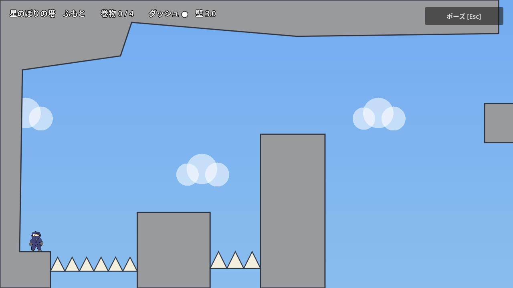
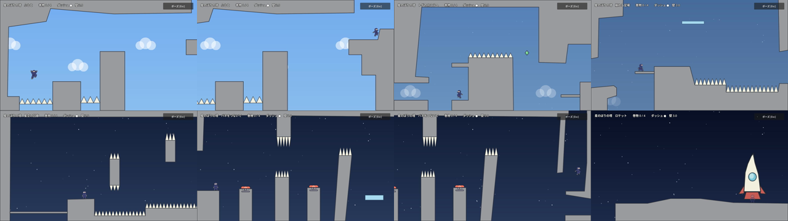

# ステージ2：星のぼりの塔

2026-10-31。参考図に沿って、旧34区間を主経路7室・寄り道3室の計10室へ作り直した。[合意した仕様](stage-2-redesign.md)、[Q1〜Q9の回答履歴](stage-2-redesign-decisions.md)を参照。

## コースと復帰

左下のふもとから出発し、バネと壁キック、トゲのある回廊、崩れる青い薄板をつないで、最上部のロケットを目指す。巻物は第2室と寄り道3室に各1本、計4本。巻物なしでも主経路を最後まで進める。

各部屋は1280×720以上とし、通常の倍率で部屋の端までキャラクターを追う。部屋の境界で切り替わり、前室と寄り道へ引き返せる。死亡・R・ポーズメニューのやり直しでは、現在の部屋へ最後に入った入口に戻る。再入室や再挑戦では板とクリスタルを復元する。

青い薄板は下から通れず、最初に上へ乗ってから0.5秒後に崩れる。離れてもカウントは続き、崩壊後2秒で復活する。プレイヤーと重なる間は復活を待つ。巻物は薄板では確定せず、崩れない安全な床へ0.2秒着地して確定する。

## 見た目と音楽

地形は灰色の単色。上へ登るほど空が暗くなり、星は位置と大きさを固定した不規則な配置でまばらに散らす。寄り道3室すべてで既存のA静版、主経路ではA通常版を流す。

以下は各部屋の輪郭を確認するため、部屋全体が収まる倍率で撮影した。

## クリアと記録

ロケットへ近づくと自動で入口まで歩いて乗り込み、暗転して既存の3層クリア画像を表示する。決定でステージ選択へ戻る。共通ポーズメニューから演出をスキップでき、途中のやり直しや帰還でも操作状態を復元する。

保存形式はバージョン3。旧ステージ2の巻物8本とクリア印を新コースへ引き継がず、他ステージの進捗と操作・画面設定は保つ。新しい巻物4本とクリア印は、以降の再プレイ・再読込でも保持する。[記録移行の判断](adr/0002-stage-2-redesign-starts-new-progress.md)を参照。

## 参考図との再照合

全10室の輪郭を元画像の座標から取り直し、図にない中継床や高い棚は追加しない。各室ごとに縦横比を保ち、横1280・縦720をともに満たす倍率で配置する。キャラクターとギミックは通常サイズ、カメラは通常倍率の1.0。部屋が小さな箱として画面内に浮かぶ状態を解消した。

| 部屋 | 幅 × 高さ（ゲーム内px、四捨五入） |
| --- | --- |
| A | 1503 × 720 |
| B | 1280 × 748 |
| C | 1419 × 720 |
| D | 1280 × 1183 |
| E・F | 1611 × 720 |
| G | 1414 × 720 |
| X | 1510 × 720 |
| Y | 1419 × 720 |
| Z | 1595 × 720 |

[追記された操作経路](stage-2-redesign/route-reference.jpg)の緑は通常移動・ジャンプ・バネ・壁キック、青はダッシュ。緑の菱形はダッシュ回復クリスタルとして描画・動作する。

上段Eでは、壁つかみジャンプで1本目の柱を回り込み、右側面から次の柱へダッシュし、再び壁つかみジャンプで越える。柱間を戻る迂回は不要。Bの右端の細い外壁も当たり判定に含め、バネから壁を使って上へ進める。大きさに合わせてB・FのバネとZのバンパーの強さを調整した。

## 壁つかみジャンプ

壁をつかんでジャンプすると、重力に逆らう方向へ通常のジャンプ速度で跳ぶ。通常重力では真上、逆さでは下、左右の重力ではそれぞれ重力の反対方向になる。ジャンプを短く離すと高さも短くなる。上昇中はつかみ直しで勢いを打ち消さず、横方向は通常の空中操作で調整できる。

1回につき壁スタミナを0.5使う。つかみを離すか、壁から離れる方向を入れてジャンプすると、従来どおりスタミナを使わない壁キックになる。スタミナが尽きても壁キックは使える。ダッシュ、バネ、重力変更、気絶、やり直しで上ジャンプの状態を解除する。既存のジャンプ、壁キック、ダッシュ自体の速度は変更しない。

## クリア映像

[開始から無死亡クリアまでの動画（MP4、41.82秒、1280×720・60fps・音声あり）](videos/stage-2-clear.mp4)

実際のゲームに移動・ジャンプ・つかみ・ダッシュを入力したリプレイをGodotのMovie Makerで収録した。AからGまで位置の強制変更や演出スキップを使わず進み、ロケットへの自動歩行、乗り込み、3層クリア画面まで記録している。撮影用の引いたカメラは使わない。

## 実装と確認

- `scripts/tower_landscape.gd`：元画像の各枠、共通縮尺、地形・トゲ・通り口・ギミック。描画と当たり判定は同じ輪郭を使う。
- `scripts/stage_2.gd`：部屋の移動と復帰、部屋の中に表示範囲を収めるカメラ、音楽、クリア演出。
- `scripts/tower_refill_crystal.gd`：既存のダッシュ回復動作を継承した、ステージ2用の緑の菱形。
- `scripts/crumbling_platform.gd`：従来どおり下から通れず、0.5秒で崩壊し、2秒で復活する。
- `scripts/ascent_backdrop.gd`：縮小後の実高度に空の変化を合わせる。不規則な星の配置は保持する。
- `tests/stage_2_reference_test.gd`：元画像の灰色面と実地形を比較する。灰色で塗られていないGを除く9室でDice係数80%以上。手描きの線幅や白抜きの柱を含むため、画像との完全一致は要求しない。
- `tests/stage_2_test.gd`：全通り口の往復、入口復帰、部屋サイズとカメラ、トゲ・落下、板、巻物、静版、乗り込み。
- `tests/stage_2_route_test.gd`：位置の強制変更を使わず開始地点からロケットまで連続攻略する。巻物の回収・帰還も確認する。

Godot 4.7.2のコピーしたプロジェクトと使い捨ての保存先で確認した。

- 壁つかみジャンプ：30・60・120fps、左右の壁、4方向の重力、長押し・短押し、スタミナ消費、通常壁キック、疲労時、やり直しの264項目。
- 既存の壁キック：運搬物や風を含む684項目。連続キックがステージ外死亡に入るテスト条件を修正し、壁キックそのものを確認する。
- ステージ2：各室の最小サイズ、カメラ範囲、全通り口の往復と復帰、薄板、トゲと落下、巻物、静版、クリアの151項目。全室・通常倍率の3場面・クリアを描画して165項目も通過。
- 実入力経路47項目：無死亡の主経路A→G、緑のクリスタルによる再ダッシュ、巻物4本の回収と帰還。Zはバンパーで巻物の棚へ届くことを確認し、獲得確定後にRで入口へ戻ってFへ帰還する。
- 元画像の灰色面との比較：9室のDice係数が80%以上。白抜きのGの床は画像照合の対象外。
- 背景12項目、ギミックの再接触33項目、開始アイリス605項目、死亡アイリス142項目、基本操作と壁スタミナ表示も確認した。

実機ゲームパッド、初見プレイヤーの難度評価、全ステージの全テストは実施していない。新バージョンの公開は行わない。
