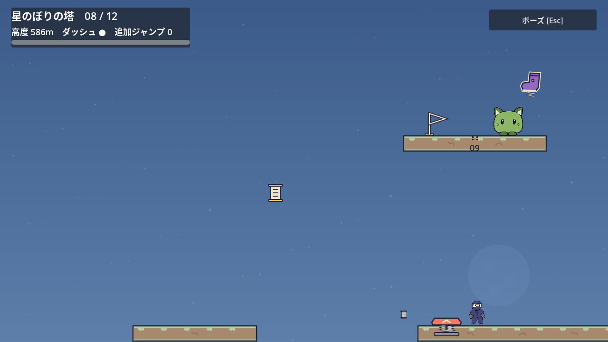
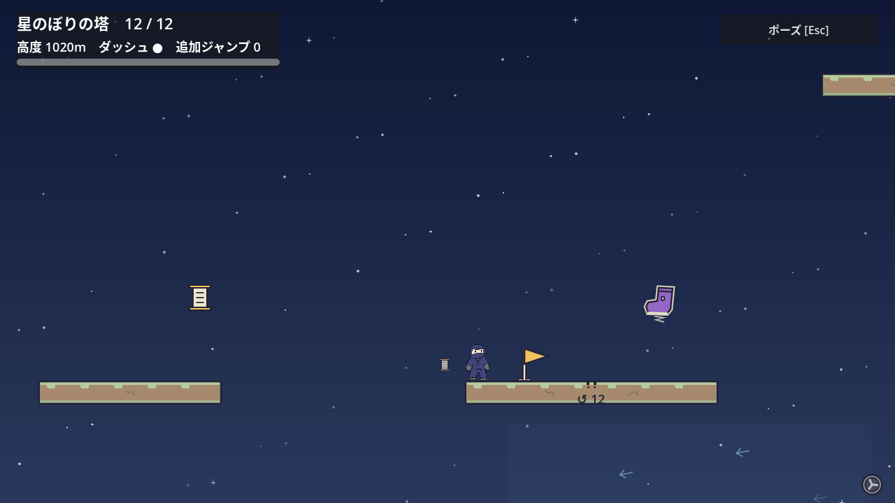
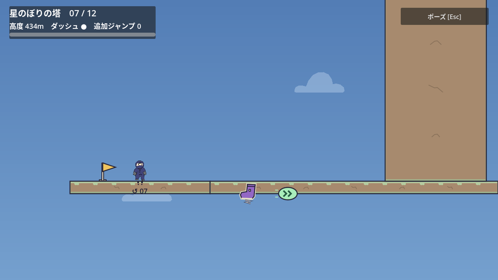
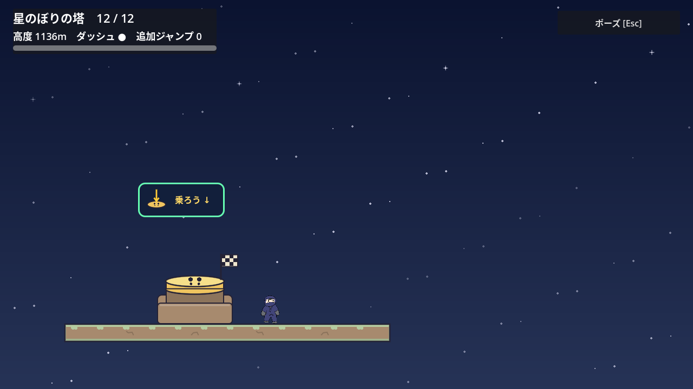

# ステージ2：星のぼりの塔

## コース

上へ登るとカメラが連続して追従する全12区間の縦コース。既存の6テーマとCP03の横枝を保ち、後半に6つの応用区間と2つの巻物ルートを加えた。入口の床はy640、頂上はy-10700で、全体の上昇量は11340px。CP01〜07までは720pxずつ、その先は操作の組み合わせに合わせて高低差を変えている。各区間に広い復帰足場を置き、区間の途中にも休憩や次の配置を観察できる足場を設ける。

| 区間 | 次の床まで | テーマ |
| --- | ---: | --- |
| 1 | 720px | 地上から壁を掴み、430px上の広い足場へ。休んで次の旗へ |
| 2 | 720px | バネで高い休憩足場へ。次のバネで旗へ |
| 3 | 720px | 空中の緑のクリスタルでダッシュを回復し、上へのダッシュをつなぐ |
| 4 | 720px | 紫の靴で追加ジャンプを得て、上ダッシュと組み合わせる |
| 5 | 720px | 生物を保持して追加ジャンプ。着地して回復し、次の旗へ |
| 6 | 720px | バネから上ダッシュし、回復ダッシュや靴の追加ジャンプを選んでCP07へ |
| 7 | 960px | 600pxの壁を登り、休憩から回復ダッシュや運搬した相棒をつなぐ |
| 8 | 960px | 右のバネから左へ折り返す。途中の休憩から次のバネへ |
| 9 | 1080px | 相棒と靴の追加ジャンプを重ねて540pxずつ、右の棚と左の復帰足場へ渡る |
| 10 | 1720px | 相棒を保持して1200pxの対向壁をキックで登り、休憩から相棒ジャンプで右へ渡る |
| 11 | 1140px | バネで浮いた反射板の上へ回り込み、反射と上ダッシュで横風を越える |
| 12 | 1160px | 靴で右の棚へ渡り、バネと空中の追加資源で左の頂上へ折り返す |

通常重力で登る。壁アクションとダッシュは最初から使用可能。着地回数による失敗条件は設けず、小さな足場はダッシュ・壁スタミナの回復や休憩に使える。第2区間は入口のバネがないと中間足場へ届かない。区間内の外壁を分断し、通常ジャンプ・8方向ダッシュ・壁登りによる迂回を防ぐ。入口のバネは上向き1450px/s、中間のバネは1100px/s。操作履歴による進行ロックは設けず、地形と既存バネで誘導する。第3区間も外壁を分断し、クリスタルによる回復と複数回のダッシュを必要とする。クリスタルはx740の列に200px間隔で並び、上昇中に次の目標が見える。出口足場は厚さ32pxで、下の側面を長く登る迂回を防ぐ。第4区間の外壁も分断する。最初の休憩足場は幅300px・厚さ16pxとし、通常ジャンプとダッシュでは側面へも届かない440pxの高低差にする。靴は2個とし、次の跳躍から見える位置に置く。右端の休憩足場からCP05へ長く折り返し、2個目の靴もx960へ離す。CP05を片面足場にして下の側面を登れなくし、CP05から前区間の靴を取り戻して相棒の代わりに運ぶ経路を防ぐ。第4区間だけカメラの上方余白を40px広げ、右端の足場をポーズボタンの下に見せる。第5区間は幅360pxの片面足場を使い、壁掴みや相棒を踏み台にする迂回を防ぐ。相棒はCP05中央から右へ離して置き、地上から掴める。途中の着地で相棒の追加ジャンプを回復する。代わりに使えていた靴3個と、この区間の外壁・中継足場を取り除く。第1区間は通常ジャンプとダッシュだけでは届かない430pxの壁を使い、最低1回の壁登りまたは壁キックを必要とする。壁の上は幅260pxあり、着地してダッシュとスタミナを回復できる。途中で手を離しても下の連続床へ戻り、その場でやり直せる。区間内に踏み台の生物や回復アイテムは置かない。既存の任意ヒントも現在の配置に合わせ、新規ラベルは増やさない。

第6区間は外壁と中継3足場を取り除く。CP06を左へ60px広げ、入口の1280px/sのバネをx760へ置いて、旗と前区間からの着地位置を空ける。Springなしでは、相棒に乗ってから掴んで跳ぶ方法と保持ジャンプ・ダッシュを組み合わせても空中のクリスタルへ届かない。バネと最初の上ダッシュから、y-3650に並ぶDash CrystalとJump Crystalへ進む。両方をつなぐ経路のほか、手ぶらでも回復ダッシュだけ・靴だけの選択経路で到着できる。両クリスタルの使用を個別に必須とする履歴ロックは設けない。前区間から相棒を保持したまま運んでも通過できる。第6区間の出口は広いCP07の足場に置き換え、元の到着台は第12区間の頂上へ移した。CP07右の床は片面足場とし、従来のクリスタルへ飛び込む経路を塞がない。

## CP03の巻物ルート

バネ区間の後、CP03の左端に小さな巻物の印を置く。左へ近づくとカメラが横へ動き、空隙の向こうの幅260pxの足場と巻物を見せる。足場の端どうしは340px離れており、通常ジャンプだけでは渡れない。ジャンプの頂点近くで左へダッシュし、空中の巻物に触れて向こう側へ着地する。帰りもジャンプと右ダッシュで同じCP03へ戻る。着地でダッシュを回復でき、往復の間に回復アイテムは必要ない。

巻物の識別子は `tower / left_balcony_01`。接触すると追従し、安全な足場に0.2秒着地したら獲得を確定して保存する。確定前の落下やRでは元の位置へ戻り、確定後は落下・R・ステージ選択への帰還でも保存を保つ。追加2本を含む塔全体の配置総数は3個で、この1本だけ取得した場合は `1 / 3` を表示する。

寄り道の足場はCP03と同じ高さに置き、上へ登る足場・壁・クリスタルは増やさない。前半の6テーマとチェックポイントを保ち、巻物を取りに行かずに先へ進める。落下は従来のCP03から180px下の判定で戻し、新しい長距離の復帰は設けない。これは最初の横枝の追加であり、合意した本編9〜15分への増量全体は今後も続ける。


## 後半の応用と巻物ルート

第7区間は前区間から相棒を持って来られるため、入口を広い連続床にする。相棒を置いて壁へ歩き、600pxの壁を登る。上は幅260pxの休憩足場で、空中の緑のクリスタルと次の復帰足場を見ながら飛べる。前半から運んだ相棒を離れた場所から壁上へ投げ渡し、手ぶらで登って再取得する選択経路もある。再取得後に一度ジャンプして着地すると相棒を回復でき、回復クリスタルの代わりに使える。壁アクションはどちらでも必要とする。

第8区間は最初のバネで560px上の左の棚へ向かう。上昇を早い横ダッシュで止めず、頂点付近で左へ渡る。棚には幅440pxの余裕があり、次の小さなバネで400px上のCP09を目指せる。巻物の印からさらに左へ逸れ、小さなバネと斜めダッシュで空中の `tower / spring_turn_02` に触れ、幅260pxの別の棚へ着地する。帰りはジャンプと横ダッシュで元の棚へ戻る。分岐側に新しい復帰地点は置かず、CP08からのやり直しを保つ。

第9区間は安全な入口で相棒を保持し、靴の追加ジャンプと相棒の追加ジャンプを重ねて540px上の右の棚へ渡り、同じ高低差で左へ戻る。前区間から運んだ相棒もそのまま使える。440pxの高低差では相棒だけで靴を代用できるため、両方の空中資源をつなぐ高さにした。靴の区間では上方余白を260px、最後の最初の跳躍では160pxとして、次の棚やバネがポーズボタンに隠れないようにする。CP10の床は幅600pxあり、飛距離が少し短くても着地して旗へ歩ける。再開用の相棒は着地経路から離したx700に置き、運搬して来た相棒を持つプレイヤーの上昇を塞がない。第10区間は入口で相棒を保持し、対向する壁をキックで登る。短い壁では上ダッシュと同時に相棒を上へ投げ、手ぶらで壁を登って回収することで壁キックを省略できたため、壁を1200pxへ伸ばした。壁の上は幅360pxの休憩足場とし、相棒の追加ジャンプを回復してから440px上のCP11へ渡る。操作履歴による通行制限は加えていない。

第11区間は1650px/sのバネで浮いた丸い反射板の上へ回り込む。反射板は下から当たっても上昇を与えず、下降中に上面へ触れると1200px/sで跳ね返す。初めのバネから上面が見えるよう、カメラの上方余白を300pxにする。反射後だけ横風の領域へ入り、上ダッシュを合わせて左のCP12へ着地する。復帰足場を風の上へ置いて、立ち止まって次を観察できる。

CP12の左にも巻物の印を置く。空隙の向こうの棚へジャンプと斜めダッシュで渡り、`tower / wind_rest_03` を獲得して同じCP12へ戻る。両枝とも左右へ近づくとカメラが動き、巻物を取らずに主経路へ進める。第12区間は靴で右の棚へ渡り、棚のバネから左へ折り返す。緑のクリスタルでダッシュを回復して幅600pxの頂上へ着地し、到着台を押す。前区間から保持して来た相棒を、バネの頂点付近での追加ジャンプに使う選択経路も残す。バネと空中の追加資源を組み合わせる課題とし、両方の資源を使わせる履歴ロックは設けない。

今回の拡張は本編9〜15分という合意に向かう中間段階。操作を熟知した自動入力の所要時間と初見のプレイ時間を同一視せず、手動試遊での目標達成はまだ主張しない。





## 背景と地形

生活圏の惑星のふもとから、雲の上、星が見える上空へつながる。地表の街や山は序盤にだけ現れ、上昇すると下へ遠ざかる。雲と星には足場より遅い縦方向の視差を付け、空の色を高度に応じて滑らかに変える。

背景はプレイヤーを追うカメラの高さに合わせる。区間の境界では切り替えず、降下や落下からの復帰でも、その高さの景色へ戻る。地表の繰り返しや背景画像の縦引き伸ばしは行わない。足場・左右の壁は現行の生活圏の地形表現に揃え、見た目と当たり判定を一致させる。

背景の動作は `scripts/ascent_backdrop.gd`、地表と空の境目は `assets/environments/ascent.gdshader`、検証は `tests/ascent_backdrop_test.gd`。

## 復帰地点と落下

- 各区間の開始位置に幅240〜600pxの足場があり、端の小さな旗と中央の足跡で着地点を示す。未到達は中空の旗、現在の復帰地点は塗った旗と「↺」、到達済みは塗った旗と「✓」で区別し、番号を添える。旗と印に当たり判定はない。
- 上の区間の復帰足場に着地した時点で更新する。空中で通過するだけでは更新しない。
- 最高到達点から640px落ちるか、最新の復帰足場より180px下へ落ちると自動復帰する。
- R / Startも最新の復帰地点へ戻る。通常重力、速度0、ダッシュ・スタミナ回復、追加ジャンプなしで再開する。
- クリスタルを再出現させ、持てる生物を初期配置へ戻す。カメラも復帰地点へ戻る。
- 選択画面へ戻ると登塔中の復帰地点は破棄する。確定した巻物は保存する。

## 表示・操作

上部には塔の名前・区間番号・高度・ダッシュの使用可否・追加ジャンプ数・壁スタミナを表示する。ダッシュは使用可能なら「●」、使用済みなら「○」。復帰地点の番号を状態欄に重ねず、区間名と詳しい操作説明はヒント表示にまとめる。

Esc・Back／Selectまたは右上の「ポーズ [Esc]」で共通メニューを開く。背景・カメラ・物理・タイマーを含むゲーム全体を停止する。再開、ヒントの切り替え、最新の復帰地点からのやり直し、確認画面を経由するステージ選択への帰還を選べる。ヒントは初期非表示で、やり直しでも設定を保つ。詳しくは [ポーズメニュー](pause-menu.md) を参照。

頂上の到着台を押すとクリアを表示する。自動で画面遷移せず、メニューから戻れる。

## 実装と確認

- `scenes/stage_2.tscn`：Godotエディターで編集できる足場、壁、アイテム、復帰地点、UIの配置。
- `scripts/stage_2.gd`：連続カメラ、復帰更新、落下、ヒント、クリア処理。
- `scripts/player.gd`：既存の復帰範囲を有効・無効にする設定を追加。ステージ2・4では無効にし、ステージ側で落下を判定する。
- `tests/stage_2_test.gd`：実際の物理移動による全区間の登頂、復帰地点更新、クリア、落下復帰、メニュー、再入場を検証。各復帰地点の更新時に、旗と印の表示・非衝突・HUDの収まりも確認する。
- `tests/tower_scroll_route_test.gd`：入口から壁・バネを使ってCP03へ登り、横枝を往復して残りの全区間を登頂する。通常ジャンプだけで渡れない空隙、16/20/24フレームのダッシュでの巻物接触、未確定のR・実落下での復元、安全着地での保存、確定後のR・実落下、30秒以内の往復、横カメラ、ステージ選択の `1 / 1` と再読込を確認する。`-- --screenshots` を付け、描画可能な環境で実行すると入口・獲得・帰還のPNGを `docs/screenshots/tower-scroll/` へ保存する。
- `tests/tower_wall_route_test.gd`：地上から壁を掴む開始時機0/6/12フレームと休憩後のダッシュ16/20/24フレームの9組、途中で手を離す安全な着地・資源回復・R、通過後のCP02保持を検証。壁アクションを除いた通常Jump・8方向Dash144例と地上DashからのJump36例（実Superdash24例を含む）の計180例を、外壁側を含む3地点から確認する。
- `tests/tower_spring_route_test.gd`：入口から2個のバネを使う成功経路、8方向・6タイミング・4地点の計192通りのバネ非利用の迂回、落下からの安全復帰、通過後のチェックポイント保持を検証。
- `tests/tower_dash_route_test.gd`：クリスタル3個と実際の4回のダッシュを使う成功経路、回復無し・追加ダッシュ無しでの8方向・6タイミング・3地点の計288通りの迂回、回復したダッシュを使わない場合の安全復帰と全クリスタル復活、次のチェックポイント保持を検証。
- `tests/tower_extra_jump_route_test.gd`：靴2個と追加ジャンプ2回による成功経路を追加ジャンプ・ダッシュ各16/20/24フレームの9組で検証。靴無し・追加ジャンプ無しの8方向・6タイミング・3地点の計288通りの迂回、取得後に落下した場合の安全復帰と靴復活、次のチェックポイント保持も確認する。
- `tests/tower_companion_route_test.gd`：相棒を地上で保持して追加ジャンプを2回使う成功経路を、追加ジャンプ・ダッシュ各16/20/24フレームの9組で検証。相棒を取らない・保持しても追加ジャンプを使わない288通りと、実際に相棒へ乗る・乗って同時Grab/Jumpを行う96通りの迂回、CP05から前区間の靴を取り戻す144通りとレビューで見つかった落下回収・上ダッシュ帰還の再現入力、保持中の落下復帰と相棒再配置・残数初期化、次CP保持も確認する。
- `tests/tower_finale_route_test.gd`：Springから両クリスタルをつなぐ成功経路を、バネ後の上ダッシュ36/40/44フレームと靴後のダッシュ16/20/24フレームの9組で確認。片方ずつのクリスタルを使う選択経路、前区間からの実際の相棒運搬、取得後の落下・即Rでの安全復帰と両クリスタル復活、旧区間の出口となるCP07到達と保持を確認する。Springなしの通常ジャンプ・保持ジャンプ・相棒踏み台・踏み台から同時Grab/Jumpを含む480通り、手ぶらで両クリスタルなしの96通りの8方向・時機・壁迂回も検証する。
- `tests/tower_upper_route_test.gd`：後半6区間を連続した実入力で登り、入力強度100%・85%と追加ジャンプ／ダッシュ16・20・24フレームの代表3組、各区間30秒以内、落下なしでの頂上到達を検証する。描画時の `-- --screenshots` で実入力の各入口と頂上を保存する。`-- --screenshots --visual-only` は各CP・分岐・頂上へ配置した静止用fixtureを使い、実際の床への接触を確認してPNGを短時間で撮る。移動経路の成否とは区別する。
- `tests/tower_upper_requirements_test.gd`：後半の壁、手ぶらでの回復、2個のバネ、2個の靴、靴区間の相棒、壁区間の相棒、反射区間のバネ・反射板、頂上のバネ・手ぶらでの回復を省いた12種類について、8方向ダッシュと3時機を確認する。バネ・反射板を省く後半の負例では相棒を実際に前区間から運び、相棒壁には踏み台・上投げ・追加ジャンプの代表32例を加える。風と頂上のバネには、実際に運んだ相棒を踏み台にして同時Grab/Jumpと追加ジャンプを行う8方向各1例、計16例も加える。壁上への投げ渡しと、最後のバネからの相棒ジャンプは成功する選択経路として別途確認する。有限の入力例であり、全操作列を証明するものではない。
- `tests/tower_upper_scroll_test.gd`：入口から12区間を実入力で通過し、新しい巻物2本の未確定R・実落下、安定着地での確定、同じCPへの往復、確定後の保存とステージ選択の `2 / 3` を検証する。
- `tests/stage_select_test.gd`：第2ステージの有効化、方向キー・ゲームパッドでの選択を含めて確認。

```powershell
Godot_v4.7.2-stable_win64_console.exe --headless --fixed-fps 60 --path . --script tests/stage_2_test.gd
```

`STAGE_2_TEST_OK` と終了コード0を成功条件とする。実際に遊んだ際の難易度・テンポはプレイ感に応じて調整する。

2026-10-25にGodot 4.7.2 / Linuxで、`stage_2_test`、従来の巻物ルート、新しい2本の巻物ルート、上層の強入力・85%入力3組、背景・選択画面・ポーズ・巻物保存の関連試験が終了コード0で通過した。前半6テーマの壁・バネ・回復ダッシュ・靴・相棒・旧最終区間の負例と時機を含む各専用試験もすべて終了コード0で通過した。入口から12区間を通る試験では自然落下0で頂上へ着き、巻物試験では意図したRと実落下だけで5回復帰した。熟知した自動入力の本編は約55秒、後半の各区間は2.47〜8.60秒、新しい巻物の往復は4.68秒と4.50秒だった。これは初見のプレイ時間の測定ではなく、9〜15分の目標達成は未確認である。

上層の省略入力は12種類×8方向×3時機の288例、相棒壁の踏み台・上投げ32例、運んだ相棒を踏み台にする風・頂上のバネ省略16例、計336例を確認した。加えて、前半のCP05から相棒を実際に運び、壁上へ投げ渡して回収し、バネの折り返しも保持したまま通過する経路で、靴を省くと新しい540pxの棚へ届かないことを確認した。相棒を投げ渡して壁上へ運ぶ経路と、最終バネから相棒ジャンプを使う経路は、成立する空中資源の選択経路として成功試験に分けている。描画はXvfb / Mesaで各CP・分岐・頂上の実シーンfixture11枚を保存して目視した。分岐カメラは踏切より手前で左の着地点を見せ、上の棚とバネがポーズボタンに隠れない余白を取った。

到着台を押した直後に終了する試験では、以前からAudioStreamWAVとAudioStreamPlaybackWAVが各1個残る警告を確認している。既存の比較ではシーン解放後に100ms待つと消え、音声付きシーン生成・解放30回でObject・Resource・Node数は増えなかった。音声コードは今回変更していない。実機でのキーボード・ゲームパッドの手動試遊はまだ行っていない。

## 高度ごとの背景





