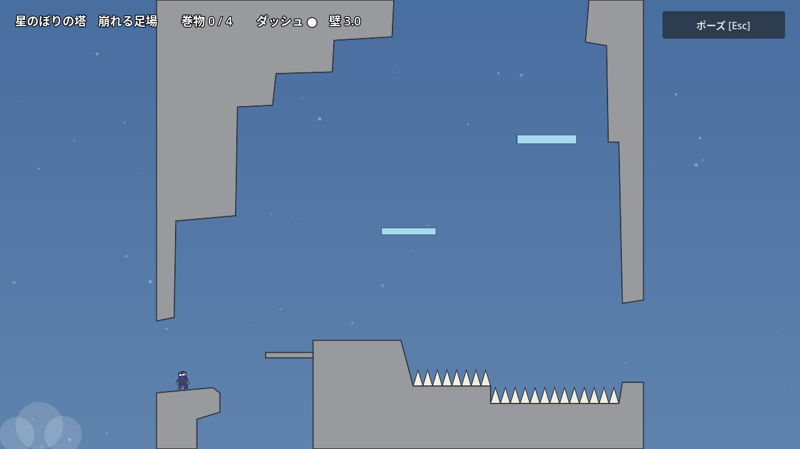
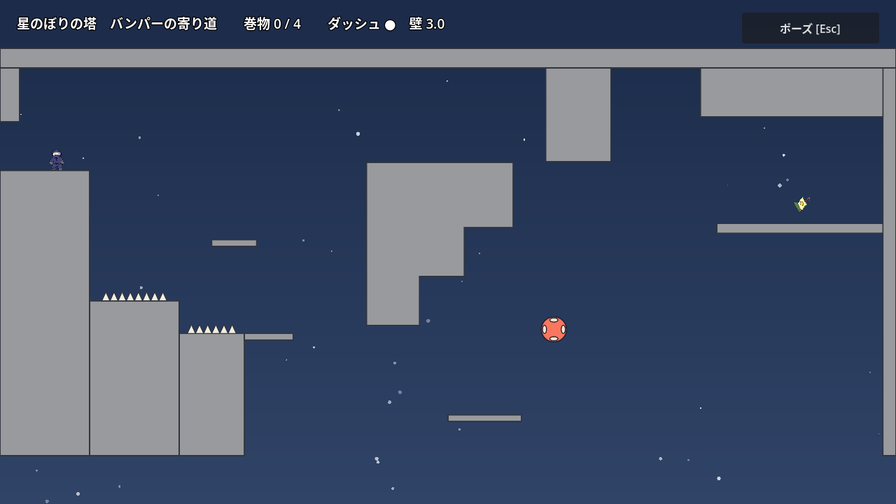
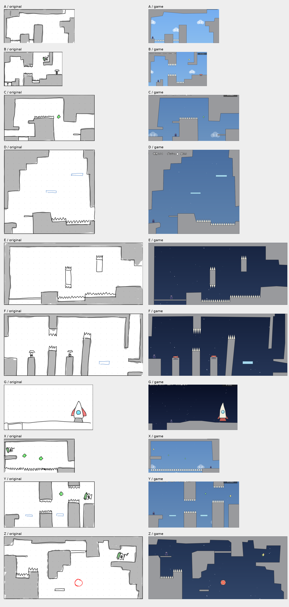

# ステージ2：星のぼりの塔

2026-10-31。参考図に沿って、旧34区間を主経路7室・寄り道3室の計10室へ作り直した。[合意した仕様](stage-2-redesign.md)、[Q1〜Q9の回答履歴](stage-2-redesign-decisions.md)を参照。

## コースと復帰

左下のふもとから出発し、バネと壁キック、トゲのある回廊、崩れる青い薄板をつないで、最上部のロケットを目指す。巻物は第2室と寄り道3室に各1本、計4本。巻物なしでも主経路を最後まで進める。

画面より小さい部屋はカメラを中央に収め、大きい部屋では部屋の端までキャラクターを追う。部屋の境界で切り替わり、前室と寄り道へ引き返せる。死亡・R・ポーズメニューのやり直しでは、現在の部屋へ最後に入った入口に戻る。再入室や再挑戦では板とクリスタルを復元する。

青い薄板は下から通れず、最初に上へ乗ってから0.5秒後に崩れる。離れてもカウントは続き、崩壊後2秒で復活する。プレイヤーと重なる間は復活を待つ。巻物は薄板では確定せず、崩れない安全な床へ0.2秒着地して確定する。

## 見た目と音楽

地形は灰色の単色。上へ登るほど空が暗くなり、星は位置と大きさを固定した不規則な配置でまばらに散らす。寄り道3室すべてで既存のA静版、主経路ではA通常版を流す。

以下は各部屋の輪郭を確認するため、部屋全体が収まる倍率で撮影した。

## クリアと記録

ロケットへ近づくと自動で入口まで歩いて乗り込み、暗転して既存の3層クリア画像を表示する。決定でステージ選択へ戻る。共通ポーズメニューから演出をスキップでき、途中のやり直しや帰還でも操作状態を復元する。

保存形式はバージョン3。旧ステージ2の巻物8本とクリア印を新コースへ引き継がず、他ステージの進捗と操作・画面設定は保つ。新しい巻物4本とクリア印は、以降の再プレイ・再読込でも保持する。[記録移行の判断](adr/0002-stage-2-redesign-starts-new-progress.md)を参照。

## 参考図との再照合

前実装は部屋ごとの引き伸ばしと足場の追加によって元図から離れていたため、全10室の輪郭を元画像の座標から取り直した。地形と通り口を同じ縮尺で小さくし、ゲーム内のキャラクターとギミック、通常カメラの倍率も合わせた。他ステージのプレイヤー設定は変更しない。

上段左の回廊に加えた中継床と、最後のバネ部屋に加えた高い棚を削除した。開始部屋の段差、第2室の巻物を囲うL字の地形、中央の付属する薄い足場、バネ部屋の長い天井壁、バンパー部屋の段状の地形を復元した。

さらに提供された[動かし方の追記](stage-2-redesign/route-reference.jpg)を操作経路の資料とする。緑は通常移動・ジャンプ・バネ・壁キック、青はダッシュ。緑の菱形はダッシュ回復クリスタルで、ステージ2では見た目も菱形にする。

現在、上段回廊の柱の上を回り込む緑の弧を照合中。既存の壁キックは壁と反対向きへ跳ぶため、緑の弧が壁つかみから上へ跳ぶ動きを含むか確認している。現在の連続攻略テストでは、柱間を一度戻る経路で通過できるが、追記された想定経路の成立を証明したものとは扱わない。

## 実装と確認

- `scripts/tower_landscape.gd`：元画像の各枠、共通縮尺、地形・トゲ・通り口・ギミック。描画と当たり判定は同じ輪郭を使う。
- `scripts/stage_2.gd`：部屋の移動と復帰、小さい部屋を中央に収めるカメラ、音楽、クリア演出。
- `scripts/tower_refill_crystal.gd`：既存のダッシュ回復動作を継承した、ステージ2用の緑の菱形。
- `scripts/crumbling_platform.gd`：従来どおり下から通れず、0.5秒で崩壊し、2秒で復活する。
- `scripts/ascent_backdrop.gd`：縮小後の実高度に空の変化を合わせる。不規則な星の配置は保持する。
- `tests/stage_2_reference_test.gd`：元画像の灰色面と実地形を比較する。灰色で塗られていないGを除く9室でDice係数80%以上。手描きの線幅や白抜きの柱を含むため、画像との完全一致は要求しない。
- `tests/stage_2_test.gd`：全通り口の往復、入口復帰、小さい部屋のカメラ、トゲ・落下、板、巻物、静版、乗り込み。
- `tests/stage_2_route_test.gd`：位置の強制変更を使わず開始地点からロケットまで連続攻略する。追記の緑・青の経路との照合は別途継続中。

Godot 4.7.2のコピーしたプロジェクトと使い捨ての保存先で確認する。現時点で、輪郭比較9室、主経路の死亡なしの連続攻略とX・Yの回収・帰還12項目、機能111項目、背景12項目、ギミックの再接触33項目、開始演出605項目、死亡演出142項目、ポーズ170項目が通過した。小部屋カメラを含めたOpenGL描画ありの124項目も通過し、全10室と通常倍率の2場面を撮影し直した。右端Zの想定経路の攻略確認は継続中。

全ステージの全テスト、実機ゲームパッド、初見プレイヤーによる難度評価は実施していない。新バージョンの公開は行わない。
