# ステージ3の部屋移動と進路の読みやすさ

2026-10-28調査。同日、ユーザーがQ1・Q2へ「両方推奨通り」と回答し、前室への任意の往復を残すこと、左向きの課題では到着台の先から次室へ進めることを確定した。改善ループを開始する。

## 今回の条件

- 最優先は、ステージ3で入室後に進む方向が分からず前室へ戻ってしまう問題。
- 文字や案内の追加に頼らず、入口の背後、進行側の空間、足場と出口の形で経路を伝える。
- 既存5ステージのテーマと基本操作を保つ。左右・上下の課題と巻物の寄り道を使い、同じ構成を繰り返して増量しない。重複する区間は短縮してよい。
- 巻物は任意。本筋と別方向へ入り、応用課題を越えて安全な足場へ戻る遊びを優先する。既存の仮取得・着地確定・保存・選択画面の表示を使う。
- 操作の使用履歴だけで出口を閉じず、狙った操作が必要になる地形を作る。入力の猶予と短い再挑戦を維持する。
- 合意後はタスク作成→検証→PR作成→PRレビュー→マージを繰り返す。各変更は通常攻略、復帰・迂回、描画の3観点で検証する。
- Weekly残量が5%未満、または100%近傍への大幅増加によるリセットを検知したら新規タスクを止め、既存タスクを完了してfastをオフにする。

既存の[改善方針](celeste-stage-design.md)と[探索・巻物の方針](celeste-exploration-design.md)は引き継ぐ。過去の部屋数・Weekly残量・fast設定は現在値と区別する。

## 変更前に確認できた原因

ステージ3は37室。次室への移動は右端、前室への移動は左端に固定されている。一方、第7・11・14・18・20・23・24・27・29・31・33・34・35・37室は右側から入り左へ課題を攻略する。

例えば第7室は入口X=1208、到着台X=130、次室へ進む出口X=1266。左の到着台まで進むと帰路の橋が開き、再び右端まで戻る必要がある。左端を越えると未クリアでも前室へ戻るため、課題を進める方向と前室へ戻る方向が重なる。復帰直後のキャラクターも入口の位置にかかわらず右を向く。

根拠：`scripts/stage_3.gd`の`_physics_process`・`_set_room`・`_update_room`、`scripts/player.gd`の`respawn`、`scenes/gravity_room_7.tscn`ほか各部屋のSpawn・Goal・ExitBarrier。

変更前のGodot 4.7.2、headless、固定60fpsの`tests/stage_3_test.gd`は、37室を入口から連続攻略して1,064項目成功した。これは既存の攻略が成立する確認であり、初見で方向が分かる証明ではない。

## Celesteの一次資料を再確認

- [Maddy Thorson「Celeste & Forgiveness」](https://www.maddymakesgames.com/articles/celeste_and_forgiveness/index.html)：崖を離れた直後のジャンプ、入力予約、壁ジャンプなどに猶予を設ける。必要な操作を配置で絞る場合も、踏切や入力の時機を極端に狭める理由にはしない。
- [開発元の製品ページ](https://maddymakesgamesinc.itch.io/celeste)：少数の操作による深さ、秘密のある多くの画面、素早い復帰を特徴に挙げる。本作でも既知の操作と短い再挑戦を使って探索に変化をつける。
- [GDCワークショップの登壇者インタビュー](https://www.gamedeveloper.com/design/gdc-2017-level-design-workshop)：地形による暗黙の学習と報酬を講演の題材として紹介する。開発者自身は部屋・エリア・ゲーム全体を見直し、合わない部分を削除・再利用すると述べる。部屋数を目標に同じ課題を増やさない方針につながる。
- [GDC講演](https://www.gdcvault.com/play/1024307/Level-Design-Workshop-Designing-Celeste)は再取得時もメンテナンス画面へ転送された。講演全体を確認したとは扱わない。Celeste本体をこの環境でプレイした結果でもない。

以下はこれらを踏まえた本作向けの提案であり、Celesteの厳密な配置規則や公称時間ではない。

## 合意した最初の改善

最初の案は、前室へ戻る遊びを残しつつ、入口の後ろを地形で区切り、課題へ進む空間を明確にすること。左右方向を統一する案も検討したが、その後の依頼には多方向への進行が含まれるため、全室の右向き統一を合意済みとは扱わない。

左向きの課題を残し、到着台へ進んだ方向に次室の出口を置く。逆向きに長く歩き直す帰路を次室への必須経路にしない。前室への戻り口は入口側へ区別して配置し、復帰時の向きも最初の安全な行動と一致させる。移動後の画面と、入ってきた通り口から空間のつながりが読めることを描画で確認する。

```text
今回の改善
├─ 説明文に頼らない、多方向の遊び、任意の巻物【ユーザー指定】
├─ 反復による水増しを避け、必要なら短縮【ユーザー指定】
├─ ステージ3の部屋移動を最優先【最初の問題を継続】
├─ 前室へ戻る遊びを残し、入口の地形で誤帰還を防ぐ【Q1：確定】
├─ 左向き課題を残し、到着台の先を次室の出口にする【Q2：確定】
└─ 方針全体を確認し、改善ループを開始【ユーザー回答：両方推奨通り】
```

## 変更が届く範囲

- 部屋の入口、出口、境界の衝突と描画、到着台、クリア後の橋、落下境界。
- 前進・後退の判定、復帰地点と向き、部屋の休止と再開、カメラの移動方向とスクロール。
- 風の世界座標方向、Springの発射面、移動ゲートとトゲの軌道、巻物と運搬物の復帰位置。
- 37室連続攻略、通常・弱入力、隣室との往復、R・落下・トゲからの復帰、巻物の仮取得と確定・保存。
- 現行の仕様・攻略用入力・固定座標の検証。経路を変えたのに旧期待値だけを残さない。

部屋全体の左右反転は行わない。風、Spring、移動ゲート、巻物と運搬物の配置を保ち、部屋の出口と復帰地点を変更する。

## 検証の合格条件

1. 通常入力と弱めの入力で入口からゴールへ進め、操作を変えた区間に十分な猶予がある。課題を避ける典型的な入力も調べる。
2. 誤った歩き始めで即座に前室へ戻らない。意図した往復、やり直し、落下、巻物の持ち越しで進捗・収集記録が壊れない。
3. ヒント非表示の描画で、入口の背後と主経路、巻物の枝、次の着地点・出口が区別できる。人による初見評価と自動入力の成功は区別する。

全入力列の不可能証明や、未実施の実機ゲームパッド・初見ユーザーテストは成功したと記載しない。

## Issue #181の実装

[Issue #181](https://github.com/Foxy-null/2d-space/issues/181)で、左向き14室の出口を左側に移し、前進・後退の判定を各室の課題方向へ合わせた。全37室の入口の背後には高さ72px・幅32pxの段差を置く。歩くだけでは前室へ戻らず、戻るときは通常ジャンプで越えられる。第19室は幅48pxでは跳ぶ際に既存の壁トゲへ当たったため、トゲと主課題を保って段差の幅を32pxにした。

復帰すると課題側を向き、前室へ戻った場合はその部屋の内側を向く。Returnは到着床に置き、到着台の台座とプレイヤーが重ならない位置に調整した。右端の空きが狭い部屋では到着台の手前を使う。到着済みの部屋でRを押しても、選択した入口・復帰地点と開いた出口を保つ。

部屋の配置は一本道の世界座標だが、課題は左右に変わるため、長い水平パンを0.28秒の短い暗転へ置き換えた。第35室では左出口へ傘を運ぶ新しい経路でHUDとの重なりが見つかった。到着前の床を見る先読みを残し、到着済み・通常重力のときだけ下方向の先読みを40px以下にする。

常設の案内は増やさない。任意ヒントの既存の文だけ、新しい出口方向へ合わせる。巻物10個と、その枝へ到着後に戻る遊びも残す。

### 3回の検証

1. 通常攻略と方向の確認：37室を実入口から連続攻略して1,095項目成功。入口・出口・R・意図した往復は全37室を通常入力と実axis 0.8で確認し、1,345項目成功。新しい境界テストでは移動だけを分離するためクリア状態を用意するが、連続攻略では実際の到着台を押して解錠する。
2. 復帰・往復・巻物：第7〜9室の全体775項目と迂回121試行、第10〜15室の通常・弱入力510項目と復帰386項目、第16〜21室の通常・弱入力228項目と往復87項目が成功。傘の復帰38,724項目、第26〜31室の復帰41,437項目、第32〜37室の復帰81,087項目も成功。室休止54項目と、他ステージを含む巻物の部屋移動50項目も成功した。巻物10本の各枝を実入力で確認し、第1室11項目、第10・14室169項目、第18・20室290項目、第22・24室82,640項目、第28・30室154,798項目が成功。第7室の巻物は上述の775項目に含む。後半の弱入力攻略も第26〜31室26,938項目、第32〜37室28,171項目が成功した。
3. 描画：Xvfb/OpenGLで第1・7・23・24・37室の入口・到着床・往復を93項目確認。別に第35室を入口から傘を持って攻略し、実際に左出口へ進む経路の描画とHUD非重複を7,826項目確認した。

追加の全迂回検証は実行環境から終了コード143で終了し未完走。失敗したassertはなく、変更に近い左向き第11・14室を別の短い実行に分け、入口の8方向ずつ計16試行・321項目は成功した。未完走の全入力例を検証済みとは扱わない。

独立コードレビューはApprove、重大な問題・必須修正なし。未使用になった右への必須帰路のテスト入力を削除した。実機ゲームパッド、初見ユーザー、60Hz以外は未検証。

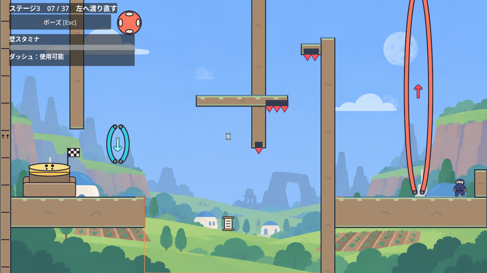

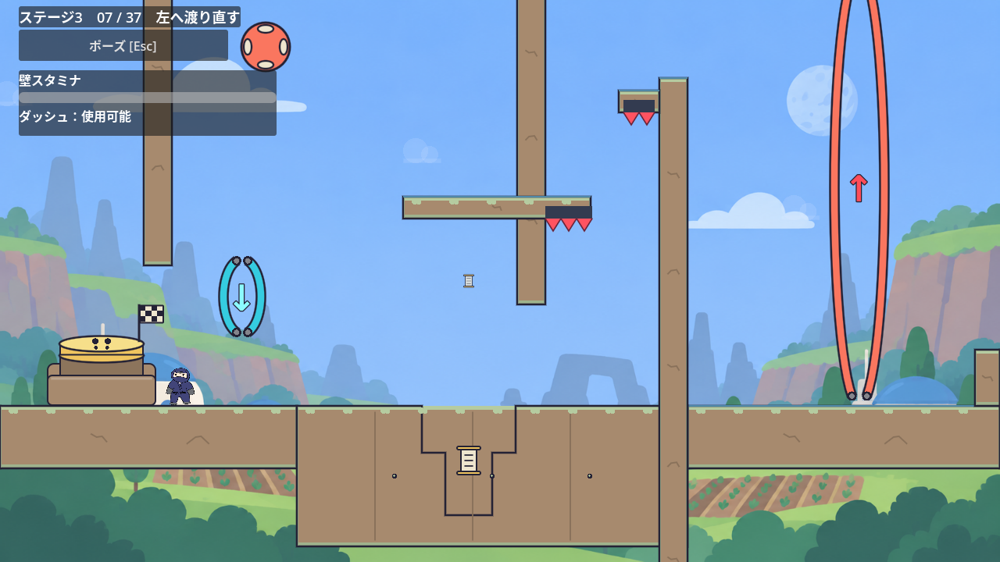

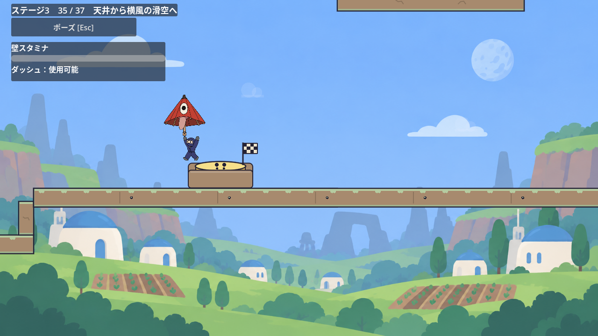

## Issue #183：第23室の出口までの空歩きを短縮

第1回の変更は[PR #182](https://github.com/Foxy-null/2d-space/pull/182)でレビュー・マージ済み。次の[Issue #183](https://github.com/Foxy-null/2d-space/issues/183)では、第23室に残った到着台から左端まで800pxの平坦な移動を見直した。

出口を到着床の左端X=650へ寄せ、到着台X=800からの距離を150pxに短縮する。上部の岩壁を残し、床から220pxの高さの開口部が開く。傘を持ったまま通れる通り口を地形で示し、画面途中の見えない境界にはしない。入口、風、重力ゲート、巻物、復帰地点は変更しない。

前進判定は部屋幅ではなく実際の出口の衝突面を参照する。他の36室は出口面と部屋の端が一致するため、移動位置は従来どおり。第23室の通常・弱入力で到着床から次室へ110物理フレーム未満で進める回帰検証は、変更前に失敗することも確認した。

### 3回の検証

1. 通常攻略：37室連続攻略1,095項目成功。全37室の入口・出口・往復を通常入力と実axis 0.8で確認し、1,347項目成功。最終の開口部は第23室の実攻略と次室への移動を実axis 0.8でも確認し、8,007項目成功。
2. 復帰と必要な操作：傘4室の復帰38,724項目成功。第23室の傘なし・反転した風なしを8方向ずつ、計16試行・4,306項目確認し、到着台を突破できなかった。開口部の上部を残した後にも16試行を再確認した。
3. 描画：Xvfb/OpenGLで第23室を傘と風で実攻略し、次室へ進むまで7,616項目成功。到着台からの移動は後待機25フレームを含め61物理フレームだった。開口部と傘の通過を確認した。

独立レビューで、160pxの開口では到着台から降りる直前の傘が岩壁に重なる可能性が見つかり、実移動の矩形交差検証で再現した。220pxへ広げると成功したため、実攻略の検証にも傘と岩壁が交差しない条件を加えた。

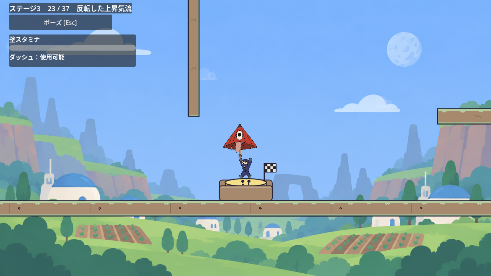

## Issue #191：第24・25・27・29室の退出を短縮

第23室の変更は[PR #184](https://github.com/Foxy-null/2d-space/pull/184)でレビュー・マージ済み。続く[Issue #191](https://github.com/Foxy-null/2d-space/issues/191)では、到着後に主課題のない平坦な移動が残る4室をまとめて見直す。既存床を切らず、到着台の進行方向150px先へ出口を寄せ、既存壁の下220pxが開く形にする。上部を残して通り口を示し、落下する穴や見えない境界にはしない。

| 部屋 | 到着台X | 旧移動距離→新移動距離 | 新出口面X | 実押下後の退出開始まで |
| --- | ---: | --- | ---: | --- |
| 24 | 700 | 700→150px | 550 | 112→20フレーム |
| 25 | 2500 | 572→150px | 2650 | 97→27フレーム |
| 27 | 604 | 604→150px | 454 | 103→27フレーム |
| 29 | 500 | 500→150px | 350 | 85→27フレーム |

時間は実際のGoalのactivated時点から測り、攻略helperが押下後に歩き直す区間を含めない。全室、追加Jump・Dash・風への接触は0。主課題、チェックポイント、Return、床、巻物の枝は動かさない。第24室の巻物と風は出口より部屋の内側にあり、退出後に戻って再訪できる。

第25室の検証は旧右端3040→3120への移動を、実際の出口を使う共通helperへ置き換える。既存の第26室への移動と正常な資源復帰の条件は残す。保持傘と上部壁が交差しない条件も、上部壁のある各室へ適用する。

### 3回の検証

1. 通常攻略と移動：全37室の通常・実axis 0.8で1,355項目成功。110物理フレーム未満で次室へ進む条件は変更前の第24室で失敗した。第24室の実攻略と退出は通常7,006・弱7,242項目、第25室は通常10,990・弱11,606項目成功。第27・29室は各2入力強度×16/20/24フレーム間隔の6通りを確認し、17,617・18,969項目成功した。
2. 復帰と往復・巻物：傘4室の復帰42,832項目、第26〜31室の復帰41,437項目成功。正式シーンで4室を実入口から攻略し、実押下→退出→元のReturnへ戻る経路と、第24室の退出後の巻物再訪・安全確定・自然帰路を22,604項目確認した。傘と上部壁の交差は0フレーム。独立レビューでは第24室の新壁を使い、傘を実Throwして下向きに登り、壁キックで回復Crystalを省略する6経路も突破しなかった。到着前は閉じた出口と床が連続するため、柱下面でDashを回復する足場にはならない。有限比較であり、全入力での不可能証明とは扱わない。
3. 描画：Xvfb/OpenGLで正式シーン4室の閉口・開口を162項目確認し、8画像を目視した。床を残した通り口全体がネイティブカメラ内に収まり、表示fixtureから実入力で退出できた。第24・25室の実傘と上部壁も重ならない。到着台上への配置から始める表示fixtureであり、主課題の実攻略の証拠とは区別する。

独立コードレビューはApprove。実機ゲームパッド、初見ユーザー、60Hz以外は未検証。

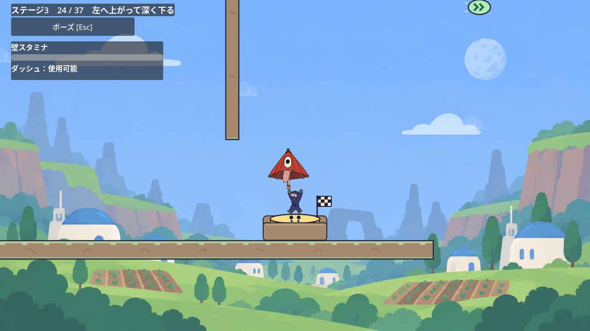

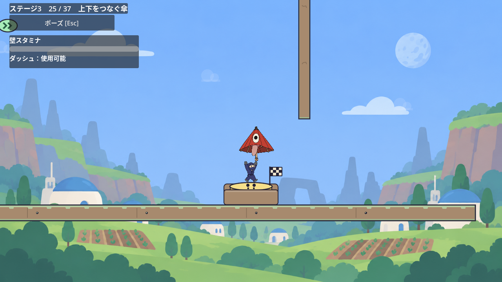

## Issue #199：第17室の休憩から次のゲートを見る

実入口から反転して天井の下面で3秒休んでも、次に使うDownゲートが画面y874〜954へ外れていた。回復Crystalは見えるものの、その先の重力ゲートへ向かう方向を見通せなかった。[Issue #199](https://github.com/Foxy-null/2d-space/issues/199)では既存の部屋別カメラ設定だけを変える。

`gravity_room_17.tscn`へ`camera_offset_y = 165`と`camera_offset_y_normal = -80`を追加する。反転中は下の次ギミックへ視線を向け、通常重力は従来の画角を保つ。地形・移動性能・ギミック・収集要素・説明ラベルは増やさない。到着床まで全てを縮小して入れることはせず、休憩中のキャラ・Crystal・次のDownゲートを同じ画面に見せる。

### 見通し・実攻略・描画の3観点

新しい`gravity_rest_view_test.gd`は旧sceneの実休憩で、Downゲートの輪郭を含む外形が画面外となり終了1。変更後は実横入力1.0/0.8×ヒントOFF/ONの4ケース・15,084項目成功し、実Rからの再攻略、Crystal1回と下降Dash2回、Down反転、実到着台から次室への退出を確認した。リングの13pxの線とAA、矢印とその縁取り、Crystalの描画、キャラ全身を含む範囲で、画面端と可視HUDから4px以上の余白を確認する。通常重力のカメラ目標は入口・R・下降・退出で従来の-80を保つ。

既存の単室主経路テストも通常・弱入力の30項目に成功し、3秒休憩を含む攻略時間は11.07秒・12.48秒、死亡0、Jump2回・Dash2回・Crystal1回・両重力を維持した。この既存driverは終了0だが、終了時にObjectDB2件の警告が残る。新回帰はエラー・警告なしだった。

Xvfb/OpenGLでは正式sceneをそのまま使い、通常・弱入力で60項目成功。休憩から到着までの全フレームで、キャラのbodyと全身画像の画面外・可視HUDとの交差は0だった。OFF/ONの4画像を目視した。静止中のゲート表示/非表示の同一画面を比較すると、AA込みの実描画外形はy623〜715未満で、ヒントONのHUD下端から7px、画面下端から5px空く。

入口→Up→休憩は旧/新×通常/弱×OFF/ONの8経路・44項目でも比較した。画面外は0だが、Up直後の既存HUD重複は全ケースで同じ12フレーム・最大交差面積3,002.799px²残る。今回の変更では悪化せず、休憩以降の見通しとは別の改善候補として残す。第17室には保持物も巻物も配置されておらず、実保持の描画検証とは扱わない。実機ゲームパッド、初見ユーザー、60Hz以外は未確認。

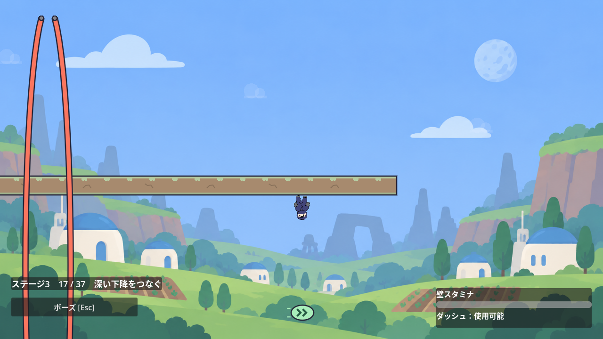

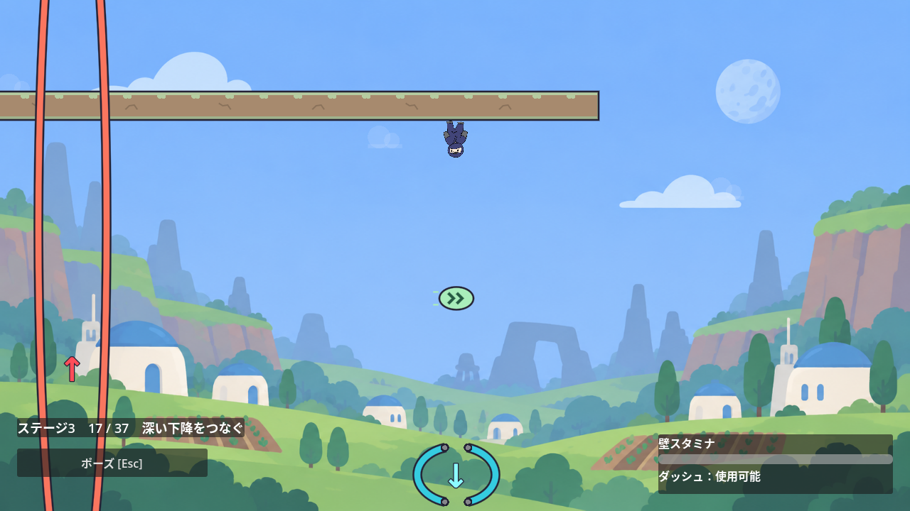

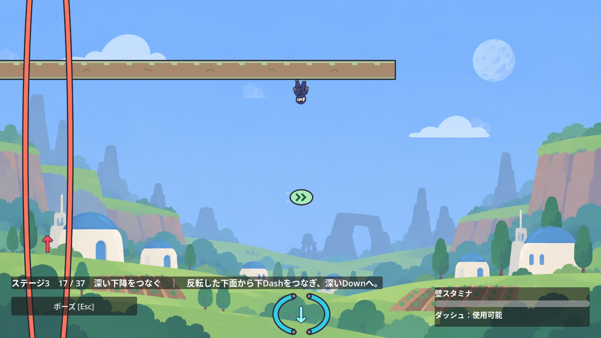

## Issue #201：反転直後もキャラをHUDへ隠さない

第17室の実入口では、Upに触れた瞬間にHUDが下へ移り、まだ低い位置にいるキャラへ重なっていた。Titleは12フレーム、ポーズボタンは5フレーム重なり、全身画像との最大交差面積は3,002.799px²。OpenGLの画像でもTitleが実際のキャラを覆うことを確認した。

[Issue #201](https://github.com/Foxy-null/2d-space/issues/201)では、重力が変わると次の配置を予約し、キャラが離れてから既存の上下配置へ一度だけ移す。上昇中は画面Yが460以下、下降中は304以上になるまで待ち、回転中の全身と傘の余白を取る。同じ重力の間は配置を往復させない。追加タイマー・表示設定・ラベルは設けず、ポーズボタンと資源表示を残す。資源の更新は従来どおり即時で、共有HUDのcompact表示を使うステージ3だけに適用する。

既存の攻略helperは入力時刻を変えない。重力変更と同時に配置も確定する旧assertは、Title・資源・ポーズボタンの側が揃っていることへ更新した。実休憩では従来の下側配置へ到達することも別に確認する。

### 実経路・復帰・描画の3観点

入口から全身・当たり判定と可視HUDの4px余白を監視する回帰は、旧処理でUp直後に失敗した。改善後は実横入力1.0/0.8×ヒントOFF/ONの4ケース・39,536項目成功。入口、3秒休憩、R、再攻略、下降Dash2回・Crystal1回・Down反転、実到着台から次室への退出を確認した。37室の実入口からの連続攻略も1,058項目成功し、部屋移動の入力時刻を保つ。

独立した状態fixtureでは、配置待機中のPause・ヒント切替・Resume、反転中のPause Retry、同じ通常重力でsignalが出ないRetryと部屋移動、選択へ戻って再入場を46項目確認した。実攻略とは区別する。第33室の移動Down矢印はヒントON/OFFの各360フレーム・9,271項目、第29室の実Spring経路は3,063項目成功し、既存の次ゲートの見通しを保つ。

Xvfb/OpenGLの正式シーンでは第17室を通常・弱入力で入口から実到着まで62項目確認し、全身画像・当たり判定の画面外とHUD重複は0フレーム。休憩でヒントを切り替え、次のCrystal・Downの表示も保った。第35室も実入口から傘を持って攻略し、左出口までキャラと保持傘の全身画像・当たり判定の表示を16,678項目確認した。第29室の描画補足3,105項目と、全7画面のPause共通テスト171項目も成功した。第17室の拡張回帰と第29室の既存driverは終了時にObjectDB2件の警告が残る。実機ゲームパッド、初見ユーザー、60Hz以外は未確認。

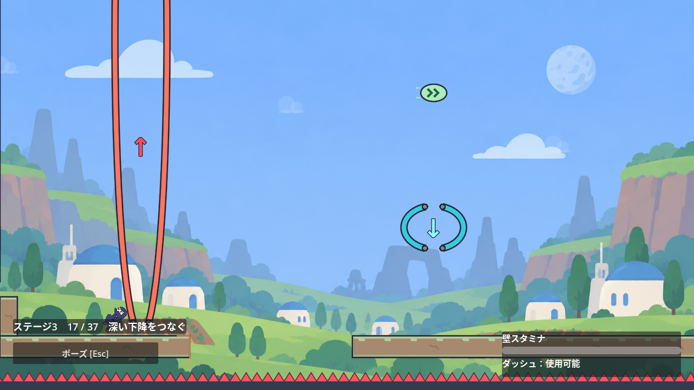

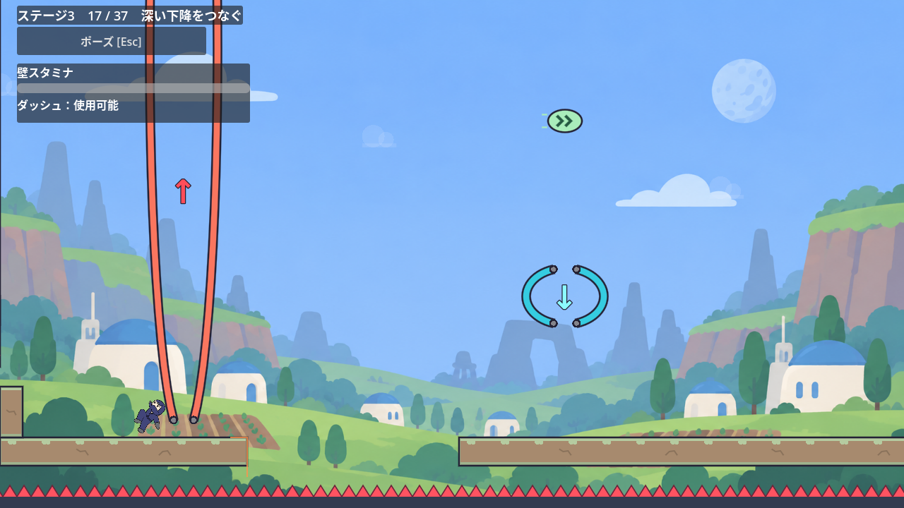

## 今回の運用確認

2026-10-28 01:58:32 UTCに`account/rateLimits/read`で10080分窓の使用率17%、Weekly残量83%を取得。リセット予定は2026-11-02 06:21:04 UTC。この83%を今回の基準とし、過去のループの残量と比べて停止を判定しない。タスク着手前・PR作成前・マージ後と長い検証の途中で再確認する。

環境の設定は`service_tier = "priority"`と`features.fast_mode = false`。後者だけでは実効tierが通常速度である根拠にならない。終了時には設定と現在スレッドへの適用を区別して確認する。独立したapp-serverで別スレッドの設定を変え、本スレッドのfastを解除したとは扱わない。参照：[公式の速度設定](https://learn.chatgpt.com/docs/agent-configuration/speed)、[設定項目](https://learn.chatgpt.com/docs/config-file/config-reference)。現在のDiscordのstdio接続へ設定変更を送る公開経路は確認できていない。
