# ステージ3：壁キックと重力

状態：9室を実装済み。第1室は交互の張り出し、第2室は反転中の下側への壁渡りで、壁キックを使う地形へ調整した。1・2部屋目にSpringと反発板を加え、3〜6部屋目の後半にも穴と異なるギミックを配置した。経路の矢印と説明文は初期状態で非表示。

## 現状と既存の方針

- ステージ1は、16部屋のチュートリアル本編と任意のSuperdash練習部屋で構成される。
- ステージ3は選択画面に「壁キックと重力」と表示され、1部屋目から開始できる。
- 実装済みステージは自由に選択できる。前のステージのクリアを開始条件にしない。
- 選択画面へ戻ると部屋の進捗を破棄する。確定した巻物は保存する。
- 既存のギミックには重力ゲート、ダッシュ、壁アクション、クリスタル、Spring、PinballSpring、風ゾーン、持てる物体、重量スイッチがある。

出典：[ステージ選択の仕様](stage-selection.md)、[README](../README.md)、[用語集](../CONTEXT.md)。

## 決定した方向性

第３ステージでは、壁キックと重力反転のギミックを前面に押し出す。

壁キックは、壁を掴んで上がる「壁登り」と区別する。壁から反対側へ跳び出す動作を課題の中心に据える。

星のぼりの塔に続く本編ステージとして、既存6室に応用3室を加えた9部屋で構成する。第1・7・8室は寄り道や上層に合わせて部屋内を縦へスクロールする。難易度アップの要望を受け、チュートリアルで覚えた操作を連続して使う中級向けの配置に調整した。後半ほど連携とタイミングの課題を増やす。

主課題は「壁キックでゲートを通過し、反転後に別の壁を蹴って次の足場へ渡る」とする。ダッシュと壁登りは補助として使えるままにし、張り出しやゲートを含む地形で壁キックと反転を使う経路を作る。

重力ゲートは静止するものを中心に配置し、終盤に移動ゲートを使う課題を入れる。

## 既存の動作による制約

- 同じ壁を蹴って戻る動作を繰り返しても、蹴り出した高さより低い位置へ戻る。壁キックで登る配置には向かい合う壁を使い、幅と高さは実際の入力で攻略して検証する。
- 壁キックは、通常重力では画面上へ、反転中は画面下へ跳び出す。横の速度は720px/s、重力に逆らう速度は560px/s。
- ダッシュ中以外に重力ゲートを通過すると、縦の速度が0になる。横の速度は残る。空中での連携は、この挙動を前提に配置する。
- ダッシュは既存の設定で無効化できる。壁キックを残して壁Grab・壁登りだけを無効化する専用設定はない。
- 壁登りを残しながら、張り出しで壁キックを使わせる配置はチュートリアルの2部屋目にある。
- 既存の到着台は、通常重力で上面に着地すると押せる。操作課題を設けずに解錠することもできる。
- 既存の部屋切り替えと復帰処理では、重力Down、速度0、ダッシュ回復、壁スタミナ最大に戻す。

出典：[プレイヤー](../scripts/player.gd)、[壁キックの回帰テスト](../tests/wall_jump_regression_test.gd)、[チュートリアル](../scenes/tutorial.tscn)、[到着台](../scripts/arrival_switch.gd)、[部屋切り替え](../scripts/tutorial.gd)。

## 9部屋の課題

各部屋の横幅は1280px。通常の高さは720pxで、第7室の下端は840px、第8室の上端は-160pxへ広げる。第3室は空中ジャンプ、第5室は空中Springに下ダッシュを組み合わせ、第8室は二つの追加ジャンプと下ダッシュを使い、他の部屋にはダッシュなしの主攻略経路を残す。いずれも実入力で確認する。

| 部屋 | 狙い | 配置と遊び |
| --- | --- | --- |
| 1：壁から壁へ | Springと壁キックと反転 | 床のSpringで跳び出し、左右の張り出しを壁登りと交互の壁キックで越える。張り出しの天面のトゲで着地によるダッシュ補充を防ぐ。後半のUpゲートから短い天井へ移り、天井のSpringからDownゲートを通って床へ戻る。下にはやり直せる床を置く |
| 2：天井を進む | 反転して下側へ壁を渡る | 床と天井の間のUpゲートを通り、幅100pxの天井の穴を跳ぶ。左右の壁を蹴り替えて下の先端を回り、全幅240pxの足場の右側下面で休んでから天井の反発板へ。最後は出口壁からDownゲートへ進む |
| 3：蹴って反転 | 空中ジャンプと下ダッシュで吊り壁の下へ | 最初の壁キックで反転し、前半の穴を跳ぶ。広い天井で止まり、真下の靴を通常ジャンプで取る。追加ジャンプと下ダッシュでトゲ壁の下へ降り、Downゲートから幅340pxの出口床へ渡る |
| 4：上下を往復 | 縦風と移動する帰還ゲート | 前半の天井と床の穴を順に跳ぶ。2回目のUpゲート後は、縦風の中で後半の天井の穴を越え、壁を掴んで上下移動するDownゲートを待つ |
| 5：動くゲートへ | 空中Springの下へ回り込む | 移動Upゲートと向かい風の穴を越え、広い天井で休む。通常ジャンプと下ダッシュでSpringの下へ進み、反転重力で自然に戻って跳ね返る。右のDownゲートから到着台へ着地する |
| 6：連携のまとめ | 向かい風と横移動ゲート | 前半のSpringから空中で壁を掴み、交互に蹴って広い穴を越える。2回目のUpゲート後も、向かい風の中で天井の穴を跳び、横移動するDownゲートへ壁キックする |
| 7：左へ渡り直す | 左向きの反転壁渡りと折り返し | 右の入口からUpゲートへ入り、壁の下を交互に蹴って左へ渡る。下面の休憩と反発板から左の到着台へ。開いた床と壁を使い、右の出口へ折り返す |
| 8：上層から二段跳び | 二つの靴から長い下降へ | 壁キックで反転して上層へ登り、天井の広い休憩へ。靴を二つ順に取り、追加ジャンプを二度使って下ダッシュし、トゲ壁の下のDownゲートへ抜ける |
| 9：風の中で待つ | 風帯と移動ゲート | 天井と床を二往復し、後半の幅130pxの穴を風の中で跳ぶ。壁で休み、上下するDownゲートを待って最後の到着台へ |

## 難易度アップの調整

- 6部屋目は、向かい合う壁の張り出しを重力に逆らう方向へ60px移動し、壁の間隔を24px広げた配置を使う。5部屋目の後半の壁は、空中Springへ回り込む課題に置き換えた。1・2部屋目は後述の張り出しと壁の先端の配置へ更新した。
- 2・3・4・6部屋目の出口には天井から伸びる壁を置く。床へ戻るゲートは2・3・6部屋目で48×96px、4部屋目で64×160pxとし、2・4・6部屋目では最後の反転にも壁キックを組み込む。3部屋目は空中ジャンプ、5部屋目はSpringから直接Downゲートへ向かう。
- 5・6部屋目の移動ゲートは64×160pxから48×96pxへ縮めた。移動速度は80px/sから、それぞれ140px/s・180px/sへ上げ、端で止まる時間は0.65秒から0.20秒・0.12秒へ短くした。壁を掴んで高さを合わせてから、ゲートが来るタイミングを待てる。
- 6部屋目の途中のDownゲートも48×128pxに縮め、壁を渡った直後のキックで入れる高さに置いた。
- 5部屋目は幅180pxの出口床へ着地する。クリア後は幅630pxのReturnBridgeで床の穴を埋め、歩いて帰れる。

## 部屋ごとの追加ギミック

- 1部屋目：床のSpringを部屋内X=490pxに配置する。速度700px/sで最初の張り出しの下へ跳び出し、壁を掴んでから蹴り出す高さを決める。壁を渡った後は（900, 320）の幅64px・高さ800pxのUpゲートからX=960〜1120pxの短い天井へ向かい、（1040, 80）のSpringと（1130, 260）のDownゲートをつなぐ。
- 2部屋目：PinballSpringを（940, 180）に置く。後半の天井を歩く経路は切り、反発後に空中で壁を掴んでDownゲートへ向かう。反発速度の範囲は850〜1000px/s。
- 3部屋目：中間の天井をX=470〜800pxへ広げ、（780, 195）にジャンプクリスタルを置く。通常ジャンプで実際に取り、追加ジャンプと下ダッシュで、下端Y=470pxのトゲ壁を回る。（940, 500）のDownゲートからX=940〜1280pxの出口床へ着地する。ヒントが非表示でも取得した空中ジャンプの残数をHUDに示す。床の穴はX=350〜940px、底のトゲはY=680px。
- 4部屋目：後半の穴に上向きの風を置く。風の加速度は300px/s²、最大速度は60px/s。出口のDownゲートはX=1030px、Y=500〜350pxを130px/sで往復する。大きさは48×96pxから64×160pxへ広げた。床側の2つのUpゲートも64×160pxから160×160pxへ広げ、壁を登る経路が範囲に入るようにした。床へ戻すDownゲートだけでは通常重力の抜け道を防げないため、両方向の既存ゲートで対策する。画面の上下を覆っていた追加の反転帯は削除した。
- 5部屋目：広い中間天井はX=470〜920px・下面Y=80px。足場を伴わないSpringを（1040, 288）に置き、この個体の反発速度を1000px/sとする。下ダッシュで下へ回り込み、反転重力で戻ってから反発し、（1060, 552）の120×96pxのDownゲートへ進む。
- 6部屋目：後半の穴に左向きの風を置く。最大速度は100px/s。出口のDownゲートはX=1020〜900pxを160px/sで往復する。穴を跳んだ後も、壁を掴んで横移動するゲートのタイミングを合わせる。

1部屋目のUpゲートは画面の上下を覆い、壁の上から通常ジャンプや8方向のダッシュで飛び越せない。重力反転を避けて到着台へ向かう抜け道を防ぐ。第1室の壁キックは、右壁の2段の張り出しと左壁の張り出しで課題にする。第5室の空中Spring以外の各Springの個別必須化と、第3〜6室の壁キックの必須化はここでは保証しない。

Spring・PinballSpring・クリスタル・風・移動ゲートは、既存のシーンと動作をそのまま使う。部屋ごとにプレイヤーの物理や操作を変えない。

### 第1室の壁キック区間

修正前は、右入力とGrab・上入力だけで右壁の上へ登り、そこから歩いてUp・Downゲートと天井のSpringを通ると、壁キック0回・Dash0回・復帰0回で到着できた。重力反転を通ることと、壁キックを使うことは別の課題だった。

右壁を上端Y=120pxまで伸ばし、X=584〜644pxに2つの張り出し（Y=426〜454px、196〜224px）を置いた。左壁の下端はY=490pxとし、既存の張り出しはY=320〜348pxに残す。3つの張り出しの上面には短いトゲを置く。壁登りは張り出しの下で止まり、ダッシュで一段を越えても、その上で着地してダッシュを戻すことはできない。トゲは既存のSpikeBlockを静止させ、Stage3の現在室にだけ反応する設定で使う。共通Player・Dash・SpikeBlockの処理は変更しない。使用回数を記録して出口を閉じる仕組みも追加しない。Upゲートは40px右のX=900pxへ移し、最後の壁上に一度着地してから歩いても、反転後に天井Springへ届くようにする。

Springから左右の壁を4回蹴り替える攻略例はダッシュなしで成立する。各回の数自体はクリア条件ではない。下には連続した安全な床があり、最初の壁掴みを放しても戻って試せる。張り出しの下面と壁の側面は掴めるままにし、天面の危険だけを形で見せる。説明は増やさず、任意ヒントの既存の文と矢印を新しい経路へ更新する。

`gravity_wall_jump_route_test.gd`は第1・第3キックの踏切高を変えた9組と、第2・最後のキックの高を変えた9組で、両Springと実際の重力反転を通る。前者9組の到着時間は6.95〜7.22秒（到着台押下中のポーズ検証を含む）。別の入力時機がすべて成功するとは保証しない。壁キックなしの負例では能力を無効化せず、壁登りとダッシュを有効にしたまま、8方向・0/6/12/18フレーム・左右の壁を使う継続操作を試す。Spring直後、左右の壁、中央からの通常ジャンプ、地上Dash→Jumpも含め、512通りを試す。後者では実際にSuperdashが発生する16例も確認する。有限の典型例の検証であり、あらゆる入力列に対する絶対不可能の証明ではない。

### 第2室の天井と下側の壁渡り

修正前は、入口で通常Jump・上Dashを使ってUpゲートの上を避け、左壁の外側を登ってから中央へ降りると、床を歩くだけで到着台へ進めた。実入口から重力反転0回・壁キック0回・Dash1回・復帰0回で再現した。反転する経路でも、天井の穴を跳んだあとに左へ移動して下Dashを使い、KickLanding下面で補充し、反発板と出口壁からDownゲートへ歩いて入れば、壁キック0回・Dash1回・復帰0回で到着できた。

入口UpゲートはX=180pxのまま、既存の天井下面Y=80pxと床上面Y=640pxの間へ収めた。上下を回るには地形を抜ける必要がある。天井の穴は幅100pxを保ってX=460〜560pxへ寄せ、右壁もX=600pxへ近づけた。反転中に左の段差の下へ蹴り、壁を降りてから右壁の先端Y=510pxの下へ蹴り戻る。段差の下面と壁の先端には短い既存トゲを配置し、登り切って補充する迂回を防ぐ。下側に動けるよう中央の床X=400〜900pxを切った。到着後は既存のReturnBridge処理で穴を埋める。

KickLandingは全幅240pxとし、壁を渡った先の右側下面で静止してDashとスタミナを戻せる。独立レビューでは、左へ張り出した下面でDashを補充し、Jumpと下Dashで天井へ戻る壁キック0回の経路も再現した。その左下面だけに短い既存トゲを置き、正規経路の右側休憩面は残した。左の張り出しは維持し、右壁を深く降りてから下Dashで先端を回る経路も防ぐ。天井の反発板・出口壁・Downゲートは残した。常設ラベル、能力制限、使用履歴による出口ロックは追加していない。第1室の配置や共有Player・Spring・GravityGateも変更していない。

`gravity_room_two_terrain_test.gd`では2回の踏切高さを変えた9経路を、Dashなし・復帰なしの8.20〜8.42秒で確認した。横入力強度0.65・0.8でも、休憩場所から通常Jumpを使って反発板へ進める。3秒静止した後の再出発、R・天井穴への落下・トゲからの復帰、次室CPの保持も実入力で確認する。抜け道の検証は、入口の8方向Dash、反転後の登りと8方向Dash、左下Dashから右へ返して下面で補充する9組、実Superdashを使う有限の入力例であり、任意の入力列を網羅する証明ではない。実機ゲームパッドでの操作感は未確認。

### 第3室の空中ジャンプ

旧配置では、実入口から壁キックでUpゲートへ入り、前半の穴を通常ジャンプで渡った後、後半のX=666pxからジャンプして16フレーム後に右ダッシュすると、追加ジャンプ0回・死亡0で到着できた。クリスタルは拾っていたが、その権利を使わなくても進めた。天井の穴を450pxへ広げる案でも右下ダッシュによる代用が残ったため、横の距離だけの課題は採用しない。

現在は幅330pxの中間天井で安全に止まり、真下の靴から追加ジャンプと下ダッシュをつなぐ。吊り壁はX=840〜860px、Y=-80〜470pxで、左側に既存の静止SpikeBlockを置く。壁を掴んで深さを稼ぐ代用はできず、画面上からも回れない。Downゲートは（940, 500）、出口床はX=940〜1280px・上面Y=640pxとし、反転後の弱い横入力でも着地できる幅を残した。

通常重力の壁上から深く落ち、60フレーム後に斜め上ダッシュすると出口へ届く試行も見つかった。床を薄い片面足場にしても通ったため、その案は採用しない。床の穴の底Y=680pxに見えるトゲを置き、深い落下からの代用を防ぐ。クリア後の橋はトゲより手前へ描画する。橋の上のPlayerは危険範囲に入らず、左へ戻れる。

独立レビューでは、通常重力の壁上から上DashとGrabで中間天井の屋根へ登り、補充してから左へ落ちて右へ戻る経路も成立した。谷底直前から右上Dashすると、クリスタル取得・空中ジャンプ・重力反転なしで、死亡0のまま実到着台まで進めた。入口と中間天井は下面Y=80pxを保ち、上面だけY=-160pxまで高くして、この屋根の補充を防ぐ。反転中の休憩面と天井の穴は変えない。吊り壁のトゲも下端Y=470pxを保って歯の描画刻みを合わせ、見える歯だけが判定より下へ延びないようにした。

横の穴だけで追加ジャンプとダッシュを区別しつつ弱い入力の猶予を保つことが難しかったため、第3室は下ダッシュを組み合わせる。第5室のSpring経路も下ダッシュを使い、他4室にはダッシュなしの経路を残す。Playerとギミックの共通処理、初期能力、履歴条件、入口・帰りの復帰地点は変えない。新しい説明ラベルは増やさず、任意ヒントの既存の文と経路を現在の配置へ合わせる。

専用の `gravity_room_three_jump_test.gd` は、実入口から取得と消費を観測し、入力強度1.0／0.85と二つの待ち時間16・20・24フレームの18組を検証する。通常入力は6.45〜6.72秒、弱い入力は7.77〜8.03秒で到着し、死亡はない。負例では能力を無効化せず、反転中の通常ジャンプと8方向ダッシュ、壁上とコヨーテ離陸、深い落下からの遅いダッシュ、実Superdashを試す。到着台の未押下だけではなく、出口床への実着地も失敗として検出する。有限の入力例の検証であり、あらゆる入力列の不可能を証明するものではない。

第2室の地形改善と表示設定を含むmainを統合し、専用1256項目、全6室329項目、Xvfb/OpenGLの実攻略12項目が成功した。通常ジャンプ・コヨーテ・8方向ダッシュ・実Superdashの199経路は出口床へ着地できず、取得だけの未使用の権利や、遅い入力の前にトゲへ触れて失敗する試行を含む。実トゲ、空中取得後のR、天井の落下、谷底への落下、3→4→3→2の実往復も確認した。描画中のPlayerとHUDは重ならない。天井上面の修正後も専用1256項目と全6室329項目が成功し、屋根補充の追加回帰3時機・9項目では屋根支持0件と同じ入口への安全復帰を確認した。実機パッド、初見プレイヤー、60fps以外は未確認。

### 第5室の空中Spring区間

変更前は、入口から実際の移動Upゲートと天井の穴、後半の壁を通り、X=850pxから右Dashするだけで到着台を押せた。Springは0回、WallKick3回・Jump2回・Dash1回、重力はUp→Down、復帰0回だった。低い壁や足場を残すと、それらからの通常ジャンプとDashでも出口へ届くため、後半の壁4つと着地足場2つを外した。

中間天井の下面X=470〜920pxは広い休憩場所にする。そこから通常ジャンプと下Dashで（1040, 288）のSpringの下へ回り込み、反転重力の自然な上昇で発射面へ戻る。Springの反発速度はこの個体だけ1000px/sにし、120×96pxのDownゲート（1060, 552）から到着台へ進む。ゲートを下へ置きすぎると到着台の縁が先に反発を止めるため、実際の通過で高さを決めた。輪の下端も反転中の右下HUDにかからない。入口の移動Upゲート、最初の壁キック、向かい風と140pxの天井穴は残す。

通常重力で入口の壁へ登り、通常Jump→上Dash→左Grabで薄い天井の上へ移ってから右へ進む別の到着も実際に再現した。入口と中間の天井だけ下面Y=80pxを保って240px厚にし、上面をY=−160pxまで上げた。共有Playerや画面外の復帰境界は変えない。旧40px厚へ戻す対照fixtureでは、同じ入力で実Goalが開き、Spring0回・復帰0回となって新しい屋根回帰が失敗する。正式配置では画面上への逸脱で1回復帰し、屋根には乗れない。

`tests/gravity_room_five_spring_test.gd`は通常入力とraw0.85（デッドゾーン後の横入力0.7）について、同じ踏切位置から下Dashを16・20・24フレーム後に使う6経路を確認する。通常入力は8.67〜8.80秒、弱入力は8.98〜9.12秒、いずれも実Spring1回・両重力・復帰0回。弱入力では前半の向かい風の穴を右Dashで補助し、中間天井への着地で回復してから下Dashする。通常入力はDash1回、弱入力は計2回。最短時間のために待機を強制しない。

代替経路は、実際の通常重力の壁上・端のコヨーテ・反転天井から通常Jumpと8方向Dashを5時機で使う120例、実Superdashが発生する壁上1例と中間天井3例、上述の屋根経路を確認する。実接触した出口床への着地と実Goalの両方を監視し、Springを省いた到達は認めない。壁キックやGrabも使用可能のままであり、後半に偶然Springを使う別経路は許容する。遅いDashの前に画面外へ出る試行も含む。狭い壁上で遅くJumpを押し、Superdash自体が出ないfixtureは成功例に数えない。

独立レビューでは、天井端X=936pxから通常Jumpし、24・26フレーム後に純下Dashして右＋Grabで進むと、閉じたExitBarrierの左面を蹴り返し、Spring0回・WallKick2回・Jump2回・Dash1回・両重力・復帰0回で実Goalを達成できた。追加キックは到着台ではなく、出口壁のlocal（1233.925, 416.798）・normal（−1, 0）で発生したため、Goalの片面化では塞げない。この出口壁の上側Y=0〜460pxにだけ、既存SpikeBlockを静止・左向きで1個置く。下側は到着後の歩行と右からの復帰に残し、共有Player・Goal・SpikeBlock処理は変えない。下端500pxの試作は通常Jumpで到着台を越える帰路にも触れたため採用せず、460pxへ短くして既存の帰路テストを維持した。

追加の負例はX=930/936pxの踏切、22/24/26/28フレーム、下/右下Dashの16経路。旧配置ではX=930px・26フレームでも実Goalが開いてテストが失敗する。修正後は実際のトゲ接触で各1回復帰し、初期キック1回のまま追加の壁キックへ入れない。元の120代表と、今回の端寄り16例の両方を残す。独立した160項目でも旧反例2経路、Gate直上で静止する12経路、低いUpGateから実壁を下りる8経路が未達だった。静止中の最深は中心Y=462.4926pxで、DownGateへ最初に触れる中心Y=478pxまで約15.5px残る。

3秒の静止、実Spring直後とDown反転直後のR、実際の上下の落下、5→6→5→4の往復も確認する。クリア後は630px幅のReturnBridgeで穴を埋め、到着台を越えて歩いて帰れる。地形による課題であり、Springの使用履歴ロックや能力制限は追加しない。常設説明も増やさず、既存の任意ヒントを更新し、不要になった後半壁の説明を削除した。

第3室（#110）と回廊の改善（#109）をmainから統合した最終配置で、専用テスト一括819項目と全6室329項目が成功した。通常Jumpで到着台を越える帰路と、Grabを使う帰路の両方を保持した。第3・5室はそれぞれ下Dashを1回、他4室はDashなしで通過する。描画ではraw0.85の攻略・3秒休憩・ヒント切替を短く実行し、9項目と全行程のPlayer/HUD非重複を確認した。実機ゲームパッド、初見プレイヤー、60Hz以外は未検証。有限の操作例であり、任意の入力列に対する数学的な不可能証明ではない。

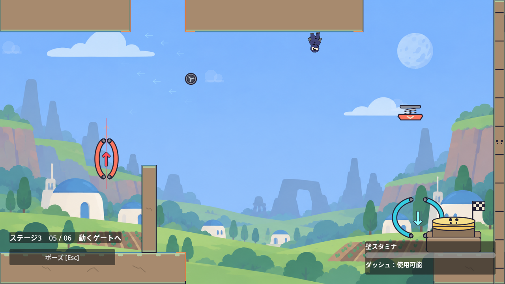

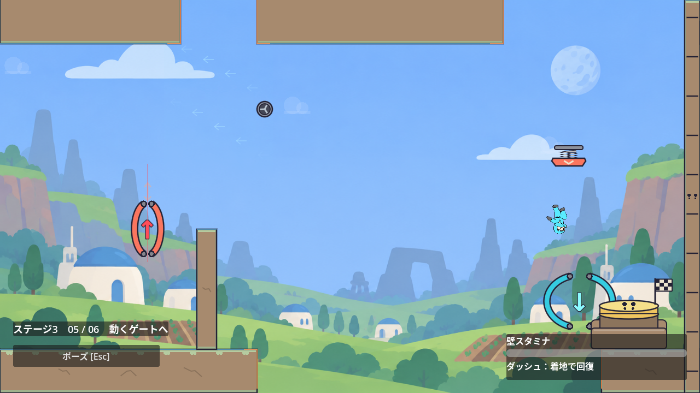

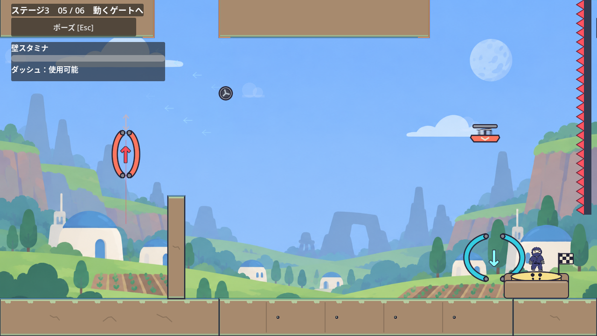

## 落とし穴

床と天井の衝突と見た目を同じ位置で切る。重力反転で床の穴を避けても、実際に通る天井側でジャンプや壁キックを使う課題が残る。

### 天井側

| 部屋・区間 | 穴の範囲（部屋内のX座標） | 幅 | 越え方 |
| --- | --- | --- | --- |
| 2 | 460〜560px | 100px | 反転中の通常ジャンプで越えてから、向かい合う壁へ進む |
| 2・後半 | 950〜1120px | 170px | 反発板から空中で出口の壁を掴む |
| 3 | 330〜470px | 140px | 最初のUpゲート通過後にジャンプする |
| 3・後半 | 800〜1060px | 260px | 手前の天井で休み、追加ジャンプと下ダッシュで吊り下がるトゲ壁の下へ降りる |
| 4 | 320〜450px | 130px | 最初の反転後にジャンプし、天井壁のDownゲートへ進む |
| 4・後半 | 850〜1020px | 170px | 縦風の中でジャンプし、移動するDownゲートの手前へ着く |
| 5 | 330〜470px | 140px | 向かい風の中で跳び、中間天井で休む。弱い横入力では右ダッシュで補助できる |
| 5・後半 | 920px以右 | — | 空中Springの下へ回り込み、反発してDownゲートへ向かう |
| 6 | 530〜820px | 290px | 手前のSpringから右の壁を掴み、交互の壁キックで越える |
| 6・後半 | 950〜1070px | 120px | 向かい風の中でジャンプし、横移動するDownゲートへキックする |

- 5部屋目の向かい風は天井の穴を覆う200×240pxの範囲に置く。風の最大速度は80px/sとし、通常ジャンプでも越えられる余裕を残す。
- 6部屋目のSpringは天井側に下向きで配置し、900px/sで跳び出す。広い穴をただ歩くと画面上へ落ち、Springを使う場合も壁への掴み替えが必要になる。
- 天井の穴はクリア後も残す。通常重力で床側の帰路を使える。

### 床側

| 部屋 | 穴の範囲（部屋内のX座標） | 幅 | 越え方 |
| --- | --- | --- | --- |
| 2 | 400〜900px | 500px | 反転中に壁の下側を渡り、出口側でDownゲートを通る |
| 3 | 350〜940px | 590px | 天井の休憩からトゲ壁の下を回り、Downゲートで床へ戻る。谷底のトゲはY=680px |
| 4 | 620〜760px | 140px | 床へ戻った後、穴の手前からジャンプする |
| 5 | 470〜1100px | 630px | 移動Upゲートから天井側へ移り、空中Springで床へ戻る |
| 6 | 340〜800px | 460px | Upゲートから天井側の壁を渡り、Downゲートで出口側の床へ着地する |

- 上下の穴の縁は常にオレンジ色で表示する。「落とし穴 ↓」はヒントを表示したときだけ見える。経路の矢印はヒントを表示したときだけ見える。
- 床の穴から画面下へ、反転中に天井の穴から画面上へ出ると、その部屋の入口へ自動で戻る。復帰の条件やリセット内容はR / Startと同じ。
- 4部屋目の2つ目のUpゲートは40px上へ移した。穴を越える通常ジャンプでは触れず、次の壁キックで通過できる高さにした。
- 到着台を押すと床の穴を埋める足場が現れ、床の穴の案内を隠す。そのプレイ中はやり直しても足場を保ち、戻って練習できる。

## 進行と復帰

- 通常は部屋ごとにカメラを固定し、部屋移動のときに横へスライドする。上層・下層を持つ第1・7・8室は、その部屋の上下端の間で縦にも追従する。
- 操作回数や体験済み操作のチェックは設けず、到着台にたどり着いて押せば出口が開く。各部屋の到着台は床側に置く。
- 出口から次の部屋へ進める。左端から前の部屋へ戻って練習できる。
- 入室時の入口を復帰地点にする。落下またはR / Startで現在の部屋の入口へ戻し、重力Down、速度0、ダッシュ使用可能、壁スタミナ最大にする。
- やり直し時は、現在の部屋の移動ゲートも初期位置から再開する。すでに開いた出口は、そのプレイ中は開いたままにする。
- 2〜9部屋目は、クリアすると床の穴を埋める足場が現れる。初回は穴を越える課題に挑戦し、クリア後は戻って練習しやすくする。

## 案内と完了

- 初期状態は部屋名、ゲージ類、「ポーズ [Esc]」の入口を表示し、経路の矢印・説明文・操作案内と、ヒント・選択画面へ戻るボタンを隠す。
- Esc・Back／Selectまたは「ポーズ [Esc]」で共通メニューを開閉する。背景・物理・タイマー・到着台の押下・部屋移動を含むゲーム全体を止め、再開ボタンにフォーカスする。H・Y／△でメニューは開かない。
- ヒントボタンで説明文と経路の矢印を表示・非表示にし、ポーズを維持する。表示中は「ヒントを隠す」に切り替える。Escを長押ししても開閉を繰り返さない。
- ヒントの設定は部屋移動・やり直し・クリア後も保持する。選択画面からステージへ入り直すと非表示に戻る。
- ゲートや風の方向、Springの見た目、穴の縁はギミックを判断する情報として常に表示する。壁スタミナは秒数やパーセントを表示しないProgressBarとし、ダッシュ・空中ジャンプと一緒に、通常重力では左上の見出し・ポーズの下、反転中は右下へ同じフレームで切り替える。左側の部屋番号・タイトル・ポーズの入口も同時に上下を切り替える。開いたポーズメニューは重力方向にかかわらず画面中央に表示する。文字は上下反転させず、読みやすい向きを保つ。「重力：床↓」の文字は表示しない。
- 9部屋目の到着台を押すと「ステージ3クリア」を表示する。第6室では出口を開くだけで完了しない。その後も部屋へ戻って練習でき、前の部屋ではクリア表示を隠す。
- ポーズ内の「ステージ選択に戻る」で帰還確認を表示する。チェックポイントからのやり直しは確認なしで現在の入口へ戻り、ゲームを再開する。再選択すると1部屋目から始まる。詳しくは [ポーズメニュー](pause-menu.md) を参照。

## ファイルの担当

- `scenes/stage_3.tscn`：9部屋の足場・落とし穴・ゲート・風・Spring・反発板・ジャンプクリスタル・到着台・ヒント・経路の矢印。
- `scenes/gravity_room_7.tscn`・`gravity_room_8.tscn`・`gravity_room_9.tscn`：追加3室のネイティブシーン。
- `scripts/stage_3.gd`：部屋切り替え、復帰地点、出口とクリア、ヒント表示の管理。
- `scripts/arrival_switch.gd`：本編では `mission_required = false` とし、ケースと操作課題の吹き出しを表示しない。
- `scripts/hud.gd`：本編の部屋名・ヒント・壁スタミナ・ダッシュ。ゲージ類を重力と反対側に置いて経路を隠しにくくする。
- `scenes/stage_select.tscn` / `scripts/stage_select.gd`：ステージ3の開始。
- `tests/stage_3_test.gd`：全9部屋の実入力攻略と進行・復帰・完了の確認。
- `tests/gravity_room_three_jump_test.gd`：第3室の実クリスタル消費、弱い入力、8方向ダッシュ・壁・Superdashの代用、上下の落下・トゲ・R・隣室往復。
- `tests/gravity_room_three_roof_test.gd`：独立レビューで実到着した屋根補充→左落ち→遅い右上Dashの回帰。通常Jumpの3時機を試し、屋根への着地・補充と出口床への実着地を防ぐこと、安全な入口復帰を確認する。修正前には実出口床へ着地して失敗する。
- `tests/gravity_wall_jump_route_test.gd`：第1室の壁キック経路の高さ違い、壁キックなしの通常ジャンプ・8方向Dash・壁登り迂回、トゲ復帰、次室CPの保持。
- `tests/gravity_room_two_terrain_test.gd`：第2室の高さ違い、弱い横入力、静止と再出発、復帰と次室CP、重力反転と壁キックを省く迂回。
- `tests/gravity_room_five_spring_test.gd`：第5室の通常・弱入力、Springを省く実入力、R・上下落下・隣室往復。
- `tests/gravity_entry_gate_test.gd`：1部屋目の壁上から歩き・通常ジャンプ・8方向ダッシュを試す72経路と、重力反転を避けた到達ができないことの確認。

## 動作確認

- ステージ選択からステージ3を開始し、戻る・再選択ができること。
- 9部屋を実際の入力で攻略し、壁キックと重力反転の連携が成立すること。
- 既存6室では、第3室で空中ジャンプと下ダッシュ、第5室で下ダッシュと実Springを使い、他4室はダッシュなしで通過できること。
- 上下それぞれの落とし穴へ入力で進み、掴まずに画面外へ落ちると、現在の入口へ戻って重力・スタミナ・ダッシュ・移動ゲートをリセットすること。
- 穴を越える攻略中には落下せず、クリアすると床の穴を埋める足場が現れて案内が隠れること。
- 開いた天井の穴から歩いて落ちると復帰すること。第3室の後半では実際のトゲ接触と谷底への落下も確認する。
- 1部屋目の2つのSpringと反転、2部屋目の反発板、3部屋目のクリスタルと空中ジャンプ、4部屋目の縦風と移動ゲート、5部屋目の出口Spring、6部屋目の向かい風と横移動ゲートが、実際の攻略経路で機能すること。
- メニューと説明文は初期状態で非表示であり、マウス・Esc・Back／Selectでメニューを開閉でき、その中で説明文と経路の矢印を切り替えられること。説明文と経路の矢印の設定は部屋移動とやり直しで保持されること。
- 3部屋目の壁上からジャンプし、横・斜め上ダッシュを0・15・30・45・55・60フレーム後に使っても、床の穴を越えてクリアできないこと。4部屋目は床の2つの壁を登っても拡大した既存のUpゲートに触れること。
- スタミナゲージが実際の消費量を表示し、部屋番号・タイトル・ポーズの入口と同時に画面の反対側へ移ること。ポーズ自体は中央に表示され、反転中もマウスでヒントを切り替えられること。
- やり直し・逆戻り・移動ゲートのリセット・最終クリアが合意した仕様どおりに動くこと。
- ステージ1のチュートリアル、既存の壁キック・重力ゲート・到着台の動作が維持されること。

```powershell
Godot_v4.7.2-stable_win64_console.exe --headless --fixed-fps 60 --path . --script res://tests/stage_3_test.gd
```

第2・3・5室を組み替える前の初期配置では、Godot 4.7.2のLinux版で `STAGE_3_TEST_OK`（331項目）と終了コード0を確認した。全6部屋の攻略には位置の変更やギミックの強制発動を使わず、移動・ジャンプ・壁Grabの入力だけを使い、落下によるやり直しも起きていない。攻略に使った壁キックは各部屋で4・3・1・4・3・5回。1部屋目では4回の壁キックから2つのSpringと重力反転をつなぎ、5・6部屋目でもSpringが発動する。2部屋目では反発板から出口の壁へ掴み替えている。3部屋目では空中でクリスタルを取り、実際に空中ジャンプからDownゲートへ進む。4・6部屋目では後半の風の範囲を通過して穴を跳び、移動Downゲートへ壁キックする。反転はそれぞれUp・Downを2回ずつ。4部屋目はゲートの拡大に合わせ、床側の壁キックを少し低い位置から行う経路で確認した。クリア後は5部屋目の到着台を跳び越えて戻り、着地足場の下を歩いて通れることも確認した。前半・後半すべての天井の穴と床の穴の検証では、穴の手前に配置したプレイヤーを入力で進ませ、画面外への落下と自動復帰を確認した。画面外への落下や部屋境界、4部屋目の2つ目の床の壁の単独検証では位置を変更している。

到着台の押し込み中にポーズすると押し込みも停止し、再開後に押下が完了して出口が開くことを実入力で確認する。

修正前の抜け道は実入力で再現した。3部屋目は壁の上でジャンプし、45フレーム待って斜め上へダッシュするとX=933.97pxの床へ着地し、反転なしで到着台を押せた。4部屋目は床の2つの壁を登り、2回のジャンプだけで到着台へ進めた。こちらも反転は0回だった。修正後は3部屋目の横・斜め上ダッシュの12通りを試し、すべて落下による復帰となった。4部屋目は追加の反転帯を使わず、両方の床の壁から拡大した既存のUpゲートへ触れることを確認した。

1部屋目にも、右壁を登って上から通常ジャンプすると、重力反転なしで到着台まで進める抜け道があった。Upゲートを縦へ広げた後は、壁の上まで実入力で登る72経路（ジャンプの有無、ダッシュなし・8方向、待ち時間0・8・16・24フレーム）で、反転せずにゲートの右側へ抜けないことを確認した。到達せず手前に残る試行も含むため、全経路がゲートへ入ったという検証ではない。`GRAVITY_ENTRY_GATE_TEST_OK`（148項目）。現在の壁上までの準備は、4回の壁キックを使う正規経路に更新している。既存の全6室331項目も成功し、2つのSpringと壁キックを使う攻略は維持した。

旧お助けメニューは共通ポーズへ置き換えた。現在の操作・停止範囲・確認画面の検証は [ポーズメニュー](pause-menu.md) を参照。ステージテストでは説明文と経路の矢印の初期非表示と保持、マウス・Esc・Back／Selectによる開閉、Enter／Aによる選択、帰還確認、重力に応じたHUDの配置を確認する。

第1室では右上のゲージが天井のSpringを隠していたため、通常重力のリソース表示を左上の見出し・ポーズの下へ移した。反転中は従来の右下を使い、左側の重力ゲートを隠さない。幅は330pxにして、左側の壁にも余白を残す。全6室×上下重力×ヒント有無の24画面で、ゲージと見出し・ポーズの非重複と画面内への収まりを確認した。

描画を有効にした環境でも同じテストを実行し、全6部屋とクリア画面のスクリーンショットを更新した。5部屋目のヒント表示、閉じて始まるポーズメニューを開いた状態、3部屋目で反転中のゲージ位置も画像で確認した。

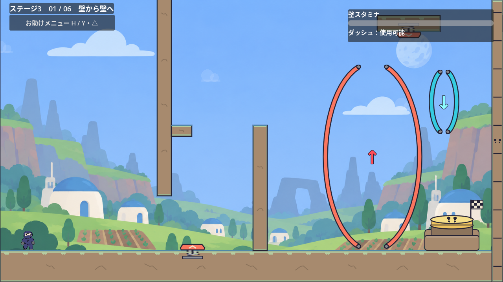

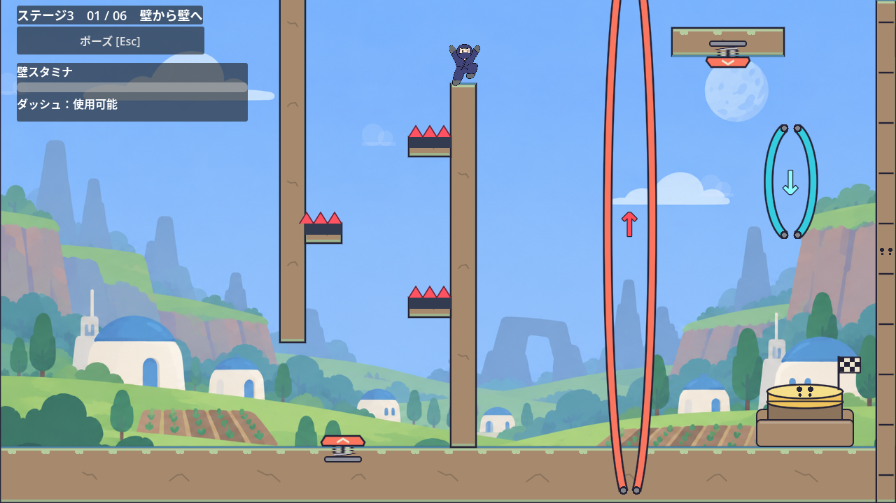

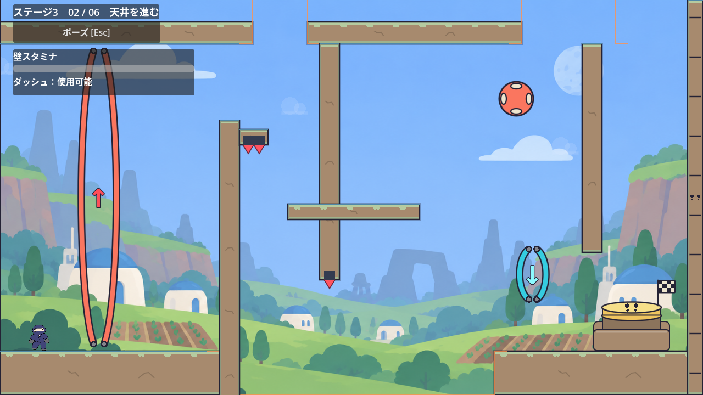

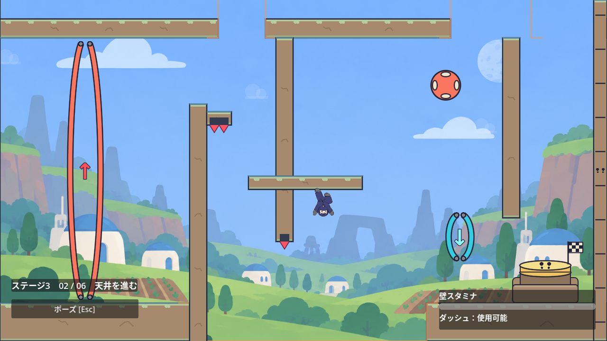

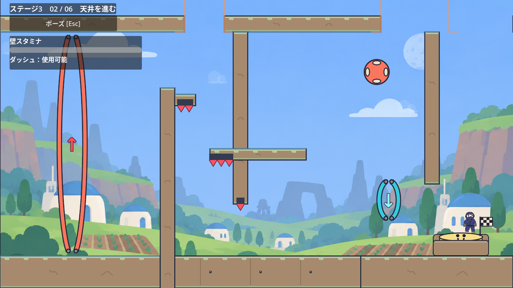

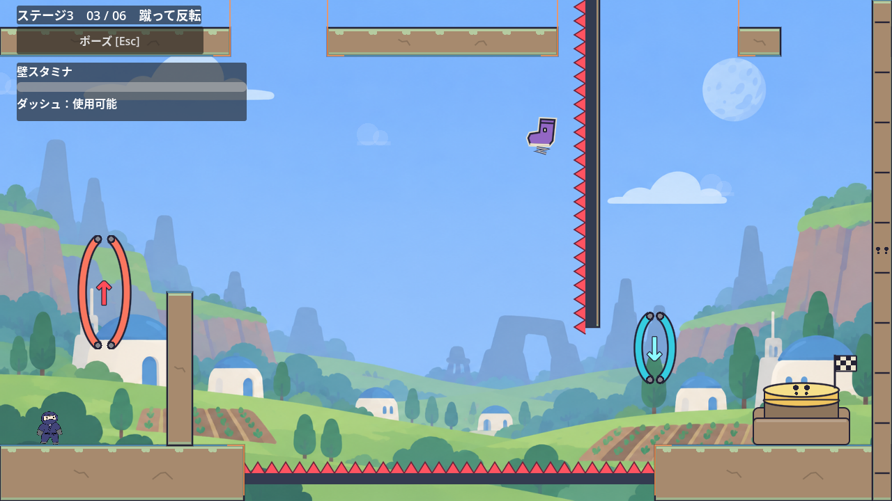

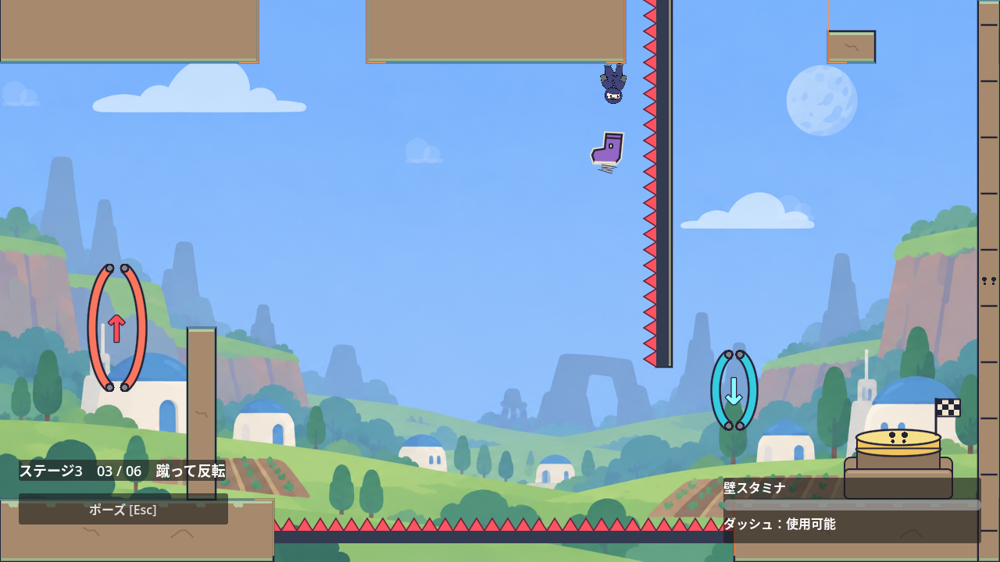

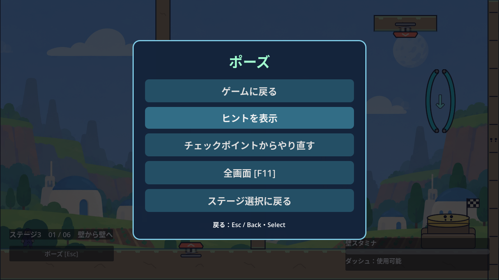

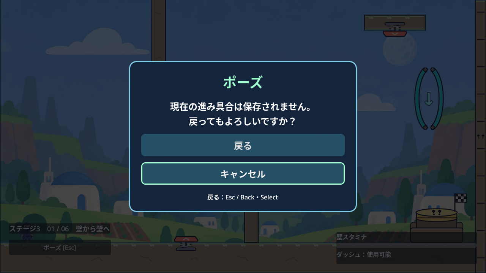

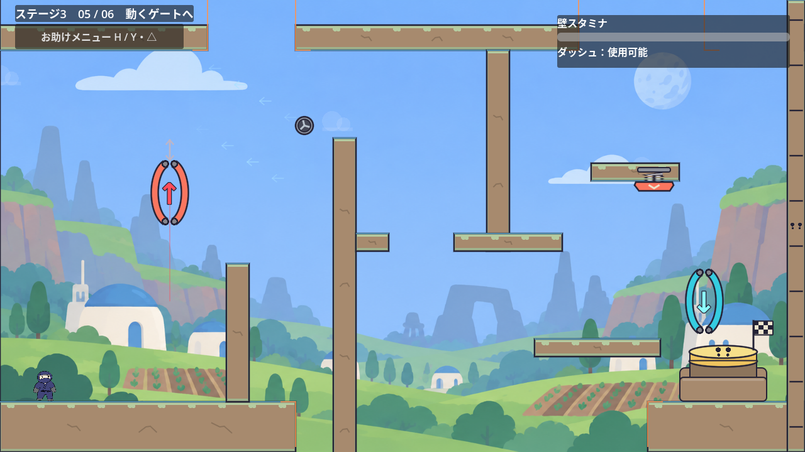

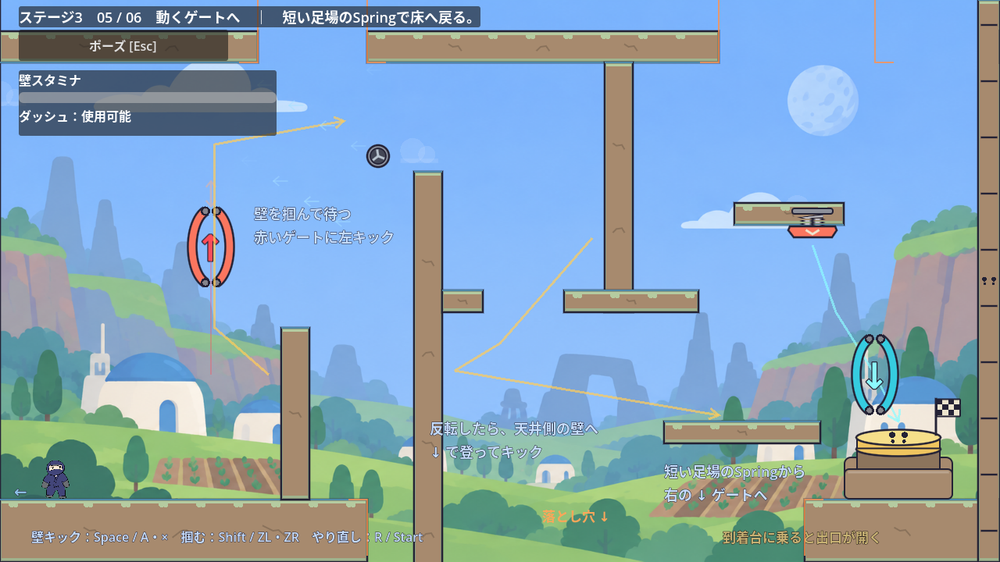

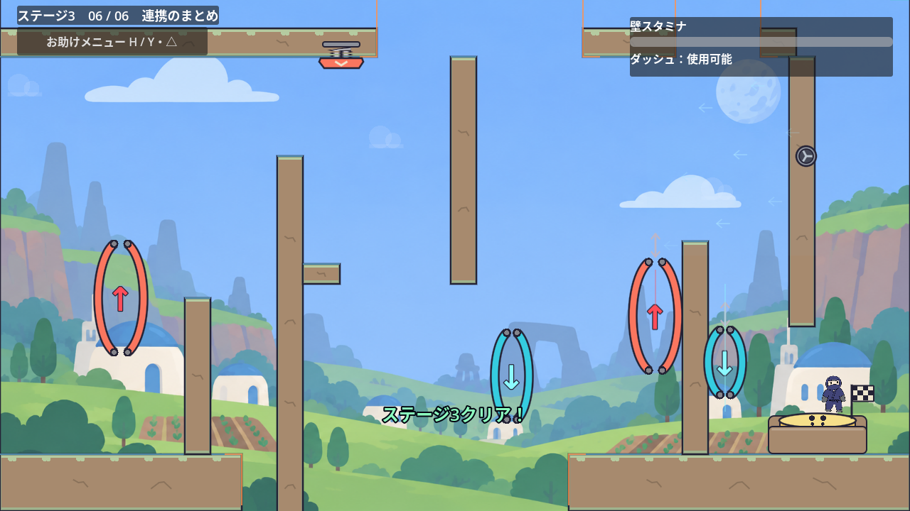

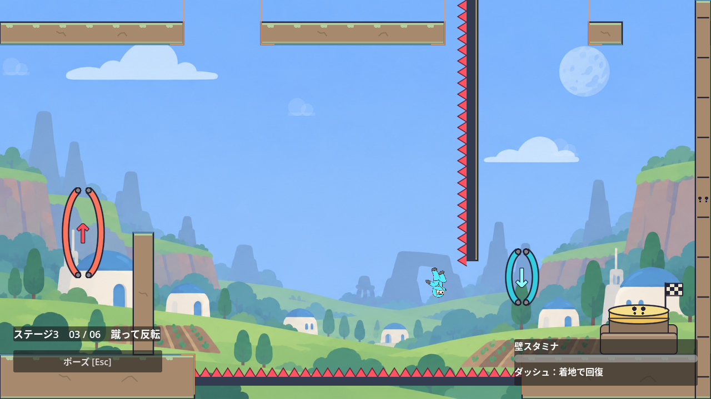

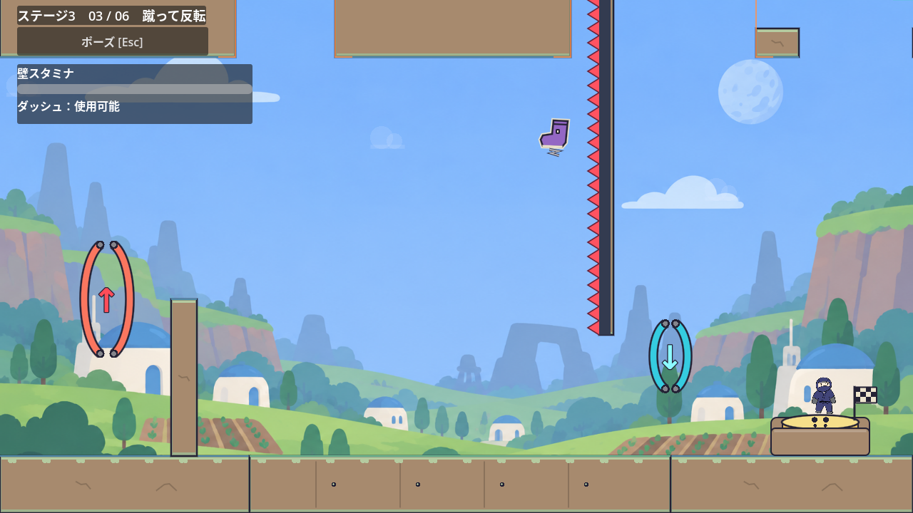

## 巻物の上層寄り道

第1室の入口側に、壁を登って上へ進む任意の寄り道を追加した。巻物の小さな印が入口を示し、片面足場で休みながら登り、上の足場へジャンプと上ダッシュで渡る。巻物は接触すると追従し、安全な足場に着地して獲得が確定する。中央の隙間を下りると元の入口側へ戻れる。部屋内の上端は-560pxとなり、この部屋だけ上層までカメラが追従する。右の主課題とは壁で区切り、寄り道を通らず既存ルートを遊べる。

最初の巻物は`gravity / wall_loft_01`。確定後は死亡・R・未クリアでの帰還・再起動でも記録が残り、ステージ選択に実配置総数との比を表示する。未確定のまま再開すると元へ戻り、取得済みは薄い巻物として場所を残す。確認は`tests/gravity_scroll_route_test.gd`の実入口からの連続入力で行い、途中の位置を変更せず登攀・獲得・帰路を通る。


## 追加した3室の配置と検証

第7室は第2室の壁渡りを左向きへ組み替えた。往路で3回の壁キックとUp・Downの反転を使う。復路は壁を2回蹴り替えて張り出しを越える。到着台を押すと中央の帰り橋を開き、右へ折り返す。入力なしで休める下面があり、巻物の寄り道からも同じ下面へ戻れる。到着前は出口を閉じ、右の入口からすぐ次室へ抜ける経路を防ぐ。

第8室は天井を160px上へ移し、吊り壁を上端-240px・下端430pxにする。左側のトゲは壁を伝って降りる代用を防ぐ。上層の休憩の真下に二つの靴を置き、通常ジャンプ、追加ジャンプ、追加ジャンプ、下ダッシュをつなぐ。一つ目の靴だけでは深さが足りない。壁上を回る経路は部屋上端の復帰判定と固い天井で防ぎ、谷底のトゲは反転前の落下迂回を防ぐ。既存の移動性能は変更していない。

第9室は後半の風を260×600pxに広げ、天井の穴へ向かう経路を覆う。風は左上向き、加速度300px/s²、最大80px/s。風の中でも横入力0.8で渡れるよう、後半の天井穴を130pxにした。上下するDownゲートを掴んだ壁で待ち、床側へ戻る。各到着台は操作履歴でロックせず、実際の着地で開く。

追加の巻物は `gravity / inverted_return_02`。第7室の安全な下面から、反転中のジャンプと下ダッシュで下の枝へ降りる。小さな巻物の印が下方向を示す。重力に引かれて同じ下面へ戻り、安全な着地で確定する。第7室の下端840pxは、この往復と失敗時の復帰に余裕を持たせるために広げた。新規の説明ラベルは増やしていない。第1室の巻物と合わせて総数は2個で、ステージ選択も実配置数を表示する。

`tests/stage_3_test.gd`は旧6室から新3室まで、入口から位置を変えずに9室を連続攻略する。第6室では完了せず、第9室で初めて完了すること、帰還・再入場・左右移動後のチェックポイントと既存のゲート復帰も確認する。`tests/gravity_expansion_route_test.gd`は各新室の実入口から通常入力・横入力0.8・第8室の踏切16/20/24フレーム、巻物の未確定R・確定保存・未クリア帰還・死亡復帰を検証する。入口からの8方向Dash・通常登りと、第8室の追加ジャンプ0回/1回の8方向Dashによる代用も試す。これらは有限の入力例であり、任意の操作列を網羅する証明ではない。

新3室の通過時間は通常入力で第7室14.68秒、第8室6.95秒、第9室12.82秒、合計34.45秒。第7室は右出口への折り返しも含む。横入力0.8では15.52秒、7.72秒、12.95秒。死亡・迷い・巻物・部屋移動演出は含めない。各復帰区間は30秒以内だが、本編9〜15分という全体の増量目標にはまだ届いていない。

旧第6室の最終境界壁は第9室へ移した。第7室から左へ戻り、第6室の右入口から再び進めることも実入力で検証する。

第7室の外側壁は上端220pxを保ち、下端960pxまで伸ばした。下へ潜って壁下面からダッシュを補充する代用を防ぎ、下端840pxの復帰判定が先に働く。第7・8室の出口壁も広げた部屋の上下を覆う。第7室の穴の縁線は下辺を840pxへ合わせ、巻物への安全な往復に重ねない。左右を反転した天井穴の縁線も実際の穴の座標へ合わせた。

Linux版Godot 4.7.2・60fpsで、9室連続攻略は417項目、通常・弱入力・踏切違い・収集・復帰・第6室との往復は189項目、従来の巻物ルートも成功した。入口からの72経路と追加ジャンプ代用48経路の負例を通し、壁延長後には下面へ潜る実入力の負例も確認した。描画を有効にした通常攻略・収集・復帰88項目を通し、入口、上層の休憩、風の待機、巻物への下降を画像でも確認した。実機での手動プレイは未確認。

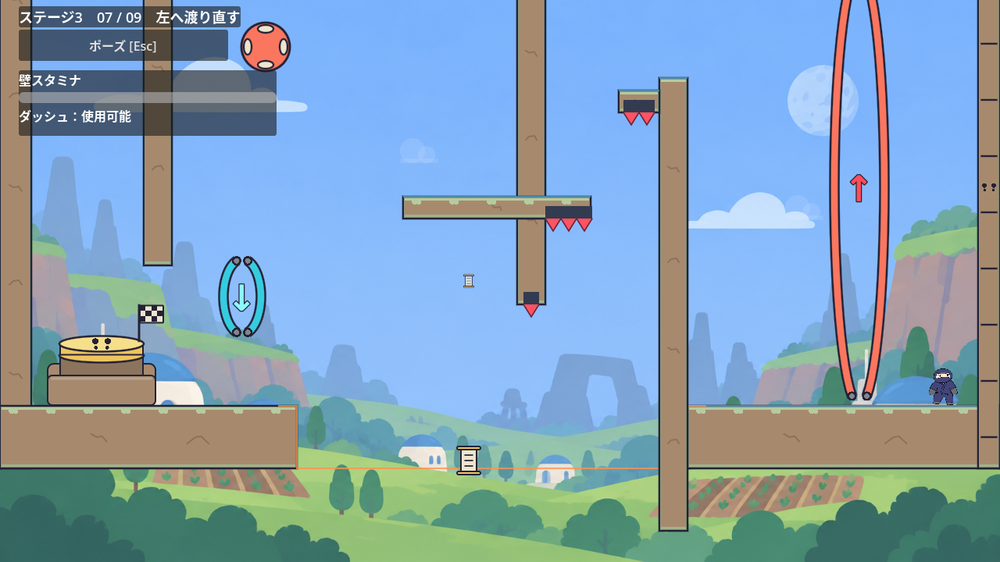

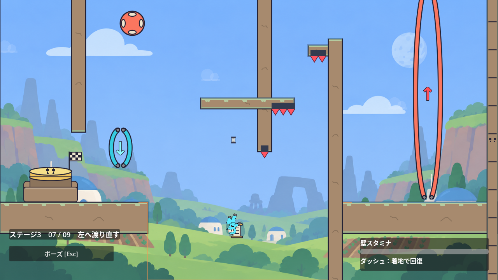

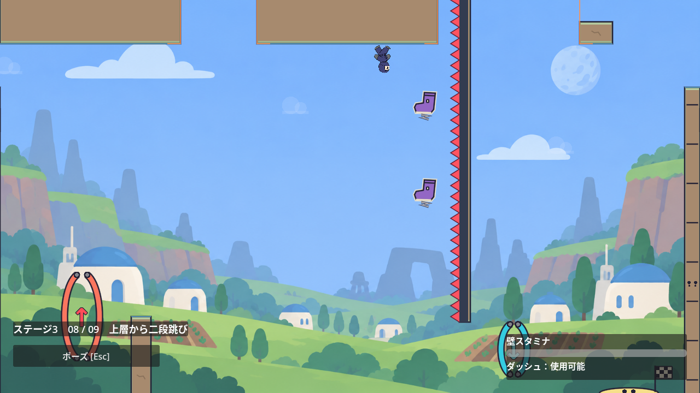

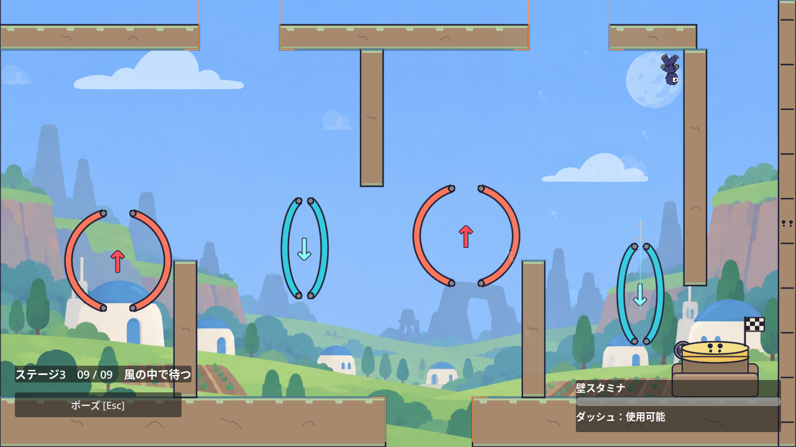
