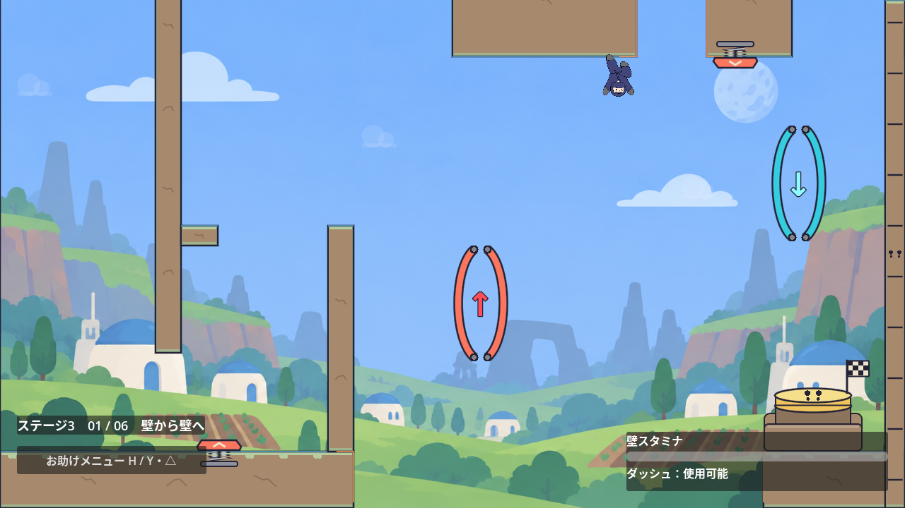
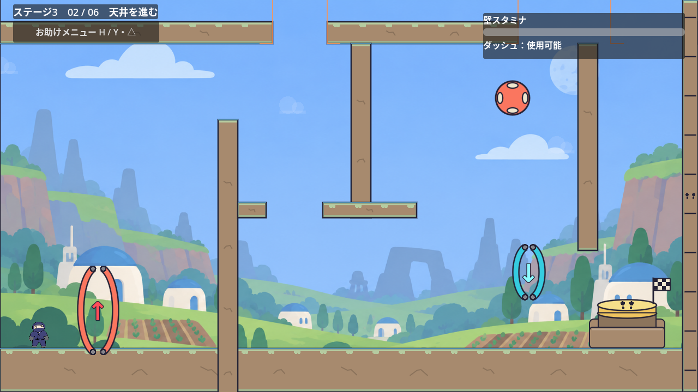
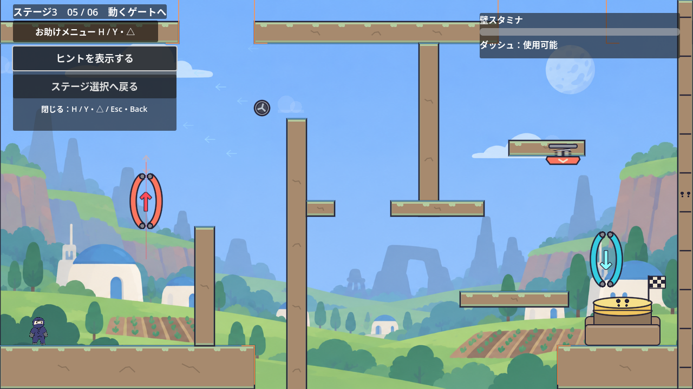
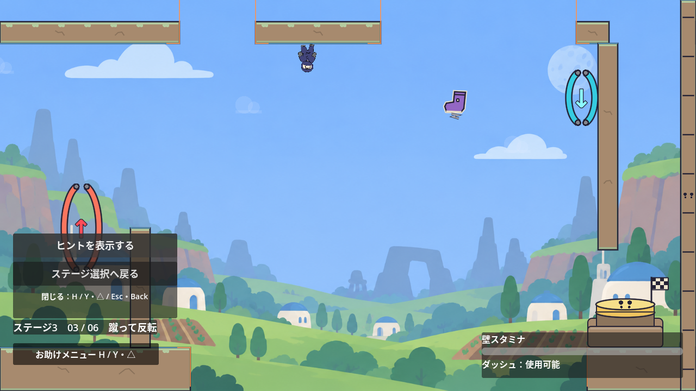
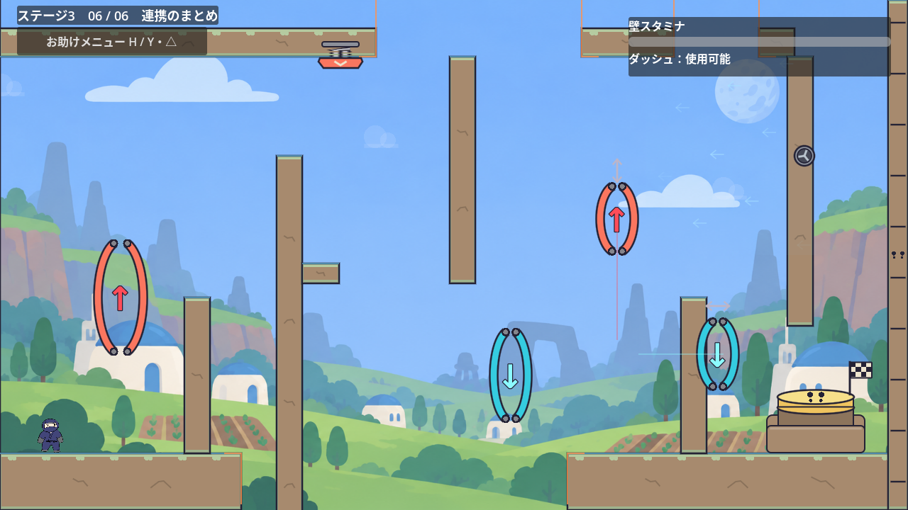

# ステージ3：壁キックと重力

状態：実装済み。1・2部屋目にSpringと反発板を加え、3〜6部屋目の後半にも穴と異なるギミックを配置した。説明文と経路の矢印は初期状態で非表示。

## 現状と既存の方針

- ステージ1は、16部屋のチュートリアル本編と任意のSuperdash練習部屋で構成される。
- ステージ3は選択画面に「壁キックと重力」と表示され、1部屋目から開始できる。
- 実装済みステージは自由に選択できる。前のステージのクリアを開始条件にしない。
- 選択画面へ戻ると進捗を破棄する。セーブ・途中再開は追加しない。
- 既存のギミックには重力ゲート、ダッシュ、壁アクション、クリスタル、Spring、PinballSpring、風ゾーン、持てる物体、重量スイッチがある。

出典：[ステージ選択の仕様](stage-selection.md)、[README](../README.md)、[用語集](../CONTEXT.md)。

## 決定した方向性

第３ステージでは、壁キックと重力反転のギミックを前面に押し出す。

壁キックは、壁を掴んで上がる「壁登り」と区別する。壁から反対側へ跳び出す動作を課題の中心に据える。

星のぼりの塔に続く本編ステージとして、1画面単位の6部屋で構成する。難易度アップの要望を受け、チュートリアルで覚えた操作を連続して使う中級向けの配置に調整した。後半ほど連携とタイミングの課題を増やす。

主課題は「壁キックでゲートを通過し、反転後に別の壁を蹴って次の足場へ渡る」とする。ダッシュと壁登りは補助として使えるままにし、張り出しやゲートを含む地形で壁キックと反転を使う経路を作る。

重力ゲートは静止するものを中心に配置し、終盤に移動ゲートを使う課題を入れる。

## 既存の動作による制約

- 同じ壁を蹴って戻る動作を繰り返しても、蹴り出した高さより低い位置へ戻る。壁キックで登る配置には向かい合う壁を使い、幅と高さは実際の入力で攻略して検証する。
- 壁キックは、通常重力では画面上へ、反転中は画面下へ跳び出す。横の速度は720px/s、重力に逆らう速度は560px/s。
- ダッシュ中以外に重力ゲートを通過すると、縦の速度が0になる。横の速度は残る。空中での連携は、この挙動を前提に配置する。
- ダッシュは既存の設定で無効化できる。壁キックを残して壁Grab・壁登りだけを無効化する専用設定はない。
- 壁登りを残しながら、張り出しで壁キックを使わせる配置はチュートリアルの2部屋目にある。
- 既存の到着台は、通常重力で上面に着地すると押せる。操作課題を設けずに解錠することもできる。
- 既存の部屋切り替えと復帰処理では、重力Down、速度0、ダッシュ回復、壁スタミナ最大に戻す。

出典：[プレイヤー](../scripts/player.gd)、[壁キックの回帰テスト](../tests/wall_jump_regression_test.gd)、[チュートリアル](../scenes/tutorial.tscn)、[到着台](../scripts/arrival_switch.gd)、[部屋切り替え](../scripts/tutorial.gd)。

## 6部屋の課題

各部屋は1280×720。足場やゲートの座標は、ダッシュなしの攻略を実入力で確認して調整した。

| 部屋 | 狙い | 配置と遊び |
| --- | --- | --- |
| 1：壁から壁へ | Springと壁キックと反転 | 床のSpringで跳び出し、壁を掴んで交互に蹴る。左右に動くUpゲートから天井へ移り、小さな穴を反転ジャンプで越える。天井のSpringからDownゲートを通って床へ戻る。天井の穴の真下には100px幅の床を置き、その前後の床の穴はクリア後も残す |
| 2：天井を進む | 反発から壁へ掴み替える | Upゲートから天井へ移り、穴と張り出しを越える。後半は反発板で跳ね返り、空中で出口の壁を掴んでDownゲートへ蹴り込む |
| 3：蹴って反転 | 空中ジャンプで広い穴を越す | 最初の壁キックで反転し、前半の穴を跳ぶ。後半は360pxの天井の穴の中でクリスタルを取り、空中でもう一度ジャンプする。出口のDownゲートへ入り、壁に沿って到着台へ着地する |
| 4：上下を往復 | 縦風と移動する帰還ゲート | 前半の天井と床の穴を順に跳ぶ。2回目のUpゲート後は、縦風の中で後半の天井の穴を越え、壁を掴んで上下移動するDownゲートを待つ |
| 5：動くゲートへ | 短い足場からSpringで飛び出す | 移動Upゲート、向かい風、壁キックを越える。後半は天井の穴の下にある短い足場のSpringで跳び出し、右のDownゲートから到着台へ着地する |
| 6：連携のまとめ | 向かい風と壁沿いの移動ゲート | 前半のSpringから空中で壁を掴み、交互に蹴って広い穴を越える。2回目のUpゲート後も、向かい風の中で天井の穴を跳び、壁沿いに上下するDownゲートへ壁キックする |

## 難易度アップの調整

- 1・2・5・6部屋目は、向かい合う壁の張り出しを重力に逆らう方向へ60px移動し、壁の間隔を24px広げた配置を使う。1部屋目ではSpringから右の壁へ掴み替えやすいよう、右の壁から伸びていた足場を取り除いた。
- 2・3・4・6部屋目の出口には天井から伸びる壁を置く。床へ戻るゲートは2・3・6部屋目で48×96px、4部屋目で64×160pxとし、2・4・6部屋目では最後の反転にも壁キックを組み込む。3部屋目は空中ジャンプ、5部屋目はSpringから直接Downゲートへ向かう。
- 5部屋目の移動Upゲートは48×96px、速度140px/s、端の停止時間0.20秒。6部屋目の後半の移動Upゲートは抜け道対策で64×160pxへ戻し、速度180px/s、端の停止時間0.12秒を保った。壁を掴み、ゲートの位置を見て蹴り出せる。
- 6部屋目の途中のDownゲートも48×128pxに縮め、壁を渡った直後のキックで入れる高さに置いた。
- 5部屋目には、出口の反転後に着地する200px幅の足場を置いた。入口側からの穴は残し、床へ戻った後もダッシュなしで着地して到着台へ進めるようにした。

## 部屋ごとの追加ギミック

- 1部屋目：床のSpringを部屋内X=310pxに配置する。速度900px/sで跳び出し、壁を掴んでから蹴り出す高さを決める。向かい合う壁の間隔と高さを保ったまま、壁・張り出し・Springを180px左へ移した。Upゲートは幅64×高さ160pxのまま、初期位置（680, 430）からX=600〜680pxを80px/sで左右に往復し、両端で0.5秒止まる。壁キックから反転し、X=640〜1120pxの天井へ向かい、（1040, 80）のSpringと（1130, 260）のDownゲートをつなぐ。天井のX=900〜1000pxは100px幅の穴とし、反転中のジャンプで越える。その真下の床側には同じX範囲・上面Y=640pxの足場を置き、青いゲートで通常重力へ戻った後に着地・歩行できる。足場は天井のSpringや両ゲートの経路に重ならない。
- 2部屋目：PinballSpringを（940, 180）に置く。後半の天井を歩く経路は切り、反発後に空中で壁を掴んでDownゲートへ向かう。反発速度の範囲は850〜1000px/s。
- 3部屋目：後半の向かい合う壁を、360px幅の天井の穴とジャンプクリスタルへ置き換える。クリスタルは（840, 195）。ジャンプ中に取り、2回目のジャンプを空中で使う。取得時はヒントが非表示でもHUDに残り1回を表示する。床の穴を730pxへ広げたため、出口のDownゲートを（1070, 180）へ移し、空中ジャンプから出口の壁沿いに着地できるようにした。
- 4部屋目：後半の穴に上向きの風を置く。風の加速度は300px/s²、最大速度は60px/s。出口のDownゲートはX=1030px、Y=500〜350pxを130px/sで往復する。大きさは48×96pxから64×160pxへ広げた。床側の2つのUpゲートも64×160pxから160×160pxへ広げ、壁を登る経路が範囲に入るようにした。床へ戻すDownゲートだけでは通常重力の抜け道を防げないため、両方向の既存ゲートで対策する。画面の上下を覆っていた追加の反転帯は削除した。
- 5部屋目：後半の天井を切り、X=940〜1080px・下面Y=288pxの短い足場を置く。その下面のSpringは750px/sで画面下へ押し出し、（1120, 480）のDownゲートへつなぐ。
- 6部屋目：後半の穴に左向きの風を置く。最大速度は100px/s。出口のDownゲートはX=1020pxに固定し、Y=400〜580pxを160px/sで往復する。床から伸びる後半の壁の右側に沿い、上下端は壁の高さの範囲内に収める。穴を跳んだ後は出口の壁を掴み、青いゲートの高さを見て左へ蹴る。

Spring・PinballSpring・クリスタル・風・移動ゲートは、既存のシーンと動作をそのまま使う。部屋ごとにプレイヤーの物理や操作を変えない。

## 1部屋目の反転を使わない抜け道への対策

元の配置では、床のSpringから2つ目の壁へ進み、Shiftの壁掴みで登り切って右側へ降りると、反転ゲートの下を歩いて到着台を押せた。開始地点から実際のキー入力だけで、重力反転0回、ゲート接触0回、壁キック0回、ダッシュ0回のクリアと2部屋目への移動を再現した。

一度はUpゲートを240×480pxへ拡大して防いだが、見栄えとバランスの指摘を受け、この大きなゲートを撤去した。現在は元の64×160pxのゲートと床の穴で経路を作っている。

- 床のX=500〜900pxとX=1000〜1080pxを切り、衝突と見た目の両方に穴を作る。X=900〜1000pxの追加足場より手前へ降りると床がなく、画面下へ落ちて入口へ戻る。
- 穴を作るだけでは、壁上からのジャンプ＋ダッシュで出口側へ届く案があった。壁の間隔や高さを保ったまま壁とSpringを180px左へ寄せ、通常重力で飛び出す場所から出口までの距離を取った。
- 小さいUpゲートはY=430pxを保ってX=600〜680pxを往復する。壁キックから反転し、天井側へ移る正規ルートを残す。
- 天井はX=640〜900pxとX=1000〜1120px、Y=-80〜80pxとする。間の100pxは穴とし、反転ジャンプで渡る。反転後に下面を進める一方、通常重力で天井の上に着地して渡る経路を作らない。衝突と見た目を同じ範囲にし、上側は画面外へつなぐ。
- 到着台を押しても穴は埋めない。出口とクリア状態だけを保持し、やり直し後も床と天井の穴を残す。初回クリアに反転回数などの隠れた条件は追加しない。

`tests/stage_3_room_1_shortcut_test.gd`は毎回入口へ通常のリセット入力で戻し、座標・速度・重力を直接変更せずに226通りを検証する。報告された登り降り、壁上からのジャンプ、壁上の3つの開始位置と14段階の待ち時間による右・上・斜め上ダッシュ、ジャンプせず壁から出るダッシュ、高い1つ目の壁から5段階の高さで蹴り出す経路を対象にする。反転するか画面外へ落ちて復帰することを確認し、時間切れは成功に数えない。報告された登り降りでは、ゲートに触れず穴に落ち、入口と重力・ダッシュ・スタミナが復帰することも確認する。

Godot 4.7.2 / Linuxのヘッドレス試験では、左右移動ゲートと床側の追加足場がある状態でも226通りすべてで反転なしのクリアが起きなかった。ゲートの往復・やり直し時の初期位置への復帰と、青いゲートで通常重力へ戻って追加足場へ着地・歩行する動作も確認する。追加足場の単独検証では開始位置と重力を設定し、226通りの抜け道検証は従来どおり入力だけで行う。全6部屋の攻略試験は329項目成功した。1部屋目の正規ルートでは壁キック2回、上下の反転、天井のSpringを使い、ダッシュ・落下によるやり直しなしで到着台を押せる。

描画を有効にした実行でも、D・Shift・W・Space・X・Rのキーイベントを送り、報告された登り降り、ジャンプ＋右・上・斜め上ダッシュ、壁キック2回を使う正規ルートを確認した。正規ルートは上下の反転、天井の穴を越えるジャンプ1回、天井のSpringを経て、落下・ダッシュなしでクリアした。ジャンプせずに天井の穴へ進む経路では、画面上へ落ちて復帰し、重力・ダッシュ・スタミナが戻ることも実入力で確認した。

上記の入力条件で抜け道が再現しないことを確認した。すべての操作の組み合わせを網羅した証明ではなく、Windows実機での確認は未実施。

## 6部屋目後半の抜け道の確認と対策

判定は真。修正前の6部屋目の入口から移動・壁キック・壁掴み・ジャンプの入力で前半を通り、中間のDownゲートで通常重力へ戻した。その後、後半の床の壁をShiftで登り、上面を乗り越えて出口側の床へ降り、到着台を押せた。部屋全体の反転は前半のUp・Downだけ、後半の赤いゲートへの接触は0回、壁キック3回、ダッシュ0回、やり直し0回。後半の青いゲートには触れたが、すでに通常重力のため反転は起きなかった。描画付きのキー入力でもこの経路を再現した。

- 後半の床の壁 `SecondLaunchWall` の高さを220pxから300pxへ変更した。床のY=640pxを保ち、上端を420pxから340pxへ80px上げた。
- 赤い `MovingUpGate` は48×96pxから64×160pxへ広げ、X=922px、Y=380〜460pxへ配置した。壁を登る経路と重なり、通常重力のまま上面へ抜ける経路を反転に捕まえる。速度180px/s、端の待ち時間0.12秒を維持する。
- 青い `DownGate` は48×96pxのままX=1020px、Y=400〜580pxを上下する。左端X=996pxを床の壁の右面に合わせ、上下端Y=352〜628pxを壁のY=340〜640px内に収める。速度160px/s、端の待ち時間0.15秒を維持する。横へ離れる動きは削除した。
- ステージ3全体の `ReturnBridge` と、クリア時に穴をふさぐ処理を削除した。穴と縁の表示はクリア後も残り、R / Startや部屋の出入りでも穴を埋めない。他のステージの仕様は変更しない。

`tests/stage_3_room_6_shortcut_test.gd` は各回を6部屋目の入口から始め、前半の上下反転を入力で通過する。8段階のタイミングで壁を登る経路と、床側の4か所から3方向・6段階のタイミングでジャンプとダッシュを組み合わせる経路の合計80通りを検証する。後半の反転に触れるか落下して復帰することを確認し、時間切れは成功に数えない。修正後は80通りすべてで後半のUpゲートに触れ、後半の反転を省くクリアは0件だった。青いゲートが動作中も壁の範囲に収まることを180フレーム検証する。

全6部屋の攻略試験は329項目成功した。6部屋目の正規ルートでは壁キック5回、上下の反転を各2回使い、ダッシュ・やり直しなしでクリアした。1部屋目の抜け道226通りも引き続き通過した。クリア済みの穴に落ちても、入口への復帰・クリア状態の維持が成立し、穴は埋まらない。

検証環境はGodot 4.7.2 / Linux。Windows実機と、列挙した条件以外のすべての入力の組み合わせは未検証。

## 落とし穴

床と天井の衝突と見た目を同じ位置で切る。重力反転で床の穴を避けても、実際に通る天井側でジャンプや壁キックを使う課題が残る。

### 天井側

| 部屋・区間 | 穴の範囲（部屋内のX座標） | 幅 | 越え方 |
| --- | --- | --- | --- |
| 1 | 900〜1000px | 100px | 反転ジャンプで越え、横入力を緩めて先のSpringへ着地する |
| 2 | 500〜600px | 100px | 反転中の通常ジャンプで越えてから、向かい合う壁へ進む |
| 2・後半 | 950〜1120px | 170px | 反発板から空中で出口の壁を掴む |
| 3 | 330〜470px | 140px | 最初のUpゲート通過後にジャンプする |
| 3・後半 | 700〜1060px | 360px | ジャンプ中にクリスタルを取り、空中ジャンプで距離を伸ばす |
| 4 | 320〜450px | 130px | 最初の反転後にジャンプし、天井壁のDownゲートへ進む |
| 4・後半 | 850〜1020px | 170px | 縦風の中でジャンプし、移動するDownゲートの手前へ着く |
| 5 | 330〜470px | 140px | 向かい風の中で跳び、次の壁キックへつなぐ |
| 5・後半 | 920〜1120px | 200px | 穴の下にある短い足場のSpringからDownゲートへ飛び出す |
| 6 | 530〜820px | 290px | 手前のSpringから右の壁を掴み、交互の壁キックで越える |
| 6・後半 | 950〜1070px | 120px | 向かい風の中でジャンプし、壁沿いに上下するDownゲートへキックする |

- 1部屋目は、穴を歩くだけでは画面上へ落ちて入口へ戻る。ジャンプで渡り、空中で横移動を緩めると先のSpringへ着地できる。穴の縁は他の部屋と同じオレンジ色で示す。ダッシュを使わない攻略を確認している。
- 5部屋目の向かい風は天井の穴を覆う200×240pxの範囲に置く。風の最大速度は80px/sとし、通常ジャンプでも越えられる余裕を残す。
- 6部屋目のSpringは天井側に下向きで配置し、900px/sで跳び出す。広い穴をただ歩くと画面上へ落ち、Springを使う場合も壁への掴み替えが必要になる。
- 天井の穴はクリア後も残す。通常重力で床側の帰路を使える。

### 床側

| 部屋 | 穴の範囲（部屋内のX座標） | 幅 | 越え方 |
| --- | --- | --- | --- |
| 1 | 500〜900px、1000〜1080px | 400px、80px | Springと交互の壁キックからUpゲートへ入り、天井のSpringとDownゲートを経て床へ戻る。天井の穴の真下のX=900〜1000pxには床側の足場がある |
| 3 | 350〜1080px | 730px | Upゲートから天井側へ移り、前後の穴をジャンプで渡る |
| 4 | 620〜760px | 140px | 床へ戻った後、穴の手前からジャンプする |
| 5 | 470〜1030px | 560px | 既存の穴。移動するUpゲートから天井側の壁へ移る |
| 6 | 340〜800px | 460px | Upゲートから天井側の壁を渡り、Downゲートで出口側の床へ着地する |

- 上下の穴の縁は常にオレンジ色で表示する。「落とし穴 ↓」や経路の矢印はヒントを表示したときだけ見える。
- 床の穴から画面下へ、反転中に天井の穴から画面上へ出ると、その部屋の入口へ自動で戻る。復帰の条件やリセット内容はR / Startと同じ。
- 4部屋目の2つ目のUpゲートは40px上へ移した。穴を越える通常ジャンプでは触れず、次の壁キックで通過できる高さにした。
- 到着台を押しても床・天井の穴と縁の表示は残す。クリア後ややり直し後にも、穴へ落ちれば現在の入口へ復帰する。

## 進行と復帰

- 各部屋のカメラは固定し、部屋移動のときに横へスライドする。
- 操作回数や体験済み操作のチェックは設けず、到着台にたどり着いて押せば出口が開く。各部屋の到着台は床側に置く。
- 出口から次の部屋へ進める。左端から前の部屋へ戻って練習できる。
- 入室時の入口を復帰地点にする。落下またはR / Startで現在の部屋の入口へ戻し、重力Down、速度0、ダッシュ使用可能、壁スタミナ最大にする。
- やり直し時は、現在の部屋の移動ゲートも初期位置から再開する。すでに開いた出口は、そのプレイ中は開いたままにする。
- 1・3〜6部屋目の床の穴は、クリア後も埋めない。進行とクリア状態の保持は、穴の有無と独立して扱う。

## 案内と完了

- 初期状態は部屋名、ゲージ類、「お助けメニュー」の入口だけを表示し、説明文・操作案内・経路の矢印と、ヒント・選択画面へ戻るボタンを隠す。
- 「お助けメニュー」、Hキー、ゲームパッドのY／△でメニューを開閉する。開いている間はキャラ操作とスタミナ消費を止め、ヒントボタンへフォーカスする。キーボードとゲームパッドでヒント・ステージ選択へ戻るボタンを選べる。閉じるとフォーカスを外し、ジャンプがボタンを押さないようにする。
- メニュー内のヒントボタンで、説明文と経路の矢印をまとめて表示・非表示にする。HやEscを長押ししてもメニューの開閉を繰り返さない。H／Y・△／Esc・Backで閉じられる。
- ヒントの設定は部屋移動・やり直し・クリア後も保持する。選択画面からステージへ入り直すと非表示に戻る。
- ゲートや風の方向、Springの見た目、穴の縁はギミックを判断する情報として常に表示する。壁スタミナは秒数やパーセントを表示しないProgressBarとし、ダッシュ・空中ジャンプと一緒に、通常重力では右上、反転中は右下へ同じフレームで切り替える。左側の部屋番号・タイトル・お助けメニューも同時に上下を切り替える。下側のメニューはボタンの上へ開き、画面外にはみ出さず、下端の操作ヒントにも重ならない配置にする。文字は上下反転させず、読みやすい向きを保つ。「重力：床↓」の文字は表示しない。
- 6部屋目の到着台を押すと「ステージ3クリア」を表示する。その後も部屋へ戻って練習でき、前の部屋ではクリア表示を隠す。
- メニューを閉じているときのEsc / Back・Select、またはメニュー内の「ステージ選択へ戻る」ボタンで選択画面へ戻る。再選択すると1部屋目から始まる。

## ファイルの担当

- `scenes/stage_3.tscn`：6部屋の足場・落とし穴・ゲート・風・Spring・反発板・ジャンプクリスタル・到着台・ヒント・経路の矢印。
- `scripts/stage_3.gd`：部屋切り替え、復帰地点、出口とクリア、お助けメニュー・ヒント表示の管理。
- `scripts/arrival_switch.gd`：本編では `mission_required = false` とし、ケースと操作課題の吹き出しを表示しない。
- `scripts/hud.gd`：本編の部屋名・ヒント・壁スタミナ・ダッシュ。ゲージ類を重力と反対側に置いて経路を隠しにくくする。
- `scenes/stage_select.tscn` / `scripts/stage_select.gd`：ステージ3の開始。
- `tests/stage_3_test.gd`：全6部屋の実入力攻略と進行・復帰・完了の確認。
- `tests/stage_3_room_1_shortcut_test.gd`：1部屋目の反転を使わない抜け道を226通りの実入力で検証。
- `tests/stage_3_room_6_shortcut_test.gd`：6部屋目後半の反転を省く経路80通りと、壁に沿う青いゲートの移動範囲を検証。

## 動作確認

- ステージ選択からステージ3を開始し、戻る・再選択ができること。
- 6部屋を実際の入力で攻略し、壁キックと重力反転の連携が成立すること。
- ダッシュを使わない攻略経路でも全6部屋を通過できること。
- 上下それぞれの落とし穴へ入力で進み、掴まずに画面外へ落ちると、現在の入口へ戻って重力・スタミナ・ダッシュ・移動ゲートをリセットすること。
- 穴を越える攻略中には落下せず、クリア後ややり直し後も床の穴と縁の表示が残ること。クリア済みの穴に落ちても、クリア状態を保って入口へ復帰すること。
- 前半・後半のすべての天井の穴で、移動だけでは落下して復帰すること。
- 1部屋目の2つのSpringと反転、2部屋目の反発板、3部屋目のクリスタルと空中ジャンプ、4部屋目の縦風と移動ゲート、5部屋目の出口Spring、6部屋目の向かい風と壁沿いの移動ゲートが、実際の攻略経路で機能すること。
- メニューとヒントは初期状態で非表示であり、マウス・Hキー・ゲームパッドでメニューを開閉でき、その中でヒントを切り替えられること。ヒントは部屋移動とやり直しで保持されること。
- 3部屋目の壁上からジャンプし、横・斜め上ダッシュを0・15・30・45・55・60フレーム後に使っても、床の穴を越えてクリアできないこと。4部屋目は床の2つの壁を登っても拡大した既存のUpゲートに触れること。
- スタミナゲージが実際の消費量を表示し、部屋番号・タイトル・お助けメニューと同時に画面の反対側へ移ること。下側のメニューもマウスでヒントを切り替えられること。
- やり直し・逆戻り・移動ゲートのリセット・最終クリアが合意した仕様どおりに動くこと。
- ステージ1のチュートリアル、既存の壁キック・重力ゲート・到着台の動作が維持されること。

```powershell
Godot_v4.7.2-stable_win64_console.exe --headless --fixed-fps 60 --path . --script res://tests/stage_3_test.gd
Godot_v4.7.2-stable_win64_console.exe --headless --fixed-fps 60 --path . --script res://tests/stage_3_room_1_shortcut_test.gd
Godot_v4.7.2-stable_win64_console.exe --headless --fixed-fps 60 --path . --script res://tests/stage_3_room_6_shortcut_test.gd
```

Godot 4.7.2のLinux版で `STAGE_3_TEST_OK`（329項目）と終了コード0を確認した。全6部屋の攻略には位置の変更やギミックの強制発動を使わず、移動・ジャンプ・壁Grabの入力だけを使い、落下によるやり直しも起きていない。攻略に使った壁キックは各部屋で2・3・1・4・3・5回。1部屋目では2つのSpringと重力反転をつなぎ、5・6部屋目でもSpringが発動する。2部屋目では反発板から出口の壁へ掴み替えている。3部屋目では空中でクリスタルを取り、実際に空中ジャンプからDownゲートへ進む。4・6部屋目では後半の風の範囲を通過して穴を跳び、移動Downゲートへ壁キックする。反転はそれぞれUp・Downを2回ずつ。4部屋目はゲートの拡大に合わせ、床側の壁キックを少し低い位置から行う経路で確認した。クリア後は5部屋目の到着台を跳び越えて戻り、残った床の穴へ落ちると右側の入口へ復帰し、クリア状態を保つことも確認した。前半・後半すべての天井の穴と床の穴の検証では、穴の手前に配置したプレイヤーを入力で進ませ、画面外への落下と自動復帰を確認した。画面外への落下や部屋境界、4部屋目の2つ目の床の壁の単独検証では位置を変更している。

到着台の押し込み中にお助けメニューを開き、押下完了で出口が開くことも実入力で確認した。キャラ操作が止まっている間も、開始済みの押し込みの完了通知を受け取る。

修正前の抜け道は実入力で再現した。3部屋目は壁の上でジャンプし、45フレーム待って斜め上へダッシュするとX=933.97pxの床へ着地し、反転なしで到着台を押せた。4部屋目は床の2つの壁を登り、2回のジャンプだけで到着台へ進めた。こちらも反転は0回だった。修正後は3部屋目の横・斜め上ダッシュの12通りを試し、すべて落下による復帰となった。4部屋目は追加の反転帯を使わず、両方の床の壁から拡大した既存のUpゲートへ触れることを確認した。

お助けメニューとヒントの初期非表示、マウス・Hキー・Y／△による開閉、ゲームパッドのA／×によるヒント切り替え、キーボードによる選択画面への移動、Hキーの長押し、部屋移動・やり直しでのヒント保持、再入場での初期化を確認した。スタミナゲージと実際の残量の一致、ゲージ・部屋番号・タイトル・お助けメニューの上下切り替え、メニューを閉じたときのフォーカス解除も検証した。反転中の下側のメニューを実際にマウスで開き、ヒントの表示・非表示と閉じる操作ができることも確認した。ステージ選択（41項目）・チュートリアルの部屋（48項目）・壁キック（684項目）・環境ギミック（443項目）の回帰テストも成功した。

描画を有効にした環境でも同じテストを実行し、全6部屋とクリア画面のスクリーンショットを更新した。5部屋目のヒント表示、閉じて始まるお助けメニューを開いた状態、3部屋目で反転中のゲージ位置も画像で確認した。















