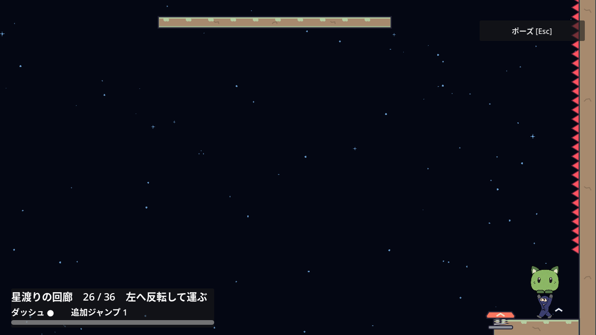
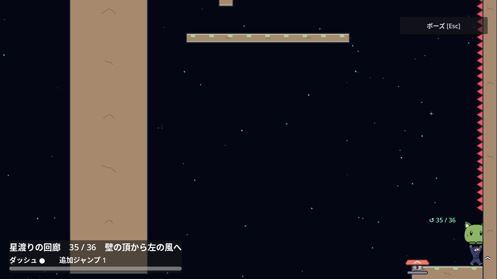
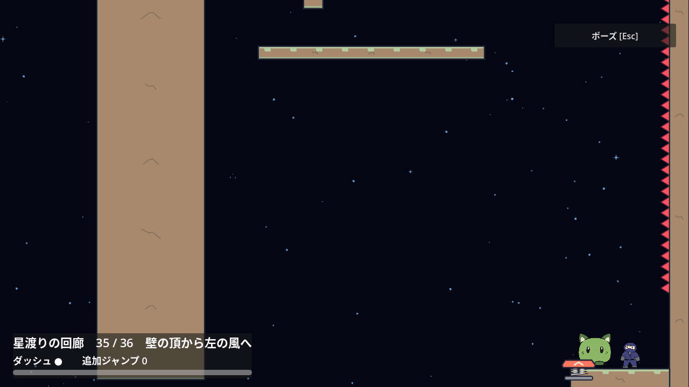
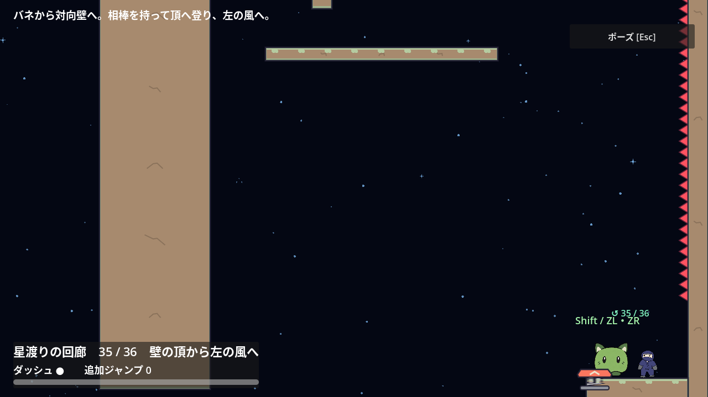
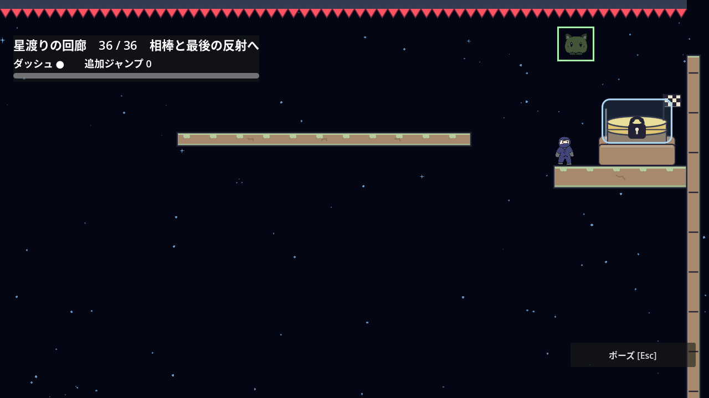

# ステージ4の入口と経路の読みやすさ

部屋移動でキャラが一時的に見えなくなるカメラ移動は、[ステージ4・5共通の改善記録](room-transition-camera.md)で扱う。

2026-10-28。[Issue #186](https://github.com/Foxy-null/2d-space/issues/186)。[調査と合意した方針](stage-3-navigation.md)に従い、進行方向を変える入口でも安全に出発できる地形にする。

## 確認した問題

第26・29・32・35室は右から左へ進むが、復帰時は右を向く。右入力を2秒保持すると、背面の壁のトゲで各10回の死亡が発生した。ステージ5のような画面外への歩き抜けではなく、入口にある見えるトゲへの接触である。

第21室の最初の足場が見えないという調査候補は、実座標と描画を確認して取り下げた。入口の反射球全体と最初の足場が見え、相棒を拾って反射する既存の経路も成功したため、課題を変更しない。

## 改善範囲

既存の実体壁を残し、左向き4室の境界トゲの下端を入口床から140px上へ移す。上端Y=100は保つ。歩く高さは安全な壁で止まり、上へ登る場合は残したトゲに触れる。新しい地形、説明文、矢印は足さない。復帰時は部屋の進行方向を向く。

入口床・最初のギミック・巻物・チェックポイントは動かさない。事前のメモリ上の試行では4室とも、相棒保持で右入力120フレームを受け止め、その場のジャンプで上側トゲに接触し、復帰後も本筋へ進めた。これは正式な変更後の検証と区別する。

120px案では相棒の上端との隙間が4.25pxしかなかったため、描画を含めて余裕のある140pxを選ぶ。第26室の3秒の静止描画では、耳を含む実テクスチャとトゲの間に24.25px以上の間隔があった。保持物の端が壁へ少し隠れる既存の描画は残る。

## 検証条件

- 全4室の通常・弱入力で、相棒を保持したまま背面の壁に歩いて接触しても死亡せず、左へ切り返せる。R後の向きも一致する。
- 各室の実入口からの本筋、必要なバネ・靴・反射・壁・風・相棒を省略する有限の比較、上側トゲからの復帰、第35室の巻物の未確定取消・確定保存を確認する。
- 常設ヒントを隠した描画で、安全な足元と残したトゲ、左のギミック、保持した相棒が見えることを確認する。自動入力の成功を初見ユーザー評価とは扱わない。

既存の復帰テストでは、背面への水平Dashでトゲに接触していた。安全にした4室では、残した上側のトゲへ向かう実入力に更新し、接触による死亡と復帰の検証条件を保つ。

## 変更後の検証

### 通常攻略と入口

新しい`corridor_navigation_test.gd`は変更前、第26室で相棒を持った右入力120フレーム中に10回死亡して失敗した。変更後は4室・実axis 1.0/0.8で、背面壁への接触、相棒保持、耳まで含む描画とトゲの余白、Rの位置と向き、左への再出発を82項目確認した。相棒の描画とトゲの間隔は通常24.2458px、弱入力24.2607pxだった。

本筋は各室について、実axis 1.0/0.8と入力間隔16/20/24フレームの計24通りを実入口から攻略した。相棒、Spring、靴、壁キック、風など、既存の課題に使う実物と入力を用い、到達位置や速度は注入しない。

| 部屋 | 成功項目 | 攻略時間の範囲 |
| --- | ---: | --- |
| 26 | 48,903 | 14.52〜15.27秒 |
| 29 | 51,981 | 15.58〜16.08秒 |
| 32 | 68,475 | 11.40〜13.38秒 |
| 35 | 85,215 | 15.02〜16.23秒 |

### 復帰と必要な操作

第25〜30室の復帰は54,707項目、第31〜36室の復帰は73,118項目成功した。安全にした4室では斜め上へのDashで残した上側のトゲへ実接触し、死亡1回と同じ入口・相棒・資源への復帰を確認している。

既存の省略検証は4室の計240経路・936項目成功。第26室のSpring・反転ゲート、第29室の靴・相棒・反射、第32室の靴・風、第35室のSpring・壁・風を省略する有限の入力例で、対象の足場や出口へ突破しなかった。

独立レビューでは新しい安全部分を起点に、実相棒を持って右壁へ歩き、約50px跳んで実壁キックを行ってから、相棒ジャンプと8方向Dashを試した。Springなしの第26・35室、靴なしの第29・32室で入力時機2種を組み合わせた64経路・256項目も突破しなかった。全入力での不可能性の証明とは扱わない。

第35室の巻物は通常17,474項目・弱入力17,339項目成功。巻物の往復は7.08秒・6.82秒、入口から出口までは19.35秒・19.20秒だった。仮取得中のR・死亡・帰還による取消、確定後のR・死亡・保存再読込を確認した。

この巻物テストにも、確定後に入口の背面へ歩いて死亡を起こす旧入力が残っていた。床と壁に接触したら実Jumpで上側トゲに触れる操作を加え、未確定時の入力と保存条件を保った。同じ死亡helperを使う第31室の通常・弱入力32,690項目、第33室の通常・弱入力30,965項目も成功した。

### 描画

Xvfb/OpenGLで第26・29室、第32・35室の入口・壁への接触を各24項目確認し、全4室の画像を目視した。相棒の耳まで含む画面内表示と上側トゲとの余白を確認している。背面へ押し続けると保持物の右端が壁に隠れる既存の描画は残る。上トゲとの重複や画面外への切れではない。

実機ゲームパッド、初見ユーザー、60Hz以外の確認は含まない。

## Issue #189：補助ラベルをヒント設定へ連動

入口の改善は[PR #188](https://github.com/Foxy-null/2d-space/pull/188)でレビュー・マージ済み。次の[Issue #189](https://github.com/Foxy-null/2d-space/issues/189)は、ヒントOFFでも相棒の近くの操作キー、出口の矢印と記号、重複するチェックポイント番号が残っていたことへの対応である。従来の切替はHUDの説明文だけを表示・非表示にしていた。

初期状態ではこれらの補助ラベルを隠す。ポーズメニューでヒントをONにすると表示し、掴むキーは近くにいて未保持の場合だけ表示する。出口の相棒の絵と枠、巻物の控えめな印、地形、HUDの部屋情報と資源は保つ。説明を読みたい場合の既存の選択肢は残し、地形と実物の絵を手がかりに進む通常の画面を整える。

### 状態と実攻略の検証

変更前はヒントOFFでも第1室の操作キーと出口矢印が表示され、新しい非表示条件で失敗した。変更後の`corridor_hint_labels_test.gd`は全36室のOFF/ON、近接・離隔、実Grab・R、ポーズメニューの実ボタン、実第1→2室の移動、再入場時のOFFを2,639項目確認した。近接と離隔の表示判定だけは、物理を進めない隔離した位置変更で確認する。

既存の全36室の運搬条件・相棒の絵と枠の検証256項目、共通ポーズ171項目、左向き入口82項目も成功。ヒントOFFの実攻略は第1・24・35・36室と、第24室で赤へ持ち替える選択経路を13項目確認した。位置を変えた表示用fixtureを、実攻略の成功とは扱わない。

第3観点の描画はXvfb/OpenGLで第1・24室、第35・36室を各12項目確認した。入口と出口のOFF/ON計16画像を目視し、補助ラベルだけが消え、出口の相棒の絵と枠・地形が残ることを確認した。出口の画像は隔離した表示用の配置であり、その位置へ実攻略で到達した証拠とは区別する。独立コードレビューはApprove。

