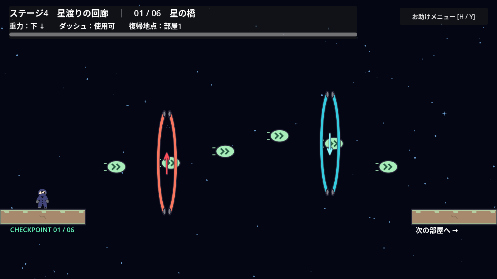

# ステージ4：星渡りの回廊

ステージ2・3と同程度の難易度を目安にした、空中移動中心の全6部屋。ステージ選択から自由に開始できる。各部屋は1280×720でカメラを固定し、出口の足場の右端まで進むと0.28秒で次の部屋へスライドする。

入口・出口の220pxの足場以外には床も天井もなく、中央840pxの空間を緑のダッシュ回復クリスタルと重力反転ゲートで渡る。基本移動の速度・重力・ダッシュ性能は既存ステージと共通。ダッシュと壁アクションは最初から使用可能。

| 部屋 | テーマ | 経路 |
| --- | --- | --- |
| 1 | 星の橋 | 緩い高低差でダッシュ回復と上→下の反転をつなぐ |
| 2 | 浮かんで渡る | 反転で高めのクリスタル列へ上がり、通常重力へ戻る |
| 3 | 低空からの反転 | 入口から低い緑へ進み、上向き重力で持ち上がる |
| 4 | 山なりの航路 | 大きな山形のクリスタル列を斜めダッシュで渡る |
| 5 | 上下のリレー | 4つのゲートで上下を交互に切り替え、低い最後の緑から着地 |
| 6 | 空の向こうへ | 高低差と4つの反転を連続させ、出口の到着台でクリア |

各部屋には緑のクリスタル6個を約140px間隔で配置。赤↑は上向き、青↓は下向き重力。上下の画面外へ出ると現在の部屋の入口から再開する。部屋間の足場では休憩できる。

次の部屋へ進むと、その入口がチェックポイントになる。R / Startまたはお助けメニューの「復帰地点からやり直す」で同じ部屋へ戻り、通常重力・ダッシュ・スタミナ・クリスタルが回復する。進行はそのプレイ中だけ保持し、ステージ選択へ戻って入り直すと部屋1から。ディスクへのセーブは行わない。

H / Y・△でお助けメニューを開くとキャラクターの移動が止まる。ヒントを有効にすると操作の説明と緑を結ぶ経路線を表示。ヒント設定は部屋移動・やり直しでも維持する。Esc / Back・Selectはメニューを閉じ、メニュー外ではステージ選択へ戻る。

配置は `scenes/stage_4.tscn`、進行は `scripts/stage_4.gd`。難易度は実入力による通過確認を基準に調整しているが、人による体感比較は今後の試遊で行う。

## 確認

`tests/stage_4_test.gd` をGodot 4.7.2で実行：

```powershell
Godot_v4.7.2-stable_win64_console.exe --headless --fixed-fps 60 --path . --script tests/stage_4_test.gd
```

選択画面からの開始、テレポート・能力の直接補充なしの全6部屋踏破、クリスタル取得・反転、上下脱落からの復帰、メニューによる移動停止、ヒント、再選択での初期化を確認する。成功時は `STAGE_4_TEST_OK`。


