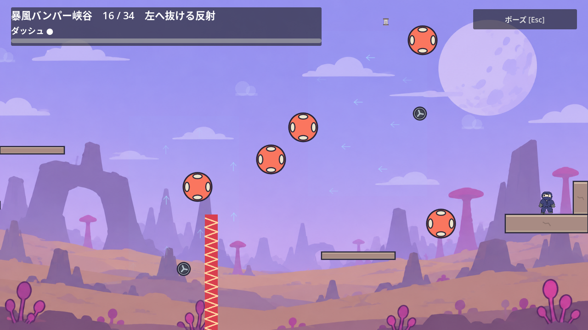
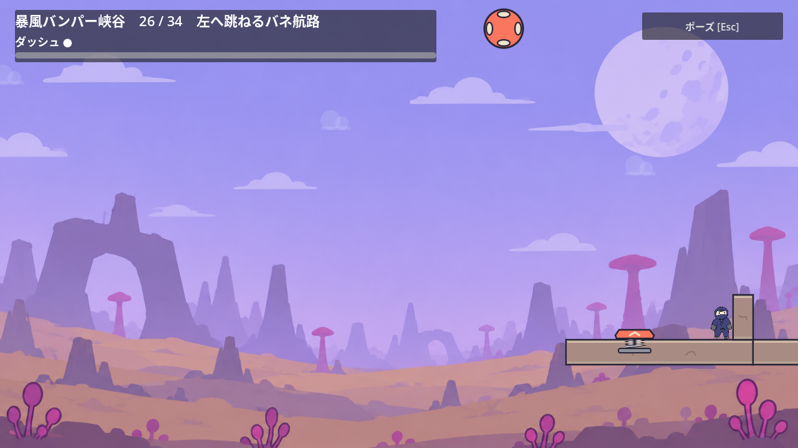
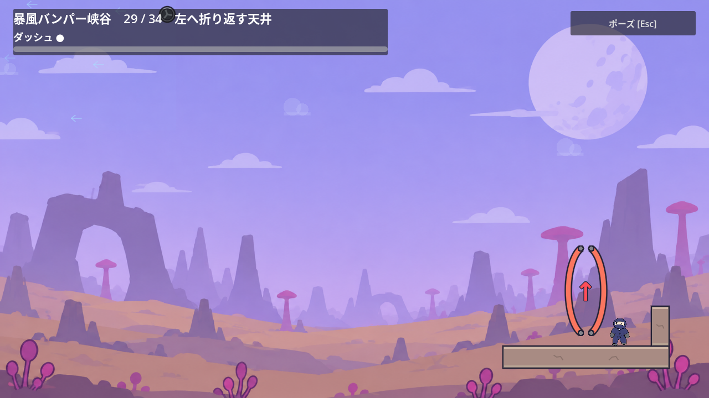

# ステージ5の左向き入口

2026-10-28。[Issue #185](https://github.com/Foxy-null/2d-space/issues/185)。Celesteの一次資料と[合意した設計方針](stage-3-navigation.md)に従い、入口の背後と進行側の空間で方向を伝える。

## 確認した問題

第16・18・20・23・26・29室は右側から左へ進む。全6室で入口から右境界まで90px、背面の地形がなく、復帰時は右を向く。入室後に右入力を2秒保持すると、各室で5回ずつ入口への復帰が発生した。

第25室を実入口から攻略して第26室への通常移動中から右を保持した場合も、4秒で9回の復帰を確認した。初回は40物理フレーム後、以後は24フレームごと。進む方向を変える前に、意図しない再挑戦を繰り返してしまう。

## 改善範囲

右から入る6室の入口背面に、既存の幅32px・高さ72pxの段差を置く。段差の下端を各入口床の上面へ合わせ、右は地形、左は課題と空間という形にする。歩くだけでは部屋の外へ抜けず、入力を左へ変えて課題へ出発できる。

復帰時の向きを、その部屋の出口側へ合わせる。右向きの部屋は右を向く。基本操作、バネ・反射・風・重力ゲート、巻物の枝、チェックポイントの位置は保つ。常設の文字や矢印は追加しない。

段差を足場にしてバネなどを省略できる可能性もあるため、入口からの実攻略に加えて、必要なギミックを省略する有限の入力例を確認する。初見での理解や全入力の不可能証明とは区別する。

## 3回の検証

1. 通常攻略と入口：新しい`canyon_navigation_test.gd`は変更前に右入力120フレーム中の5回復帰で失敗した。変更後は全6室・実axis 1.0/0.8の右入力保持、地形接触、左への切り返し、R、実第25→26室の移動で4,135項目成功。第26室の実攻略は入力強度2種×入力間隔16/20/24フレームの6通り・23,660項目、第29室は実axis 0.8・4,102項目成功。
2. 復帰と必要な操作：第25〜27室の復帰48項目、第28〜30室の復帰19,207項目成功。第26室はバネ・反射なしの34経路・136項目、第29室は天井バネなし8方向・66項目で突破しなかった。独立レビューでは第26室の実入口から新しい段差の中央・左端へ通常ジャンプで乗り、バネを無効にして8方向や複数の入力時機を組み合わせた計44経路も突破しないことを確認した。巻物は第16・18室の通常・弱入力82項目、第19・23室の通常・弱入力78項目で、仮取得中の死亡による取消と確定後の保存維持も確認した。
3. 描画：Xvfb/OpenGLで代表第16・26・29室の入口と段差への接触を24項目確認し、右の段差と左の課題が同じ画面に入ることを目視した。別実行で第25室を実攻略し、第26室への移動中から右を240フレーム保持する4,061項目も成功した。

34室の連続攻略は第1〜32室の成功まで進んだ後、実行環境から終了コード143で終了した。assert失敗はないが全34室の完走とは扱わない。長い描画実行も終了コード143となったため、上述の入口と部屋移動の2実行に分けて終端の成功を確認した。

旧巻物テストは確定後にRで入口へ戻り、背面へ歩いて意図的な死亡を起こしていた。新段差で止まるため、接地状態で始める死亡操作は主経路側の穴へ向かう入力に変更した。空中の仮取得中に死亡する操作は保ち、両helperの全呼出経路を確認した。独立レビューの最終判定はApprove。

実機ゲームパッド、初見ユーザー、60Hz以外の確認は含まない。

