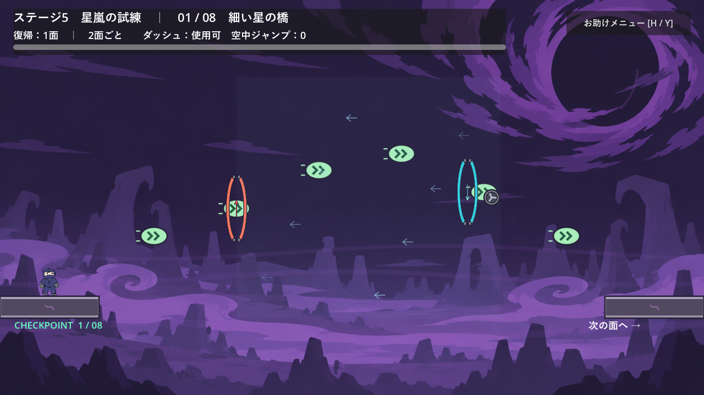
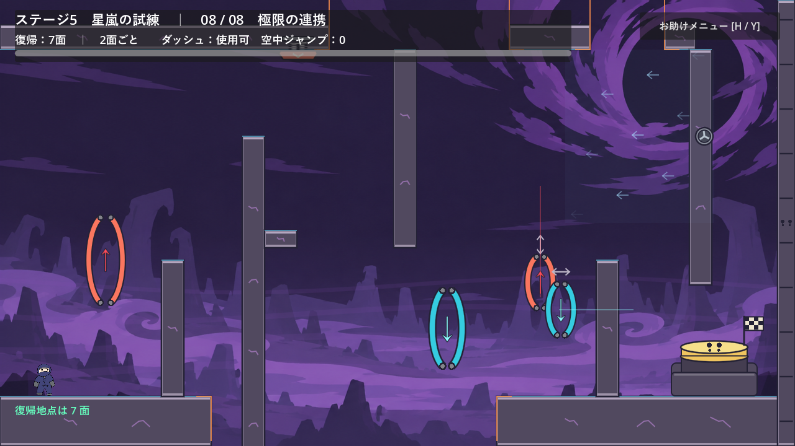

# ステージ5：星嵐の試練

全8面の上級コース。1〜4面はステージ4の空中移動を難しくし、5〜8面はステージ3の壁キックと重力反転を、約2倍の難しさを目標に組み合わせる。選択画面から自由に開始できる。

プレイヤーの移動性能は既存のまま。各面は1280×720の固定カメラで、次の面へ進むと0.28秒でスライドする。ステージ全体に既存の「邪悪なオーラ」の背景と地形表現を使う。

| 面 | 課題 | 難しくした点 |
| --- | --- | --- |
| 1：細い星の橋 | 緑とUp・Downゲートで山形の空間を渡る | 入口・出口の足場を220pxから180pxへ短縮。緑の間隔は140pxから150pxへ拡大。向かい風を追加 |
| 2：揺れる航路 | 高い航路を上下に動くゲートで渡る | 反転ゲートを上下40px、95px/sで往復させる |
| 3：上下の急旋回 | 4つの反転を続けてつなぐ | ゲートの幅を約45pxから32px、高さを264pxから120pxへ縮小。風の中で緑を拾う |
| 4：嵐の回廊 | 山形の緑と4つの移動ゲートをつなぐ | 短い足場・向かい風・狭い移動ゲートを組み合わせる |
| 5：風の中の空中跳躍 | 壁キック、反転、紫、空中ジャンプ | 最初の天井の穴に向かい風を追加。紫を右へ30px移動し、帰還ゲートも縮小 |
| 6：高速の帰還ゲート | 床と天井を往復し、壁キックで帰還 | 移動ゲートを130→260px/s、端の待機を0.20→0.04秒へ変更。縦風の加速度を2倍にする |
| 7：瞬間を蹴る | 移動Upゲート、向かい風、壁キック、Spring | ゲートを140→280px/s、端の待機を0.20→0.04秒へ変更。向かい風の加速度を2倍にする |
| 8：極限の連携 | Spring、壁キック、反転、天井の穴、横移動ゲート | 移動Upゲートを180→360px/s、Downゲートを160→320px/sへ変更。端の待機は0.04秒、向かい風の加速度は2倍 |

後半のゲートは元の幅の85%、高さの90%とする。風の加速度を2倍にした部分も、最大風速は元の設定を保つ。難しさの「2倍」は体感上の目標であり、測定済みの倍率ではない。移動ゲートの速度と端での待機時間、経路の狭さ、2面連続の攻略で調整する。

## チェックポイント

復帰地点は1・3・5・7面の入口。2・4・6・8面へ入っても更新しない。たとえば6面で失敗すると5面から再開し、5面と6面の到着台・出口を戻して両方をやり直す。すでに終えた前の組のクリア状態は保持する。

- 上下の画面外、入口から左への脱落、R / Start、お助けメニューのやり直しは同じ復帰地点を使う。
- 復帰時は通常重力、速度0、ダッシュ・スタミナ回復、追加ジャンプ未取得の状態に戻す。クリスタルと移動ゲートも初期化する。
- 前半は出口の足場に着地して右端へ進むと次の面へ移る。後半は到着台を押すと出口が開く。床の穴はクリア後も埋めない。
- 8面の到着台でクリアを表示する。クリア後のやり直しでは7・8面を再攻略できる。
- 選択画面へ戻ると進捗を破棄し、再選択すると1面から始まる。セーブは追加しない。

## お助けメニュー

H / Y・△で開閉し、ヒント、再開、やり直し、選択画面への移動を選べる。メニュー中はプレイヤーと移動ゲートを停止する。Esc / Backはメニューを閉じ、メニュー外ではステージ選択へ戻る。切り替え中にも選択画面へ戻れる。

ヒントは初期非表示で、面の移動と復帰後も設定を保持する。重力反転中は部屋名・復帰地点・スタミナ・ダッシュ・追加ジャンプの表示とメニューボタンを画面下へ移す。

## ファイルと検証

- `scenes/stage_5.tscn`：8面の足場・ゲート・風・クリスタル・Spring・到着台・HUD。既存シーンから取り出して調整した独立した配置で、Godot上で編集できる。
- `scripts/stage_5.gd`：面移動、2面単位のチェックポイントと復帰、到着台、クリア、メニュー。
- `scripts/arrival_switch.gd`：ステージ5が明示的に呼ぶ `reset_activation()` を追加。既存ステージの復帰では呼ばない。非表示の面でも物理的な押す面を元の高さへ戻せる。
- `scenes/stage_select.tscn` / `scripts/stage_select.gd`：ステージ5の選択と起動。
- `tests/stage_5_test.gd` / `tests/stage_select_test.gd`：攻略・復帰と、マウス・キーボード・ゲームパッドによる選択。

```powershell
Godot_v4.7.2-stable_win64_console.exe --headless --fixed-fps 60 --path . --script tests/stage_5_test.gd
```

Godot 4.7.2で全8面を、位置の変更・能力の強制補充・落下によるやり直しなしで実入力攻略した。後半はダッシュなしで通過し、壁キックは各面で1・4・3・5回。最終ペアの復帰後も、7・8面を入力で再攻略して到着台を押し直せることを確認した。境界・復帰の単独検証では位置や面番号を変更している。

`STAGE_5_TEST_OK`（181項目）と `STAGE_SELECT_TEST_OK`（51項目）を確認した。既存ステージ2〜4、チュートリアル2本、移動、壁キック、環境ギミック、運搬、到着台、背景、キャラクターなど、全16本の自動テストが終了コード0で成功した。描画ありの実行でもステージ5を攻略し、全8面・クリア表示・反転中のHUD・メニューを画像で確認した。

一部のヘッドレス実行ではWindows証明書ストアの読み込みエラーが出る。また、到着台・チュートリアルのテストでは終了時にObjectDB解放警告が出る。各テストは成功しており、描画ありのステージ5テストではこれらの出力はなかった。

難易度の体感比較とゲームパッド実機での試遊は未実施。




