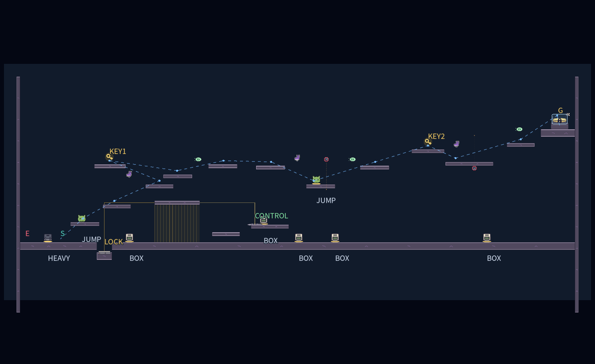

# ステージ6：追跡者の終域

全13部屋。作業ブランチは `feat/hikariyamaseistage6overhaul`。mainには反映しない。前半6室は溶岩、後半7室は邪悪なオーラを使用する。追跡敵はUMA妖怪エイリアン「星間山荒・大赤斑」1体。素材と攻撃の詳細は [敵の仕様](enemy-star-mountain.md) を参照。

## 追跡と反撃

敵は忍者と同じ `PlayerController` の速度・ジャンプ・ダッシュ・運搬・壁スタミナを使う。敵には全てのトゲが無効で、棘の壁を登り、刺さった針の上も歩ける。投げた箱は有効。

敵は視線が通った位置だけを記録する。壁の向こうの忍者の位置は取得せず、最後に見た場所まで探索する。そこで2.5秒探すか、見失って8秒たつと、その周辺を巡回する。再発見すると追跡を再開する。背の低い箱だけでは、大きい敵の視線を完全には遮れない。画面外の敵は方向と追跡状態をHUDへ表示し、新しい弾の予告は画面内から開始する。

観測した経路は約55pxごと、または重力変更時に追加し、最大512地点を保持する。敵は近くのゲート、足場の端、傘と生物の供給を使って追う。上昇に使っている傘を攻撃のために捨てず、足場の裏では端へ回り込む。長い迷路の完全な経路探索や、瞬間移動による追い付きは行わない。

攻撃は長針3連射、扇形5本、時間差の追尾トゲ2本、灰の雲6波21本。各室では1〜2種類を提示し、最終戦で全種類を使う。0.8〜1秒の予告は狙いを固定し、発射後0.65秒は反撃の隙になる。追尾弾と灰雲は同時に重ねない。詳細な速度・寿命は敵の仕様を参照。

接近すると0.25秒の「掴む！」の構えが入り、範囲外へ出ると空振りする。空振り後0.35秒、弾の予告・連射・硬直中、物を持っている間、怯み中には捕獲できない。捕獲が成立すると壁スタミナで失敗を抽選し、満タン0%、半分50%、空100%。助かると進行方向の後ろへ投げ返され、2秒の再捕獲猶予を得る。失敗時も現在の部屋から再挑戦する。

敵の投擲・飛行弾はスタミナを最大値の3分の1減らし、0.3秒怯ませる。被弾後1秒はスタミナ回復を止める。忍者の投擲は敵を2秒止めるが、怯み中の追撃で停止を延長できない。

## 13部屋の構成

| 室 | 主な課題 | 敵の弾 |
| --- | --- | --- |
| 1 針を道へ変える | 受け壁に刺さる針と箱の固定足場。通常の足場でも渡れる。最初の動く棘を低くして導入を緩和。 | 長針 |
| 2 開門と予備の箱 | 軽い箱の開門と別の箱による反撃。準備後1.5秒で追跡開始。 | 長針・扇形 |
| 3 重荷を先へ送れ | 重箱を運ぶ段差を45px刻みにし、投げ送りと運搬を選ぶ。 | 長針・扇形 |
| 4 灰雲と傘渡り | 傘と上昇気流。着地点の屋根で雨を避け、動く棘の外側を渡る。 | 灰雲 |
| 5 逆さまの逃走路 | 天井を床にし、回復とゲートをつなぐ。 | 長針・追尾 |
| 6 反発と空中ダッシュ | ばね・バンパー・ダッシュ・追加ジャンプを順番に使う。 | 長針・扇形 |
| 7 横向きの重力迷宮 | 前半の横重力と後半の低い通常路。左重力と壁ばねの上側経路は任意。 | 追尾 |
| 8 重力を渡る縦の塔 | 左右の壁を床にして登る。 | 長針・追尾 |
| 9 相棒と越える断崖 | 緑の生物と低くした中継足場。途中にも相棒を補充。 | 扇形・追尾 |
| 10 二つの重量扉 | 軽箱と重箱を別々に残して開門。高い反撃・迂回路。 | 長針・追尾 |
| 11 封鎖装置の予行 | 閉じる重量扉、傘、風、上下の重力。 | 長針・灰雲 |
| 12 棘の振り子と誘導路 | 新設。ステージ4と同じ四面棘ブロック4個、待避所、受け壁。 | 扇形・追尾 |
| 13 追跡者との最終決着 | 幅4,480×高さ1,680。三つの勝利を選ぶ。 | 全種類 |

第12室と最終戦の棘ブロックは `scenes/spike_block.tscn` を共用する。ステージ6側で移動前後の接触を判定し、高速移動のすり抜けを避ける。ステージ4側の挙動は変更しない。

## 最終戦の三つの勝利

前座の重量扉は廃止し、最初から最終区画で戦う。3通りのどれか一つで共通クリア画面を表示する。

| 勝利 | 条件 |
| --- | --- |
| 決着 | 怯んでいない敵へ、実際の投擲を6回当てる。同じ投擲の重複接触と怯み中の追撃は数えない。 |
| 封じ込め | 左のくぼみの台へ重箱を置いて通電。敵の全身を檻へ誘い、箱で怯ませる。その間に右の高台の制御盤へ新しく踏み込む。重箱だけ・制御盤に乗り続けるだけ・怯んでいない敵では閉まらない。 |
| 逃走 | 両者が区画内で活動する時間を20秒積算。左右の高所にある鍵2個を取り、二つの棘ブロックを越えて右上の到着台へ。捕獲では積算時間を戻す。視線を切っても時間は進む。 |

檻はx=1,100〜1,460、制御盤はx=1,900、逃走出口はx=4,330へ分離した。通電台は深さ80pxのくぼみに置き、追ってきた敵が重箱を横へ押して通電を失わせる事故を抑える。逃走路の棘の手前には広い待避所を置く。HUDに有効打、残り時間、鍵、封鎖手順を表示し、H / Y・△で詳しい攻略説明を開く。



図のSは忍者、Eは敵、Gは逃走出口。LOCKは通電台、CONTROLは制御盤、KEY1/2は実際に取る鍵。青い線は経路の目安で、ジャンプの軌道ではない。

## 復帰と負荷

落下・トゲでは忍者だけ入口へ戻し、敵・針・箱・壊した足場・雲・鍵・最終目標を維持する。R / Startまたはポーズのやり直しでは部屋全体を初期化する。捕獲失敗での復帰待ち中にポーズからやり直しても、古い待ち処理が後から部屋を戻さない。部屋移動時は前の部屋を解放する。

供給物は1か所最大6個。針は1部屋384本、同時飛行32本を上限に、新しい攻撃を予告する前に空きを確認する。既存の固定足場は消さない。同一点の刺さった針は統合する。画面外の弾、物体、雲は実際に衝突し、壁越しの飛び道具は当てない。

## 検証と再現

Godot 4.7.2、固定60物理fpsで確認する。論理テストは専用配置を使うが、通し攻略は通常入力だけを使い、敵の停止、位置・速度の代入、能力補充、時間・鍵・勝利条件の書き換えを行わない。

```sh
godot --headless --fixed-fps 60 --path . --script tests/stage_6_overhaul_test.gd
godot --headless --fixed-fps 60 --path . --script tests/stage_6_test.gd
godot --headless --fixed-fps 60 --path . --script tests/stage_6_chase_test.gd
godot --headless --fixed-fps 60 --path . --script tests/stage_6_needles_test.gd
godot --headless --fixed-fps 60 --path . --script tests/stage_6_attacks_test.gd
# 全13部屋を続けて逃走クリア。描画ありで実行すると録画にも使える。
godot --headless --fixed-fps 60 --path . --script tests/stage_6_playthrough.gd -- --live
# 最終部屋からの練習。位置調整は開始時の部屋選択だけ。
godot --headless --fixed-fps 60 --path . --script tests/stage_6_playthrough.gd -- 12 --seal
godot --headless --fixed-fps 60 --path . --script tests/stage_6_playthrough.gd -- 12 --defeat
```

追加50項目、ステージ6の既存テスト、ステージ4全6室、共通移動・環境・運搬、ステージ5、表示・ポーズ・選択・クリアの回帰テストを実行する。入力再生はクリア可能性の一例であり、人の初見難易度や楽しさ、実機ゲームパッド、低性能端末のfpsを保証しない。自動入力の所要時間を人の目標攻略時間には用いない。
