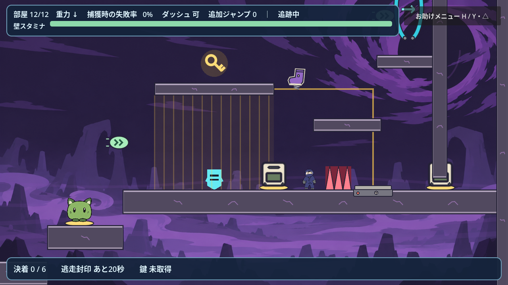

# ステージ6：追跡者の終域

状態：全12部屋の試作。試遊の指摘を受け、コース、追跡行動、進行判定と最後の勝利条件を改修した。楽しさと初回攻略時間は人の試遊で調整する。

## 作業先と素材

作業ブランチは `feat/stage6-chase-gimmick`。mainへのコミット・プッシュ・マージは行わない。参考ブランチは `origin/shinkaikoshi5`（調査時 `9c71a4f`）で、ステージ5自体は取り込まない。ユーザーはステージ5の攻略に60分以上かかったと報告しているが、ステージ6の目標攻略時間は未確定。

前半6部屋は溶岩、後半6部屋は邪悪なオーラ。敵は以前の水色の五角形アバターを仮表示する。本番PNGは `scenes/stage_6.tscn` の `enemy_avatar` に割り当てる。新しい画像や依存パッケージは追加していない。

## 追跡と公平性

敵はプレイヤーと同じ `PlayerController` を使い、速度、ジャンプ力、ダッシュ、壁スタミナ、運搬制約とギミックの作用を共有する。操作判断のみ敵専用にする。

- 固定経路のゴールへ先行せず、プレイヤーが実際に通った道と重力の切り替えを記録して追う。近距離で地形や危険帯を挟まなければ直接追うため、引き返したプレイヤーにも反応する。
- 壁を掴んで登れる間は、壁キックやダッシュで自分から掴みを解除しない。頭を足場にぶつけたときは横へ回り込む。上昇中に必要な傘は投げ捨てない。
- 物体を持った敵はプレイヤーを掴めない。捕獲するために荷物を強制的に消したり手放したりしない。
- プレイヤーと敵は供給物を共有する。開門や封鎖のスイッチに置いた物体は敵の取得候補から外す。投擲後0.75秒は拾い直さない。
- 敵も落下やトゲで部屋入口へ復帰する。プレイヤーと部屋の進捗は戻さず、記憶した道を入口から追い直す。壁抜け、瞬間移動による追い付き、敵だけの無敵化は使わない。

記録は1部屋につき最大512地点。1地点は移動約55ピクセル、または重力の変化で追加する。極端に長く往復を繰り返すと古い地点から失われる。通常の部屋より長い経路を作る場合は経路方式を見直す。

## 捕獲・投擲・復帰

接触時の壁スタミナで、ゲームオーバーを1回だけ抽選する。満タン0%、半分50%、空100%で、間は直線的に変化する。スタミナが空でも接触しなければゲームオーバーにはならない。

助かった場合は進行経路の後方へ投げ返され、2秒間再捕獲されない。失敗した場合はステージ選択へ戻る。プレイヤーの落下・トゲでは、プレイヤーだけ入口へ戻し、敵の位置・速度・重力・怯み・手持ち・追跡状態を維持する。物体、開いた扉、鍵や最終目標の進捗も戻さない。R / Startまたはメニューの「部屋全体をやり直す」を選んだ場合のみ、両キャラ、物体、仕掛けと最終目標を初期化する。H / Y・△のお助けメニューは追跡と物理を止める。

敵の投擲に当たると最大スタミナの3分の1を失い、0.3秒怯む。被弾から1秒は着地してもスタミナを回復しない。プレイヤーの投擲は敵を2秒怯ませる。怯み中の追撃で停止時間を延ばし続けることはできない。

物体は保持中に持ち主の重力に合わせ、投げた後もその向きを引き継ぐ。未保持の物体もゲートの重力を受ける。風は両キャラに作用し、未保持物体には作用させない。

## 部屋の構成

全室に投げられる物体を供給する。供給は1か所につき最大6個で、上限時は保持中でもスイッチ上でもない物体を戻して補充する。回復クリスタルは移動経路の段差や空中のつなぎにも追加した。

| 部屋 | 課題と今回の配置 |
| --- | --- |
| 1 | 箱の投げ合いと足場渡り。追加ジャンプ・ダッシュ回復をつなぐ。 |
| 2 | 軽い箱の開門。幅3,000、開始間隔520、準備区間を出てから追跡まで4秒。広い作業場所、逃げる高低差、ばね・バンパーを用意。 |
| 3 | 重い箱の運搬と先送り。幅3,200、開始間隔520、準備後4秒の猶予。90ピクセルずつの段差を越えて重い箱の扉を開く。 |
| 4 | 幅2,880、高さ1,680の傘渡り。二つの上昇気流、横風、足場の回り込み、動くトゲと空中回復を組み合わせる。 |
| 5 | 上重力の天井逃走。障害物の下を進み、回復を使って通常重力へ戻す。 |
| 6 | ばね・バンパー・空中ダッシュ・追加ジャンプによる連結。 |
| 7 | 幅2,880の横重力コース。壁の上端・下端を回り込み、後半は左重力への切り替えと壁ばねで跳び返し、回復をつないで出口へ。 |
| 8 | 高さ2,160の塔。左右の壁を床にして歩き、ゲートで反対の壁へ渡る。 |
| 9 | 緑の生物とクリスタルで断崖を越える。移動する危険帯にも注意。 |
| 10 | 軽い箱と重い箱の二つの扉。幅3,200、開始間隔520、準備後4秒。作業場所と高い迂回路を分ける。 |
| 11 | 金の封鎖装置の練習と、傘・風・重力の総合逃走。 |
| 12 | 幅3,840、高さ1,680。二つの重量扉を開き、両者が登れる階段から、三つの勝利を選ぶ区画へ。 |

左右重力の歩行は画面の↑↓。Space / Aで床になった壁から跳ぶ。壁を掴むときの登りは重力に逆らう方向で判断する。

## 最後の三つの勝利

いずれも軽い箱と重い箱による二つの開門が共通条件。クリアすると両者の操作を止め、共通のクリア画面を表示する。

| 勝利 | 達成条件 |
| --- | --- |
| 決着 | 最後の区画で、怯んでいない敵にプレイヤーの投擲を6回当てる。怯み中の追撃、同じ投擲の重複接触、区画外の投擲は回数に加えない。 |
| 封じ込め | 敵の全身を檻へ誘導し、プレイヤーは右外側へ抜けて、金の封鎖スイッチに箱を載せる。檻とスイッチを金の線で結ぶ。 |
| 逃走 | 最後の区画に両者がいる間に20秒を積算し、檻の屋根の鍵をプレイヤーが取る。解除された右上の到着台を押す。途中で捕獲されると時間を数え直す。 |

敵が区画に到達していない間は逃走の時間が進まない。鍵は敵には取れない。鍵の取得、残り秒数、有効打の回数は画面下に表示する。ステージ名、部屋別の攻略手順、供給・開門・封鎖の説明、投擲と捕獲のルールはお助けメニュー内にまとめる。地形上の説明ラベルと到着台の吹き出しは表示せず、供給場所は金の輪、扉と檻の対応は金の線で示す。プレイ中は部屋番号・重力・残り能力・スタミナ・追跡状態と攻撃予告を残す。決着の必要回数と逃走時間はステージ6ルートの `defeat_hits_required`（初期値6）と `escape_seconds`（初期値20）で試遊に合わせて調整できる。

## 部屋移動と負荷

到着台の押し込み演出は従来どおり0.2秒。プレイヤーが押し切ったら、キャラの中心が追加の狭い範囲へ入るのを待たず、次の物理フレームで部屋を切り替える。敵が押しただけでは移動やクリアにならず、プレイヤー自身の到達が必要。

敵のアイテム探索は毎フレームの全件ソートをやめ、0.15秒ごとに近い候補を走査する。動く危険帯がない部屋では毎フレームの背景ギミック再描画をやめた。物体供給の上限と資源のプリロードは維持している。

## 検証の範囲

Godot 4.7.2を使用する。自動テストではコード上の成立性を検証し、人の攻略時間や楽しさを評価したことにはしない。

- `tests/stage_6_test.gd`：138項目。自動落下・トゲ復帰時の敵の位置・速度・重力・手持ちと進捗の維持、明示的な全体リトライ、4方向重力、捕獲確率、運搬中の捕獲禁止、実投擲の衝突と怯み、復帰・補充、実接触での鍵取得と敵による取得禁止、時間と重量扉の条件、怯み中の得点禁止、三つのクリア。到着台の端を実際に踏み、作動から2物理フレーム以内の部屋移動も確認。
- `tests/stage_6_chase_test.gd`：9項目。動いている敵の追従と引き返しへの反応、壁掴みから足場の上への登り、傘で天井を回り込んで上昇する動作、最終階段から檻への実移動、敵の復帰時の経路保持。壁・傘は衝突用の専用地形、最終部屋は経路を与えた再生で検証する。最終区画へ敵を瞬間移動して到達扱いにはしない。
- `tests/stage_6_playthrough.gd -- --live`：1〜11部屋は敵を動かし、プレイヤーの入力操作で通過する。7部屋目は壁ばねの発射も必須確認。12部屋目は敵を停止し、時間条件のみ満了させて地形を検証する。二つの重量課題、屋根への移動と実際の鍵取得、横重力、到着台までを入力で通過する。最終戦で人が三つの勝利を攻略した証明ではない。
- `tests/stage_help_test.gd`：65項目。全5ステージのお助けメニュー。開閉、部屋別の攻略文、チュートリアルの未達成目標、一時停止、キーボードとゲームパッドでの長文閲覧・フォーカス移動、再開・やり直し・選択画面への復帰を確認。
- 既存17本の回帰テスト：移動305、環境443、運搬1,512、壁684、ステージ2〜4、チュートリアル、到着台92、選択48、共通クリア41項目など、すべて成功。
- 描画ありのステージ6テスト：12部屋の入口と3種類のクリア画面を保存し、追加配置の表示も確認する。

入力検証の最終実行は9,204フレーム、114回のジャンプ、4回のやり直しで全12部屋が成功した。1〜11部屋の敵は動作し、12部屋目の時間条件は上記のとおり分離している。

室内生成時間の確認では、この環境でこの改修後の最も遅い部屋が約30ミリ秒だった。到着台の遅延テストは論理フレーム数の検証であり、実機で常に60fpsを保証する計測ではない。終了時に一部の既存テストでObjectDB警告が出るが、テストの失敗はない。

人が敵と攻防して最後まで遊ぶ試遊、初回攻略時間、実機ゲームパッドと低性能端末での操作感は未確認。本番の敵PNGも未割当て。特に決着6回と対峙20秒、敵との初期間隔、傘と左右重力の回復配置は次の試遊で調整する。
