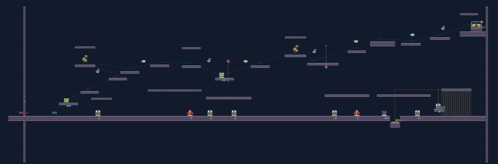

# ステージ6：追跡者の終域

全13部屋。前半6室は溶岩、後半7室は邪悪なオーラを使用する。追跡敵はUMA妖怪エイリアン「星間山荒・大赤斑」1体。素材と攻撃の詳細は [敵の仕様](enemy-star-mountain.md) を参照。三つの勝利条件のいずれかを満たすと、共通の保存先へクリア印を記録する。

## 追跡と反撃

敵は忍者と同じ `PlayerController` の速度・ジャンプ・ダッシュ・運搬・壁スタミナを使う。敵には全てのトゲが無効で、棘の壁を登り、刺さった針の上も歩ける。投げた箱は有効。

敵は視線が通った位置だけを記録する。壁の向こうの忍者の位置は取得せず、最後に見た場所まで探索する。そこで2.5秒探すか、見失って8秒たつと、その周辺を巡回する。再発見すると追跡を再開する。背の低い箱だけでは、大きい敵の視線を完全には遮れない。画面外の敵は方向と追跡状態をHUDへ表示し、遠距離の攻撃も予告し、画面外の攻撃・探索・見失った状態を下部の行動パネルへ表示する。個体名の常時表示は廃止し、冒頭の登場演出と図鑑で確認できる。

観測した経路は約55pxごと、または重力変更時に追加し、最大512地点を保持する。敵は近くのゲート、足場の端、傘と生物の供給を使って追う。上昇に使っている傘を攻撃のために捨てず、足場の裏では端へ回り込む。長い迷路の完全な経路探索や、瞬間移動による追い付きは行わない。

攻撃は長針3連射、扇形5本、同時追尾6発、灰雲8波36本、山なりの長針10本、短針18連射。距離、視認した移動速度、前回の技、技別の待ち時間で選び、600pxより遠い相手には灰雲を優先する。見えない現在位置を照準には使わない。短針は各発で直近の観測位置へ向き直り、旋回量を制限する。第2室は箱を残す導入のため長針と扇形に限定する。狭い第11室の気流区間には短針連射を置かず、反転時の針密集を避ける。

0.8〜1.1秒の予告、発射後0.75秒の隙、全技共通1.8秒以上の待ち時間がある。追尾弾と灰雲の同時使用を避ける。飛行弾は箱へ刺さって吸収され、開いた傘は重力方向から来る雨を防ぐ。屋根の上で雨が止まり、屋根の下へ雲を生成しない。

接近すると0.25秒の「掴む！」の構えが入り、範囲外へ出ると空振りする。空振り後0.35秒、弾の予告・連射・硬直中、物を持っている間、怯み中には捕獲できない。捕獲が成立しても壁スタミナが少しでも残っていれば必ずしのぎ、進行方向の後ろへ投げ返されて2秒の再捕獲猶予を得る。残量による失敗抽選は行わない。スタミナ0で捕獲された場合は1.2秒のゲームオーバー演出後、現在の部屋の入口のチェックポイントから自動で再開する。

敵の投擲・飛行弾はスタミナを最大値の3分の1減らし、0.2秒怯ませ、0.75秒の連続被弾・捕獲の猶予を設ける。被弾後4秒はスタミナ回復速度を最大値の10%/秒に下げる。効果中の追加被弾は2秒ずつ延長し、残り時間の上限は8秒。通常時の着地は従来どおり即時全回復。回復低下中もダッシュと相棒の追加ジャンプは着地で補充する。忍者の投擲は敵を2秒止めるが、怯み中の追撃で停止を延長できない。

## 13部屋の構成

| 室 | 主な課題 | 敵の弾 |
| --- | --- | --- |
| 1 針を道へ変える | 受け壁に刺さる針と箱の固定足場。通常の足場でも渡れる。最初の動く棘を低くして導入を緩和。 | 長針3連射・灰雨36本 |
| 2 開門と予備の箱 | 軽い箱の開門と別の箱による反撃。準備後1.5秒で追跡開始。 | 長針3連射・扇形5本 |
| 3 重荷を先へ送れ | 重箱を運ぶ段差を45px刻みにし、投げ送りと運搬を選ぶ。 | 長針3連射・灰雨36本・短針18連射 |
| 4 灰雲と傘渡り | 傘と上昇気流。着地点の屋根で雨を避け、動く棘の外側を渡る。 | 灰雨36本・山なり10本 |
| 5 逆さまの逃走路 | 天井を床にし、回復とゲートをつなぐ。 | 同時追尾6発・灰雨36本・山なり10本 |
| 6 反発と空中ダッシュ | ばね・バンパー・ダッシュ・追加ジャンプを順番に使う。 | 扇形5本・灰雨36本・山なり10本・短針18連射 |
| 7 横向きの重力迷宮 | 前半の横重力と後半の低い通常路。左重力と壁ばねの上側経路は任意。 | 同時追尾6発・灰雨36本・短針18連射 |
| 8 重力を渡る縦の塔 | 左右の壁を床にして登る。 | 長針3連射・同時追尾6発・灰雨36本・山なり10本 |
| 9 相棒と越える断崖 | 緑の生物と低くした中継足場。途中にも相棒を補充。 | 扇形5本・同時追尾6発・灰雨36本・短針18連射 |
| 10 二つの重量扉 | 軽箱と重箱を別々に残して開門。高い反撃・迂回路。 | 長針3連射・同時追尾6発・灰雨36本・山なり10本・短針18連射 |
| 11 封鎖装置の予行 | 閉じる重量扉、傘、風、上下の重力。 | 長針3連射・灰雨36本・山なり10本 |
| 12 棘の振り子と誘導路 | 新設。ステージ4と同じ四面棘ブロック4個、待避所、受け壁。 | 扇形5本・同時追尾6発・灰雨36本・山なり10本・短針18連射 |
| 13 追跡者との最終決着 | 幅5,600×高さ1,680。三つの勝利を選ぶ。 | 長針3連射・扇形5本・同時追尾6発・灰雨36本・山なり10本・短針18連射 |

第12室と最終戦の棘ブロックは `scenes/spike_block.tscn` を共用する。ステージ6側で移動前後の接触を判定し、高速移動のすり抜けを避ける。ステージ4側の挙動は変更しない。

通常の12室にそれぞれ横幅1,000pxの出口区画を追加する。到着台を踏むと旧出口の壁が開き、そこから屋根のある下道または回復を置いた上道を選んで進む。部屋によって動く棘・ばね・バンパーを配置する。最後の境界を歩いて越えると次室へ移る。敵は次室のコースを囲う左端の壁の外側で待ち、0.9秒後に壁の一部を破壊して中へ入る。部屋全体のやり直しでも壁が復元される。最初の部屋は従来の紹介演出で登場する。部屋全体の連続スクロールではなく、境界で部屋を読み替える構造は維持する。

第6室には空中連携を失敗しても戻れる下段の足場と登り直す壁を増やす。第1・2・10室と最終戦にも雨を避ける屋根を追加した。単に歩く距離を延ばすだけでなく、速い上道と防御しやすい下道を選べる配置にする。

箱と傘は同じ床の補給点を200px以上離し、近づいたときは実際に掴める物だけを水色の枠と「掴む：箱／傘」の名前で示す。壁越し、固定済みの足場、運搬中、ダッシュ中、操作停止中には対象を表示しない。選択表示と取得は共通の判定を使う。

ダッシュ回復と追加ジャンプは経路点からの自動配置を廃止し、空中連携と出口区画の上道に手動配置する。同じ種類は240px以上、異なる種類も160px以上離し、一度の通過でまとめて取る重複配置をなくす。着地で回復できる区間へ同種を重ねず、空中で次の動作につなぐ位置に残す。

## 最終戦の三つの勝利

前座の重量扉は廃止し、最初から最終区画で戦う。3通りのどれか一つで共通クリア画面を表示する。

| 勝利 | 条件 |
| --- | --- |
| 決着 | 怯んでいない敵へ、実際の投擲を6回当てる。同じ投擲の重複接触と怯み中の追撃は数えない。 |
| 封じ込め | 逃走出口の下のくぼみの台へ重箱を置いて通電。敵の全身を檻へ誘い、箱で怯ませる。その間に檻の左の高台の制御盤へ新しく踏み込む。重箱だけ・制御盤に乗り続けるだけ・怯んでいない敵では閉まらない。 |
| 逃走 | 両者が区画内で活動する時間を20秒積算。左右の高所にある鍵2個を取り、二つの棘ブロックを越えて右上の到着台へ。捕獲では積算時間を戻す。視線を切っても時間は進み、施錠中の高い出口に乗っても止まらない。 |

檻はx=5,040〜5,400・y=1,020〜1,320へ移し、逃走出口x=5,460・y=300の下へ配置した。通電台はx=4,480・y=1,400、制御盤はx=5,000・y=1,240。重箱の供給と雨よけの屋根も近くへ移し、準備から誘導、反撃、制御盤の順に進む。制御盤の足場は通常ジャンプで登れる80pxの段差にまとめた。通電台は深さ80pxのくぼみに置き、追ってきた敵が重箱を横へ押して通電を失わせる事故を抑える。逃走路の棘の手前には広い待避所を置く。HUDに有効打、残り時間、鍵、封鎖手順を表示し、H / Y・△で詳しい攻略説明を開く。



図のSは忍者、Eは敵、Gは逃走出口。通常室のSWITCHは隔壁を開く台、NEXTは次室へ渡る境界。LOCKは通電台、CONTROLは制御盤、KEY1/2は実際に取る鍵。青い線は経路の目安で、ジャンプの軌道ではない。

## 復帰と負荷

残針の先端は即死ではなく、最大スタミナの15%のダメージと1秒の走行速度30%低下にする。ジャンプ・ダッシュ・入力は止めず、抜け出せるようにする。飛行弾と共通の0.75秒の被弾猶予を使い、多数の針へ同時に触れても一度しか減らさない。針の上に居続けると回復より損失が多くなり、スタミナが尽きればゲームオーバーになる。

登場・ゲームオーバー・クリアにはタイトル画面の金色の放射線と粒、拡大とフェードを参照した演出を使う。動きを減らす設定では放射線と拡大を省く。

落下・固定棘・移動棘への接触、R / Start、ポーズとヘルプのやり直し、敗北後の再開は、すべて現在の部屋を初期状態へ戻す。敵・箱・針・雲・壊した足場・回復アイテム・扉・動く棘・部屋の時計と補充タイマーを初期化し、その部屋の鍵・決着の命中数・対峙時間・封鎖と出口の進捗もリセットする。忍者はスタミナを全回復し、回復低下と減速を解除して入口のチェックポイントへ戻る。クリア済みの部屋は保持する。スタミナ0での捕獲、または飛行弾・投擲・残針のダメージでスタミナが0になるとゲームオーバー演出に入り、操作とポーズによる再開を止め、1.2秒後に自動でやり直す。壁登りなど移動でスタミナを使い切っただけではゲームオーバーにしない。部屋移動時は前の部屋を解放する。

復帰直後は0.8秒のトゲ・弾の猶予を付け、入口へ残った雨による復帰の反復を避ける。各部屋のスタート位置を基準に、左160〜右240px・上200〜下80pxに危険な先端がある未固定の針は、種類を問わず刺さってから0.6秒で消える。それ以外の場所では灰雨の針は8秒、短針連射は5秒で消える。箱を固定した足場と、箱が受け止めた安全な針は消さない。箱を固定する候補位置が忍者と重なる場合は固定せず、閉じ込めを防ぐ。

供給物は1か所最大6個。針は1部屋640本、同時飛行96本を上限に、新しい攻撃を予告する前に空きを確認する。既存の固定足場は消さない。同一点の刺さった針は統合する。画面外の弾、物体、雲は実際に衝突し、壁越しの飛び道具は当てない。

## 検証と再現

Godot 4.7.2、固定60物理fpsで確認する。論理テストは専用配置を使うが、通し攻略は通常入力だけを使い、敵の停止、位置・速度の代入、能力補充、時間・鍵・勝利条件の書き換えを行わない。

```sh
godot --headless --fixed-fps 60 --path . --script tests/stage_6_fatigue_test.gd
godot --headless --fixed-fps 60 --path . --script tests/stage_6_pressure_test.gd
godot --headless --fixed-fps 60 --path . --script tests/gallery_test.gd
godot --headless --fixed-fps 60 --path . --script tests/stage_6_overhaul_test.gd
godot --headless --fixed-fps 60 --path . --script tests/stage_6_test.gd
godot --headless --fixed-fps 60 --path . --script tests/stage_6_chase_test.gd
godot --headless --fixed-fps 60 --path . --script tests/stage_6_needles_test.gd
godot --headless --fixed-fps 60 --path . --script tests/stage_6_attacks_test.gd
godot --headless --fixed-fps 60 --path . --script tests/phase3_grab_test.gd
# 全13部屋を続けて逃走クリア。描画ありで実行すると録画にも使える。
godot --headless --fixed-fps 60 --path . --script tests/stage_6_playthrough.gd -- --live
# 最終部屋からの練習。位置調整は開始時の部屋選択だけ。
godot --headless --fixed-fps 60 --path . --script tests/stage_6_playthrough.gd -- 12 --seal
godot --headless --fixed-fps 60 --path . --script tests/stage_6_playthrough.gd -- 12 --defeat
```

新規の追撃・防御・復帰・通路76項目と図鑑42項目、ステージ6の既存テスト、ステージ4全6室、共通移動・環境・運搬、ステージ5、表示・ポーズ・選択・クリアの回帰テストを実行する。入力再生はクリア可能性の一例であり、人の初見難易度や楽しさ、実機ゲームパッド、低性能端末のfpsを保証しない。自動入力の所要時間を人の目標攻略時間には用いない。

被弾状態の変更前には全13室を18回の再挑戦で逃走クリアしたが、この数値は新しいゲームオーバー条件の難易度を示すものではない。変更後は関連3,927項目（ステージ6は598項目）が通過し、全13室を通常入力で通し、部屋の再試行12回で逃走クリアを確認した。最終室から決着と封じ込めもクリア。通し後に施錠中の出口上で対峙時間が止まる問題を修正し、最終室の逃走を再確認した。再試行には自動入力の取得・移動の失敗も含むため、人の失敗回数とは扱わない。この通し攻略は敗北時に選択画面へ戻る旧条件の記録で、現在は敗北しても現部屋のチェックポイントから再開する。人による操作感と難易度の再確認は未実施。

### main統合時の確認

PR #228の体験モードと、第1面の可変ジャンプ・進捗保存を含むmainへ統合して検証した。4方向でジャンプを離した際の高さ調整、従来の部屋移動と巻物の確定、到着台の再開、ステージ6のクリア保存、敗北中の体験モード警告とタイトル復帰を確認した。自動攻略のジャンプは既存の `FullJumpInput` を使う長押し入力へ合わせ、決着用の自動操作から不要な移動を除いた。敵や勝利条件の無効化・書き換えは行っていない。

Godot 4.7.2・固定60物理fpsで、関連32本のテストと9画面の起動確認が通過した。ステージ1〜5の通し攻略に加え、ステージ6は全13室を通して逃走クリアし、自動入力の再試行は8回だった。最終室からは決着と封じ込めもそれぞれ再試行1回で確認した。XvfbとOpenGLで6面の選択画面と図鑑を描画し、カードと体験モードボタンの重なりを解消した。

追加で実行した `wall_jump_regression_test.gd` は32件の失敗が既存mainと完全に一致した。描画ありの `display_settings_test.gd` も、全画面表示からの再起動復元で既存mainと同じ失敗を再現した。この2本は未解決で、上記の通過本数には含めない。実機ゲームパッド、人の初見難易度、低性能端末でのfpsは未確認。
