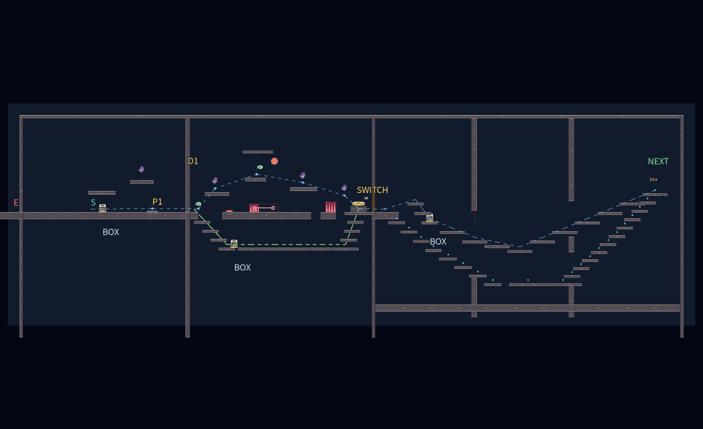

# ステージ6：追跡者の終域

全13部屋。作業ブランチは `feat/hikariyamaseistage6overhaul`。mainには反映しない。前半6室は溶岩、後半7室は邪悪なオーラを使用する。追跡敵はUMA妖怪エイリアン「星間山荒・大赤斑」1体。素材と攻撃の詳細は [敵の仕様](enemy-star-mountain.md) を参照。

## 追跡と反撃

敵は忍者と同じ `PlayerController` の速度・ジャンプ・ダッシュ・運搬・壁スタミナを使う。敵には全てのトゲが無効で、棘の壁を登り、刺さった針の上も歩ける。投げた箱は有効。

敵は視線が通った位置だけを記録する。壁の向こうの忍者の位置は取得せず、最後に見た場所まで探索する。到着スイッチの音は、そのスイッチの場所を調べる手掛かりとなる。隠れた忍者の現在位置は伝えない。そこで2.5秒探すか、見失って8秒たつと、その周辺を巡回する。再発見すると追跡を再開する。背の低い箱だけでは、大きい敵の視線を完全には遮れない。画面外の敵は方向と追跡状態をHUDへ表示し、遠距離の攻撃も予告し、画面外の攻撃・探索・見失った状態を下部の行動パネルへ表示する。個体名の常時表示は廃止し、冒頭の登場演出と図鑑で確認できる。

観測した経路は約55pxごと、または重力変更時に追加し、最大512地点を保持する。敵は近くのゲート、足場の端、傘と生物の供給を使って追う。上昇に使っている傘を攻撃のために捨てず、足場の裏では端へ回り込む。長い迷路の完全な経路探索や、瞬間移動による追い付きは行わない。

攻撃は長針3連射、扇形5本、同時追尾6発、灰雲8波36本、山なりの長針10本、短針18連射。距離、視認した移動速度、前回の技、技別の待ち時間で選び、600pxより遠い相手には灰雲を優先する。見えない現在位置を照準には使わない。短針は各発で直近の観測位置へ向き直り、旋回量を制限する。第2室は箱を残す導入のため長針と扇形に限定する。狭い第11室の気流区間には短針連射を置かず、反転時の針密集を避ける。

0.8〜1.1秒の予告、発射後0.75秒の隙、全技共通1.8秒以上の待ち時間がある。追尾弾と灰雲の同時使用を避ける。飛行弾は箱へ刺さって吸収され、開いた傘は重力方向から来る雨を防ぐ。屋根の上で雨が止まり、屋根の下へ雲を生成しない。

接近すると0.25秒の「掴む！」の構えが入り、範囲外へ出ると空振りする。空振り後0.35秒、弾の予告・連射・硬直中、物を持っている間、怯み中には捕獲できない。捕獲が成立すると壁スタミナで失敗を抽選し、満タン0%、半分50%、空100%。助かると進行方向の後ろへ投げ返され、2秒の再捕獲猶予を得る。失敗時も現在の部屋から再挑戦する。

敵の投擲・飛行弾はスタミナを最大値の3分の1減らし、0.2秒怯ませ、0.75秒の連続被弾・捕獲の猶予を設ける。被弾後1秒はスタミナ回復を止める。忍者の投擲は敵を2秒止めるが、怯み中の追撃で停止を延長できない。

## 13部屋の構成

| 室 | 主な課題 | 敵の弾 |
| --- | --- | --- |
| 1 針を道へ変える | 受け壁に刺さる針と箱の固定足場。通常の足場でも渡れる。最初の動く棘を低くして導入を緩和。 | 長針3連射・灰雨36本 |
| 2 開門と予備の箱 | 軽い箱の開門と別の箱による反撃。扉の先は高い近道と屋根付きの下道で再合流。動き始めた後4秒の準備猶予。 | 長針3連射・扇形5本 |
| 3 重荷を先へ送れ | 重箱を運ぶ段差を45px刻みにし、投げ送りと運搬を選ぶ。 | 長針3連射・灰雨36本・短針18連射 |
| 4 灰雲と傘渡り | 傘と上昇気流。着地点の屋根で雨を避け、動く棘の外側を渡る。 | 灰雨36本・山なり10本 |
| 5 逆さまの逃走路 | 天井を床にし、回復とゲートをつなぐ。 | 同時追尾6発・灰雨36本・山なり10本 |
| 6 反発と空中ダッシュ | ばね・バンパー・ダッシュ・追加ジャンプを順番に使う。 | 扇形5本・灰雨36本・山なり10本・短針18連射 |
| 7 横向きの重力迷宮 | 前半の横重力と後半の低い通常路。左重力と壁ばねの上側経路は任意。 | 同時追尾6発・灰雨36本・短針18連射 |
| 8 重力を渡る縦の塔 | 左右の壁を床にして登る。 | 長針3連射・同時追尾6発・灰雨36本・山なり10本 |
| 9 相棒と越える断崖 | 緑の生物と低くした中継足場。途中にも相棒を補充。 | 扇形5本・同時追尾6発・灰雨36本・短針18連射 |
| 10 二つの重量扉 | 軽箱と重箱を別々に残して開門。高い反撃・迂回路。 | 長針3連射・同時追尾6発・灰雨36本・山なり10本・短針18連射 |
| 11 封鎖装置の予行 | 閉じる重量扉、傘、風、上下の重力。 | 長針3連射・灰雨36本・山なり10本 |
| 12 棘の振り子と誘導路 | 新設。ステージ4と同じ導入の四面棘ブロック4個と開門後の1個、迂回路、受け壁。 | 扇形5本・同時追尾6発・灰雨36本・山なり10本・短針18連射 |
| 13 追跡者との最終決着 | 幅5,600×高さ1,680。三つの勝利を選ぶ。 | 長針3連射・扇形5本・同時追尾6発・灰雨36本・山なり10本・短針18連射 |

第12室と最終戦の棘ブロックは `scenes/spike_block.tscn` を共用する。ステージ6側で移動前後の接触を判定し、高速移動のすり抜けを避ける。ステージ4側の挙動は変更しない。

全室を幅5,600px以上・高さ1,680px以上とし、第8室の高さ2,160pxは維持する。通常の12室は、到着台で隔壁を開いた後、部屋ごとに形の異なる上道と下の迂回路へ進む。二つの道は両端で再合流し、間の隔壁には上下の通り口を置く。足場の高さの差は80px以内。最初の上道へ跳び、跳ばずに進むと下道へ入る。箱・傘・相棒は、それぞれの役割に応じた着地点に置く。同じ入口へ3種類を並べる配置と、経路の一定間隔での自動補給は廃止した。重量扉の第2・3・10室は、入口から動き始めて4秒の準備猶予を設ける。

最後の境界を歩いて越えると次室へ移る。敵はコースの外周壁の外で待機し、2.5秒後に外壁の一部を破壊する。壁の上下は外周へ連続し、破壊した部分だけが物理的な通り口になる。境界で部屋を読み替える構造は維持する。

配置の参照には[Omega Metroidの100%配置図](https://omegametroid.com/metroid-dread-walkthrough/map/)からアルタリアとカタリスを用いた。扉・補給・上下の経路の接続を確認し、この作品では上下で再合流する道、視線を遮る隔壁、使う仕掛けの前の補給へ応用した。地形そのものは転写せず、忍者の通常ジャンプと共有の追跡物理に合わせて作る。



第6室には空中連携を失敗しても戻れる下段の足場と登り直す壁を増やす。第1・2・10室と最終戦にも雨を避ける屋根を追加した。単に歩く距離を延ばすだけでなく、速い上道と防御しやすい下道を選べる配置にする。

## 最終戦の三つの勝利

前座の重量扉は廃止し、最初から最終区画で戦う。3通りのどれか一つで共通クリア画面を表示する。

| 勝利 | 条件 |
| --- | --- |
| 決着 | 怯んでいない敵へ、実際の投擲を6回当てる。同じ投擲の重複接触と怯み中の追撃は数えない。 |
| 封じ込め | 左のくぼみの台へ重箱を置いて通電。敵の全身を檻へ誘い、箱で怯ませる。その間に右の高台の制御盤へ新しく踏み込む。重箱だけ・制御盤に乗り続けるだけ・怯んでいない敵では閉まらない。 |
| 逃走 | 両者が区画内で活動する時間を20秒積算。左右の高所にある鍵2個を取り、二つの棘ブロックを越えて右上の到着台へ。捕獲では積算時間を戻す。視線を切っても時間は進む。 |

檻はx=1,100〜1,460、制御盤はx=1,900、逃走出口はx=5,460へ分離した。通電台は深さ80pxのくぼみに置き、追ってきた敵が重箱を横へ押して通電を失わせる事故を抑える。逃走路の棘の手前には広い待避所を置く。HUDに有効打、残り時間、鍵、封鎖手順を表示し、H / Y・△で詳しい攻略説明を開く。


図のSは忍者、Eは敵、Gは逃走出口。通常室のSWITCHは隔壁を開く台、NEXTは次室へ渡る境界。LOCKは通電台、CONTROLは制御盤、KEY1/2は実際に取る鍵。青い線は経路の目安で、ジャンプの軌道ではない。

## 復帰と負荷

落下・地形のトゲ・捕獲失敗で世界を停止し、ゲームオーバーを表示する。自動再開はしない。通常の決定入力・クリック・ゲームパッドで「この部屋を最初からやり直す」を選ぶと、忍者、敵、針、箱、雲、壊した足場、鍵、目標の進捗を初期化する。R / Startまたはポーズのやり直しも同じ初期化処理を使う。ゲームオーバー中にポーズを重ねない。

入口周辺へ危険な固定針を蓄積させない。地形に刺さった未固定の長針は6秒、追尾トゲは5秒、短針は3秒、灰は2秒で消え、最後の1秒は薄くなる。160px以内では、箱で固定していない針を新しい2本までに抑える。針の物理面は従来どおり敵のみが使い、忍者と箱はその面に衝突しない。忍者への危険判定は先端のみで行う。箱で固定した足場と箱へ吸収された針はこれらの整理から除外する。開いた扉の衝突レイヤーも解除し、その扉に刺さった針が空中に残る不具合を防ぐ。

1部屋240本、同時飛行96本、雲1個を上限とする。供給場所ごとの未固定の道具は使用中の1個と予備1個までにし、スイッチ上や固定足場の箱を回収しない。投擲中や忍者の近くの箱も再配置せず、途中で箱が消える事故を防ぐ。部屋を移ると旧部屋の針や物体を解放する。

## 検証と再現

Godot 4.7.2、固定60物理fpsで確認する。論理テストは専用配置を使うが、通し攻略は通常入力だけを使い、敵の停止、位置・速度の代入、能力補充、時間・鍵・勝利条件の書き換えを行わない。

```sh
godot --headless --fixed-fps 60 --path . --script tests/stage_6_human_play_test.gd
godot --headless --fixed-fps 60 --path . --script tests/stage_6_routes_test.gd
godot --headless --fixed-fps 60 --path . --script tests/stage_6_pressure_test.gd
godot --headless --fixed-fps 60 --path . --script tests/gallery_test.gd
godot --headless --fixed-fps 60 --path . --script tests/stage_6_overhaul_test.gd
godot --headless --fixed-fps 60 --path . --script tests/stage_6_test.gd
godot --headless --fixed-fps 60 --path . --script tests/stage_6_chase_test.gd
godot --headless --fixed-fps 60 --path . --script tests/stage_6_needles_test.gd
godot --headless --fixed-fps 60 --path . --script tests/stage_6_attacks_test.gd
# 全13部屋を続けて逃走クリア。描画ありで実行すると録画にも使える。
godot --headless --fixed-fps 60 --path . --script tests/stage_6_playthrough.gd -- --live
# 最終部屋からの練習。位置調整は開始時の部屋選択だけ。
godot --headless --fixed-fps 60 --path . --script tests/stage_6_playthrough.gd -- 12 --seal
godot --headless --fixed-fps 60 --path . --script tests/stage_6_playthrough.gd -- 12 --defeat
```

新規の追撃・防御・復帰・通路76項目と図鑑42項目、ステージ6の既存テスト、ステージ4全6室、共通移動・環境・運搬、ステージ5、表示・ポーズ・選択・クリアの回帰テストを実行する。入力再生はクリア可能性の一例であり、人の初見難易度や楽しさ、実機ゲームパッド、低性能端末のfpsを保証しない。自動入力の所要時間を人の目標攻略時間には用いない。


人間向けの復帰回帰テストは `tests/stage_6_human_play_test.gd`、拡張した12室の上下24経路と第2室の開門前の下道を、戦闘と物体から分離して実際の入力で歩く検証は `tests/stage_6_routes_test.gd`。後者は地形の到達性を調べるもので、敵に追われる初見プレイの評価とは分ける。
