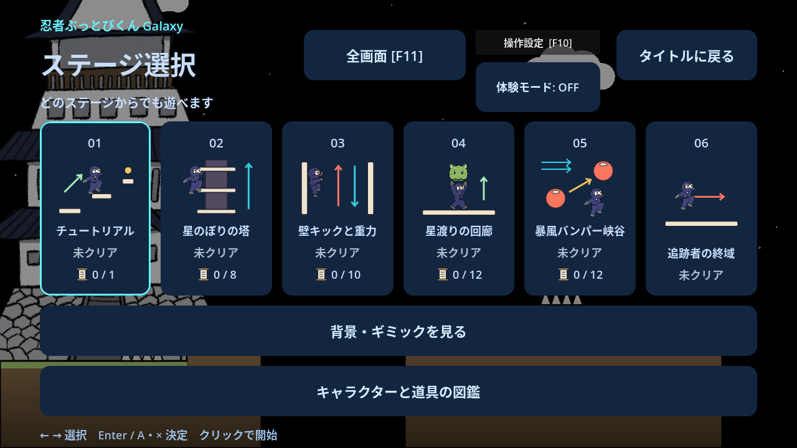

# ステージ選択

## 確定した仕様

F5でプロジェクトを起動すると、ステージ1〜6のカードを左から右へ並べた選択画面を表示する。

| ステージ | 表示 | 開始地点 |
| --- | --- | --- |
| 1 | チュートリアル | 1部屋目。17部屋の本編と任意の18部屋目を含む |
| 2 | 星のぼりの塔 | ふもと。全6区間の上昇コース |
| 3 | 壁キックと重力 | 1部屋目。全6部屋 |
| 4 | 星渡りの回廊 | 1部屋目。全6部屋 |
| 5 | 準備中 | 選択不可。参考ブランチのコースは取り込まない |
| 6 | 追跡者の終域 | 1部屋目。全12部屋の試作 |

`sota_sodex_1st`の星のぼりの塔をステージ2として取り込み、以前のステージ2「壁キックと重力」をステージ3へ移した。同じブランチのステージ4も取り込む。詳細は [第2ステージ](stage-2.md)、[第3ステージ](stage-3.md)、[第4ステージ](stage-4.md) を参照。

番号は表示順を表す。ステージ1〜4・6は自由に選べ、前のステージのクリアを開始条件にしない。開始時はステージ1にフォーカスを置く。

背景は宇宙基地。選択中の枠を水色で示す。



## 環境プレビュー

「5つの環境を見る」から、宇宙基地・生活圏・未開発・溶岩・邪悪なオーラの背景・地形・ギミックを操作できるプレビューへ入る。攻略コースとは区別する。数字キー1〜5、ゲームパッドのL／R、選択欄で環境を切り替える。背景の動きはMキー、Y／△、チェックボタンで停止・再開できる。

## 操作と再開

| 操作 | マウス | キーボード | ゲームパッド |
| --- | --- | --- | --- |
| ステージを選ぶ | ステージをクリック | 方向キー＋Enter | 十字キー／左スティック＋A／× |
| 選択画面へ戻る | 戻るボタン | Esc | Back／Select |
| 現在の復帰地点からやり直す | 本編のお助けメニュー | R | Start |

選択画面はGodot標準のUI入力を使う。ダッシュのB／○、やり直しのStartとは戻る操作を分ける。部屋の切り替え中にも戻れる。お助けメニューを開いているときのEsc／Backはメニューを閉じる。

選択画面へ戻ると進捗を破棄し、再選択するとそのステージの最初から始まる。セーブや途中再開は追加しない。ステージ2〜4・6の壁アクションとダッシュは最初から使える。

チュートリアルは17部屋目で赤い敵から5秒逃げ切り、封印の解けた到着台を押すと本編の完了を表示する。捕まるとその部屋からやり直す。18部屋目は任意のSuperdash練習として残す。塔は頂上の到着台、ステージ3・4は6部屋目の到着台でクリア。ステージ6は12部屋目の逃走・封じ込め・決着のいずれかでクリア。クリアしても自動で別のステージへ進まない。

クリア時はプレイ可能な5ステージ共通で「ステージクリア！」と「ステージ選択に戻る [Enter]」ボタンを表示する。Enter・テンキーEnter・マウスクリック・ゲームパッドAで選択画面へ戻れる。クリア前のEnterでは戻らず、Spaceはジャンプとして使える。

## ファイルと確認

- `scenes/stage_select.tscn` / `scripts/stage_select.gd`：選択画面、開始先、フォーカス移動、環境プレビューの入口。
- `scenes/stage_2.tscn` / `scripts/stage_2.gd`：星のぼりの塔。
- `scenes/stage_3.tscn` / `scripts/stage_3.gd`：壁キックと重力。
- `scenes/stage_4.tscn` / `scripts/stage_4.gd`：星渡りの回廊。
- `scripts/stage_clear.gd`：共通クリア表示と選択画面へ戻るボタン。
- `tests/stage_clear_test.gd`：全5ステージのクリア表示、Enter・テンキーEnter・クリックでの復帰。
- `tests/stage_select_test.gd`：起動、表示順、3種類の入力、準備中の項目、戻る操作、再入場時の初期化。

```powershell
Godot_v4.7.2-stable_win64_console.exe --headless --fixed-fps 60 --path . --script res://tests/stage_select_test.gd
```

`STAGE_SELECT_TEST_OK` と終了コード0を成功条件とする。環境プレビューは `tests/environment_art_test.gd`、各攻略コースは対応するステージテストで確認する。ステージ6は `tests/stage_6_test.gd` で捕獲・投擲・重力・復帰と3通りのクリアを検証する。

共通クリア画面は `tests/stage_clear_test.gd` でステージ1〜4・6の表示と復帰を確認する。成功条件は `STAGE_CLEAR_TEST_OK`（41項目）。ステージ選択は48項目。ステージ6の追加後、既存ステージと共通の移動・運搬・環境を含む17本のヘッドレステストが成功した。選択画面は描画ありでも48項目が成功した。

## ステージ6の追加

ステージ5は準備中のままフォーカスを飛ばし、ステージ4から右へ進むと6を選ぶ。6枚のカードが1280×720の画面内へ収まる幅に揃え、マウス・キーボード・ゲームパッドから起動できる。ステージ6のクリア条件と復帰は [設計書](stage-6.md) を参照。
