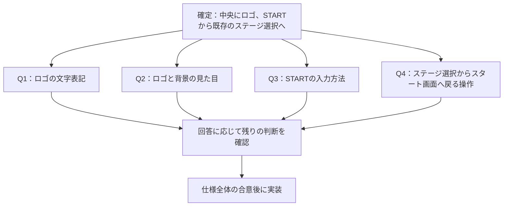

# スタート画面

仕様の検討中。画面の実装は合意後に行う。

## 確定している要件

- ゲームの入口にスタート画面を設ける。
- 作品のロゴを画面中央に表示する。
- STARTを押すと既存のステージ選択画面へ進む。

## 既存の状態

- 起動するとステージ選択画面を直接表示する。
- 用語集と既存画面の作品名は「忍者ぶっとびくん Galaxy」。今回の指定は「忍者ぶっとびくんgalaxy」であり、ロゴの表記は確認する。
- 専用のロゴ画像はなく、既存画面の作品名は文字で表示している。
- 基準の画面サイズは1280×720。
- ステージ選択はクリック、キーボード、ゲームパッドに対応している。
- プレイ中とクリア後の戻り先はステージ選択画面。

## 設計の分岐

現段階では変更しにくい設計上の選択はなく、ADRは作成しない。
