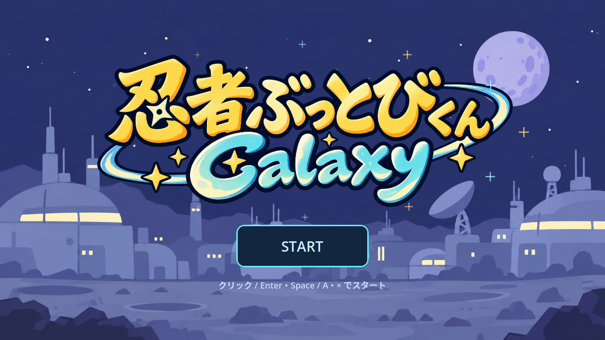
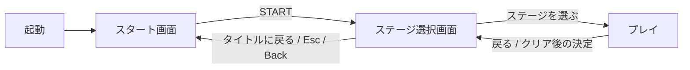

# スタート画面

ユーザーがQ1〜Q4のおすすめをすべて採用し、制作を依頼した。

## 確定した仕様

- ゲームを起動すると、最初にスタート画面を表示する。
- 中央に手描き風のロゴを置き、日本語の「忍者ぶっとびくん」の下に「Galaxy」を表示する。
- 背景は既存の宇宙基地の星空を使い、選択画面と絵柄を揃える。
- ロゴの下にSTARTを表示し、クリック、Enter／テンキーEnter／Space、ゲームパッドA／×で既存のステージ選択画面へ進む。
- 起動時とタイトルへ戻ったときはSTARTにフォーカスを置く。
- ステージ選択からは「タイトルに戻る」、Esc、ゲームパッドBack／Selectでスタート画面へ戻る。戻るボタンは方向キーでも選べる。
- プレイ中とクリア後の戻り先はステージ選択画面とする。
- 基準の画面サイズは1280×720。ロゴの縦横比を保つ。

## タイトルの演出

- ロゴは0.65秒で、少し小さい状態から通常の大きさへ拡大しながら表示する。
- 起動から0.8秒後にSTARTが現れ始め、操作説明も続いて表示する。レイアウトの位置は動かさない。
- ロゴの周囲に金色と水色の星を12個配置し、それぞれ異なるタイミングで約2.8秒かけて明滅させる。
- 表示後のロゴは約5.6秒の周期で、最大1.2%だけ緩やかに拡大・縮小する。
- 演出中もEnter／Space・ゲームパッドA／×でステージ選択へ直接進める。STARTが現れ始めるまでは、透明なボタンがクリックを受け取らないようにする。
- OSが「アニメーションを減らす」設定を通知した場合は、登場演出・きらめき・拡大縮小と背景の動きを止め、ロゴとSTARTを最初から表示する。通知の有無は [GodotのAPI](https://docs.godotengine.org/en/stable/classes/class_displayserver.html#class-displayserver-method-accessibility-should-reduce-animation) で確認する。



## 画面遷移



## ファイルと確認

- `scenes/start_screen.tscn` / `scripts/start_screen.gd`：ロゴ、START、初期フォーカスと選択画面への遷移。
- `assets/ui/title-logo.png`：透過ロゴ。生成方法とプロンプトは [素材の記録](../assets/ui/PROMPTS.md) を参照。
- `assets/ui/menu-theme.tres`：スタート画面と選択画面で共有する既存のボタン装飾。
- `scenes/stage_select.tscn` / `scripts/stage_select.gd`：スタート画面へ戻る操作。
- `tests/stage_select_test.gd`：起動先、各入力での画面の往復、フォーカス復帰と既存ステージ選択の動作。

```sh
godot --headless --fixed-fps 60 --path . --script res://tests/stage_select_test.gd
```

描画ありで同じテストに `-- --screenshots` を付けると、スタート画面とステージ選択の画像を `docs/screenshots/` に保存する。

`tests/stage_select_test.gd` では、登場順・STARTの表示完了・クリック受付開始・演出中の決定操作と、既存の画面遷移を確認する。ゲームパッドは入力イベントで検証し、実機では未確認。

Godot 4.7.2で69項目がヘッドレス・描画ありの双方で成功した。7秒の動画から登場順と星の変化を確認し、START表示後の画像を更新した。OSの動きを減らす設定は実機では未確認。

変更しにくい設計上の選択はないため、ADRは作成しない。
