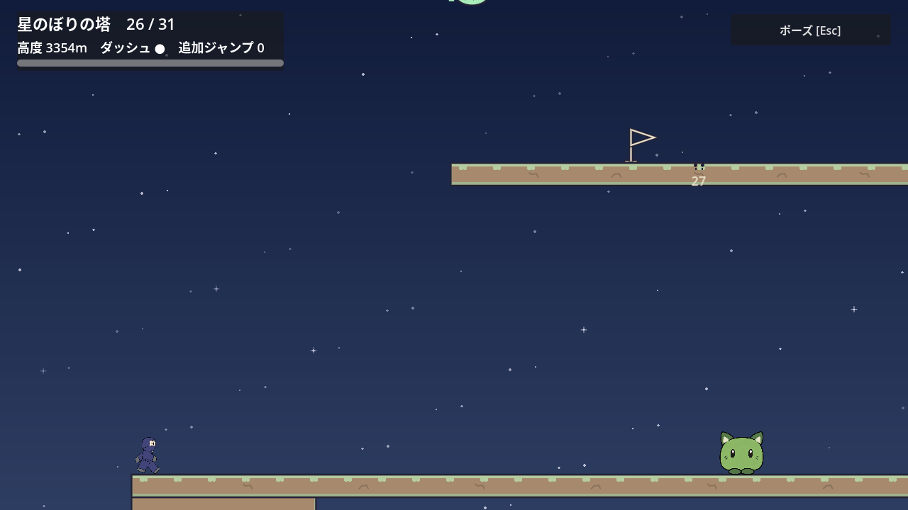
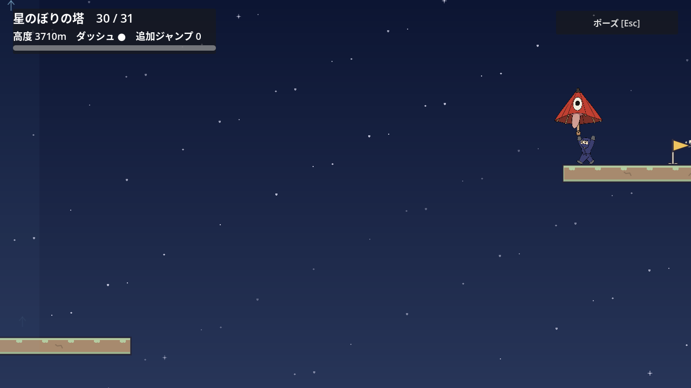
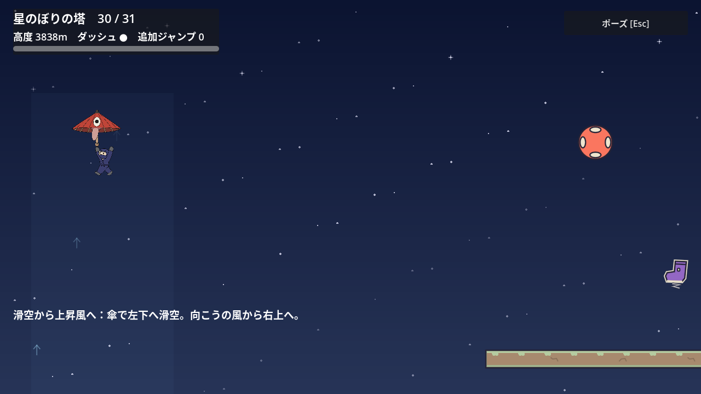
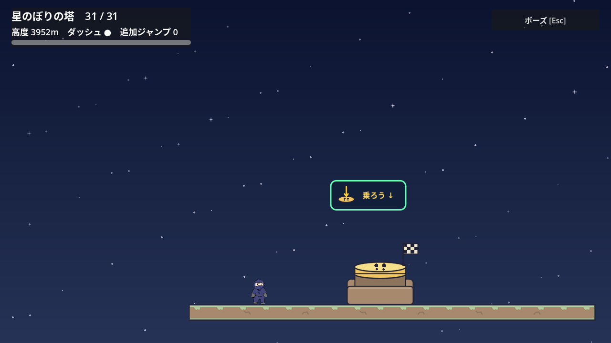

# 塔の運搬と折り返しをつなぐ六区間（Issue166）

以下は31区間版の配置と検証記録。現在は[32〜34区間](tower-applications.md)を加え、旧第31区間の到着台はCP32へ接続する。旧31区間の地形と8巻物IDは保持している。

塔を全31区間へ拡張し、旧頂上をCP26、新しい第31区間を最後の到着台へつないだ。旧25区間の地形・8巻物ID・共有物理は保持した。投げ渡し、回復の折り返し、下降して入るSpring、風と反射、滑空からの上昇、靴と反射を別の組合せで練習する。新しいギミックや使用履歴ロックは追加していない。

## 実装前の設計仮説

2026-10-25。PR167の最終独立レビューとmerge後、main f3536adから専用worktreeで着手した。21:15:58 UTCのWeekly25%、reset1793513849不変で停止条件未成立を確認。[Issue #166](https://github.com/Foxy-null/2d-space/issues/166)と[合意済み探索設計](celeste-exploration-design.md)に基づく実装前の仮説。旧25区間・8巻物ID・共有物理を保ち、旧頂上はCP26へつなぐ。巻物は増やさない。既存nativeギミックで成立する仮説から始め、Dash破壊床の新実装は現段階では不要。

| 区間 | 試す異なる組合せ | 実測で必要性を確かめる箇所 |
| --- | --- | --- |
| 26 | 相棒を上の棚へ実投げ→手ぶらで壁を登る→同一個体を再取得し、離れた上棚へ追加Jump。壁上は広い観察面。 | 600px級の壁と、壁から離れた440px級の片面着地棚。保持した壁キックも自然な代替として比較し、投げの履歴で閉じない。 |
| 27 | 壁上から左へ回復を取りに外れ、空中で向きを変えて右上の復帰棚へ。回復を真上に並べない。 | 戻りのDashがないと届かない横距離と高さ。壁の側面・前区間の実相棒・coyoteも比べる。 |
| 28 | 入口から200pxほど下へ回り、張り出しの下のSpringから開口へ上昇。上棚で休み、壁で次の旗へ。 | 下降は最高地点から640pxの復帰境界以内。Springなし、上から直接Dash、外壁からの省略を比べる。 |
| 29 | 壁上から風へ降り、反射の上側を捉えて左の高い復帰棚へ。Springから反射する既存順序と変える。 | 入り方の異なる反射と向かい風。反射なしのDash、壁の屋根、実相棒・傘の運搬も調べる。 |
| 30 | 傘で左の低い棚まで滑空し、そこから一つの上昇風へ戻り、右上の旗へ。最初から上昇風へ入る旧19/24と変える。 | 初稿は落差300px・横900px程度を仮説とし、通常Jump/Dashでは届かず傘滑空に余裕があるか実測。下棚も復帰境界以内にする。 |
| 31 | 靴の追加Jumpから斜めの反射へ入り、空中回復を取りに折り返して別の反射／最終棚へ。最後の実Goalを見せる。 | 既存25のSpring→反射→回復のコピーにしない。靴と最初の発射源、回復と最後の到達を個別に省いて比べる。 |

全て仮説で、成立済みの配置や必要操作として主張しない。物理に合わなければ課題の組合せを減らして成立させ、距離・待ち時間で水増ししない。通常／実axis0.8×16/20/24fを計測し、広い静止面・全身／保持物・次の足場をヒントOFF/ONで確認。成功再試行は原則30秒以内。初見9〜15分は実測前に達成扱いしない。

実装時はGoal/25CP/旧fourth driver/reloadの全呼出元をrgする。旧25の正例・視界・復帰をCP26実着地へ整え、最後のGoalは新31で別に実押下。旧8IDの未確定/確定/別process/選択8を保ち、全31は入口から接続する。旧19風のCP20基準カメラを保持する。新しい課題から旧課題を省く足場が生まれないことも現物入力で比較する。

## 実入力から決めた配置

共有Player・相棒・傘・風・反射・靴の物理は変更していない。既存native sceneへ足場、旗、既存ギミックを追加した。旧25区間の地形と8巻物IDは保持し、旧頂上をCP26として、最後の実Goalを第31区間へ移した。第26〜31区間には新しい巻物を置いていない。

| 区間 | 実装した順路 | 静止して次を見られる場所 |
| --- | --- | --- |
| 26 | 600pxの壁を越えるように相棒を実投げし、手ぶらで登って同一個体を再取得。広い棚で接地して相棒を回復し、440px上のCP27へ。 | 壁上の幅1800pxの棚。投げの履歴では開錠せず、保持壁キックなどは現物比較する。 |
| 27 | 左の回復へ寄って上の棚へ戻り、右側の500px壁を登る。 | 幅900pxの棚。前区間から保持した相棒の追加Jumpも、回復の代わりとして通過できる。 |
| 28 | CPから120px下のSpringへ降り、左上の棚へ跳ね、左側の500px壁を登る。 | Springの下棚と左上の幅600pxの棚。 |
| 29 | 上側から1450の反射を捉え、左向きの風を横切って棚へ。そこで靴を使い、左上440pxのCP30へ。 | 反射後の幅700pxの棚。風は反射の直下を覆わず、反射後の移動を支える。 |
| 30 | 傘で左へ滑空して320px下の棚へ。歩いて上昇風へ戻り、右上のCP31へ渡る。 | 幅800pxの下棚。CP30だけ復帰面を通常の180px下から420px下へ広げ、意図した下降を許す。 |
| 31 | 靴の追加Jumpで反射に入り、右の棚で休む。空中の回復を取り、最後の到着台へ。 | 幅700pxの中継棚。最後の実Goalは静止面から本体を確認する。 |

最初の第30区間は下棚の落差160pxで、手ぶらのcoyote Jump→左Dashを40f遅らせると実到達できた。落差320px・入口から下棚右端まで800pxへ修正した。現在の24通りの傘なしと36通りのcoyote比較では到達しない。これは試した有限入力の結果であり、全入力の不可能性の証明ではない。

第29区間の反射を1950へ強める案は採らなかった。反射から靴を省いて次の旗へ直接届く余裕が大きくなるため、1450を保って風の位置を左へ寄せた。第30区間の傘はCPの主人公と重ならない場所へ置き、R直後に押し出されず静止床へ復帰することを実接触で確認した。

## 検証記録

新6区間は通常／実axis0.8と16/20/24fの6組、計36経路で121,476項目、全て実到着・死亡0で終了0だった。axis値は Input.action_press 後の Input.get_axis を測定し、0.8を確認している。ハードウェアのゲームパッドを測った結果ではない。第30区間の傘の初期位置を、その後にCPから150px左へ離したため、その変更後の同区間と全体接続も下記のとおり確認した。

変更後のR・実落下・再攻略は25,642項目、終了0。全6区間で入口の静止支持、R後の同じCPと資源復帰、実際の場外落下、弱入力での再攻略を確認した。第26区間は同一相棒の保持中、第30区間は実傘を持って実風へ入った途中でRを押し、風登録と保持状態が解除されることも確認した。

第26区間の投げ渡し・壁登り・再取得を本当に通った後、相棒を脇へ投げて上棚への追加Jumpを省いた24例は529項目、終了0・警告なし。相棒を運べなかった準備段階の失敗は省略成功に数えていない。

36経路とR系列の終了時には既存系列でも見られるObjectDBの2件警告が出た。終了0と経路の成功は確認したが、警告が解消したとは主張しない。警告なしの個別実行と区別する。全31区間通し、旧8巻物の現物経路・保存互換、有限省略、native画像の最終結果は下記に分けて記録した。

壁・回復・Springを個別に省く第26〜28区間の72例は985項目で終了0・警告なし。第27区間の回復省略は相棒を持たない入口からの比較であり、回復だけを絶対必須とは扱わない。前区間から同一Greenを実投げ・壁登り・再取得で運び、回復を使わず上の棚へ渡り、Greenを壁と反対側へ置いて壁を登る経路が通常／実axis0.8の両方でCP28まで死亡0で通った。既存ヒントもこの自然な代替へ合わせた。

実物比較は9,896項目で終了0・警告なし。Greenの支持から同時Grab/Jumpを8方向、旧24の同一傘を25経由でCP26まで実運搬してからの支持を2方向、計10の実支持で比較した。壁・上棚資源を省く到達はなかった。投げ渡しは通常／0.8とDash中1f／8fのreleaseの4組で再取得まで通過した。初回のGreen持ち越し試験は、右の壁へ投げたGreenを登る際に再取得して準備段階で失敗したため、終了1の実行を成功実績から除いた。配置を変えず左へ置く実入力へ直し、上記の最終結果を確認している。

省略比較の最終5分割は合計15,000項目、全て終了0・警告なし。内訳は以下のとおり。

| 実行対象 | 項目 | 有限比較の範囲 |
| --- | ---: | --- |
| `--only=26_companion` | 529 | 実投げ・再取得後に相棒を置き、上段への追加資源を省く24例 |
| `--only=26_wall,27_refill,28_spring` | 985 | 8方向×16/24/40fの72例 |
| `--only=30_parachute,coyote` | 853 | 傘なし24例と、両strength×3猶予×2方向×3時機の走り落ち36例 |
| `--only=throws,steps,carried,old_parachute` | 9,896 | 実支持10例、実投げ4組、Greenと旧傘の同一個体運搬4回。Greenの2回は合法な代替正例 |
| `--only=29_bumper,29_boot,29_direct_boot,30_wind,31_boot,31_bumper,31_refill,31_direct_refill` | 2,737 | 192例。反射から休憩棚を経由せず次の旗へ直行する比較も含む |

全13種の資源省略は312例、coyote36例、実支持10例で計358例。共有ギミックの監視を切る試験は資源を単独で省く対照条件であり、その機能を製品へ追加したものではない。fresh CPからの比較と、旧24→25→26や26→27の実入力による連続運搬は分けている。前者だけを根拠に前区間の資源を運べないと主張しない。

最新main `1a19ca6`へ統合し、他ステージの総数はチュートリアル8／重力10／回廊9／峡谷9を保持した。最終位置の第30区間は6組とも53,284項目、終了0・警告なしで再確認した。Rで傘と重ならず静止接地する入口も各組で確認している。

`tests/tower_fifth_carried_test.gd` は144項目、終了0・警告なし。通常／0.8で実際にGreenを保持し、壁キック17回／15回と上Dashを試す代表では壁上に届かない。第30区間を同一傘で本当に通ってCP31へ着地した後、前の風へ戻り、実風へ再接触して上端へ上がった。両strength×0/12/24fの離脱6組では次の反射へ届かず、最後のBootを省けなかった。この特定の入力を再現する有限比較であり、保持物がある全経路の禁止を証明するものではない。

## native画像

旧25→新31の連続実入力をヒントOFF／ONで撮影した。各20枚、合計40枚を目視し、再取得する同一Green・次の静止面・保持した傘・最後のGoalと表示中のClearCardを確認した。重要場面は原寸でも確認した。描画fixtureも毎frameの実Collision boundsと可視HUDを検査し、OFF15,877項目／ON21,136項目で終了0。両方にXvfbのVSync警告、ONの終了時にはObjectDB2件の警告があり、描画不良や実経路の失敗と混同していない。

画像は `docs/screenshots/tower-fifth/`。各名前に `_hints` を付けた版がヒントONである。

| 区間 | 撮影場面 |
| --- | --- |
| 旧25→26 | `25_entry`, `25_refill`, `25_checkpoint` |
| 26 | `26_entry`, `26_throw`, `26_wall`, `26_carry` |
| 27 | `27_entry`, `27_wall` |
| 28 | `28_entry`, `28_wall` |
| 29 | `29_entry`, `29_boot` |
| 30 | `30_glide`, `30_lower`, `30_wind` |
| 31 | `31_entry`, `31_refill`, `31_goal`, `31_completed` |

## 旧経路との接続

`stage_2_test.gd` は入口から全31区間を位置・速度の注入なしで通り、死亡0で実Goalを押した。終了0・警告なし。熟知した自動入力は260.72秒だった。既存driverの観察・入力調整時間を含むため、これを初見9〜15分の達成とみなさない。クリア後の従来の単体リセットfixtureには位置を変える検査が残るが、その部分を経路の到達証明に使っていない。新6区間のRと死亡は別のretry試験で実入力から確認した。

旧8巻物はserialized fixtureとは別に、全て元の現物経路で確認した。以下の既存5系列が全て終了0・警告なしだった。

| 試験 | 確認した旧ID |
| --- | --- |
| `tower_scroll_route_test.gd` | `left_balcony_01` |
| `tower_upper_scroll_test.gd` | `spring_turn_02`, `wind_rest_03` |
| `tower_more_scroll_test.gd -- --weak` | `left_return_04`, `upper_wall_05` |
| `tower_parachute_route_test.gd`（61,949項目） | `wind_glide_06` |
| `tower_fourth_scroll_test.gd`（41,659項目） | `reflection_left_07`, `updraft_return_08` |

各系列で確定前の取消と確定後の保存・帰還を確認した。最後の2IDは別processでのreloadへ渡し、旧8IDを含む保存形式の互換性は専用fixtureでも確認した。旧第25区間のヒントに残っていた旧終点の表現は、次の旗を示す文へ直し、影響するHintON3画像を1,632項目・終了0のnative実行で局所更新し、原寸で次の旗と文字の両方を確認した。

別processで実2IDを読み直す `tower_fourth_reload_test.gd` は9項目、旧8IDのserialized fixtureを読む `tower_fifth_compatibility_test.gd` は書込み側22項目・別process21項目で全て終了0だった。後者は実8本を同じプレイで連続取得した主張ではなく、古い保存形式の同じ8IDが、選択画面の8 / 8と再訪時の確定済み表示へ一致する互換検査である。互換fixtureと共通UIの実行は専用XDG userdataを使い、通常のユーザー保存へ書き込んでいない。

| 共通回帰 | 項目 | 結果 |
| --- | ---: | --- |
| `stage_select_test.gd` | 144 | 終了0・警告なし |
| `stage_clear_test.gd` | 71 | 終了0・警告なし |
| `arrival_cues_test.gd` | 388 | 終了0・警告なし |
| `scroll_room_transfer_test.gd` | 48 | 終了0・警告なし |
| `ascent_backdrop_test.gd` | 114 | 終了0・警告なし |

保存reload9項目と互換22/21項目では終了時ObjectDB2件の警告が残る。新36経路・R系列・HintON nativeでも同型の2件が出た一方、全31通し・旧8枝の5系列・有限省略・最終30の6組・carried144・共通5本は警告なしだった。警告が解消したとは扱わず、この差分だけからゲーム中の累積リークとも断定していない。VSync警告はXvfbのnative実行だけである。

## 操作時間と確認の限界

| 新区間 | 通常／実axis0.8×16/20/24fの操作時間 |
| --- | ---: |
| 26 | 11.15〜12.35秒 |
| 27 | 7.38〜8.22秒 |
| 28 | 7.05〜7.90秒 |
| 29 | 6.18〜7.25秒 |
| 30（最終配置） | 18.20〜19.00秒 |
| 31 | 7.85〜8.80秒 |

新区間は3秒静止などの待機を足して増量したものではなく、投げ・再取得・折り返し・下降・上昇の操作を計測した。足場で止まる時間を量の達成根拠にしない。初見の本編9〜15分、巻物込み15〜24分は未測定・未達成扱いとし、実機のゲームパッドや人による初見UXも未検証である。有限例を通したことは全操作列の到達不能証明ではない。

途中の未完成配置とfixtureの失敗を、上の終了0の実績へ混ぜていない。特に初稿の手ぶらcoyote到達は実際の配置修正へ使い、相棒を壁へ置いた再取得、R試験の落下方向、再攻略後のrespawn累計比較の誤りは試験入力・比較条件を直して再実行した。最終報告は各jobの期待する完了markerと終了0の両方を確認している。PRの独立レビューは別担当が行う。

## 最新mainとの統合

2026-10-26、main `b29bf5b31cff22aa2192c358e9c9d5350958c379` へrebaseした。文書の競合を解消し、塔31区間・巻物8個、重力31室、回廊36室・巻物12個、峡谷33室・巻物11個を保持した。塔のscene・進行script・関連試験11ファイルは統合前の固定head `2e4e6b6` と同一で、地形・物理・既存40PNGを変更していない。共有slot経由でimportが終了0、続く `stage_select_test.gd` が144項目・終了0・警告なしで通過した。import時の未追跡テストUID再生成は成果物へ含めない。
