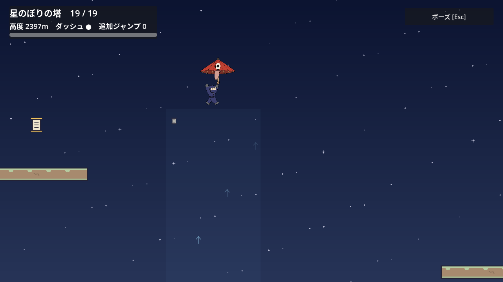
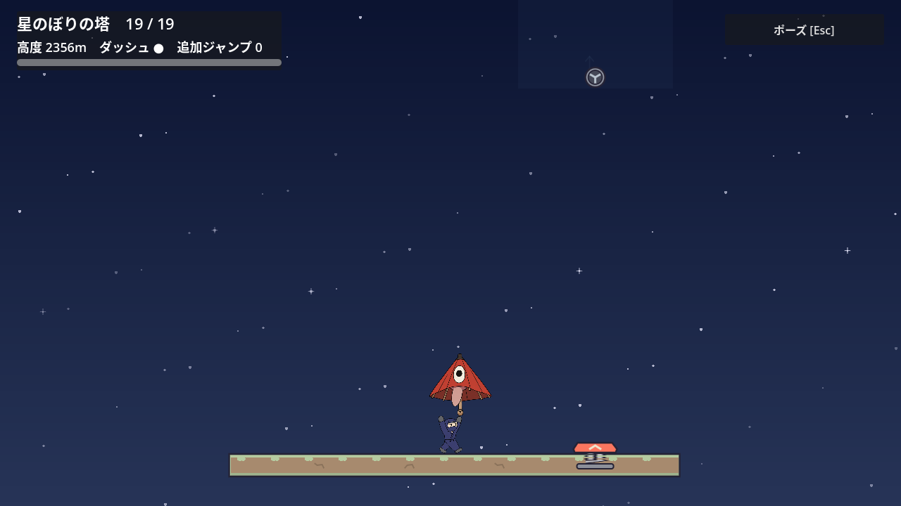
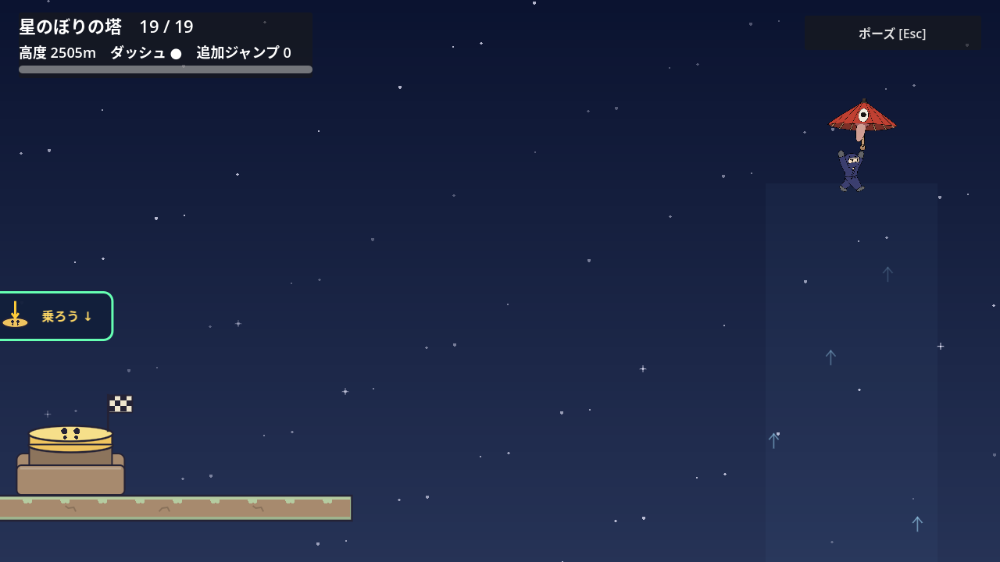
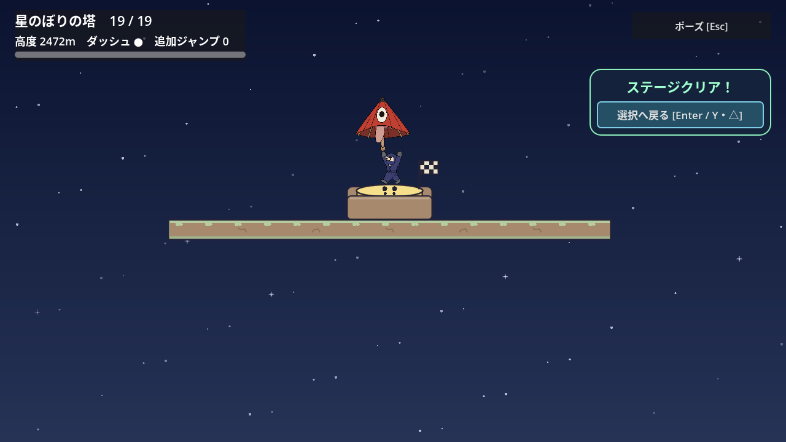
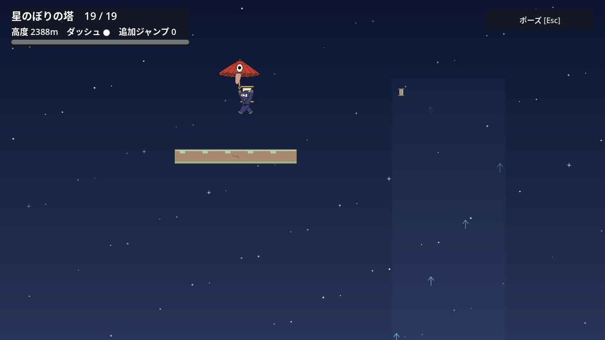
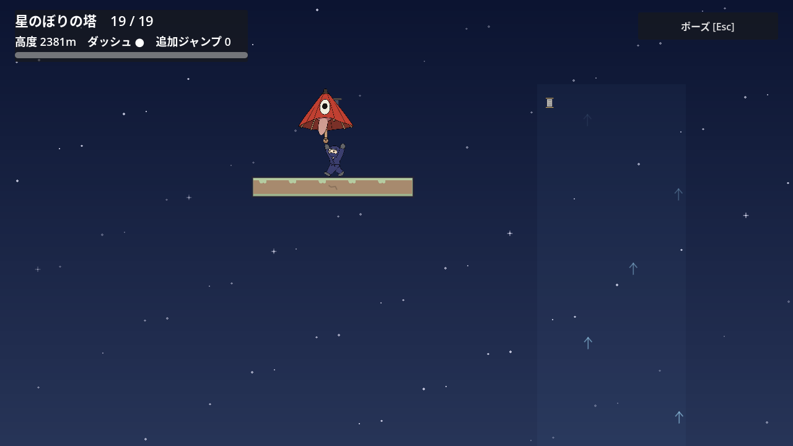
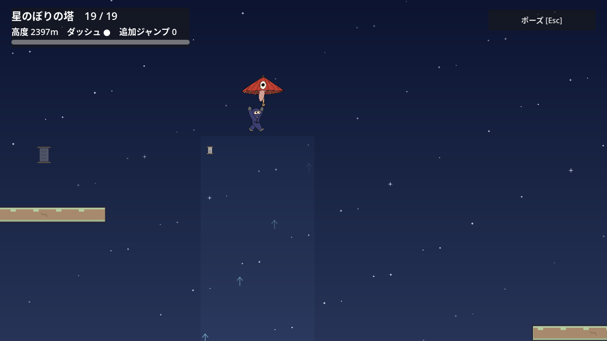

# 塔の傘と上昇風の区間

[Issue #145](https://github.com/Foxy-null/2d-space/issues/145)。旧18区間の頂上をCP19へ変え、傘と二つの上昇風を使う第19区間を追加する。塔は全19区間・上昇24640px・巻物6本になる。旧18区間の足場・アイテム・5個の巻物IDと共通Player物理は保つ。

## 配置と読み取り

| 場所 | 配置と遊び |
| --- | --- |
| CP19 | 床y-22320、傘x-550。持って左側の風へ歩いて入れる |
| 第1の風 | x-200、高さ1100px。傘で浮上し、風の上から右の棚へ滑空する |
| 休憩棚 | 床y-22900、幅640px。CPより580px上で、安全に止まり次の風を観察できる |
| Springと第2の風 | Spring x900、1450px/s。第2の風の下端は棚より520px上にあり、Springから入る |
| 頂上 | 床y-24000、幅720px。第2の風の上から左へ滑空して実到着台を踏む |
| 任意の枝 | 第1の風の左、床y-23150・幅260px。巻物の印から左へ降り、ジャンプで巻物に触れて同じ棚に着地する |

巻物は `tower / wind_glide_06`。棚から右へ跳んで元の風へ戻り、主経路へ合流できる。接触して追従中のR・実落下・ステージ離脱では未取得に戻り、安全な床への着地で確定する。確定後のR・落下・選択画面への帰還・プロセス再起動で保存を保ち、再訪時は薄く表示する。新しい復帰旗は枝に置かない。

既存の傘と風をそのまま使う。通常の落下を遅くする風は、傘の落下速度制限と組み合わせると浮上を生む。通常ジャンプ・ダッシュで棚や第2の風へ届く短絡を避ける高低差にし、操作履歴の開錠は加えない。説明ラベルも増やさず、傘・風の流れ・広い着地面・小さな巻物印で進む先を示す。

第19区間のカメラだけを調整する。休憩棚では上方の風の下端を見せ、第2の風の頂点では左の到着台の本体・ケース・旗が画面内に入る。左への着地中は主人公を中央へ戻し、保持中の傘の90×89.11pxの当たり判定までHUD・ポーズ・クリアカードに隠れない位置にする。旧18区間の追従は変更しない。

## 確認結果

Godot 4.7.2 / Linux / 固定60Hz。次の記録では成功マーカー・終了コード・エラーログを併せて確認した。

- `tower_parachute_route_test.gd`：63,740項目、終了0。通常入力と実axis0.8、風の中から横移動を始める待ち16/20/24f、実際の棚で3秒静止して再出発、巻物の未確定R・実落下・離脱、確定後の保存と自然な帰還・再入場・選択の `1 / 6` と読み上げを確認した。主人公と保持中の傘、次の着地面と風、HUDの重なりも毎フレーム確認する。16/20/24fは風の中での横移動開始時機であり、ジャンプやDashの発動時機ではない。
- `tower_parachute_reload_test.gd`：上記の実取得で作った保存を別プロセスで読み、取得ID・薄い再訪表示・選択の数と読み上げ3項目、終了0。試験用の保存先はPIDで分け、終了後に削除した。
- `tower_parachute_required_test.gd`：8種類×8方向×16/24fの128省略経路、1,681項目、終了0。傘なし、第1の風なし、Springなし、第2の風なし、第1の風から直接第2の風へ向かう経路、前区間から相棒を保持する経路、傘/相棒に実際に乗る経路を比較した。計32回の実支持と32回の実運搬を観測した。
- 相棒は旧第18区間の実個体を、投げ上げ・手ぶらの壁登り・同じ個体の空中回収・既存Springと回復DashでCP19へ運んだ。相棒の踏み台比較はCP19から最初の棚へ、傘の踏み台比較はSpring棚から第2の風へ行う。Spring棚での相棒踏み台まで検証したとは扱わない。経路の途中で位置・速度・資源を注入していない。
- `stage_2_test.gd`：入口から全19区間を連続入力で通過し、新しい実Goal、R、再入場まで終了0。旧 `tower_scroll_route_test.gd`、`tower_upper_scroll_test.gd`、`tower_more_scroll_test.gd -- --weak` も終了0で、旧巻物5本の未確定/確定と `1 / 6`・`2 / 6` を確認した。旧第18区間はCP19到達として判定し、Goalの確認は新頂上で行う。
- 描画付きの新経路は16,120項目、終了0。nativeの配置とカメラで7枚のPNGを保存し、すべて原寸で目視した。XvfbのVSync非対応の警告のみで、最終の通常・省略・旧接続のログにエラー/警告はなかった。

本編のこの区間は通常23.02秒、弱入力24.40〜24.67秒。3秒休憩と検証用の風内待ちを含む。枝の往復は3秒休憩込み15.47秒・16.23秒。待ち時間を本編ボリュームの増加とは数えない。各再試行は30秒以内だが、本編9〜15分・巻物込み15〜24分の全体目標は引き続き未達・未計測である。

初期の保存fixture消失による再読込失敗、HUDに傘が隠れた撮影、143で終了した省略jobは成功数から除外し、修正後に完走した結果だけを上に記載した。初期の即終了時にはObjectDBの音声2件の警告が出た実行もある。最終の通常経路では再現しなかったが、根本原因を確定したとは扱わない。初見の手動試遊・実機パッドは未確認で、有限の省略入力は全操作列の不可能証明ではない。

## 実描画

