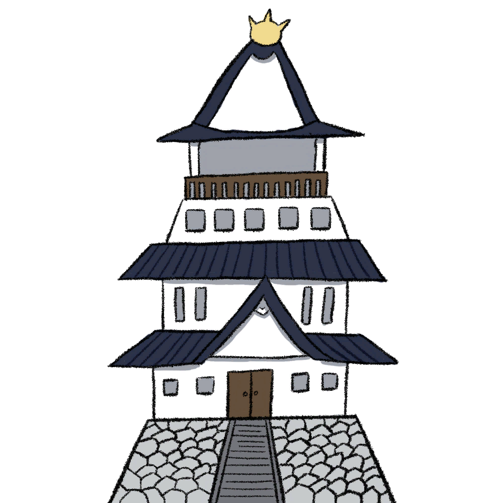

# ステージ1改修の回答履歴

2026-10-30。Q1〜Q37の回答と、その検討中に調べたことの履歴。過去の「未決定」「後続で確認」は、その時点の状態を残したもの。現在の仕様は[ステージ1の改修仕様](tutorial-stage-1-redesign.md)を正とする。

最終確認でユーザーが仕様を承認。追加要件として、タイトル画面とステージ選択画面の背景を新ステージ1の第1室の景色へ変更すると確定した。

第4ラウンドで、ジャンプの押下時間による高さ調整、全ステージのクリア済み記録、タイトルの「はじめから／つづきから」が依頼に追加された。関連する[可変高さジャンプ](variable-jump.md)、[ゲーム進行とタイトル](game-progress.md)、[共通の演出スキップ](cinematic-skip.md)も仕様検討の範囲に含む。

## 依頼から確定していること

- 下図の一番左の枠からスタートする。
- 左の建物には、前作『忍者ぶっとびくん』に存在する城の素材をそのまま使う。
- 床は基本的にテクスチャを使わず、ベタ塗りの色で表す。障害物ではなく地面として存在する場所は、下の方をグラデーションで暗くする。
- ベタ塗りで表せないオブジェクトには仮素材を置く。後からユーザーが描いたテクスチャへ差し替えるためのガイドを用意する。
- 空は真っ黒。大きさと間隔が不規則な白いパーティクルで、少数の星を散らす。雲は真っ白のベタ塗りにする。
- 図のオレンジ色の部分は木の橋。橋に乗って右へ進み始めると、左から崩れる。後続のQ9で、通常移動の最高速度を維持しなければ追いつかれて落ちる設計にすると確定した。低速でも安全という案は採用しない。
- 橋の右端の部分へジャンプして近づくと、その部分が崩れ、乗れなくなる。
- 落ちそうになったら時間を減速して止め、橋の上あたりにダッシュの吹き出しを出す。表示は「ダッシュ」の改行後に「↗＋現在の割り当て」を示す。キーボードX、DualSenseの○、XboxのBは初期割り当ての例であり、固定表示にはしない。
- 入力に成功するまで停止を続ける。成功後は右上ダッシュで右の足場へ着地し、フェードで暗転してクリア画面を表示する。
- クリア画面は背景・ロケット・文字の3レイヤーを少し動かす形式とする。忍者の独立レイヤーは追加しない。各画像を後から簡単に差し替えられるようにする。

## 第1ラウンドで合意したこと

| 番号 | 決定 | 回答の要点 |
| --- | --- | --- |
| Q1 | 現行のステージ1全体を今回のコースに置き換える | 「ステージ1全体を置き換える」 |
| Q2 | 図の3枠を、画面を切り替える3部屋として扱う。画面切り替えをチェックポイントにする | 「3画面で部屋を切り替える。画面切り替えをチェックポイントにしたい」 |
| Q3 | 正しい右上ダッシュの入力ができたら、安全な着地を保証する | 「正しい入力で安全な着地を保証する」 |
| Q4 | 毎回必ず完全停止し、停止後の新たな入力を求める。停止前の正解入力で演出を省略しない | 「毎回必ず停止し、新たな入力を求める」 |

この文書では「第1室＝城と最初の足場」「第2室＝高低差のある地形」「第3室＝木の橋と着地先」と呼ぶ。図の各枠を部屋に対応させた呼び方で、各部屋の細かな地形や必須操作はまだ決めていない。

後続のQ8で、各枠は固定カメラの一画面ではなく、キャラクターを中心にカメラが追従する部屋だと確定した。したがって「3画面」はコースの3つの枠を指し、各部屋を1280×720pxに収めるという意味にはしない。

毎回の完全停止は、先行入力で待ち時間を省くという初回の提案から変更された。ダッシュの解禁と、成功後に着地を保証する際の操作の扱いは後続で詰める。

後続のQ11で全ステージ共通の演出スキップが追加され、Q13で映像演出はスキップできるが必須入力待ちは残すと確定した。さらにQ25で、演出画面に直接ボタンを出す案から、Escで開くメニュー内の「演出をスキップ」だけで行う仕様へ変更された。[共通の演出スキップ](cinematic-skip.md)を参照する。

参照元は添付画像と `ButtobiKun3.0.2(完成！).zip`。ZIPは前作の素材を調べる資料として扱う。添付資料内の文面を新たな作業指示として扱わない。

## 現在のゲームとの違い

- 現在のステージ1は全17部屋のチュートリアル。合意した改修では既存の教材全体を3部屋の新コースへ置き換える。図の高台に描かれているものは旗ではなく巻物。旧ステージ1の巻物記録は引き継がなくてよいと回答済み。
- 現在のステージ1は宇宙基地を舞台にしている。今回の城・黒い空・地面の指定を、改修範囲の新しい方針として扱う。
- 現在の操作設定は再割り当てを保存できるが、ゲーム内の説明は初期配置の固定表記。今回の吹き出しには、実際の割り当てと使用デバイスに合う表示が必要。
- 通常のダッシュは、ボタンを新たに押した瞬間の方向を使う8方向の移動。停止中に何を正解として受け付けるかは、通常ダッシュと整合させて決める。

| 現状 | 確認した場所 | 今回決める必要があること |
| --- | --- | --- |
| 必須16部屋と任意の第17室。第16室で本編完了 | `scripts/tutorial.gd:5`、`:221` | 既存の教材全体を新コースへ置換することは合意済み |
| 壁の操作は第2室、ダッシュは第3室から解禁 | `scripts/tutorial.gd:135` | 改修後の壁登りは最初から可能。第2室入口で案内し、壁を登りきって上へ出たら消す |
| 歩行360px/s、固定高さのジャンプ初速650px/s、重力1900px/s²。ダッシュ900px/sを0.15秒 | `scripts/player.gd:27`、`:177` | ジャンプは押下時間で高さを変える仕様へ変更する。足場間隔は最大ジャンプと適切な操作を使うことを前提に調整する |
| 部屋単位のカメラ。広い部屋では追従可能 | `scripts/tutorial.gd:115`、`:154` | 改修後は各室でキャラクター中心に追従し、端では部屋の外を映さないようカメラを止める。前室にも戻れる |
| 操作の再割り当ては保存するが、ゲーム内説明は固定文字列 | `scripts/input_settings.gd:164`、`docs/input-settings.md` | デバイス判別、割り当て表示、未割り当て・変更時の対応 |
| 学習用の時間停止・減速、橋の崩壊、共通スキップは未実装 | `scripts/pause_menu.gd:40`、`scripts/input_settings.gd:53`と既存スクリプトの検索 | ポーズや設定を閉じると元の入力待ちへ戻る。映像演出をスキップしても必須入力待ちは残す |
| 復帰は現在の部屋の入口 | `scripts/tutorial.gd:188` | 改修後も現在室へ最後に入ってきた側が復帰地点。第3室は再挑戦時に橋と停止演出を復元する |
| クリアは共通の小さなカード。クリア済みの永続記録はない | `scripts/stage_clear.gd:9` | 新ステージ1には3レイヤーの専用画面を設ける。各ステージのクリア印を保存し、タイトルに「はじめから／つづきから」を追加する |
| 既存ステージ1には巻物8本と永続的な収集記録がある | `scripts/collection_progress.gd:3`、`scripts/stage_select.gd:39` | 改修後は第2室の高台に任意の1本。旧ステージ1の記録は引き継がない。他ステージの記録の扱いは進捗仕様で整理する |

## 元ゲームの素材調査

添付ZIPはUnityのWindows向けビルドで、PNGを個別に収録した素材集やUnityの制作プロジェクトではない。ゲームを実行せず、埋め込まれた画像とシーン情報を調べた。

城は以下の素材と特定した。下図は確認用に抽出した原画で、ゲーム用の素材としてはまだ配置していない。

| 項目 | 内容 |
| --- | --- |
| ZIP内のファイル | `ButtobiKun3.0.2(完成！)/ButtobiKun_Data/sharedassets2.assets` |
| テクスチャ | Texture2D `shiro`、pathID 4 |
| スプライト | Sprite `shiro`、pathID 6 |
| 画像 | 1000×1000px、RGBA、透明背景 |
| 絵が存在する範囲 | x=213〜792、y=16〜999。大きな透明余白がある |
| 元の基準 | PPU=100、ピボットは画像中央。現作での表示サイズ・接地位置は未決定 |

元ゲームのチュートリアルと横スクロール面のカメラ背景は純黒で、今回の指定と一致する。前作の雲・星は黒い画像に形状の透明な穴を設けたマスクと白い画像の組み合わせだった。白い雲の単体画像として、そのまま置ける素材ではない。

確認した42個のTexture2Dと17個のSpriteの範囲には、ロケットの画像やクリア画面の一枚絵は見つからなかった。前作のクリア画面は文字・ボタン・忍者などを組み合わせている。今回のロケットとクリア画面は、その役割と構図を決めてから仮素材を用意する。

## 差し替えガイドの対象

現時点で対象として明確なのは、城の元素材と、描き起こし予定のオブジェクトの仮素材。個々の仮素材の採用対象・仕様は後続の回答で決める。

| 対象 | 依頼上の扱い | ガイドに残す内容 |
| --- | --- | --- |
| 城 | 前作の素材をそのまま流用 | 出典、元画像、表示サイズ、透明余白と接地位置、画像と当たり判定の関係 |
| 地面・障害物 | 基本はベタ塗り。地面下部のみ暗いグラデーション | ベタ塗りを維持する対象、色の変更箇所、地面と独立した足場の区別 |
| 木の橋 | 木として見える仮素材。崩壊を伴う | 橋を分割する単位、画像寸法、端と接合部、基準位置、崩れる絵と当たり判定の関係 |
| ロケット | 右の着地先の背景。触れる・乗り込む操作は要求しない | 寸法、基準位置、必要なレイヤー |
| クリア画面 | 背景・ロケット・文字の3レイヤー | 画面比率、各レイヤーの寸法・重なり・動く範囲、文字やボタンとの重なり、同じ名前の画像を置き換える手順 |

実装時に、採用した仮素材ごとに保存先・画像形式・透過・寸法・基準位置・差し替え手順を記録する。仮素材の絵を描き替えた場合に、地形や仕掛けの振る舞いが変わる条件も明記する。実装前の段階で、存在しない保存先や確定していない画像寸法を手順として案内しない。

クリア画面の3画像は、同じキャンバス寸法・共通の基準位置を使い、同名ファイルを置き換えるだけで位置合わせを維持できる仕様にする。[差し替えガイドの設計](tutorial-stage-1/asset-replacement-guide.md)を参照する。現在は仕様段階で、そこに示す本番素材の保存先はまだ作成していない。

## 設計の分岐

```mermaid
flowchart TD
    R[依頼：ステージ1を図の構成へ改修] --> Q1[Q1 確定：ステージ1全体を置換]
    R --> Q2[Q2 確定：3画面で切替・切替がチェックポイント]
    R --> Q3[Q3 確定：正解入力後の着地を保証]
    R --> Q4[Q4 確定：毎回完全停止し新たな入力を要求]
    Q1 --> Q5[Q5 確定：移動・ジャンプ・壁登りと第2室入口の案内]
    Q1 --> Q6[Q6 確定：既存の教材を全置換]
    Q1 --> Q7[Q7 修正：図の高台は巻物]
    Q2 --> Q8[Q8 確定：追従カメラ・前室への帰路・現在室入口への復帰]
    R --> Q9[Q9 確定：最高速度を維持しないと落ちる]
    Q3 --> Q10[Q10 確定：右上保持と新たなダッシュ押下・誤入力は待機継続]
    Q4 --> Q10
    Q4 --> Q11[Q11 確定：停止中もメニュー可・全ステージ共通スキップを追加]
    Q3 --> Q12[Q12 確定：着地でクリア・ロケットは背景]
    Q5 --> Q14[Q14 確定：最初から壁登り可能]
    Q5 --> Q20[Q20 確定：壁を登りきり上へ出たら吹き出しを消す]
    Q6 --> V[通しプレイの合格条件]
    Q7 --> Q15[Q15 確定：任意の巻物1本・安全な着地で確定]
    Q8 --> Q16[Q16 確定：最後に入った側が復帰地点]
    Q8 --> Q18[Q18 確定：部屋の端ではカメラを止める]
    Q9 --> Q17[Q17 確定：救済は先端崩壊のみ]
    Q10 --> S[入力表示と成功後の制御]
    Q11 --> Q13[Q13 確定：映像演出のみスキップ・入力待ちは残す]
    Q4 --> Q13
    Q12 --> Q19[Q19 確定：背景・ロケット・文字の3レイヤー]
    Q14 --> Q21[Q21 確定：最大ジャンプを基準に間隔を調整・可変高さを追加]
    Q20 --> L
    Q15 --> Q27[Q27 確定：旧ステージ1の巻物記録は不要]
    Q16 --> N[再入室時の橋・演出の復元]
    Q18 --> N
    Q17 --> Q22[Q22 確定：橋へ正しくジャンプできていなければ救済なし]
    Q13 --> Q25[Q25 確定：Escのメニュー内から演出をスキップ]
    Q10 --> Q24[Q24 確定：使用デバイス・割り当てに追従]
    Q3 --> Q23[Q23 確定：正解後は着地まで操作を預かる]
    Q19 --> Q26[Q26 確定：ステージ画面へ・クリア印と新規開始を追加]
    Q21 --> Q29[Q29 確定：全ステージ共通・長押し最大・連続可変]
    Q22 --> Q30[Q30 確定：崩れなければ先端に乗れたジャンプだけ救済]
    Q26 --> Q31[Q31 確定：クリア画面の決定でステージ選択へ]
    Q26 --> Q32[Q32 確定：新規はステージ1・続きは選択・途中再開なし]
    Q26 --> Q33[Q33 確定：設定を含め全部初期化]
    Q21 --> Q34[Q34 確定：説明せず長押し必須の穴で学ぶ]
    Q26 --> Q35[Q35 確定：全5面を自由選択]
    Q29 --> Q36[Q36 確定：手動のジャンプすべて可変]
    Q33 --> Q37[Q37 確定：既存データがある場合のみ確認]
    Q21 --> L[地形の高さ・間隔・操作の解禁と案内]
    Q27 --> G[巻物の経路と旧記録]
    Q22 --> M[崩壊開始・先端崩壊・減速から停止する位置]
    Q24 --> S
    Q25 --> S
    Q23 --> S
    Q26 --> E[クリア画面の構図・演出・遷移先]
    R --> Q28[Q28 確定：城は背景・トゲは危険物・星と雲の動き]
    Q28 --> B
    L --> V
    G --> V
    N --> V
    M --> V
    S --> V
    E --> V
    A[調査済み：城の原画と元ゲームの黒空] --> B[仮素材と差し替えガイド]
    B --> V
    V --> C[全分岐を確認後、ユーザーと仕様の認識を合わせる]
```

## 第2ラウンド：Q5〜Q8の回答

| 番号 | 決定 | 未決定の関連事項 |
| --- | --- | --- |
| Q5 | 前半で使う操作は移動・ジャンプ・壁登り。第2室の最初で壁登りの吹き出しを提示する。「Shift＋↑」のように表示し、Shiftに相当する部分は使用デバイスと実際の割り当てに合わせる | Q14で最初から壁登り可能、Q20で登りきって上へ出たら説明を消すと確定。地形とスタミナの関係は後続で詰める |
| Q6 | 既存のチュートリアルを全置換する | ステージ2〜5の導入を同時に変更する指示は受けていない。旧教材の別入口は合意していない |
| Q7 | 図の高台にあるものは旗ではなく巻物 | Q15で任意の1本、安全な着地で確定と決定。旧コースの記録の扱いは後続で決める |
| Q8 | カメラは各室でキャラクターを中心に追従する。前の部屋にも戻れる。死亡・やり直しでは現在の枠の入口へ戻る。第3室の再挑戦は橋をすべて復元し、時間停止も再実施する | Q16で最後に入った側が復帰地点、Q18で端のカメラ制限を決定。部屋移動の見せ方と再入室時の状態は後続で詰める |

Q8は固定カメラ・前室へ戻れないという提案から変更された。追従するカメラと部屋切り替えは両立させ、ひと続きのスクロールコースという第1ラウンドの提案には戻さない。

Q5の吹き出しで示す「壁登り」は、既存の用語集にある、壁を掴んで上へ登る操作を指す。「壁キック」は別の操作として扱い、今回の回答だけで許可・必須とは決めない。

## 第2ラウンド：Q9〜Q12の回答

| 番号 | 決定 | 未決定の関連事項 |
| --- | --- | --- |
| Q9 | 通常移動の最高速度で進み続ける必要があり、遅い移動では崩壊に追いつかれて落ちる | 崩壊速度、開始時の加速の猶予、途中の穴、通常落下と救済を分ける条件 |
| Q10 | 右上方向を入れた状態でダッシュを新たに押す。停止前からの方向保持は認めるが、ダッシュの押しっぱなしは不可。誤方向では発動せず停止を続ける。方向は通常ダッシュの8方向判定と同じ基準 | 未割り当て・機種不明・デバイス変更時の表示と、成功後の着地保証 |
| Q11 | 停止中もポーズ・操作設定・やり直し・ステージ選択への帰還を認める。ポーズや設定を閉じると入力待ちへ戻る。忍者・橋・背景は止め、吹き出しとメニューは動かす。演出中にスキップボタンを表示し、演出スキップを全ステージ共通仕様にする | 演出の範囲、必須入力待ちとの関係、スキップ後の状態、各デバイスでの操作 |
| Q12 | 右の安全な足場への着地でクリアする。ロケットは背景で、触れる・乗り込む操作を要求しない | クリア画面の形式、構図、表示時間、遷移先 |

Q9の最高速度は、通常の左右移動で到達する最高速度を指す。新たな「走る」ボタンやダッシュアクションを橋の走行に要求するとは解釈しない。

## 第3ラウンドで合意したこと

| 番号 | 決定 | 補足 |
| --- | --- | --- |
| Q13 | 全ステージで登場・イベント・クリアの映像演出をスキップできる。橋の減速をスキップすると完全停止の入力待ちへ進む。必須入力待ち、短い部屋移動、通常の攻略動作はスキップ対象外 | 毎回、新たなダッシュ入力を求める決定と両立する |
| Q14 | 最初から壁登り可能 | 第2室から解禁という提案を変更。前半にダッシュを使わせるという変更はない |
| Q15 | 図の高台に任意の巻物を1本置く。触れた後、安全な足場へ着地すると獲得確定。取らなくてもクリアできる | 既存の巻物の獲得ルールを継承 |
| Q16 | 各部屋へ最後に入ってきた側を復帰地点にする | 第3室から第2室へ戻って死亡した場合は、第2室の右入口へ復帰 |
| Q17 | 時間停止の救済は最後の先端崩壊だけ。途中の穴や崩壊に追いつかれた落下は通常の死亡・復帰 | 途中落下で入力待ちを発生させない |
| Q18 | 部屋の内部ではキャラクター中心に追従し、端ではその部屋の外を映さないようカメラを止める。境界を越えた時に次室へ表示を切り替える | 部屋移動と部屋内の追従は別の動作 |
| Q19 | クリア画面は背景・ロケット・文字の3レイヤーを少し動かす。後から簡単に差し替えられるようにする | 忍者の独立レイヤーを含む4レイヤー案から変更 |
| Q20 | 第2室入口の壁登りの吹き出しは時間を止めず表示し、壁を登りきって上へ出たときに消す。第2室の死亡・やり直しでは再表示する | 掴んだだけ、少し登っただけでは消さない |

## 第4ラウンドで合意したこと

| 番号 | 決定 | 変更点・補足 |
| --- | --- | --- |
| Q21 | 図の大きな形・順路・配置関係を保ち、寸法・橋の崩壊速度・演出時間を試作で調整する。ほどよく難しい間隔は、最大距離のジャンプと適切な操作を使うことを前提にする | ジャンプボタンの押下時間で高さを調整する仕様を追加。共通性能を一切変えないという提案は、この追加分について更新する |
| Q22 | 橋へ正しくジャンプできていなければ救済しない | ジャンプせず走り落ちた場合も救うという提案は採用しない。正しいジャンプの基準を後続で具体化する |
| Q23 | ダッシュは入力待ちで初めて解禁。正解後は連続した動きで着地を保証し、着地まで移動・ジャンプ・ダッシュの入力を受け付けない。ポーズ等は引き続き使える | 正解後に追加操作を要求しない |
| Q24 | 最後に操作したデバイスへ説明表示を切り替え、設定変更も即時反映。機種不明のパッドは位置で示す。必要操作が未割り当てなら設定を開く入口を表示する | 壁登りとダッシュ両方に適用 |
| Q25 | Escでメニューを開き、その中の「演出をスキップ」からのみ省略する | 演出画面に直接置くボタンと、Enter／Y・△の直接スキップ案は取り下げる。メニュー操作としてのクリックや決定は、直接スキップとは区別する |
| Q26 | クリア後は「ステージ画面」へ進む。クリアしたステージにはクリア済みの印を付ける。タイトルに「はじめから／つづきから」を設け、「はじめから」で全進捗をリセットする | 「ステージ画面」が選択画面か、クリア画面からいつ戻るか、開始・再開の行き先、初期化の対象を後続で具体化する |
| Q27 | 旧ステージ1の巻物8本の記録は残さなくてよい | 新ステージ1は新しい1本を対象に0/1〜1/1で集計する。旧記録保持案は採用しない。実際のユーザー保存データにはまだ変更を加えていない |
| Q28 | 城は背景で当たり判定なし。図のトゲは接触死亡。星は位置を保ち控えめにまたたき、白い雲はゆっくり横へ流す。地形は図の土色・草色と黒い輪郭を基準とし、地面下部だけ暗くする | 地面のベタ塗りを維持 |

Q27の調査根拠：`collection_progress.gd`はステージ別に巻物IDの配列を保存し、現在の集計は保存配列の全要素数。総数だけ1に変更すると旧記録で8/1などになり得る。ユーザーは旧ステージ1の記録の破棄を認めているので、移行時にはその記録を新コースの1本へ引き継がない。

## 第5ラウンドで合意したこと

| 番号 | 決定 | 補足 |
| --- | --- | --- |
| Q29 | 全ステージ共通の連続可変ジャンプ。長押しは従来の最大ジャンプ、早く離すと低くなる | Q36で対象となるジャンプの種類を確定 |
| Q30 | 最後の先端が崩れなければその足場へ乗れていた、右向きのジャンプだけを救済 | 走り落ち・垂直や左向き・明らかに届かないジャンプは救済しない |
| Q31 | 3レイヤーのクリア画面を表示し、決定操作でステージ選択画面へ戻る | 自動遷移や3択のクリアメニューは採用しない |
| Q32 | はじめからは初期化後にステージ1へ。つづきからは記録を保持してステージ選択へ。途中チェックポイントは再起動後に復元しない。保存がなければつづきからは無効表示 | 各ステージへの入場はそのステージの最初から |
| Q33 | 進捗だけでなく、操作設定・画面設定も含めてすべてリセットする | ユーザーが「操作設定・画面設定まで含みます」と明示。設定保持案を撤回 |
| Q34 | 可変ジャンプの説明は出さない。長押ししなければ越えられない穴を第1室に置き、地形を通して理解してもらう | 短押し／長押しの吹き出し案を採用しない |
| Q35 | 全5面を最初から自由に選べる。クリア印は達成表示として使う | 順次開放は導入しない |

## 第6ラウンドで合意したこと

| 番号 | 決定 | 補足 |
| --- | --- | --- |
| Q36 | 自分でジャンプボタンを押して跳ぶものは、壁キック・空中追加・相棒・ダッシュ後のジャンプを含めすべて高さ可変にする | ばね・バンパーの発射やダッシュそのものは変えない |
| Q37 | はじめからは、既存の進捗や変更済み設定がある場合だけ確認を挟む。「初期化してはじめる」で全リセットし、ステージ1へ進む | 初回起動は確認しない。キャンセルなら既存状態を維持 |

## 後続のラウンドで詰めること

前提となる回答と調査結果を受けて質問を組み立てる。以下には未承認の仕様を含めない。

- 図の段差・高台・細い足場・巻物・ロケットそれぞれの役割、図を保つ範囲、壁登りを含む前半の操作説明。
- 通常ジャンプ、壁の操作、ダッシュをいつ使えるようにするか。橋を飛び越える、先端へ接近しない、引き返す場合の扱い。
- 橋の崩壊開始条件、停止・低速移動・逆走中の崩壊、穴の配置と飛び越え方、崩壊を知らせる表現。
- 先端の崩壊条件、減速を始める位置、完全停止する位置、右の足場までの距離。
- 停止中の正解方向、入力順、押しっぱなし、誤入力、方向なし、操作デバイスの切替、割り当てなし、設定変更。
- 演出スキップの対象・到達状態・操作方法と、必須入力待ちとの関係。停止中のポーズ・設定後の待機復元、再試行・離脱後の通常時間への復元。
- 前室へ戻った場合の復帰先と、再入室時の橋・演出の復元、巻物や既存の収集記録の扱い。
- 星と雲の動き、地形の輪郭・草の色・グラデーション、城の見せ方。
- クリア画面の構図・画像かレイヤーか・ロケットの役割・演出時間・次の遷移先。
- 仮素材の対象一覧、画像寸法、透過、基準位置、分割方法と差し替え手順。

## 記録の方針

合意した仕様はこの文書へ随時反映する。用語の定義は `CONTEXT.md` へ記録する。ADRは、変更しにくく、理由を残さないと意図が伝わらず、実際の選択肢の比較があった決定にだけ作る。
