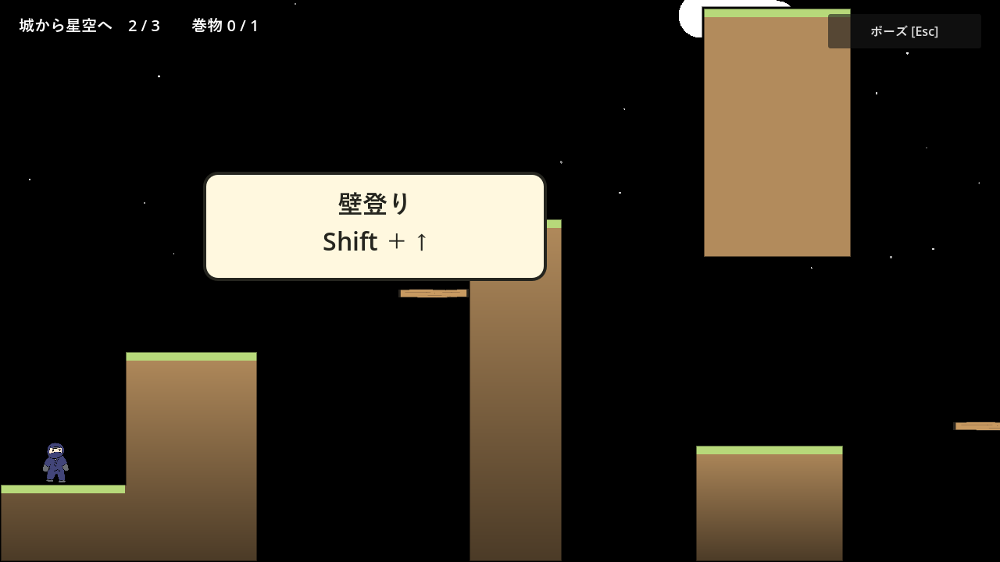
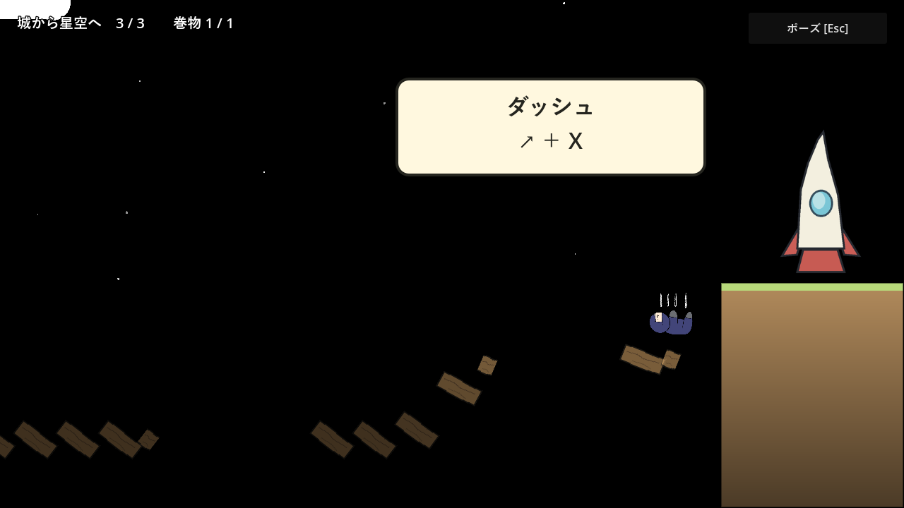
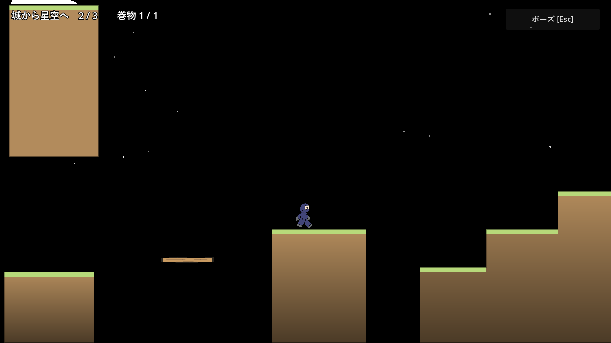

# 第1面改修の実装・検証記録

2026-10-30。承認済みの [仕様](tutorial-stage-1-redesign.md)に沿って、旧17部屋を新しい3部屋へ置き換えた。

## 実装

| ファイル | 役割 |
| --- | --- |
| `scripts/tutorial_landscape.gd` | 地形の描画と多角形の共有、黒い空・星・雲、原作の城、タイトルと選択の背景 |
| `scripts/tutorial_bridge.gd` | 板の当たり判定、左からの崩壊、先端の崩壊、やり直しでの復元 |
| `scripts/tutorial.gd` | 3室、両方向の移動と復帰地点、壁登り案内、適切なジャンプの救済、必須入力、着地保証、3レイヤーのクリア画面 |
| `scripts/player.gd` | 全手動ジャンプの可変高さ。第1面だけ壁キックと先行ダッシュを無効化 |
| `scripts/input_settings.gd` | 使用デバイス・実割り当てによる説明、未割り当て時の設定入口、全初期化 |
| `scripts/collection_progress.gd` | 開始済み・クリア・巻物の永続化、旧IDの移行、3ファイルを含む初期化と保存失敗時の復元 |
| タイトル・選択・共通ポーズ | はじめから／つづきから、クリア印、共有背景、メニュー経由のスキップと停止復元 |

第1室の穴は230px。最高速度360px/sの長押しジャンプで越えられる。橋は幅220pxの穴が2つと、最後の180pxの飛び移りを持ち、崩壊前線は362px/sで進む。最初の96pxの余裕を使って最高速度を維持する。最後の着地予定位置を現在の速度と重力から判定し、正しい右向きの踏切だけを救済する。

減速は0.42秒、着地後の暗転は0.45秒、クリア画像の登場は0.65秒。減速の省略でも同じ停止位置と橋の状態へ進み、新規のダッシュ入力を待つ。正解後は共通プレイヤーのダッシュと重力移動を使い、安全な足場まで操作を制限する。

城は前作の1000×1000px原画と同一。橋・ロケット・クリアの3枚は描き替え用の仮PNGで、[差し替えガイド](tutorial-stage-1/asset-replacement-guide.md)から原寸ファイルを開ける。旧コース固有の収集シーン・攻略テストは廃止し、共通の到着台と他の4面のテストは維持・更新した。

## 実行方法

Godot 4.7.2 Stable、Windows、60Hzで確認した。描画はOpenGL 3.3 / NVIDIA GeForce RTX 3080 Tiを使用。Python標準ライブラリのランナーがプロジェクトを一時コピーし、検証ごとに別の `user://` を作る。実際のプレイ保存へは書き込まない。

```sh
python tests/run_checks.py --godot /path/to/godot --smoke --render --timeout 240 tutorial_redesign_test.gd variable_jump_test.gd game_progress_test.gd phase1_movement_test.gd phase2_environment_test.gd phase3_grab_test.gd input_settings_test.gd input_settings_pause_test.gd display_settings_test.gd collection_progress_test.gd pause_menu_test.gd stage_select_test.gd stage_clear_test.gd arrival_retry_test.gd scroll_room_transfer_test.gd gimmick_retry_contact_test.gd stage_2_test.gd stage_3_test.gd stage_4_test.gd stage_5_test.gd
```

## 初回改修の確認結果

主要20本が成功。タイトル・選択・全5面の起動確認も成功した。

| テスト | 確認内容 | 結果 |
| --- | --- | --- |
| `tutorial_redesign_test.gd` | 各室の実入力経路、任意巻物、逆走と復帰、短押し・低速・誤踏切、自然な減速、メニュー経由のスキップ、停止中の押し直し・誤方向・設定・未割り当て、実キーXによる着地、クリアと帰還 | 107項目成功 |
| 同テストの描画あり実行 | 通し入力、10枚の画像保存 | 117項目成功 |
| `variable_jump_test.gd` | 高さの連続変化、反転、壁キック、追加ジャンプ、先行入力、ばねとダッシュへの非干渉 | 11項目成功 |
| `game_progress_test.gd` | 新規保存・再読込・移行・全初期化・保存失敗の復元と通知・タイトル確認 | 25項目成功 |
| Phase 1 / 2 / 3 | 移動、ギミック、運搬・相棒・Superdash | 411 / 443 / 1512項目成功 |
| 操作設定・操作設定とポーズ・表示設定・巻物 | 既存の共通処理 | 全て成功（停止との組合せ109項目、表示2項目） |
| ポーズ・選択・クリア後UI | キー・パッドイベント・クリック、フォーカス、各カードの表示範囲、帰還 | 175 / 200 / 57項目成功 |
| 到着台のやり直し・巻物の部屋移動・ギミック接触からの復帰 | 共通処理の回帰 | 26 / 36 / 33項目成功 |
| ステージ2〜5 | 最大ジャンプの保持入力で既存の34区間・37室・36室・34室を攻略 | 全て成功。第3〜5面は1004 / 1257 / 15667項目 |

最大ジャンプ用の既存リプレイは頂点まで保持する入力へ変更した。短押しを最大跳躍とみなす旧前提を残していない。第1面の失敗比較やメニューのfixtureでは位置・状態を用意し、経路の実入力テストと区別している。

ログは `deliverables/tutorial-validation/` に出力する。巻物の破損ファイル試験で出るConfigFileの構文エラーは意図したもの。塔・峡谷の即終了と選択テストには、既存のObjectDB終了警告が残る。スクリプトエラーや経路の失敗はない。

## 描画確認

城・忍者の重なり、地面の下方向のグラデーション、壁登り案内、停止中の忍者と崩れた橋・着地先、クリアの3枚、タイトルと選択の文字を保存画像で確認した。選択カード内の巻物表示がはみ出した箇所は、余白・絵・文字サイズを調整して収めた。






実機ゲームパッドの接続、初見ユーザーの難度評価、60Hz以外、OSの動きの抑制の実通知は未確認。ゲームパッド操作はGodotの入力イベント、機種別表記はデバイス名ごとの関数で確認した。橋とロケットの絵は仕様どおり仮素材であり、完成テクスチャへの差し替えを待つ。

## 落下姿勢と薄い木板の追加修正

追加要望に合わせ、橋の減速開始から入力待ちまで、既存の頭打ち姿勢 `bonk` をそのまま表示するようにした。姿勢更新だけを止め、正解ダッシュ・やり直しで再開する。新しい画像・アニメーション名・専用の再利用処理は追加していない。操作を制限した着地演出でも、ダッシュと空中移動に対応する通常の姿勢を表示する。

構成図の薄い張り出し・細い台3箇所は、厚さ12pxの木の片面足場にした。第2室では対応する土の張り出しと細い柱を取り除き、板の下に空間を残す。Godot標準の `one_way_collision` を使い、下から通過して上から着地できる。既存の橋用仮画像を薄く表示し、新しい画像は作っていない。追加で示された参考画像は保存せず、特徴だけを [差し替えガイド](tutorial-stage-1/asset-replacement-guide.md)に記録した。

```sh
python tests/run_checks.py --godot /path/to/godot --render tutorial_platforms_test.gd tutorial_redesign_test.gd character_sprites_test.gd
```

- 木板の実物理テスト16項目成功。全3枚で下からの通過、頭をぶつけないこと、上からの着地、着地後45フレーム立ち続けられることを確認した。
- 第1面の実入力テスト112項目、描画あり123項目成功。通常の減速とメニュー経由の省略、入力待ち、やり直し、正解ダッシュでの姿勢も確認した。
- 既存のキャラクタースプライトテスト成功。可変ジャンプ導入後の下降確認は、最大ジャンプを保持してから下降する入力に更新した。
- 共通の移動テスト411項目成功。


