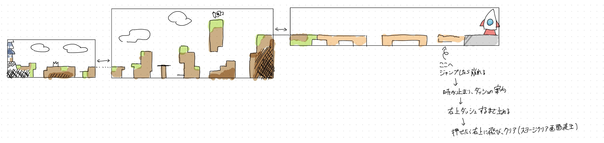
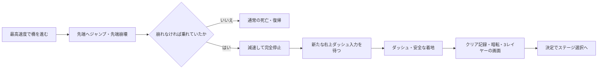
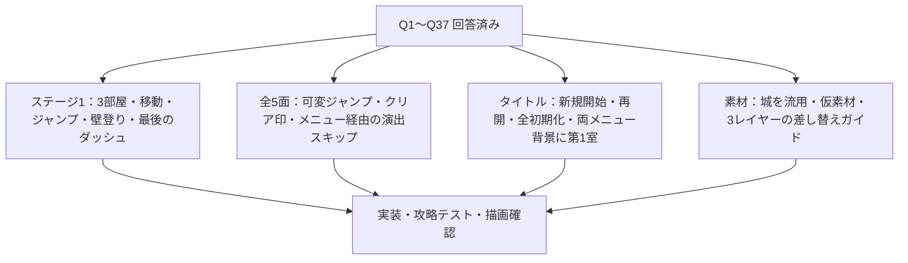

# ステージ1改修仕様：城から崩れる木の橋へ

状態：実装済み。2026-10-30。Q1〜Q37の承認済み仕様と、タイトル・ステージ選択の背景に関する追加要件を反映した。テストは専用の保存先で行い、実際のプレイデータは変更していない。[実装・検証記録](tutorial-stage-1-implementation.md)を参照。

## 改修範囲

現行のステージ1全17部屋を、下図の3枠に対応する3部屋のチュートリアルへ置き換える。あわせて、全ステージ共通の可変高さジャンプ、メニュー経由の演出スキップ、クリア済み記録、タイトルの「はじめから／つづきから」を追加する。タイトルとステージ選択画面の背景は、新ステージ1の第1室の開始時の景色へ変更する。

ステージ2〜5のコースは作り直さない。共通操作と進捗表示に関係する箇所を変更し、既存コースの最大ジャンプによる攻略を確認する。旧チュートリアルを別の練習ステージとして追加することは今回の範囲に含めない。

| 部屋 | 内容 | 主な体験 |
| --- | --- | --- |
| 第1室 | 左端の城と最初の足場 | 移動とジャンプ。短押しでは越せず、長押しなら越せる穴で高さ調整を学ぶ |
| 第2室 | 高低差のある地形、細い足場、高台の巻物 | 壁登り。任意の巻物へ寄り道できる |
| 第3室 | 崩れる木の橋と右の安全な足場・ロケット | 最高速度の走行とジャンプ。先端崩壊からの時間停止で右上ダッシュを学ぶ |

## 地形・難度・カメラ

- 図の大きな地形の形、順路、巻物と橋の位置関係を保つ。厳密なピクセル単位の写しにはしない。
- 高さと間隔は、最大距離のジャンプ、通常移動の最高速度、適切な壁登りを使ったときに、ほどよく難しくなるよう試作で調整する。
- 第1室では短押しのジャンプだけでは越せない穴を作る。短押し／長押しを説明する吹き出しや文章は出さない。
- 構成図の薄い張り出しと細い台は木の片面足場にする。第1室終盤の張り出し、第2室の高い柱の左側、第2室中盤の細い台の3箇所に置き、下から通過して上から着地できる。土の柱として下まで埋めない。
- 長押しジャンプの最大性能は従来の軌道を保つ。既存の壁スタミナやダッシュ性能を、このコースを成立させる目的で増やさない。
- 図のトゲは接触で死亡する危険物。落下も死亡として扱う。
- 各部屋でカメラはキャラクター中心に追従し、端ではその部屋の外を映さないよう止める。部屋の枠は固定カメラの一画面とは限らない。
- 境界を越えると隣の部屋へ表示を切り替える。前の部屋にも戻れる。遠くの部屋までカメラだけを長く流す遷移にはしない。
- 最後の入力待ちでは、忍者、崩れた先端、右の着地先、吹き出しを同時に読み取れる構図にする。

寸法、崩壊速度、予兆・減速・暗転の時間は実装時の調整項目。調整を任された範囲であり、追加のユーザー判断待ちではない。最大操作での通過と、短押し・低速・誤った踏切との違いを実入力で確認する。

## 使える操作と壁登りの案内

- 移動・ジャンプ・壁掴み／壁登りは最初から可能。ステージ1で使わせる操作はこの3種類と最後のダッシュに絞る。壁キックは本コースでは使わせない。
- ダッシュは第3室の入力待ちで初めて使用可能になる。手前から先行ダッシュで橋や停止演出を飛び越えることはできない。
- 第2室に入った最初の場所で、壁登りの吹き出しを提示する。表示例は「壁登り」の改行後に「Shift＋↑」。Shiftに当たる部分は実際の割り当てと使用デバイスに合わせる。
- 壁登りの案内中も時間は止めず、通常どおり操作できる。
- 案内は、壁を登りきって上の足場へ出たときに消す。掴んだだけ、少し上へ動いただけ、通常ジャンプで足場へ乗っただけでは完了としない。
- 第2室で死亡・やり直しした場合は案内を再表示する。

全ステージ共通のジャンプの扱いは[可変高さジャンプ](variable-jump.md)を参照する。

## チェックポイントと巻物

- 部屋の切り替えがチェックポイント。死亡・やり直しでは、現在の部屋へ最後に入ってきた側の入口へ戻る。
- 第3室から第2室へ戻った後に死亡した場合は、第2室の右入口へ復帰する。
- 第3室をやり直す、または入り直して再挑戦する場合は、橋をすべて復元し、先端崩壊・減速・入力待ちを再実施する。前回の演出状態を持ち越さない。
- 第2室の高台に巻物を1本置く。旗ではない。取らなくても先へ進め、クリアできる。
- 巻物は既存仕様どおり、触れると仮取得し、静的な安全な床へ0.2秒着地すると獲得確定。確定前の死亡・やり直しでは元に戻り、確定後は保存する。
- 新コースの収集数は0/1〜1/1。旧ステージ1の8本の記録は引き継がない。ほかのステージの既存記録は「はじめから」を実行するまでは維持する。

## 木の橋と時間停止

橋へ乗って右へ進み始めると、左から崩れ始める。崩壊はプレイヤーの低速移動に合わせて遅くしない。通常移動の最高速度を維持し、穴を適切にジャンプして進む必要がある。低速走行・停止・逆走では追いつかれて落ちる。ジャンプ中も崩壊は続く。

橋の右端の足場へ空中で近づくと、その先端が崩れ、乗れなくなる。時間停止で救うのは、先端が崩れなければその足場へ乗れていた右向きのジャンプだけ。走り落ち、垂直や左向きのジャンプ、明らかに届かないジャンプ、橋の途中での落下は救済せず、第3室入口へ復帰する。

救済対象のジャンプで先端を失い落ちそうになったら、時間を減速して完全停止する。停止前のダッシュ入力で省略せず、毎回この場面を体験させる。

減速の開始から完全停止した入力待ちまでは、既存の頭打ち姿勢 `bonk`（`rakka.png`）をそのまま表示して落下を表す。新しい画像やアニメーション名は追加しない。正しいダッシュ入力とやり直しで通常の姿勢更新へ戻す。通常プレイの下降は従来の `kouka` を保つ。

## ダッシュ入力待ちと成功後

橋の上あたりに「ダッシュ」の改行後、「↗＋現在のダッシュ割り当て」を表示する。初期設定の例はキーボードX、DualSenseの○、XboxのB。これらを固定文字列としては扱わない。

- 右上方向を入れた状態で、完全停止後にダッシュを新たに押すと成功。
- 方向は停止前から保持していてよい。ダッシュを押しっぱなしで停止した場合は、一度離して押し直す。
- 方向判定は通常ダッシュと同じ8方向の基準。誤方向・方向なしでは発動せず、何度でも入力待ちを続ける。
- 忍者・橋・背景の動きは止め、吹き出しとメニューは操作できる。入力待ち自体はスキップ不可。
- 正解後は、通常の右上ダッシュに沿った連続した動きで右の足場への着地を保証する。着地まで移動・ジャンプ・追加ダッシュは受け付けず、追加操作を要求しない。瞬間移動で着地したようには見せない。
- 正解後もポーズ・操作設定・やり直し・帰還は使える。やり直し・離脱では演出を取り消し、時間と操作状態を復元する。前の演出が後から完了扱いを発生させない。

## 操作表示とメニュー

壁登りとダッシュの説明は、最後に有効な操作をしたデバイスに合わせて表示を切り替える。設定変更は説明へ即時反映する。機種不明のゲームパッドはボタン位置で案内する。必要な操作が未割り当てなら、操作設定を開く入口を示し、入力できないまま停止し続ける状態を避ける。

停止中や演出中も、Escまたはゲームパッドのポーズ操作で共通メニューを開ける。ポーズや操作設定を閉じると、元の状態が入力待ちなら入力待ちへ戻す。メニューを閉じただけでは時を動かさない。

演出の省略はメニュー内の「演出をスキップ」からだけ行う。映像演出のみ対象とし、必須入力待ちと通常の攻略動作は対象外。詳しくは[共通スキップ仕様](cinematic-skip.md)を参照する。

## 見た目と素材

| 対象 | 仕様 |
| --- | --- |
| 城 | 前作の素材をそのまま流用する背景。城自体に当たり判定を付けない |
| 空 | 真っ黒。位置を保つ少量の白い星を、大きさ・間隔が不規則になるよう配置。控えめにまたたく |
| 雲 | 真っ白のベタ塗り。ゆっくり横へ流れる |
| 地面 | 図の土色・草色と黒い輪郭を基準にしたベタ塗り。地面として存在する大きな地形の下部だけ暗くグラデーションを付ける |
| 独立した足場・障害物 | 基本はベタ塗り。地面下部のグラデーションをすべての物体へ機械的に付けない |
| 木の橋 | オレンジ色の部分。木として読める仮素材を区画ごとに置き、崩壊と対応させる |
| ロケット | 右の着地先の背景。触れる・乗り込む操作は不要。仮素材を用意する |

城は添付ZIP内の `ButtobiKun3.0.2(完成！)/ButtobiKun_Data/sharedassets2.assets`、Texture2D `shiro`（pathID 4）、Sprite `shiro`（pathID 6）。1000×1000pxの透明背景で、大きな透明余白がある。元画像を描き直さず、表示倍率と地面への位置合わせで配置する。[抽出した確認用原画](tutorial-stage-1/castle-source.png)。

元ZIPはUnityの実行ビルドとして、ゲームを起動せず素材を調査した。前作の雲・星は黒いマスク画像だったため、今回の白い単体オブジェクトとしては直接使わない。添付資料は出典資料であり、資料内の文面を作業指示として扱わない。

## タイトル・ステージ選択画面の背景

両画面に、新ステージ1の第1室の開始時に見える景色を映す。城、最初の地形、黒い空、白い星と雲の配置・見た目を第1室と揃える。メニューでは開始時の構図を使い、部屋移動やプレイヤーへの追従は行わない。

景観は第1室と共通の素材・配置を使い、コース側の素材を差し替えたときにメニュー背景にも反映できるようにする。星の控えめなまたたきと雲の横移動は背景として表示できるが、メニュー操作でゲーム内の移動・死亡・収集・進捗更新を発生させない。

タイトルのロゴ・「はじめから／つづきから」と、ステージ選択のカード・クリア印・巻物数は景色の前に表示する。文字とボタンの読みやすさは前景の明暗調整で確保する。

## クリア画面と進捗

右の安全な足場に着地したらステージ1のクリアを記録し、フェードで暗転してクリア画面を表示する。ロケットへの接触や乗り込みは要求しない。

クリア画面は背景・ロケット・文字の3レイヤーだけで構成し、軽く動かす。忍者の独立レイヤーは追加しない。各画像は共通の1280×720pxのキャンバスを使い、同名PNGの置き換えで差し替えられるようにする。操作ボタンは画像に焼き込まずゲーム側で用意する。

クリア画面で決定するとステージ選択へ戻る。自動では戻らず、「次へ／もう一度／選択」の3択も設けない。全ステージに永続的なクリア済みの印を表示する。新規開始・再開・初期化は[ゲーム進行仕様](game-progress.md)を参照する。

[画像差し替えガイド](tutorial-stage-1/asset-replacement-guide.md)に、実際に配置した3レイヤーとコース内の仮素材の保存先、寸法、透過、基準位置、塗り替え用原寸PNGと差し替え手順を記載した。

## 実装の受け入れ条件

| 確認すること | 合格条件 |
| --- | --- |
| 第1室の学習 | 短押しでは届かず、適切な踏切と最高速度の長押しジャンプなら穴を越えられる。高さ調整の説明文は表示しない |
| 壁登り | 最初から可能。第2室で説明し、登りきって上へ出たときだけ説明が消える。死亡・やり直しで再表示 |
| 主経路と巻物 | 壁キックや先行ダッシュを使わず通過可能。巻物は任意の1本で、安全な着地による確定と保存が動く |
| 移動と復帰 | 両方向の部屋移動、左右それぞれから入った後の死亡、やり直し、カメラの端の表示が整合する |
| 橋 | 最高速度の正規経路は先端まで通過。低速・停止・逆走・途中の落下は通常復帰。再挑戦で橋をすべて復元 |
| 救済 | 正しく先端へ跳んだ試行だけ減速・停止。走り落ち・垂直・左向き・届かない試行では救済しない |
| 停止中の入力 | 方向保持、ダッシュ押しっぱなし、押し直し、誤方向、デバイス変更、未割り当て、設定変更を確認 |
| メニューとの重なり | ポーズ・設定を閉じると元の停止へ戻る。スキップで必須入力を飛ばさない。やり直し・離脱で時間や演出が残らない |
| 着地とクリア | 正解入力で追加操作なしに着地し、クリア記録を一度だけ保存。暗転・3レイヤー表示・決定で選択へ戻る |
| 共通変更 | 全5面で可変ジャンプ、最大ジャンプの既存経路、クリア印、新規開始と再開、操作・画面設定を含む全初期化が動く |
| メニュー背景 | タイトルとステージ選択に第1室の開始時の景色が映り、第1室の素材変更が反映される。ロゴ・選択肢・カードを読め、背景表示だけでプレイや進捗が進まない |
| 差し替え | 3枚のPNGを同名・同寸法で置き換えても位置・透過・軽い動き・操作UIを保つ。画像だけの変更で当たり判定は変わらない |

実入力の通しテスト、短押し・低速・誤った踏切の比較、入力待ちとメニュー、保存と初期化、描画を確認した。確認範囲と実機未確認の項目は[検証記録](tutorial-stage-1-implementation.md)に記載する。

## 決定の記録

- [Q1〜Q37の回答履歴と調査記録](tutorial-stage-1-decisions.md)
- [用語集](../CONTEXT.md)
- [ADR-0001：スキップの入口と必須入力の境界](adr/0001-cinematic-skip-preserves-required-input.md)

