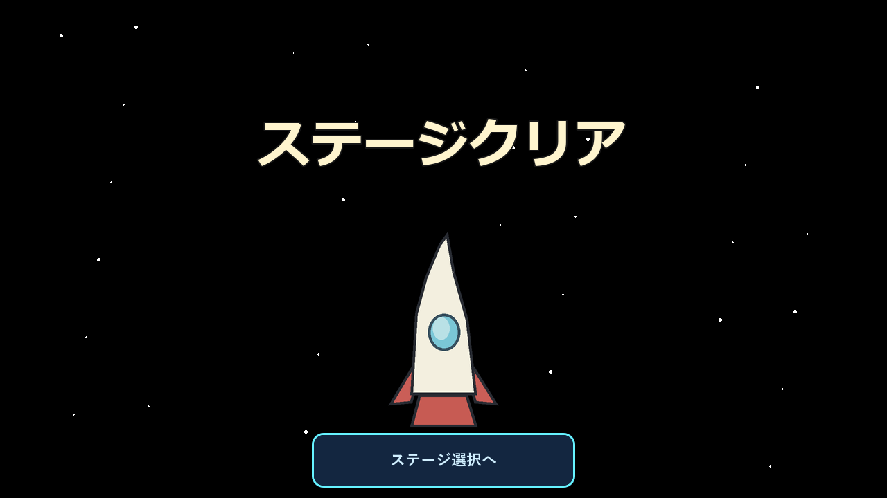

# ステージ1の画像差し替えガイド

以下は実際に配置したPNGです。保存先・名前・キャンバス寸法を保って上書きすると、Godotが再読み込みします。元画像のコピーを残してから描き替えてください。画像だけの変更では、足場や死亡の判定は変わりません。

## コース内の画像

| 対象 | ファイル・塗り替え用の原寸画像 | 寸法 | 透過と配置 |
| --- | --- | --- | --- |
| 城 | [castle.png](../../assets/tutorial/castle.png) | 1000×1000 | 前作から抽出した原画を無加工で使用。透明余白を含む全体を720×720として、第1室の `(-190, 40)` に描画。画像の下端が開始地点の地面 `y=760` |
| 木の板 | [bridge-board.png](../../assets/tutorial/bridge-board.png) | 96×32 | 透明背景。1枚の板を横60px・縦28pxに表示。区画の端では横20〜40px。上面は `y=620`。同じ画像を全板で使用 |
| 着地先のロケット | [rocket.png](../../assets/tutorial/rocket.png) | 200×320 | 透明背景。第3室の `(2810, 350)` に144×230で表示し、下端 `y=580` を着地先に合わせる。背景なので接触操作は不要 |

橋は画像中心を軸に、崩れると回転しながら下へ落ちます。透明余白を大きくすると板の接合部に穴が見えるため、横端まで木を描いてください。画像の角の透過は小さく留めます。見た目の継ぎ目を隠すため、描画だけ左右に1px重ねています。

### 下から通過できる薄い木板

追加で示された参考画像は保存していません。見た目の指定は「茶色から焦げ茶の、横に長いごく薄い木の板。暗い縁と短い木目や継ぎ目があり、一端が地形の脇に差し込まれている。下面を土で埋めず、下に空間を見せて、下からすり抜けられることが見た目から伝わる形」です。参考画像の絵そのものは素材として使用しません。

静止した片面足場にも `bridge-board.png` を使い、厚さ12pxに縮めて描画します。橋とは別の足場で、崩れません。第1室の `(1330, 710, 60, 12)`、第2室の `(510, 650, 90, 12)` と `(1220, 820, 110, 12)` に配置しています。座標は各部屋の左上からの `x, y, 幅, 高さ` です。下からは通過でき、上から着地した後は落ちません。位置と描画・判定の寸法は `TutorialLandscape.one_way_platforms()` で共有しています。

城の透明余白は原画の一部です。切り抜くと配置が変わるため、そのまま使います。城の出典は [素材の記録](../../assets/tutorial/README.md)。橋とロケットは今回用意した仮画像で、自由に描き替える前提です。

## クリア画面の3レイヤー

全て1280×720pxのPNGです。各ファイルを絵の輪郭で切り詰めず、透明部分も含めた共通キャンバスを保ってください。左上を共通原点として、背景→ロケット→文字の順で重ねます。忍者の画像レイヤーはありません。

| 役割 | ファイル・塗り替え用の原寸画像 | 透過 | 動き |
| --- | --- | --- | --- |
| 背景 | [background.png](../../assets/ui/stage_1_clear/background.png) | 全面不透明 | 横へ最大2px |
| ロケット | [rocket.png](../../assets/ui/stage_1_clear/rocket.png) | ロケット以外は透明 | 縦へ最大6px |
| 文字 | [text.png](../../assets/ui/stage_1_clear/text.png) | 文字以外は透明 | 縦へ最大2px |

下部の `x=450〜830、y=626〜705` は「ステージ選択へ」ボタンの範囲です。このボタンはゲーム側で描画するため、画像に焼き込まないでください。大事な絵はこの範囲に置かず、各レイヤーの移動幅を含めて余白を取ります。背景は端まで塗り、端の2pxが動いても違和感がない絵にします。OSの動きの抑制が取得できた場合、この移動は止まります。

### 差し替え手順

1. 上表の画像を複製し、同じキャンバスで描く。
2. コースの橋・ロケットと、クリアのロケット・文字は透明背景のPNGで書き出す。
3. 元と同じ名前・保存先で上書きする。`.png.import` の編集は不要。
4. Godotへ戻り、画像の再読み込みが終わってから起動する。
5. 第1面を通して遊び、橋の継ぎ目・落下時の回転、ロケットの接地、クリアの透過・重なり・動きとボタンを確認する。演出はEscのメニューから省略できるが、ダッシュ入力は必要。
6. 城を変えた場合は、共有しているタイトルとステージ選択の見え方も確認する。

コース内のロケットとクリア画面のロケットは別ファイル・別寸法です。コースの画像をそのままクリア用ファイルへ上書きせず、1280×720のキャンバスに配置して書き出してください。

## 色・地形・星・雲を変える場合

`scripts/tutorial_landscape.gd` の `SOIL` と `GRASS` が土色と草色です。地面の底まで届く地形だけ、下へ最大58%暗くするグラデーションを描画します。第2室の巻物の浮遊足場はベタ塗りです。地形の多角形は `landforms()`、トゲは `spikes()` を描画と衝突判定の両方で共有しています。形を変える場合は両方が変わるため、攻略も確認してください。

星は `_ready()` 内の個数・大きさ・乱数範囲、またたきは `_draw()` で調整できます。雲の形は `_draw_cloud()`、速度と配置は `_draw()` にあります。空は真っ黒、星と雲は白です。タイトル・選択も同じクラスを使うため、共通部分の変更が反映されます。

橋の足場寸法は `bridge_sections()`、崩壊単位と速度は `scripts/tutorial_bridge.gd`、クリア画像の順序と移動幅は `scripts/tutorial.gd` で調整します。これらは画像を塗り替えるだけなら変更不要です。
