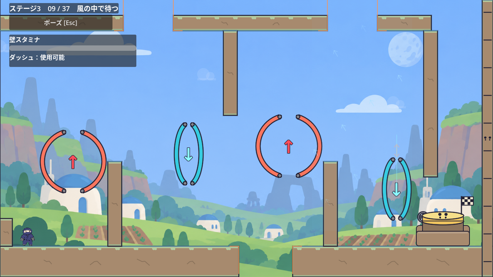
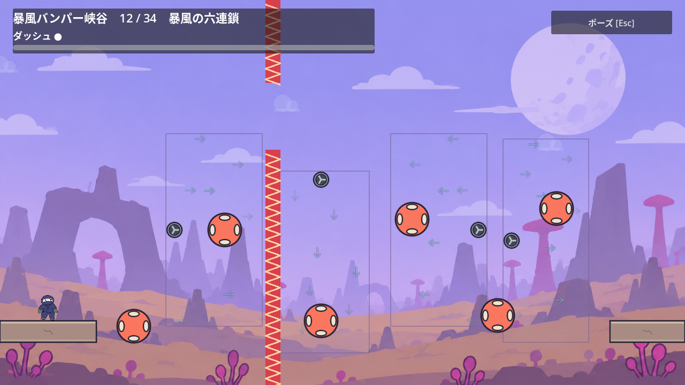

# 文字に頼らず風向きを読む

2026-10-28。[Issue #197](https://github.com/Foxy-null/2d-space/issues/197)。[Celesteの研究と合意した方針](stage-3-navigation.md)に沿って、明るい背景へ溶けていた風の矢印を読みやすくする。

## 変更

既存の水色の矢印の下へ、共通の`ArtDraw.INK`色を透明度0.35、幅3.5pxで重ねる。本線は幅1.5px、透明度0.55のままとし、同じsinのフェードを使う。9個の位置・向き・6秒周期、風の物理設定、ファンは保つ。

個別に下描きを足した最初の案は、風が4個あるステージ5第12室で描画呼出しが366→510回へ増え、ソフトGLで遅れも観測したため採用しなかった。最終案は矢印の軸と鏃を54点・27線分へまとめ、輪郭と本線を各1回描く。[Godot標準の`draw_multiline_colors`](https://docs.godotengine.org/en/stable/classes/class_canvasitem.html#class-canvasitem-method-draw-multiline-colors)を使い、線分ごとのフェード色を保つ。共有の`ArtDraw.arrow()`や新しい設定・描画システムは追加しない。

## 視覚レビュー

`make-interfaces-feel-better`のfull範囲を、Godotの`WindArea._draw()`と既存のArtDraw配色に限定して適用した。ブラウザUI・他のギミック全体のレビューとは区別する。

| 観点 | 確認範囲 | 判断 |
| --- | --- | --- |
| Typography | 文字の追加・変更は対象外 | 対象外 |
| Surfaces | 青空、雲、暗背景、地形・トゲとの重なり | 風向きの輪郭を読みやすくし、危険箇所の見通しを保つ |
| Animations | 既存の6秒周期、フェードの継ぎ目、10%相当の時刻列 | 速度や周期を増やさず、向きを保ったまま消える |
| Icons | 9矢印の向き、軸、鏃、本線と輪郭 | 既存の形と本線幅を保つ |
| Performance | 同画角・同時刻のソフトGL描画統計 | 個別下描きを退け、標準の一括描画を選ぶ |

| 重要度 | 場所 | 変更前 | 変更後 | 理由 |
| --- | --- | --- | --- | --- |
| MEDIUM・対応済み | `scripts/wind_area.gd`の風矢印 | 青空や雲に溶ける水色の細線 | 既存INKの薄い輪郭を重ねる | 文字を読まずに進む際、使う風向きを見落としにくくする |

比較した代案は透明度増加と輪郭追加の2種類で、以下の2案を退けた。

| 候補 | 不採用の理由 |
| --- | --- |
| 水色の透明度だけを0.75へ上げる | 雲や青空へ溶ける箇所が残る |
| 各矢印へ個別に下描きを追加する | 見た目は改善するが、風が多い画面で描画呼出しと遅れが増えた |

## 検証と限界

新しい`wind_visual_test.gd`は隔離した1280×720のSubViewportと実wind sceneで25項目成功。4方向の軸と鏃、明背景に対する暗い輪郭、回転時のワールド方向、周期端の消失、ゼロ方向を実ピクセルで確認する。描画呼出しは11回で、上限16回以内だった。旧版では輪郭条件が失敗し、個別の`ArtDraw.arrow()`へ戻した変異版では82回となり、描画上限だけで失敗する。headlessは描画成功と扱わず、OpenGL実行が必要と示して終了1にする。

```sh
rtk proxy xvfb-run -a Godot --rendering-method gl_compatibility --path . --script res://tests/wind_visual_test.gd
```

実攻略はチュートリアルの風経路53項目、ステージ4第35室14,070項目、ステージ5第3・12室7項目に成功した。第35室では実Spring・相棒ジャンプ・壁キックと風の接触54フレームを経て通常の部屋移動へ到達した。

最終バッチ版をOpenGLで描画しながらチュートリアル第9室の実入口から風をDashで抜け、実到着台を押して次室へ進む7項目も成功した。位置・速度・資源の注入は行わない。

表示・物理状態の不変とABBAの負荷観測は45項目、10%相当の時刻列は51項目に成功。時刻列は3室×旧/新について各61描画を確認した。正式3室の画像と開始・中間・終了を目視し、フェードと方向、ファン、地形とトゲの見通しを確認している。

同画角・同時刻の旧/新をABBA順で各80標本観測した値を示す。描画呼出しは減る一方で、輪郭の三角形数は増える。

| 場所 | draw calls 旧→新 | primitives 旧→新 | frame間隔の中央値 旧→新 | p95 旧→新 |
| --- | ---: | ---: | ---: | ---: |
| ステージ5 第12室 | 366→226 | 13,674→15,978 | 27.082→28.215ms | 28.905→30.308ms |
| ステージ4 第35室 | 266→231 | 12,716→13,292 | 14.944→15.242ms | 17.834→16.770ms |
| ステージ3 第9室 | 475→440 | 18,490→19,066 | 38.467→38.477ms | 40.709→40.688ms |






第35室の既存driver終了時に出るObjectDB 2件の警告は旧windでも再現した。verboseの対象は`AudioStreamWAV`と`AudioStreamPlaybackWAV`で、終了待ちを増やしても一律に消えない。描画変更固有の失敗とは扱わず、既存driverの終了処理の制限として残す。

実機の性能、初見ユーザー、60Hz以外は未確認である。ソフトGLの短い時間観測だけで、実機の性能向上や無影響を断定しない。
